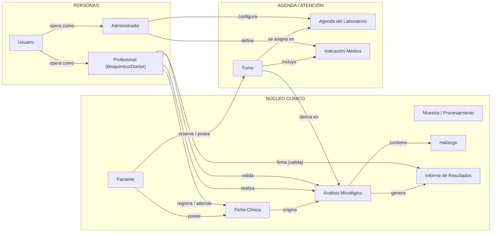
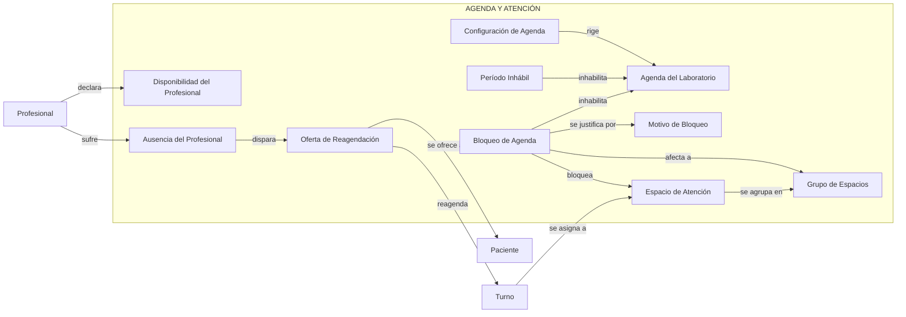
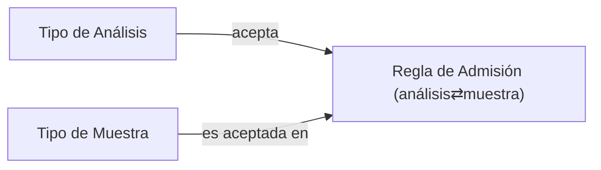
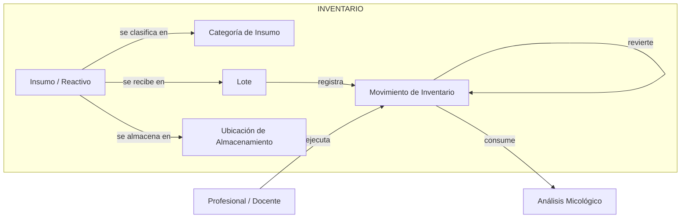
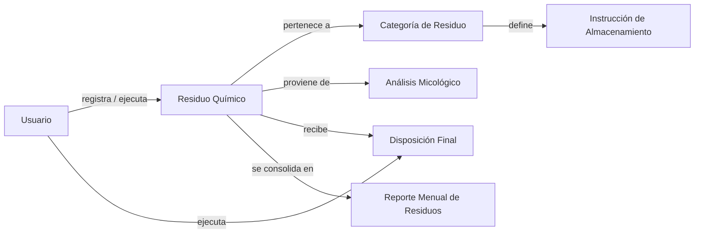
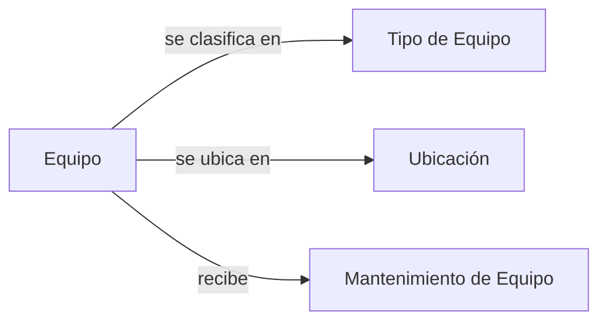
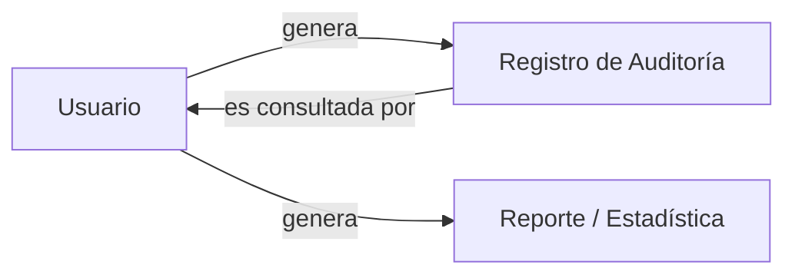

# Modelo de Dominio Conceptual — SIGEMI (Completo)

> **Nivel de abstracción**: 1 — Concepto / Dominio.
> **Propósito**: expresar *de qué habla el negocio* y cómo se relacionan los conceptos en el mundo real. **No** expresa clases de software ni tablas de base de datos.
> **Fuente**: `TF_2026_Requerimientos_KLUKA_JORGE.md` y `Diagramas/diagrama_clases_sigemi.mmd` (depurado).
> **Alcance**: sistema completo, organizado por subsistemas (§2 núcleo clínico, §6 agenda, §7 catálogos de análisis, §8 inventario, §9 residuos, §10 equipos, §11 transversales).
> **Regla de oro**: acá NO hay claves (`id`), NO hay `FK`, NO hay tipos SQL, NO hay mecanismos (`OTP`, `hash`, `Auditoría`). Si aparece un mecanismo, está en el nivel equivocado.

## 1. Actores y roles (quién interactúa)

- **Paciente** — persona atendida. No usa el sistema interno; interactúa por WhatsApp (agendado) y por el portal de resultados (descarga de informe).
- **Profesional** — personal clínico (Bioquímico/Doctor) que atiende, registra datos clínicos y valida resultados.
- **Administrador** — gestiona catálogos, agenda, acceso y puede operar como Profesional.
- **Agente IA (automatización)** — atiende solicitudes de turno del Paciente vía WhatsApp. No es una persona; es una pieza del sistema que actúa *en nombre de* la recepción.

> Nota de modelado: `Profesional` y `Administrador` son *roles* sobre la noción de **Usuario** (la persona que opera el sistema). En dominio, "Profesional" es un concepto clínico; "Usuario/rol" es más un concepto de acceso (ver §3).

## 2. Conceptos del núcleo clínico y sus relaciones semánticas

## 3. Conceptos de soporte (acceso, agenda y entrega)

- **Usuario** — la persona que opera el sistema; asume un **rol** (Profesional, Administrador) que determina qué puede hacer. En dominio, el rol es una *responsabilidad*, no una tabla.
- **Agenda del Laboratorio** — el calendario de disponibilidad: días hábiles, horarios, franjas, bloqueos e inhabilitaciones. Es *capacidad de atención*, no una entidad de negocio con identidad propia fuerte.
- **Indicación Médica** — instrucciones de preparación que acompañan un turno/estudio. Concepto de negocio legítimo.
- **Entrega de resultados** — el dominio dice "el resultado se entrega al paciente de forma segura y fehaciente". El *mecanismo* (OTP, enlace, portal, hash de archivo) es decisión de **implementación/persistencia**, por eso **no** aparece en este nivel.
- **Historia de la Ficha Clínica** — el dominio dice "la ficha clínica tiene historia y no se pierde". El *mecanismo* (versionado con `datos_previos/datos_nuevos`) es de implementación.

## 4. Decisiones conceptuales tomadas (y qué evitan)

1. **`Profesional` se corresponde 1:1 con `Usuario`** (ya estaba en el `.mmd`): un profesional *es* un usuario del sistema con responsabilidad clínica. Esto evita duplicar identidad entre "persona clínica" y "cuenta".
2. **`Administrador` es un rol de `Usuario`, no una entidad paralela** al Profesional. Un Administrador "también puede operar como Bioquímico" (ver RF-13 y actores): eso es composición de responsabilidades, no herencia de entidades.
3. **El ciclo del análisis** (pendiente → en proceso → terminado → validado) es un *estado* del concepto `Análisis Micológico`, gobernado por `Profesional`. El paso "validado" exige un bioquímico habilitado → de ahí la relación `valida` separada de `realiza`.
4. **La entrega de resultados** es un compromiso del dominio ("entrega segura y fehaciente"), cuya implementación (OTP + portal) vive en el nivel de persistencia/seguridad, no acá.

## 5. Lo que quedó FUERA de este nivel (y va al esquema relacional)

Estos son *mecanismos*, no conceptos de negocio. Se modelarán en el Esquema de Base de Datos (nivel 3):

- `VersionFichaClinica` (inmutabilidad → versionado)
- `Auditoria` / `CambioAuditoria` (trazabilidad de acciones)
- `Otp` (entrega segura de resultados)
- `hash_archivo`, `ruta_archivo` (almacenamiento de archivos)
- `intentos_fallidos`, `bloqueado_hasta` (seguridad de acceso)
- Toda `id PK` y `FK` (llaves de persistencia)

---

## 6. Subsistema Agenda y Atención (completo)

Conceptos que rodean al Turno: la *capacidad de atención* del laboratorio y la disponibilidad de los profesionales.

**Conceptos y su lectura de dominio:**

- **Agenda del Laboratorio** — la capacidad global de atención (días, horarios, franjas). Su configuración (`Configuración de Agenda`) define cuántos turnos caben y cuánto duran.
- **Período Inhábil / Bloqueo de Agenda** — dos formas de "este hueco no se puede agendar": el período es una regla recurrente o general; el bloqueo es puntual y *motivado* (un feriado, un mantenimiento, una franja específica).
- **Espacio de Atención** — el lugar físico donde se atiende (consultorio, box de toma de muestra). Puede agruparse en **Grupo de Espacios**.
- **Disponibilidad del Profesional** — qué días/horarios puede atender cada profesional.
- **Ausencia del Profesional** — vacaciones/licencia; cuando ocurre, sus turnos futuros entran en riesgo y se dispara la **Oferta de Reagendación** (el sistema ofrece el hueco liberado a otro paciente, en cascada).
- **Oferta de Reagendación** — no es un "turno nuevo" todavía: es una *propuesta* con vencimiento que el paciente puede aceptar, rechazar o dejar expirar.

---

## 7. Subsistema Catálogos de Análisis

Los *tipos* que tipifican un estudio y una muestra, y las reglas de qué análisis admite qué muestra.

- **Tipo de Análisis** — el estudio que se puede solicitar (ej. cultivo de uñas, directo micológico).
- **Tipo de Muestra** — de qué se toma la muestra (uña, piel, pelo).
- **Regla de Admisión** — la relación N:N que dice "este análisis acepta estas muestras". Es la que alimenta al Agente IA y al registro de muestra para no permitir combinaciones inválidas.

---

## 8. Subsistema Inventario (Stock de Insumos Reactivos)

- **Insumo / Reactivo** — el material consumible (reactivos, medios de cultivo). Tiene umbral mínimo de alerta y vencimiento.
- **Lote** — cada *recibimiento* de un insumo con su propio vencimiento y cantidad. Es la unidad de trazabilidad: el stock total de un insumo **se deriva** de la suma de sus lotes (no se persiste un `stock_actual`).
- **Movimiento de Inventario** — ingreso / retiro / devolución de una cantidad de un lote. Puede estar asociado a un análisis (consumo real) y puede *revertirse* (una devolución). Marca si es para práctica educativa.
- **Categoría / Ubicación** — catálogos de soporte.
- **Regla de vencimiento**: el vencimiento se *registra* y se alerta, pero **no** descarta automáticamente el consumo. Ciertas actividades no permiten insumos vencidos y otras sí; esa regla vive en la *actividad*, no en el lote.

---

## 9. Subsistema Residuos Químicos

- **Residuo Químico** — el desecho generado por prácticas y análisis (con volumen y peso exactos, exigidos por normativa 2026).
- **Categoría de Residuo** — la *clase de peligrosidad*, que a su vez define **Instrucciones de Almacenamiento** (cómo guardarlo, paso a paso, según la categoría).
- **Disposición Final** — el registro de qué se hizo con el residuo (método de tratamiento) y cuándo.
- **Reporte Mensual de Residuos** — la consolidación normativa del mes.

---

## 10. Subsistema Equipos

- **Equipo** — el bien físico del laboratorio (microscopio, cabina de seguridad biológica).
- **Tipo de Equipo** — su categoría, con un nivel de **criticidad** (un equipo crítico sin mantenimiento detiene el laboratorio).
- **Mantenimiento de Equipo** — cada intervención, con su próxima fecha de mantenimiento.

---

## 11. Subsistemas Transversales (Seguridad y Reportes)

- **Registro de Auditoría** — la traza "quién hizo qué y cuándo" sobre acciones críticas. En dominio es *un compromiso*: "toda acción crítica queda registrada de forma inmutable". El detalle de campos (IP, cambios por campo) es mecanismo → esquema de BD.
- **Reporte / Estadística** — el producto de consolidación para toma de decisiones e investigación. Distinto de `ReporteResiduos` (que es normativo y ya está en §9).

---

## 12. Resumen de relaciones entre subsistemas

Los puntos de acoplamiento entre subsistemas (por dónde "se tocan"):

- **Clínico ⇄ Agenda**: `Turno` pertenece a ambos; el análisis nace de un turno atendido.
- **Clínico ⇄ Inventario**: `Movimiento ⇄ Análisis` (consumo real de insumo) y `Residuo ⇄ Análisis` (desecho del análisis).
- **Clínico ⇄ Transversales**: `Auditoría` y `Reporte` observan a todos los subsistemas.
- **Personas (Usuario/Profesional/Administrador)** tocan todos: son quienes ejecutan.