# Modelo Conceptual — SIGEMI
## Sistema Integral de Gestión Micológica

---

## 1. Resumen de Entidades (Contratos del Dominio)

| **Entidad** | **Descripción** | **Naturaleza en el dominio** |
|---|---|---|
| **Paciente** | Persona atendida en el laboratorio de Micología. Núcleo del historial clínico, creado incluso de forma temprana (alta con solo DNI y nombre). | Entidad transaccional |
| **FichaClinica** | Documento clínico estructurado de una consulta presencial sujeto a versionado. Se genera por cada visita. | Entidad transaccional |
| **VersionFichaClinica** | Historial inmutable de los cambios de una ficha; conserva el contenido previo y el nuevo ante cada modificación. | Entidad de auditoría clínica |
| **Turno** | Cita programada para un paciente con ciclo de estados y control de reprogramaciones y cancelaciones. | Entidad transaccional |
| **IndicacionMedica** | Instrucción médica predefinida que se comunica al paciente al agendar, asociada a un tipo de análisis. | Catálogo funcional |
| **ConfiguracionAgenda** | Parámetros que definen la disponibilidad horaria del laboratorio y las reglas de emisión de turnos. | Configuración del sistema |
| **PeriodoInhabilitado** | Cierre **global** de agenda por rango de fecha/franja. Reemplaza el texto `periodos_inhabiles` de la ConfiguracionAgenda: permite cerrar todo el laboratorio con un solo registro. | Entidad transaccional |
| **Recurso** | Lugar físico u operativo de la agenda (sala, consultorio, laboratorio). Permite bloquear de forma puntual sin instanciar por médico. | Catálogo de recursos |
| **GrupoRecurso** | Agrupación de recursos (ej. «Laboratorios de Micología») para aplicar bloqueos y configuraciones de una sola vez. | Catálogo de agrupación |
| **BloqueoAgenda** | Restricción puntual (día completo o franja) que impide asignar turnos a un **Recurso** o **GrupoRecurso** específico. Incluye precedencia frente a solapamientos. | Entidad transaccional |
| **TipoBloqueo** | Catálogo que clasifica el alcance de un bloqueo: Día Completo / Franja Horaria. | Catálogo funcional |
| **AnalisisMicologico** | Trazado del ciclo completo de una muestra, desde el ingreso hasta la validación o cancelación. | Entidad transaccional central del diagnóstico |
| **TipoAnalisis** | Catálogo de análisis micológicos y tipos de muestra ofrecidos. | Catálogo funcional |
| **Otp** | Token de un solo uso generado al validar el análisis, clave para la descarga segura del informe. | Entidad transaccional de seguridad |
| **InformeResultados** | Documento PDF compilado al validar un análisis; disponible para el paciente mediante OTP. | Artefacto generado |
| **Insumo** | Bien físico o reactivo del inventario con propiedades, categoría y ubicación por defecto. | Catálogo operativo |
| **Lote** | Conjunto de un mismo insumo con número de lote y vencimiento; base para la trazabilidad FEFO. | Entidad transaccional |
| **MovimientoInventario** | Operación singular sobre el inventario: ingreso, retiro o devolución de un lote. | Entidad transaccional |
| **CategoriaInsumo** | Clasificación de insumos según su naturaleza y uso. | Catálogo |
| **UbicacionAlmacenamiento** | Lugar físico de resguardo de los insumos y equipos del laboratorio. | Catálogo |
| **ResiduoQuimico** | Desecho químico generado por las actividades del laboratorio, con volumen y peso exactos. | Entidad transaccional |
| **DisposicionFinal** | Tratamiento definitivo que reciben los residuos acumulados. | Entidad transaccional |
| **CategoriaResiduo** | Clasificación de peligrosidad aplicable a los residuos químicos. | Catálogo |
| **Usuario** | Personal interno autenticado con credenciales, estado y control de intentos de acceso. | Entidad de acceso |
| **Rol** | Perfil que define los permisos y alcance operativo de un usuario. | Catálogo funcional |
| **Auditoria** | Registro cronológico e inmutable de los eventos críticos del sistema. | Entidad transversal |
| **Reporte** | Documento consolidado de residuos, inventario u operaciones para cumplimiento o investigación. | Entidad generada |
| **Equipo** | Insumo **no consumible** del laboratorio (microscopio, autoclave, centrífuga). Almacena datos de activo fijo: serie, garantía, estado. | Entidad de activo fijo |
| **TipoEquipo** | Catálogo de categorías de equipos con requisitos de uso y criticidad. | Catálogo funcional |
| **MantenimientoEquipo** | Historial de mantenimientos preventivos/correctivos de cada equipo. | Entidad transaccional |
| **DatoClinico** | Detalle estructurado de la información clínica de una ficha: reemplaza el texto `datos_clinicos` de FichaClinica. | Detalle clínico |
| **HallazgoAnalisis** | Detalle de observaciones y resultados de una muestra: reemplaza los textos `observaciones` y `resultado_final` de AnalisisMicologico. | Detalle diagnóstico |
| **CambioAuditoria** | Detalle por campo de lo modificado en un evento de auditoría: reemplaza el texto `cambio_realizado` de Auditoria. | Detalle de auditoría |
| **InstruccionAlmacenamiento** | Pasos secuenciales de resguardo por categoría de residuo: reemplaza el texto `instrucciones_almacenamiento` de CategoriaResiduo. | Detalle normativo |

---

## 2. Contratos de Entidades (Atributos de Negocio)

| **Entidad** | **Atributo** | **Descripción** |
|---|---|---|
| Paciente | numero_registro | Número de registro clínico interno |
| Paciente | dni | Documento Nacional de Identidad (único) |
| Paciente | nombre | Nombre/s del paciente |
| Paciente | apellido | Apellido/s del paciente |
| Paciente | fecha_nacimiento | Fecha de nacimiento (base para cálculo de edad) |
| Paciente | sexo | Sexo del paciente |
| Paciente | domicilio | Dirección de residencia |
| Paciente | telefono | Teléfono de contacto (WhatsApp) |
| Paciente | correo_electronico | Correo electrónico |
| Paciente | obra_social | Obra social o cobertura médica |
| Paciente | estado | Activo / Inactivo (baja lógica) |
| Paciente | fecha_ingreso | Fecha de registro |
| FichaClinica | fecha_consulta | Fecha y hora de la consulta presencial |
| FichaClinica | version_actual | Número de versión vigente |
| FichaClinica | estado | Activo / Modificado / Histórico |
| VersionFichaClinica | numero_version | Número secuencial de la versión |
| VersionFichaClinica | datos_previos | Contenido de la ficha antes del cambio (snapshot inmutable) |
| VersionFichaClinica | datos_nuevos | Contenido de la ficha después del cambio (snapshot inmutable) |
| VersionFichaClinica | fecha_modificacion | Momento de la modificación |
| VersionFichaClinica | motivo | Razón del cambio |
| Turno | fecha_hora | Fecha y hora programada |
| Turno | estado | Confirmado / Pendiente / Atendido / Cancelado / No Asistió |
| Turno | reprogramaciones | Contador de reprogramaciones (máx. 2) |
| Turno | motivo_cancelacion | Motivo de cancelación (si aplica) |
| Turno | fecha_creacion | Fecha de creación del turno |
| Turno | fecha_atencion | Fecha/hora real de atención (si asistió) |
| IndicacionMedica | titulo | Título de la indicación |
| IndicacionMedica | contenido | Cuerpo de la indicación (texto libre) |
| IndicacionMedica | estado | Activo / Inactivo (baja lógica) |
| IndicacionMedica | fecha_creacion | Fecha de creación |
| IndicacionMedica | fecha_modificacion | Fecha de última modificación |
| ConfiguracionAgenda | dias_habiles | Días de atención |
| ConfiguracionAgenda | franja_manana | Horario matutino (inicio y fin) |
| ConfiguracionAgenda | franja_tarde | Horario vespertino (inicio y fin) |
| ConfiguracionAgenda | duracion_turno | Duración en minutos de cada turno |
| ConfiguracionAgenda | intervalo_entre_turnos | Separación entre turnos consecutivos |
| ConfiguracionAgenda | max_turnos_por_franja | Máximo de turnos por bloque |
| ConfiguracionAgenda | fecha_modificacion | Fecha del último cambio |
| PeriodoInhabilitado | fecha_inicio | Inicio del cierre global |
| PeriodoInhabilitado | fecha_fin | Fin del cierre global |
| PeriodoInhabilitado | hora_inicio | Inicio de franja (nulo si día completo) |
| PeriodoInhabilitado | hora_fin | Fin de franja (nulo si día completo) |
| PeriodoInhabilitado | motivo | Razón del cierre (mantenimiento, feriado) |
| PeriodoInhabilitado | recurrencia | Patrón recurrente opcional (ej. semanal) |
| PeriodoInhabilitado | estado | Activo / Inactivo |
| Recurso | nombre | Nombre del recurso (ej. «Sala 3», «Laboratorio B») |
| Recurso | tipo_recurso | Sala / Consultorio / Laboratorio |
| Recurso | descripcion | Detalle del recurso |
| Recurso | estado | Activo / Inactivo |
| GrupoRecurso | nombre | Nombre del grupo (ej. «Laboratorios de Micología») |
| GrupoRecurso | descripcion | Detalle del grupo |
| BloqueoAgenda | fecha_inicio | Inicio del período bloqueado |
| BloqueoAgenda | fecha_fin | Fin del período (mismo día si es día único) |
| BloqueoAgenda | hora_inicio | Inicio de la franja bloqueada (nulo si día completo) |
| BloqueoAgenda | hora_fin | Fin de la franja bloqueada (nulo si día completo) |
| BloqueoAgenda | motivo | Razón del bloqueo |
| BloqueoAgenda | precedencia | Quién gana ante solapamientos: Global > Grupo > Recurso |
| BloqueoAgenda | estado | Activo / Inactivo (desbloqueado) |
| TipoBloqueo | nombre | Día Completo / Franja Horaria |
| TipoBloqueo | descripcion | Detalle del tipo de bloqueo |
| AnalisisMicologico | tipo_muestra | Tipo de muestra biológica |
| AnalisisMicologico | estado | Pendiente / En Proceso / Terminado / Validado / Cancelado / Derivado |
| AnalisisMicologico | fecha_creacion | Fecha de ingreso de la muestra |
| AnalisisMicologico | fecha_validacion | Fecha de validación final |
| AnalisisMicologico | motivo_cancelacion | Motivo obligatorio si se cancela |
| TipoAnalisis | nombre | Nombre del tipo de análisis |
| TipoAnalisis | descripcion | Descripción del análisis o tipo de muestra |
| TipoAnalisis | estado | Activo / Inactivo |
| Otp | codigo | Código generado criptográficamente |
| Otp | fecha_generacion | Fecha y hora de generación |
| Otp | fecha_expiracion | Fecha de expiración (TTL = 7 días) |
| Otp | usado | Indica si ya fue consumido |
| Otp | fecha_uso | Fecha de consumo (nulo si no usado) |
| InformeResultados | ruta_archivo | Ruta del PDF en servidor local |
| InformeResultados | fecha_generacion | Fecha de generación automática |
| InformeResultados | hash_archivo | Hash de integridad del archivo |
| Insumo | nombre | Nombre del reactivo o insumo |
| Insumo | descripcion | Descripción técnica |
| Insumo | unidad_medida | ml / g / unidades |
| Insumo | stock_actual | Cantidad total disponible (de lotes activos) |
| Insumo | umbral_minimo | Umbral de alerta de stock bajo |
| Insumo | dias_alerta_vencimiento | Anticipación de alerta de vencimiento |
| Insumo | estado | Activo / Inactivo |
| Insumo | fecha_creacion | Fecha de alta en catálogo |
| Lote | numero_lote | Número de lote del fabricante |
| Lote | fecha_ingreso | Fecha de recepción en el laboratorio |
| Lote | fecha_vencimiento | Fecha de vencimiento |
| Lote | cantidad_inicial | Cantidad recibida originalmente |
| Lote | cantidad_actual | Cantidad remanente disponible |
| Lote | estado | Activo / Agotado / Vencido |
| MovimientoInventario | tipo_movimiento | Ingreso / Retiro / Devolución |
| MovimientoInventario | cantidad | Cantidad movida |
| MovimientoInventario | practica_educativa | Descripción de práctica si no es para análisis clínico |
| MovimientoInventario | fecha | Fecha y hora del movimiento |
| CategoriaInsumo | nombre | Nombre de la categoría |
| CategoriaInsumo | descripcion | Descripción de la categoría |
| CategoriaInsumo | estado | Activo / Inactivo |
| UbicacionAlmacenamiento | nombre | Nombre de la ubicación física |
| UbicacionAlmacenamiento | descripcion | Detalle de la ubicación |
| UbicacionAlmacenamiento | estado | Activo / Inactivo |
| ResiduoQuimico | fecha_hora | Fecha y hora de generación |
| ResiduoQuimico | volumen | Volumen exacto generado (ml) |
| ResiduoQuimico | peso | Peso exacto generado (g) |
| ResiduoQuimico | descripcion | Observaciones adicionales |
| DisposicionFinal | fecha | Fecha de disposición final |
| DisposicionFinal | metodo_tratamiento | Método de tratamiento aplicado |
| DisposicionFinal | descripcion | Detalles de la disposición |
| CategoriaResiduo | nombre | Nombre de la categoría |
| CategoriaResiduo | clase_peligrosidad | Clase I / Clase II / Clase III |
| CategoriaResiduo | descripcion | Descripción de la categoría |
| CategoriaResiduo | estado | Activo / Inactivo |
| Usuario | nombre | Nombre/s del usuario |
| Usuario | apellido | Apellido/s del usuario |
| Usuario | correo_institucional | Correo de acceso (login) |
| Usuario | credencial | Credencial de acceso al sistema |
| Usuario | estado | Activo / Inactivo / Bloqueado Temporal |
| Usuario | intentos_fallidos | Contador de intentos fallidos de acceso |
| Usuario | bloqueado_hasta | Fecha/hora de desbloqueo automático |
| Usuario | fecha_registro | Fecha de creación de la cuenta |
| Rol | nombre | Administrador / Bioquímico-Doctor / Profesor |
| Rol | descripcion | Descripción del rol y sus alcances |
| Auditoria | fecha_hora | Fecha y hora precisa del evento |
| Auditoria | direccion_ip | Dirección IP de origen |
| Auditoria | modulo | Módulo del sistema donde ocurrió |
| Auditoria | accion | Acción ejecutada (CREAR, MODIFICAR, ELIMINAR, VALIDAR…) |
| Auditoria | entidad_afectada | Entidad afectada |
| Reporte | tipo_reporte | Residuos / Inventario / Operativo (Clínico) |
| Reporte | periodo | Rango de fechas reportado |
| Reporte | ruta_archivo | Ruta del archivo generado |
| Reporte | formato_archivo | PDF / CSV / XLSX |
| Reporte | fecha_generacion | Fecha de emisión |
| Reporte | mes_anio | Mes/año consolidado (reporte mensual de residuos) |
| Equipo | numero_serie | Número de serie del equipo (identificador) |
| Equipo | nombre | Nombre del equipo (ej. «Microscopio óptico»). |
| Equipo | marca | Marca / fabricante |
| Equipo | proveedor | Proveedor de adquisición |
| Equipo | fecha_adquisicion | Fecha de compra/ingreso |
| Equipo | garantia_hasta | Vigencia de la garantía |
| Equipo | estado | Operativo / En Mantenimiento / Inhabilitado |
| Equipo | requisitos_uso | Condiciones de uso y calibración |
| TipoEquipo | nombre | Nombre de la categoría de equipo |
| TipoEquipo | descripcion | Descripción de la categoría |
| TipoEquipo | criticidad | Criticidad para el servicio |
| MantenimientoEquipo | tipo_mantenimiento | Preventivo / Correctivo |
| MantenimientoEquipo | fecha | Fecha del mantenimiento |
| MantenimientoEquipo | descripcion | Detalle de la tarea realizada |
| MantenimientoEquipo | proximo_mantenimiento | Fecha del próximo control preventivo |
| DatoClinico | campo | Campo clínico (ej. «Motivo de consulta») |
| DatoClinico | valor | Valor del campo |
| DatoClinico | tipo_dato | Tipo del valor (texto, selección, numérico) |
| HallazgoAnalisis | tipo_hallazgo | Observación / Resultado |
| HallazgoAnalisis | dato | Contenido del hallazgo |
| HallazgoAnalisis | fecha | Fecha del hallazgo |
| CambioAuditoria | campo | Campo modificado |
| CambioAuditoria | valor_anterior | Valor previo al cambio |
| CambioAuditoria | valor_nuevo | Valor posterior al cambio |
| InstruccionAlmacenamiento | paso | Número de orden del paso |
| InstruccionAlmacenamiento | instruccion | Descripción del paso de resguardo |

---

## 3. Matriz de Relaciones (sin cardinalidad)

| **Entidad Origen** | **Verbo / Acción** | **Entidad Destino** | **Descripción del Vínculo** |
|---|---|---|---|
| Paciente | Posee historial en | FichaClinica | Un paciente acumula un historial de consultas frontal. |
| Paciente | Reserva | Turno | Un paciente agenda citas; cada turno es de un paciente. |
| Paciente | Es desactivado por | Usuario | Un usuario autorizado ejecuta la baja lógica del paciente. |
| FichaClinica | Origina | AnalisisMicologico | Una ficha da origen a los análisis de la muestra recolectada. |
| FichaClinica | Mantiene historial en | VersionFichaClinica | Cada modificación preserva una versión previa. |
| FichaClinica | Es registrada por | Usuario | El bioquímico/doctor completa y registra la ficha. |
| FichaClinica | Detalla en | DatoClinico | La información clínica se descompone en campos estructurados. |
| VersionFichaClinica | Versiona | FichaClinica | La versión referencia la ficha a la que pertenece. |
| VersionFichaClinica | Es generada por | Usuario | El usuario que modifica queda como autor de la versión. |
| Turno | Pertenece a | Paciente | El turno está asignado a un paciente. |
| Turno | Se agenda para | TipoAnalisis | Se agenda para un tipo de análisis específico. |
| Turno | Incluye | IndicacionMedica | Al agendar se envía la indicación médica asociada. |
| Turno | Se asigna a | Recurso | El turno ocupa un recurso físico (sala, laboratorio). |
| IndicacionMedica | Se asocia a | TipoAnalisis | La indicación pertenece a un tipo de análisis. |
| ConfiguracionAgenda | Declara cierres en | PeriodoInhabilitado | Los períodos de cierre global reemplazan al texto `periodos_inhabiles`. |
| PeriodoInhabilitado | Usa | TipoBloqueo | El cierre se clasifica como día completo o franja. |
| BloqueoAgenda | Usa | TipoBloqueo | El bloqueo se clasifica como día completo o franja. |
| BloqueoAgenda | Bloquea a | Recurso | Bloqueo puntual sobre un recurso específico. |
| BloqueoAgenda | Aplica a | GrupoRecurso | Bloqueo que alcanza a todos los recursos del grupo. |
| BloqueoAgenda | Es ejecutado por | Usuario | El administrador crea el bloqueo. |
| Recurso | Pertenece a | GrupoRecurso | Un recurso puede integrar uno o más grupos. |
| Equipo | Se clasifica en | TipoEquipo | El equipo pertenece a una categoría de equipos. |
| Equipo | Se ubica en | UbicacionAlmacenamiento | Indica la ubicación física del equipo. |
| Equipo | Recibe | MantenimientoEquipo | El equipo acumula un historial de mantenimientos. |
| MantenimientoEquipo | Es ejecutado por | Usuario | El responsable registra la tarea de mantenimiento. |
| AnalisisMicologico | Se origina en | FichaClinica | El análisis proviene de una ficha clínica. |
| AnalisisMicologico | Es de tipo | TipoAnalisis | El análisis corresponde a un tipo del catálogo. |
| AnalisisMicologico | Es validado por | Usuario | Un bioquímico valida el análisis. |
| AnalisisMicologico | Genera | Otp | Al validar se emite un token de descarga segura. |
| AnalisisMicologico | Genera | InformeResultados | Al validar se compila el PDF del informe. |
| AnalisisMicologico | Consume insumos en | MovimientoInventario | Los retiros de insumos se asocian al análisis. |
| AnalisisMicologico | Produce | ResiduoQuimico | El análisis puede generar residuos químicos. |
| AnalisisMicologico | Detalla hallazgos en | HallazgoAnalisis | Observaciones y resultados se guardan como hallazgos estructurados. |
| Otp | Habilita descarga de | InformeResultados | El token permite al paciente descargar el informe. |
| Insumo | Se clasifica en | CategoriaInsumo | El insumo pertenece a una categoría. |
| Insumo | Se almacena en | UbicacionAlmacenamiento | El insumo tiene una ubicación por defecto. |
| Insumo | Se recibe en | Lote | Un insumo puede tener varios lotes con distintos vencimientos. |
| Lote | Pertenece a | Insumo | Cada lote corresponde a un único insumo. |
| Lote | Registra movimientos en | MovimientoInventario | Cada operación afecta a un lote específico. |
| MovimientoInventario | Afecta a | Lote | El movimiento (ingreso/retiro/devolución) impacta un lote. |
| MovimientoInventario | Es ejecutado por | Usuario | Un usuario registra cada movimiento. |
| MovimientoInventario | Se retira/ingresa en | UbicacionAlmacenamiento | El movimiento indica la ubicación de origen o destino. |
| MovimientoInventario | Se asocia a | AnalisisMicologico | Opcionalmente se vincula al análisis que lo motiva. |
| MovimientoInventario | Revierte a | MovimientoInventario | Una devolución revierte un retiro previo. |
| ResiduoQuimico | Pertenece a | CategoriaResiduo | El residuo se clasifica según su peligrosidad. |
| ResiduoQuimico | Es registrado por | Usuario | Un usuario registra la generación del residuo. |
| ResiduoQuimico | Proviene de | AnalisisMicologico | El residuo puede originarse en un análisis. |
| ResiduoQuimico | Recibe | DisposicionFinal | El residuo recibe un tratamiento final. |
| ResiduoQuimico | Se consolida en | Reporte | El residuo queda vinculado al reporte mensual. |
| CategoriaResiduo | Define | InstruccionAlmacenamiento | La categoría define pasos de resguardo. |
| DisposicionFinal | Es ejecutada por | Usuario | Un usuario autorizado registra la disposición. |
| Usuario | Posee | Rol | Cada usuario tiene un único rol que define sus alcances. |
| Usuario | Genera registros en | Auditoria | Toda acción crítica del usuario queda auditada. |
| Usuario | Genera | Reporte | Un usuario autorizado emite reportes. |
| Usuario | Configura | ConfiguracionAgenda | El administrador define los parámetros de la agenda. |
| Usuario | Ejecuta | BloqueoAgenda | El administrador crea bloqueos de agenda. |
| Auditoria | Detalla en | CambioAuditoria | Los cambios se descomponen por campo. |

---

## 4. Diagrama Conceptual (Mermaid)

```mermaid
classDiagram
    direction TB

    Paciente --> FichaClinica : "Posee historial en"
    Paciente --> Turno : "Reserva"
    Paciente --> Usuario : "Es desactivado por"

    FichaClinica --> AnalisisMicologico : "Origina"
    FichaClinica --> VersionFichaClinica : "Mantiene historial en"
    FichaClinica --> Usuario : "Es registrada por"
    FichaClinica --> DatoClinico : "Detalla en"

    VersionFichaClinica --> FichaClinica : "Versiona"
    VersionFichaClinica --> Usuario : "Es generada por"

    Turno --> Paciente : "Pertenece a"
    Turno --> TipoAnalisis : "Se agenda para"
    Turno --> IndicacionMedica : "Incluye"
    Turno --> Recurso : "Se asigna a"

    IndicacionMedica --> TipoAnalisis : "Se asocia a"

    ConfiguracionAgenda --> PeriodoInhabilitado : "Declara cierres en"
    PeriodoInhabilitado --> TipoBloqueo : "Usa"

    BloqueoAgenda --> TipoBloqueo : "Usa"
    BloqueoAgenda --> Recurso : "Bloquea a"
    BloqueoAgenda --> GrupoRecurso : "Aplica a"
    BloqueoAgenda --> Usuario : "Es ejecutado por"

    Recurso --> GrupoRecurso : "Pertenece a"

    AnalisisMicologico --> FichaClinica : "Se origina en"
    AnalisisMicologico --> TipoAnalisis : "Es de tipo"
    AnalisisMicologico --> Usuario : "Es validado por"
    AnalisisMicologico --> Otp : "Genera"
    AnalisisMicologico --> InformeResultados : "Genera"
    AnalisisMicologico --> MovimientoInventario : "Consume insumos en"
    AnalisisMicologico --> ResiduoQuimico : "Produce"
    AnalisisMicologico --> HallazgoAnalisis : "Detalla hallazgos en"

    Otp --> InformeResultados : "Habilita descarga de"

    Insumo --> CategoriaInsumo : "Se clasifica en"
    Insumo --> UbicacionAlmacenamiento : "Se almacena en"
    Insumo --> Lote : "Se recibe en"

    Lote --> Insumo : "Pertenece a"
    Lote --> MovimientoInventario : "Registra movimientos en"

    MovimientoInventario --> Lote : "Afecta a"
    MovimientoInventario --> Usuario : "Es ejecutado por"
    MovimientoInventario --> UbicacionAlmacenamiento : "Se retira/ingresa en"
    MovimientoInventario --> AnalisisMicologico : "Se asocia a"
    MovimientoInventario --> MovimientoInventario : "Revierte a"

    ResiduoQuimico --> CategoriaResiduo : "Pertenece a"
    ResiduoQuimico --> Usuario : "Es registrado por"
    ResiduoQuimico --> AnalisisMicologico : "Proviene de"
    ResiduoQuimico --> DisposicionFinal : "Recibe"
    ResiduoQuimico --> Reporte : "Se consolida en"

    CategoriaResiduo --> InstruccionAlmacenamiento : "Define"

    DisposicionFinal --> Usuario : "Es ejecutada por"

    Equipo --> TipoEquipo : "Se clasifica en"
    Equipo --> UbicacionAlmacenamiento : "Se ubica en"
    Equipo --> MantenimientoEquipo : "Recibe"

    MantenimientoEquipo --> Usuario : "Es ejecutado por"

    Usuario --> Rol : "Posee"
    Usuario --> Auditoria : "Genera registros en"
    Usuario --> Reporte : "Genera"
    Usuario --> ConfiguracionAgenda : "Configura"
    Usuario --> BloqueoAgenda : "Ejecuta"

    Auditoria --> CambioAuditoria : "Detalla en"

    class Paciente {
        numero_registro
        dni
        nombre
        apellido
        fecha_nacimiento
        sexo
        domicilio
        telefono
        correo_electronico
        obra_social
        estado
        fecha_ingreso
    }

    class FichaClinica {
        fecha_consulta
        version_actual
        estado
    }

    class DatoClinico {
        campo
        valor
        tipo_dato
    }

    class VersionFichaClinica {
        numero_version
        datos_previos
        datos_nuevos
        fecha_modificacion
        motivo
    }

    class Turno {
        fecha_hora
        estado
        reprogramaciones
        motivo_cancelacion
        fecha_creacion
        fecha_atencion
    }

    class IndicacionMedica {
        titulo
        contenido
        estado
        fecha_creacion
        fecha_modificacion
    }

    class ConfiguracionAgenda {
        dias_habiles
        franja_manana
        franja_tarde
        duracion_turno
        intervalo_entre_turnos
        max_turnos_por_franja
        fecha_modificacion
    }

    class PeriodoInhabilitado {
        fecha_inicio
        fecha_fin
        hora_inicio
        hora_fin
        motivo
        recurrencia
        estado
    }

    class Recurso {
        nombre
        tipo_recurso
        descripcion
        estado
    }

    class GrupoRecurso {
        nombre
        descripcion
    }

    class BloqueoAgenda {
        fecha_inicio
        fecha_fin
        hora_inicio
        hora_fin
        motivo
        precedencia
        estado
    }

    class TipoBloqueo {
        nombre
        descripcion
    }

    class AnalisisMicologico {
        tipo_muestra
        estado
        fecha_creacion
        fecha_validacion
        motivo_cancelacion
    }

    class HallazgoAnalisis {
        tipo_hallazgo
        dato
        fecha
    }

    class TipoAnalisis {
        nombre
        descripcion
        estado
    }

    class Otp {
        codigo
        fecha_generacion
        fecha_expiracion
        usado
        fecha_uso
    }

    class InformeResultados {
        ruta_archivo
        fecha_generacion
        hash_archivo
    }

    class Insumo {
        nombre
        descripcion
        unidad_medida
        stock_actual
        umbral_minimo
        dias_alerta_vencimiento
        estado
        fecha_creacion
    }

    class Lote {
        numero_lote
        fecha_ingreso
        fecha_vencimiento
        cantidad_inicial
        cantidad_actual
        estado
    }

    class MovimientoInventario {
        tipo_movimiento
        cantidad
        practica_educativa
        fecha
    }

    class CategoriaInsumo {
        nombre
        descripcion
        estado
    }

    class UbicacionAlmacenamiento {
        nombre
        descripcion
        estado
    }

    class ResiduoQuimico {
        fecha_hora
        volumen
        peso
        descripcion
    }

    class DisposicionFinal {
        fecha
        metodo_tratamiento
        descripcion
    }

    class CategoriaResiduo {
        nombre
        clase_peligrosidad
        descripcion
        estado
    }

    class InstruccionAlmacenamiento {
        paso
        instruccion
    }

    class Usuario {
        nombre
        apellido
        correo_institucional
        credencial
        estado
        intentos_fallidos
        bloqueado_hasta
        fecha_registro
    }

    class Rol {
        nombre
        descripcion
    }

    class Auditoria {
        fecha_hora
        direccion_ip
        modulo
        accion
        entidad_afectada
    }

    class CambioAuditoria {
        campo
        valor_anterior
        valor_nuevo
    }

    class Reporte {
        tipo_reporte
        periodo
        ruta_archivo
        formato_archivo
        fecha_generacion
        mes_anio
    }

    class Equipo {
        numero_serie
        nombre
        marca
        proveedor
        fecha_adquisicion
        garantia_hasta
        estado
        requisitos_uso
    }

    class TipoEquipo {
        nombre
        descripcion
        criticidad
    }

    class MantenimientoEquipo {
        tipo_mantenimiento
        fecha
        descripcion
        proximo_mantenimiento
    }
```

---

## Notas del Modelo Conceptual

- **Conversión de atributos `text` estructurado a tablas de detalle**: `datos_clinicos`, `periodos_inhabiles`, `observaciones`/`resultado_final`, `cambio_realizado` e `instrucciones_almacenamiento` pasaron a ser tablas con campos explícitos (`DatoClinico`, `PeriodoInhabilitado`, `HallazgoAnalisis`, `CambioAuditoria`, `InstruccionAlmacenamiento`). Los `text` descriptivos cortos (`descripcion`, `contenido`, `datos_previos`/`datos_nuevos` como snapshot inmutable) se mantienen como atributos libres por no tener sub-estructura.
- **`TipoAnalisis.indicaciones_asociadas` se eliminó** por ser redundante con la relación existente `IndicacionMedica → TipoAnalisis`.
- **Nueva tabla `TipoBloqueo`**: catálogo que clasifica todo bloqueo (Día Completo / Franja Horaria), utilizado tanto por `PeriodoInhabilitado` (global) como por `BloqueoAgenda` (puntual).
- **Bloqueo de agenda — enfoque híbrido (Opción 3 elegida)**: se separan dos conceptos. (1) `PeriodoInhabilitado` para cierres **globales** (mantenimiento masivo, feriado): un solo registro cierra todo el laboratorio, eliminando la necesidad de instanciar `BloqueoAgenda` una vez por médico/sala. (2) `BloqueoAgenda` para bloqueos **puntuales** contra `Recurso` o `GrupoRecurso`. El campo `precedencia` (Global > Grupo > Recurso) resuelve solapamientos de forma determinística. «Cerrar los 50 laboratorios» = **1** registro, no 50.
- **`Recurso` / `GrupoRecurso`**: la noción de recurso habilita bloqueos selectivos y la asignación de turnos a salas/laboratorios reales. **El bloqueo aplica exclusivamente a la agenda**: `Recurso` representa espacios de atención (sala, consultorio, laboratorio), no equipos.
- **Equipos — modelo desacoplado (Alternativa 1 elegida)**: `Equipo`, `TipoEquipo` y `MantenimientoEquipo` son entidades independientes de `Insumo` y totalmente **desvinculadas de la lógica de bloqueo de agenda**. `Lote`, `stock_actual` y `fecha_vencimiento` (propios de consumibles) no contaminan al equipo, que incorpora serie, garantía y mantenimiento.
- Las relaciones se presentan **sin cardinalidad**; los contratos exponen solo **atributos de negocio**, omitiendo identificadores, claves foráneas y tipos de dato técnicos (ver `modelo_dominio_sigemi.md` para el detalle físico).
- **Paciente** no es un usuario del sistema (ACT-04): accede de forma anónima vía WhatsApp y portal OTP.