# Modelo de Datos — SIGEMI
## Sistema Integral de Gestión Micológica

---

## 1. Resumen de Clases (Tablas del Modelo de Datos)

| **Clase** | **Descripción** | **Naturalezca** |
|---|---|---|
| **Paciente** | Núcleo del historial clínico; soporta alta temprana. No es un Usuario del sistema (ACT-04). | Transaccional |
| **FichaClinica** | Documento clínico de una consulta sujeto a versionado. | Transaccional |
| **DatoClinico** | Detalle estructurado de los campos clínicos de una ficha (reemplaza `datos_clinicos` text). | Detalle |
| **VersionFichaClinica** | Historial inmutable de cambios de una ficha. | Auditoría clínica |
| **Turno** | Cita programada con ciclo de estados; se asigna a un Recurso. | Transaccional |
| **Recurso** | Espacio físico de la agenda (sala, consultorio, laboratorio). Base del bloqueo puntual. | Catálogo |
| **GrupoRecurso** | Agrupación de recursos para bloqueos masivos. | Catálogo |
| **RecursoGrupo** | Tabla asociativa N-N entre Recurso y GrupoRecurso. | Transaccional (asociativa) |
| **IndicacionMedica** | Instrucción enviada al paciente, vinculada a un TipoAnalisis. | Catálogo |
| **ConfiguracionAgenda** | Parámetros de disponibilidad y emisión de turnos. | Configuración |
| **PeriodoInhabilitado** | Cierre **global** de agenda (reemplaza `periodos_inhabiles` text). | Transaccional |
| **BloqueoAgenda** | Bloqueo **puntual** de un Recurso o GrupoRecurso de la agenda. | Transaccional |
| **TipoBloqueo** | Catálogo: Día Completo / Franja Horaria. | Catálogo |
| **AnalisisMicologico** | Ciclo de vida completo de una muestra. | Transaccional central |
| **HallazgoAnalisis** | Observaciones/resultados estructurados (reemplaza `observaciones`/`resultado_final`). | Detalle |
| **TipoAnalisis** | Catálogo de análisis y tipos de muestra. | Catálogo |
| **Otp** | Token de un solo uso para descarga del informe. | Seguridad |
| **InformeResultados** | PDF compilado al validar el análisis. | Artefacto |
| **Insumo** | Bien consumible del inventario. | Catálogo operativo |
| **Lote** | Conjunto de un insumo con vencimiento; base FEFO. | Transaccional |
| **MovimientoInventario** | Operación de inventario: ingreso/retiro/devolución. | Transaccional |
| **CategoriaInsumo** | Clasificación de insumos. | Catálogo |
| **UbicacionAlmacenamiento** | Lugar físico de resguardo. | Catálogo |
| **ResiduoQuimico** | Desecho químico con volumen y peso exactos. | Transaccional |
| **DisposicionFinal** | Tratamiento definitivo de residuos. | Transaccional |
| **CategoriaResiduo** | Clasificación de peligrosidad. | Catálogo |
| **InstruccionAlmacenamiento** | Pasos de resguardo (reemplaza `instrucciones` text). | Detalle |
| **Usuario** | Personal interno autenticado. | Acceso |
| **Rol** | Perfil de autorización. | Catálogo |
| **Auditoria** | Registro cronológico de eventos críticos. | Transversal |
| **CambioAuditoria** | Detalle por campo de un evento (reemplaza `cambio_realizado` text). | Detalle |
| **Reporte** | Documento consolidado de residuos/inventario/operativo. | Generado |
| **Equipo** | Activo no consumible (microscopio, autoclave). **Desvinculado del bloqueo de agenda.** | Activo fijo |
| **TipoEquipo** | Categoría de equipo. | Catálogo |
| **MantenimientoEquipo** | Historial de mantenimientos del equipo. | Transaccional |

---

## 2. Diccionario de Atributos por Clase

| **Clase** | **Atributo** | **Tipo de Dato** | **Descripción** |
|---|---|---|---|
| Paciente | id | integer (PK) | Identificador único |
| Paciente | numero_registro | string | Registro clínico interno (único) |
| Paciente | dni | string | DNI (único) |
| Paciente | nombre | string | Nombre/s |
| Paciente | apellido | string | Apellido/s |
| Paciente | fecha_nacimiento | date | Fecha de nacimiento |
| Paciente | sexo | string | Sexo |
| Paciente | domicilio | string | Dirección |
| Paciente | telefono | string | Teléfono (WhatsApp) |
| Paciente | correo_electronico | string | Correo |
| Paciente | obra_social | string | Obra social |
| Paciente | estado | string | Activo / Inactivo |
| Paciente | fecha_ingreso | datetime | Alta del registro |
| FichaClinica | id | integer (PK) | Identificador único |
| FichaClinica | paciente_id | integer (FK→Paciente) | Paciente de la consulta |
| FichaClinica | bioquimico_id | integer (FK→Usuario) | Usuario que registró |
| FichaClinica | fecha_consulta | datetime | Fecha/hora de consulta |
| FichaClinica | version_actual | integer | N.° de versión vigente |
| FichaClinica | estado | string | Activo / Modificado / Histórico |
| DatoClinico | id | integer (PK) | Identificador único |
| DatoClinico | ficha_clinica_id | integer (FK→FichaClinica) | Ficha a la que pertenece |
| DatoClinico | campo | string | Nombre del campo clínico |
| DatoClinico | valor | text | Valor del campo |
| DatoClinico | tipo_dato | string | Tipo del valor (texto/selección/número) |
| VersionFichaClinica | id | integer (PK) | Identificador único |
| VersionFichaClinica | ficha_clinica_id | integer (FK→FichaClinica) | Ficha versionada |
| VersionFichaClinica | numero_version | integer | N.° secuencial |
| VersionFichaClinica | datos_previos | text | Snapshot previo (JSON) |
| VersionFichaClinica | datos_nuevos | text | Snapshot nuevo (JSON) |
| VersionFichaClinica | usuario_id | integer (FK→Usuario) | Autor de la versión |
| VersionFichaClinica | fecha_modificacion | datetime | Momento del cambio |
| VersionFichaClinica | motivo | string | Razón del cambio |
| Turno | id | integer (PK) | Identificador único |
| Turno | paciente_id | integer (FK→Paciente) | Paciente del turno |
| Turno | tipo_analisis_id | integer (FK→TipoAnalisis) | Análisis agendado |
| Turno | indicacion_medica_id | integer (FK→IndicacionMedica) | Indicación enviada |
| Turno | recurso_id | integer (FK→Recurso) | Recurso asignado |
| Turno | fecha_hora | datetime | Fecha/hora programada |
| Turno | estado | string | Confirmado/Pendiente/Atendido/Cancelado/No Asistió |
| Turno | reprogramaciones | integer | Contador (máx. 2) |
| Turno | motivo_cancelacion | string | Motivo (si aplica) |
| Turno | fecha_creacion | datetime | Creación |
| Turno | fecha_atencion | datetime | Atención real |
| Recurso | id | integer (PK) | Identificador único |
| Recurso | nombre | string | Nombre (Sala 3, Laboratorio B) |
| Recurso | tipo_recurso | string | Sala / Consultorio / Laboratorio |
| Recurso | descripcion | text | Detalle |
| Recurso | estado | string | Activo / Inactivo |
| GrupoRecurso | id | integer (PK) | Identificador único |
| GrupoRecurso | nombre | string | Nombre del grupo |
| GrupoRecurso | descripcion | text | Detalle |
| RecursoGrupo | recurso_id | integer (FK→Recurso) | Recurso del grupo |
| RecursoGrupo | grupo_recurso_id | integer (FK→GrupoRecurso) | Grupo al que pertenece |
| IndicacionMedica | id | integer (PK) | Identificador único |
| IndicacionMedica | titulo | string | Título |
| IndicacionMedica | contenido | text | Cuerpo (texto libre) |
| IndicacionMedica | tipo_analisis_id | integer (FK→TipoAnalisis) | Análisis asociado |
| IndicacionMedica | estado | string | Activo / Inactivo |
| IndicacionMedica | fecha_creacion | datetime | Creación |
| IndicacionMedica | fecha_modificacion | datetime | Última modificación |
| ConfiguracionAgenda | id | integer (PK) | Identificador único |
| ConfiguracionAgenda | dias_habiles | string | Días de atención |
| ConfiguracionAgenda | horario_inicio_manana | time | Inicio franja mañana |
| ConfiguracionAgenda | horario_fin_manana | time | Fin franja mañana |
| ConfiguracionAgenda | horario_inicio_tarde | time | Inicio franja tarde |
| ConfiguracionAgenda | horario_fin_tarde | time | Fin franja tarde |
| ConfiguracionAgenda | duracion_turno | integer | Minutos por turno |
| ConfiguracionAgenda | intervalo_entre_turnos | integer | Separación entre turnos |
| ConfiguracionAgenda | max_turnos_por_franja | integer | Máx. por bloque |
| ConfiguracionAgenda | usuario_modificacion_id | integer (FK→Usuario) | Quien modificó |
| ConfiguracionAgenda | fecha_modificacion | datetime | Último cambio |
| PeriodoInhabilitado | id | integer (PK) | Identificador único |
| PeriodoInhabilitado | tipo_bloqueo_id | integer (FK→TipoBloqueo) | Tipo de cierre |
| PeriodoInhabilitado | usuario_id | integer (FK→Usuario) | Quien lo creó |
| PeriodoInhabilitado | fecha_inicio | date | Inicio del cierre global |
| PeriodoInhabilitado | fecha_fin | date | Fin del cierre global |
| PeriodoInhabilitado | hora_inicio | time | Inicio franja (nulo si día completo) |
| PeriodoInhabilitado | hora_fin | time | Fin franja (nulo si día completo) |
| PeriodoInhabilitado | motivo | text | Razón (mantenimiento, feriado) |
| PeriodoInhabilitado | recurrencia | string | Patrón recurrente opcional |
| PeriodoInhabilitado | estado | string | Activo / Inactivo |
| BloqueoAgenda | id | integer (PK) | Identificador único |
| BloqueoAgenda | tipo_bloqueo_id | integer (FK→TipoBloqueo) | Tipo de bloqueo |
| BloqueoAgenda | recurso_id | integer (FK→Recurso, nulo si por grupo) | Recurso puntual |
| BloqueoAgenda | grupo_recurso_id | integer (FK→GrupoRecurso, nulo si por recurso) | Grupo bloqueado |
| BloqueoAgenda | usuario_id | integer (FK→Usuario) | Administrador que lo creó |
| BloqueoAgenda | fecha_inicio | date | Inicio del período |
| BloqueoAgenda | fecha_fin | date | Fin del período |
| BloqueoAgenda | hora_inicio | time | Inicio franja (nulo si día completo) |
| BloqueoAgenda | hora_fin | time | Fin franja (nulo si día completo) |
| BloqueoAgenda | motivo | string | Razón |
| BloqueoAgenda | precedencia | string | Global > Grupo > Recurso |
| BloqueoAgenda | estado | string | Activo / Inactivo |
| TipoBloqueo | id | integer (PK) | Identificador único |
| TipoBloqueo | nombre | string | Día Completo / Franja Horaria |
| TipoBloqueo | descripcion | text | Detalle del tipo |
| AnalisisMicologico | id | integer (PK) | Identificador único |
| AnalisisMicologico | ficha_clinica_id | integer (FK→FichaClinica) | Ficha de origen |
| AnalisisMicologico | tipo_analisis_id | integer (FK→TipoAnalisis) | Tipo de análisis |
| AnalisisMicologico | bioquimico_validador_id | integer (FK→Usuario, nulo) | Validador |
| AnalisisMicologico | tipo_muestra | string | Tipo de muestra |
| AnalisisMicologico | estado | string | Pendiente/Proceso/Terminado/Validado/Cancelado/Derivado |
| AnalisisMicologico | fecha_creacion | datetime | Ingreso de la muestra |
| AnalisisMicologico | fecha_validacion | datetime | Validación |
| AnalisisMicologico | motivo_cancelacion | string | Motivo si cancelado |
| HallazgoAnalisis | id | integer (PK) | Identificador único |
| HallazgoAnalisis | analisis_id | integer (FK→AnalisisMicologico) | Análisis del hallazgo |
| HallazgoAnalisis | tipo_hallazgo | string | Observación / Resultado |
| HallazgoAnalisis | dato | text | Contenido del hallazgo |
| HallazgoAnalisis | fecha | datetime | Fecha del hallazgo |
| TipoAnalisis | id | integer (PK) | Identificador único |
| TipoAnalisis | nombre | string | Nombre |
| TipoAnalisis | descripcion | text | Descripción |
| TipoAnalisis | estado | string | Activo / Inactivo |
| Otp | id | integer (PK) | Identificador único |
| Otp | analisis_id | integer (FK→AnalisisMicologico) | Análisis del OTP |
| Otp | codigo | string | Código criptográfico (único) |
| Otp | fecha_generacion | datetime | Generación |
| Otp | fecha_expiracion | datetime | Expiración (TTL 7 días) |
| Otp | usado | boolean | Consumido |
| Otp | fecha_uso | datetime | Consumo (nulo si no usado) |
| InformeResultados | id | integer (PK) | Identificador único |
| InformeResultados | analisis_id | integer (FK→AnalisisMicologico) | Análisis del informe |
| InformeResultados | ruta_archivo | string | Ruta PDF en servidor |
| InformeResultados | fecha_generacion | datetime | Generación |
| InformeResultados | hash_archivo | string | Hash de integridad |
| Insumo | id | integer (PK) | Identificador único |
| Insumo | nombre | string | Nombre del insumo |
| Insumo | descripcion | text | Descripción técnica |
| Insumo | unidad_medida | string | ml / g / unidades |
| Insumo | categoria_id | integer (FK→CategoriaInsumo) | Categoría |
| Insumo | ubicacion_id | integer (FK→UbicacionAlmacenamiento) | Ubicación por defecto |
| Insumo | stock_actual | real | Stock total |
| Insumo | umbral_minimo | real | Umbral de alerta |
| Insumo | dias_alerta_vencimiento | integer | Días de alerta |
| Insumo | estado | string | Activo / Inactivo |
| Insumo | fecha_creacion | datetime | Alta en catálogo |
| Lote | id | integer (PK) | Identificador único |
| Lote | insumo_id | integer (FK→Insumo) | Insumo del lote |
| Lote | numero_lote | string | N.° del fabricante |
| Lote | fecha_ingreso | date | Recepción |
| Lote | fecha_vencimiento | date | Vencimiento |
| Lote | cantidad_inicial | real | Cantidad recibida |
| Lote | cantidad_actual | real | Cantidad remanente |
| Lote | estado | string | Activo / Agotado / Vencido |
| MovimientoInventario | id | integer (PK) | Identificador único |
| MovimientoInventario | insumo_id | integer (FK→Insumo) | Insumo afectado |
| MovimientoInventario | lote_id | integer (FK→Lote) | Lote afectado |
| MovimientoInventario | usuario_id | integer (FK→Usuario) | Responsable |
| MovimientoInventario | ubicacion_id | integer (FK→UbicacionAlmacenamiento) | Origen/destino |
| MovimientoInventario | analisis_id | integer (FK→AnalisisMicologico, nulo) | Análisis asociado |
| MovimientoInventario | devolucion_referencia_id | integer (FK→MovimientoInventario, nulo) | Retiro revertido |
| MovimientoInventario | tipo_movimiento | string | Ingreso / Retiro / Devolución |
| MovimientoInventario | cantidad | real | Cantidad movida |
| MovimientoInventario | practica_educativa | string | Práctica si no es clínico |
| MovimientoInventario | fecha | datetime | Momento |
| CategoriaInsumo | id | integer (PK) | Identificador único |
| CategoriaInsumo | nombre | string | Nombre |
| CategoriaInsumo | descripcion | text | Descripción |
| CategoriaInsumo | estado | string | Activo / Inactivo |
| UbicacionAlmacenamiento | id | integer (PK) | Identificador único |
| UbicacionAlmacenamiento | nombre | string | Nombre (Estante A-3) |
| UbicacionAlmacenamiento | descripcion | text | Detalle |
| UbicacionAlmacenamiento | estado | string | Activo / Inactivo |
| ResiduoQuimico | id | integer (PK) | Identificador único |
| ResiduoQuimico | categoria_residuo_id | integer (FK→CategoriaResiduo) | Categoría |
| ResiduoQuimico | usuario_id | integer (FK→Usuario) | Registrador |
| ResiduoQuimico | analisis_id | integer (FK→AnalisisMicologico, nulo) | Análisis origen |
| ResiduoQuimico | disposicion_final_id | integer (FK→DisposicionFinal, nulo) | Disposición |
| ResiduoQuimico | reporte_mensual_id | integer (FK→Reporte, nulo) | Reporte que consolida |
| ResiduoQuimico | fecha_hora | datetime | Generación |
| ResiduoQuimico | volumen | real | Volumen (ml) |
| ResiduoQuimico | peso | real | Peso (g) |
| ResiduoQuimico | descripcion | text | Observaciones |
| DisposicionFinal | id | integer (PK) | Identificador único |
| DisposicionFinal | usuario_id | integer (FK→Usuario) | Responsable |
| DisposicionFinal | fecha | datetime | Fecha |
| DisposicionFinal | metodo_tratamiento | string | Método aplicado |
| DisposicionFinal | descripcion | text | Detalles |
| CategoriaResiduo | id | integer (PK) | Identificador único |
| CategoriaResiduo | nombre | string | Nombre |
| CategoriaResiduo | clase_peligrosidad | string | Clase I / II / III |
| CategoriaResiduo | descripcion | text | Descripción |
| CategoriaResiduo | estado | string | Activo / Inactivo |
| InstruccionAlmacenamiento | id | integer (PK) | Identificador único |
| InstruccionAlmacenamiento | categoria_residuo_id | integer (FK→CategoriaResiduo) | Categoría |
| InstruccionAlmacenamiento | paso | integer | N.° de orden |
| InstruccionAlmacenamiento | instruccion | text | Paso de resguardo |
| Usuario | id | integer (PK) | Identificador único |
| Usuario | rol_id | integer (FK→Rol) | Rol asignado |
| Usuario | nombre | string | Nombre/s |
| Usuario | apellido | string | Apellido/s |
| Usuario | correo_electronico | string | Correo institucional (login, único) |
| Usuario | contrasena_hash | string | Hash de contraseña |
| Usuario | estado | string | Activo/Inactivo/Bloqueado Temporal |
| Usuario | intentos_fallidos | integer | Contador de fallos |
| Usuario | bloqueado_hasta | datetime | Desbloqueo automático |
| Usuario | fecha_registro | datetime | Creación |
| Rol | id | integer (PK) | Identificador único |
| Rol | nombre | string | Administrador / Bioquímico-Doctor / Profesor |
| Rol | descripcion | text | Descripción |
| Auditoria | id | integer (PK) | Identificador único |
| Auditoria | usuario_id | integer (FK→Usuario) | Responsable |
| Auditoria | fecha_hora | datetime | Momento |
| Auditoria | direccion_ip | string | IP origen |
| Auditoria | modulo | string | Módulo |
| Auditoria | accion | string | CREAR/MODIFICAR/ELIMINAR/VALIDAR… |
| Auditoria | entidad_afectada | string | Entidad |
| Auditoria | entidad_id | integer | ID del registro afectado |
| CambioAuditoria | id | integer (PK) | Identificador único |
| CambioAuditoria | auditoria_id | integer (FK→Auditoria) | Evento |
| CambioAuditoria | campo | string | Campo modificado |
| CambioAuditoria | valor_anterior | text | Valor previo |
| CambioAuditoria | valor_nuevo | text | Valor nuevo |
| Reporte | id | integer (PK) | Identificador único |
| Reporte | usuario_id | integer (FK→Usuario) | Generador |
| Reporte | tipo_reporte | string | Residuos / Inventario / Operativo |
| Reporte | rango_fecha_inicio | date | Inicio del período |
| Reporte | rango_fecha_fin | date | Fin del período |
| Reporte | ruta_archivo | string | Ruta del archivo |
| Reporte | formato_archivo | string | PDF / CSV / XLSX |
| Reporte | fecha_generacion | datetime | Emisión |
| Reporte | mes_anio | string | Mes/año (mensual residuos) |
| Equipo | id | integer (PK) | Identificador único |
| Equipo | tipo_equipo_id | integer (FK→TipoEquipo) | Categoría |
| Equipo | numero_serie | string | N.° de serie (único) |
| Equipo | nombre | string | Nombre |
| Equipo | marca | string | Marca/fabricante |
| Equipo | proveedor | string | Proveedor |
| Equipo | fecha_adquisicion | date | Adquisición |
| Equipo | garantia_hasta | date | Garantía |
| Equipo | ubicacion_id | integer (FK→UbicacionAlmacenamiento) | Ubicación |
| Equipo | estado | string | Operativo/En Mantenimiento/Inhabilitado |
| Equipo | requisitos_uso | text | Uso y calibración |
| TipoEquipo | id | integer (PK) | Identificador único |
| TipoEquipo | nombre | string | Nombre |
| TipoEquipo | descripcion | text | Descripción |
| TipoEquipo | criticidad | string | Criticidad del servicio |
| MantenimientoEquipo | id | integer (PK) | Identificador único |
| MantenimientoEquipo | equipo_id | integer (FK→Equipo) | Equipo |
| MantenimientoEquipo | usuario_id | integer (FK→Usuario) | Responsable |
| MantenimientoEquipo | tipo_mantenimiento | string | Preventivo / Correctivo |
| MantenimientoEquipo | fecha | datetime | Fecha |
| MantenimientoEquipo | descripcion | text | Tarea realizada |
| MantenimientoEquipo | proximo_mantenimiento | datetime | Próximo control |

---

## 3. Matriz de Relaciones (con cardinalidad)

| **Clase Origen** | **Verbo / Acción** | **Clase Destino** | **Cardinalidad** | **Descripción** |
|---|---|---|---|---|
| Paciente | Posee historial en | FichaClinica | 1 → 0..N | Un paciente puede tener múltiples consultas. |
| FichaClinica | Pertenece a | Paciente | N ← 1 | Cada ficha es de un único paciente. |
| Paciente | Reserva | Turno | 1 → 0..N | Un paciente agenda uno o más turnos. |
| Turno | Pertenece a | Paciente | N ← 1 | Cada turno es de un paciente. |
| Paciente | Es desactivado por | Usuario | N ← 1 | Solo un Administrador ejecuta la baja. |
| FichaClinica | Es registrada por | Usuario | N ← 1 | El bioquímico/doctor registra la ficha. |
| FichaClinica | Detalla en | DatoClinico | 1 → 0..N | Cada ficha descompone sus campos clínicos. |
| DatoClinico | Pertenece a | FichaClinica | N ← 1 | Cada dato clínico pertenece a una ficha. |
| FichaClinica | Mantiene historial en | VersionFichaClinica | 1 → 0..N | Cada modificación genera una versión. |
| VersionFichaClinica | Versiona a | FichaClinica | N ← 1 | La versión referencia la ficha. |
| VersionFichaClinica | Es generada por | Usuario | N ← 1 | El usuario que modifica es el autor. |
| FichaClinica | Origina | AnalisisMicologico | 1 → 0..N | Una ficha origina múltiples análisis. |
| AnalisisMicologico | Se origina en | FichaClinica | N ← 1 | Cada análisis proviene de una ficha. |
| Turno | Se agenda para | TipoAnalisis | N ← 1 | Cada turno tiene un tipo de análisis. |
| Turno | Incluye | IndicacionMedica | N ← 0..1 | Se envía la indicación al agendar. |
| Turno | Se asigna a | Recurso | N ← 1 | Cada turno ocupa un recurso físico. |
| IndicacionMedica | Se asocia a | TipoAnalisis | N ← 1 | La indicación pertenece a un análisis. |
| ConfiguracionAgenda | Declara cierres en | PeriodoInhabilitado | 1 → 0..N | Reemplaza el texto de cierres globales. |
| PeriodoInhabilitado | Usa | TipoBloqueo | N ← 1 | El cierre es día completo o franja. |
| BloqueoAgenda | Usa | TipoBloqueo | N ← 1 | El bloqueo es día completo o franja. |
| BloqueoAgenda | Bloquea a | Recurso | N → 0..1 | Bloqueo puntual de un recurso. |
| BloqueoAgenda | Aplica a | GrupoRecurso | N → 0..1 | Bloqueo que abarca un grupo. |
| BloqueoAgenda | Es ejecutado por | Usuario | N ← 1 | El administrador crea el bloqueo. |
| Recurso | Pertenece a | GrupoRecurso | N → 0..N | Un recurso integra varios grupos. |
| GrupoRecurso | Agrupa a | Recurso | 1 → 0..N | Un grupo puede contener varios recursos. |
| AnalisisMicologico | Es de tipo | TipoAnalisis | N ← 1 | Cada análisis tiene un tipo del catálogo. |
| AnalisisMicologico | Es validado por | Usuario | N ← 0..1 | Solo el bioquímico valida. |
| AnalisisMicologico | Genera | Otp | 1 → 0..1 | Al validar se emite el token. |
| AnalisisMicologico | Genera | InformeResultados | 1 → 0..1 | Al validar se compila el PDF. |
| AnalisisMicologico | Detalla en | HallazgoAnalisis | 1 → 0..N | Observaciones y resultados estructurados. |
| HallazgoAnalisis | Pertenece a | AnalisisMicologico | N ← 1 | Cada hallazgo es de un análisis. |
| Otp | Habilita descarga de | InformeResultados | 1 ↔ 1 | El OTP permite descargar el informe. |
| AnalisisMicologico | Consume insumos en | MovimientoInventario | 1 → 0..N | Trazabilidad del consumo clínico. |
| AnalisisMicologico | Produce | ResiduoQuimico | 1 → 0..N | El análisis genera residuos. |
| Insumo | Se clasifica en | CategoriaInsumo | N ← 1 | El insumo pertenece a una categoría. |
| Insumo | Se almacena en | UbicacionAlmacenamiento | N ← 1 | Ubicación por defecto. |
| Insumo | Se recibe en | Lote | 1 → 0..N | Varios lotes por insumo. |
| Lote | Pertenece a | Insumo | N ← 1 | Cada lote es de un único insumo. |
| Lote | Registra en | MovimientoInventario | 1 → 0..N | Movimientos por lote. |
| MovimientoInventario | Afecta a | Lote | N ← 1 | Cada movimiento impacta un lote. |
| MovimientoInventario | Es ejecutado por | Usuario | N ← 1 | Un usuario registra el movimiento. |
| MovimientoInventario | Se retira/ingresa en | UbicacionAlmacenamiento | N ← 1 | Origen/destino. |
| MovimientoInventario | Se asocia a | AnalisisMicologico | N ← 0..1 | Vinculación clínica opcional. |
| MovimientoInventario | Revierte a | MovimientoInventario | N → 0..1 | Devolución referencia al retiro. |
| ResiduoQuimico | Pertenece a | CategoriaResiduo | N ← 1 | Clasificación por peligrosidad. |
| ResiduoQuimico | Es registrado por | Usuario | N ← 1 | Un usuario registra el residuo. |
| ResiduoQuimico | Proviene de | AnalisisMicologico | N ← 0..1 | Origen opcional por análisis. |
| ResiduoQuimico | Recibe | DisposicionFinal | N ← 0..1 | Tratamiento final. |
| ResiduoQuimico | Se consolida en | Reporte | N ← 0..1 | Reporte mensual que lo consolida. |
| CategoriaResiduo | Define | InstruccionAlmacenamiento | 1 → 0..N | Pasos de resguardo. |
| InstruccionAlmacenamiento | Pertenece a | CategoriaResiduo | N ← 1 | Cada piv. de categoría. |
| DisposicionFinal | Es ejecutada por | Usuario | N ← 1 | Un usuario autorizado la registra. |
| Usuario | Posee | Rol | N ← 1 | Un rol por usuario. |
| Usuario | Genera registros en | Auditoria | 1 → 0..N | Toda acción crítica se audita. |
| Auditoria | Detalla en | CambioAuditoria | 1 → 0..N | Los cambios por Campo. |
| CambioAuditoria | Pertenece a | Auditoria | N ← 1 | Detalle de un evento. |
| Usuario | Genera | Reporte | 1 → 0..N | Un usuario emite reportes. |
| Usuario | Configura | ConfiguracionAgenda | 1 → 0..1 | El administrador configura. |
| Equipo | Se clasifica en | TipoEquipo | N ← 1 | Cada equipo tiene una categoría. |
| Equipo | Se ubica en | UbicacionAlmacenamiento | N ← 1 | Ubicación física. |
| Equipo | Recibe | MantenimientoEquipo | 1 → 0..N | Historial de mantenimientos. |
| MantenimientoEquipo | Esa ejecutado por | Usuario | N ← 1 | El responsable registra tareas. |

---

## 4. Diagrama del Modelo de Datos (Mermaid)

```mermaid
classDiagram
    direction TB

    Paciente "1" --> "0..N" FichaClinica : "Posee historial en"
    Paciente "1" --> "0..N" Turno : "Reserva"
    Paciente "N" --> "1" Usuario : "Es desactivado por"

    FichaClinica "1" --> "0..N" VersionFichaClinica : "Mantiene historial en"
    FichaClinica "1" --> "0..N" DatoClinico : "Detiene en"
    FichaClinica "N" --> "1" Usuario : "Es registrada por"
    VersionFichaClinica "N" --> "1" FichaClinica : "Versiona a"
    VersionFichaClinica "N" --> "1" Usuario : "Es generada por"
    FichaClinica "1" --> "0..N" AnalisisMicologico : "Origina"

    Turno "N" --> "1" Paciente : "Pertenece a"
    Turno "N" --> "1" TipoAnalisis : "Se agenda para"
    Turno "N" --> "0..1" IndicacionMedica : "Incluye"
    Turno "N" --> "1" Recurso : "Se asigna a"

    IndicacionMedica "N" --> "1" TipoAnalisis : "Se asocia a"

    ConfiguracionAgenda "1" --> "0..N" PeriodoInhabilitado : "Declara cierres en"
    PeriodoInhabilitado "N" --> "1" TipoBloqueo : "Usa"

    BloqueoAgenda "N" --> "1" TipoBloqueo : "Usa"
    BloqueoAgenda "N" --> "0..1" Recurso : "Bloquea a"
    BloqueoAgenda "N" --> "0..1" GrupoRecurso : "Aplica a"
    BloqueoAgenda "N" --> "1" Usuario : "Es ejecutado por"

    Recurso "N" --> "0..N" GrupoRecurso : "Pertenece a"

    AnalisisMicologico "N" --> "1" FichaClinica : "Se origina en"
    AnalisisMicologico "N" --> "1" TipoAnalisis : "Es de tipo"
    AnalisisMicologico "N" --> "0..1" Usuario : "Es validado por"
    AnalisisMicologico "1" --> "0..1" Otp : "Genera"
    AnalisisMicologico "1" --> "0..1" InformeResultados : "Genera"
    AnalisisMicologico "1" --> "0..N" HallazgoAnalisis : "Detiene en"
    AnalisisMicologico "1" --> "0..N" MovimientoInventario : "Consume en"
    AnalisisMicologico "1" --> "0..N" ResiduoQuimico : "Produce"

    Otp "1" <--> "1" InformeResultados : "Habilita descarga de"

    Insumo "N" --> "1" CategoriaInsumo : "Se clasifica en"
    Insumo "N" --> "1" UbicacionAlmacenamiento : "Se almacena en"
    Insumo "1" --> "0..N" Lote : "Se recibe en"
    Lote "N" --> "1" Insumo : "Pertenece a"
    Lote "1" --> "0..N" MovimientoInventario : "Registra en"

    MovimientoInventario "N" --> "1" Lote : "Afecta a"
    MovimientoInventario "N" --> "1" Usuario : "Es ejecutado por"
    MovimientoInventario "N" --> "1" UbicacionAlmacenamiento : "Se retira/ingresa en"
    MovimientoInventario "N" --> "0..1" AnalisisMicologico : "Se asocia a"
    MovimientoInventario "N" --> "0..1" MovimientoInventario : "Revierte a"

    ResiduoQuimico "N" --> "1" CategoriaResiduo : "Pertenece a"
    ResiduoQuimico "N" --> "1" Usuario : "Es registrado por"
    ResiduoQuimico "N" --> "0..1" AnalisisMicologico : "Proviene de"
    ResiduoQuimico "N" --> "0..1" DisposicionFinal : "Recibe"
    ResiduoQuimico "N" --> "0..1" Reporte : "Se consolida en"

    CategoriaResiduo "1" --> "0..N" InstruccionAlmacenamiento : "Define"
    DisposicionFinal "N" --> "1" Usuario : "Es ejecutada por"

    Equipo "N" --> "1" TipoEquipo : "Se clasifica en"
    Equipo "N" --> "1" UbicacionAlmacenamiento : "Se ubica en"
    Equipo "1" --> "0..N" MantenimientoEquipo : "Recibe"
    MantenimientoEquipo "N" --> "1" Usuario : "Es ejecutado por"

    Usuario "N" --> "1" Rol : "Posee"
    Usuario "1" --> "0..N" Auditoria : "Genera registros en"
    Auditoria "1" --> "0..N" CambioAuditoria : "Detiene en"
    Usuario "1" --> "0..N" Reporte : "Genera"
    Usuario "1" --> "0..1" ConfiguracionAgenda : "Configura"

    class Paciente {
        +integer id PK
        +string numero_registro
        +string dni
        +string nombre
        +string apellido
        +date fecha_nacimiento
        +string sexo
        +string domicilio
        +string telefono
        +string correo_electronico
        +string obra_social
        +string estado
        +datetime fecha_ingreso
    }

    class FichaClinica {
        +integer id PK
        +integer paciente_id FK
        +integer bioquimico_id FK
        +datetime fecha_consulta
        +integer version_actual
        +string estado
    }

    class DatoClinico {
        +integer id PK
        +integer ficha_clinica_id FK
        +string campo
        +text valor
        +string tipo_dato
    }

    class VersionFichaClinica {
        +integer id PK
        +integer ficha_clinica_id FK
        +integer numero_version
        +text datos_previos
        +text datos_nuevos
        +integer usuario_id FK
        +datetime fecha_modificacion
        +string motivo
    }

    class Turno {
        +integer id PK
        +integer paciente_id FK
        +integer tipo_analisis_id FK
        +integer indicacion_medica_id FK
        +integer recurso_id FK
        +datetime fecha_hora
        +string estado
        +integer reprogramaciones
        +string motivo_cancelacion
        +datetime fecha_creacion
        +datetime fecha_atencion
    }

    class Recurso {
        +integer id PK
        +string nombre
        +string tipo_recurso
        +text descripcion
        +string estado
    }

    class GrupoRecurso {
        +integer id PK
        +string nombre
        +text descripcion
    }

    class IndicacionMedica {
        +integer id PK
        +string titulo
        +text contenido
        +integer tipo_analisis_id FK
        +string estado
        +datetime fecha_creacion
        +datetime fecha_modificacion
    }

    class ConfiguracionAgenda {
        +integer id PK
        +string dias_habiles
        +time horario_inicio_manana
        +time horario_fin_manana
        +time horario_inicio_tarde
        +time horario_fin_tarde
        +integer duracion_turno
        +integer intervalo_entre_turnos
        +integer max_turnos_por_franja
        +integer usuario_modificacion_id FK
        +datetime fecha_modificacion
    }

    class PeriodoInhabilitado {
        +integer id PK
        +integer tipo_bloqueo_id FK
        +integer usuario_id FK
        +date fecha_inicio
        +date fecha_fin
        +time hora_inicio
        +time hora_fin
        +string motivo
        +string recurrencia
        +string estado
    }

    class BloqueoAgenda {
        +integer id PK
        +integer tipo_bloqueo_id FK
        +integer recurso_id FK
        +integer grupo_recurso_id FK
        +integer usuario_id FK
        +date fecha_inicio
        +date fecha_fin
        +time hora_inicio
        +time hora_fin
        +string motivo
        +string precedencia
        +string estado
    }

    class TipoBloqueo {
        +integer id PK
        +string nombre
        +text descripcion
    }

    class AnalisisMicologico {
        +integer id PK
        +integer ficha_clinica_id FK
        +integer tipo_analisis_id FK
        +integer bioquimico_validador_id FK
        +string tipo_muestra
        +string estado
        +datetime fecha_creacion
        +datetime fecha_validacion
        +string motivo_cancelacion
    }

    class HallazgoAnalisis {
        +integer id PK
        +integer analisis_id FK
        +string tipo_hallazgo
        +text dato
        +datetime fecha
    }

    class TipoAnalisis {
        +integer id PK
        +string nombre
        +text descripcion
        +string estado
    }

    class Otp {
        +integer id PK
        +integer analisis_id FK
        +string codigo
        +datetime fecha_generacion
        +datetime fecha_expiracion
        +boolean usado
        +datetime fecha_uso
    }

    class InformeResultados {
        +integer id PK
        +integer analisis_id FK
        +string ruta_archivo
        +datetime fecha_generacion
        +string hash_archivo
    }

    class Insumo {
        +integer id PK
        +string nombre
        +text descripcion
        +string unidad_medida
        +integer categoria_id FK
        +integer ubicacion_id FK
        +real stock_actual
        +real umbral_minimo
        +integer dias_alerta_vencimiento
        +string estado
        +datetime fecha_creacion
    }

    class Lote {
        +integer id PK
        +integer insumo_id FK
        +string numero_lote
        +date fecha_ingreso
        +date fecha_vencimiento
        +real cantidad_inicial
        +real cantidad_actual
        +string estado
    }

    class MovimientoInventario {
        +integer id PK
        +integer insumo_id FK
        +integer lote_id FK
        +integer usuario_id FK
        +integer ubicacion_id FK
        +integer analisis_id FK
        +integer devolucion_referencia_id FK
        +string tipo_movimiento
        +real cantidad
        +string practica_educativa
        +datetime fecha
    }

    class CategoriaInsumo {
        +integer id PK
        +string nombre
        +text descripcion
        +string estado
    }

    class UbicacionAlmacenamiento {
        +integer id PK
        +string nombre
        +text descripcion
        +string estado
    }

    class ResiduoQuimico {
        +integer id PK
        +integer categoria_residuo_id FK
        +integer usuario_id FK
        +integer analisis_id FK
        +integer disposicion_final_id FK
        +integer reporte_mensual_id FK
        +datetime fecha_hora
        +real volumen
        +real peso
        +text descripcion
    }

    class DisposicionFinal {
        +integer id PK
        +integer usuario_id FK
        +datetime fecha
        +string metodo_tratamiento
        +text descripcion
    }

    class CategoriaResiduo {
        +integer id PK
        +string nombre
        +string clase_peligrosidad
        +text descripcion
        +string estado
    }

    class InstruccionAlmacenamiento {
        +integer id PK
        +integer categoria_residuo_id FK
        +integer paso
        +text instruccion
    }

    class Usuario {
        +integer id PK
        +integer rol_id FK
        +string nombre
        +string apellido
        +string correo_electronico
        +string contrasena_hash
        +string estado
        +integer intentos_fallidos
        +datetime bloqueado_hasta
        +datetime fecha_registro
    }

    class Rol {
        +integer id PK
        +string nombre
        +text descripcion
    }

    class Auditoria {
        +integer id PK
        +integer usuario_id FK
        +datetime fecha_hora
        +string direccion_ip
        +string modulo
        +string accion
        +string entidad_afectada
        +integer entidad_id
    }

    class CambioAuditoria {
        +integer id PK
        +integer auditoria_id FK
        +string campo
        +text valor_anterior
        +text valor_nuevo
    }

    class Reporte {
        +integer id PK
        +integer usuario_id FK
        +string tipo_reporte
        +date rango_fecha_inicio
        +date rango_fecha_fin
        +string ruta_archivo
        +string formato_archivo
        +datetime fecha_generacion
        +string mes_anio
    }

    class Equipo {
        +integer id PK
        +integer tipo_equipo_id FK
        +string numero_serie
        +string nombre
        +string marca
        +string proveedor
        +date fecha_adquisicion
        +date garantia_hasm
        +integer ubicacion_id FK
        +string estado
        +text requisitos_uso
    }

    class TipoEquipo {
        +integer id PK
        +string nombre
        +text descripcion
        +string criticidad
    }

    class MantenimientoEquipo {
        +integer id PK
        +integer equipo_id FK
        +integer usuario_id FK
        +string tipo_mantenimiento
        +datetime fecha
        +text descripcion
        +datetime proximo_mantenimiento
    }
```

---

## Notas de Diseño

- **El bloqueo aplica exclusivamente a la agenda.** `BloqueoAgenda` y `PeriodoInhabilitado` bloquean `Recurso`/`GrupoRecurso` (espacios de atención) y fechas. **No existe ninguna FK entre las tablas de equipo y la lógica de bloqueo**: `Equipo`, `TipoEquipo` y `MantenimientoEquipo` son independientes y se gestionan por su propio flujo (estado, garantía, mantenimiento).
- **Bloqueo híbrido**: `PeriodoInhabilitado` para cierres **globales** (un solo registro cierra todo el laboratorio, ej. mantenimiento masivo de 50 salas) y `BloqueoAgenda` para bloqueos **puntuales** contra un `Recurso` o `GrupoRecurso`. `precedencia` (Global > Grupo > Recurso) define el ganador ante solapamientos.
- **`RecursoGrupo` es una tabla asociativa implícita** para modelar la relación N-N entre `Recurso` y `GrupoRecurso`; en el diagrama se representa con `Recurso "N" --> "0..N" GrupoRecurso`.
- **Snapshots de versión** (`datos_previos`/`datos_nuevos` en `VersionFichaClinica`) se conservan como `text` JSON porque representan un estado inmutable, no sub-estructura consultable.
- **Paciente** no es un `Usuario` del sistema (ACT-04): accede de forma anónima vía WhatsApp y portal OTP.
- La conversión de `text` estructurado del modelo conceptual se materializó en tablas de detalle: `DatoClinico`, `HallazgoAnalisis`, `CambioAuditoria`, `InstruccionAlmacenamiento` y `PeriodoInhabilitado`.