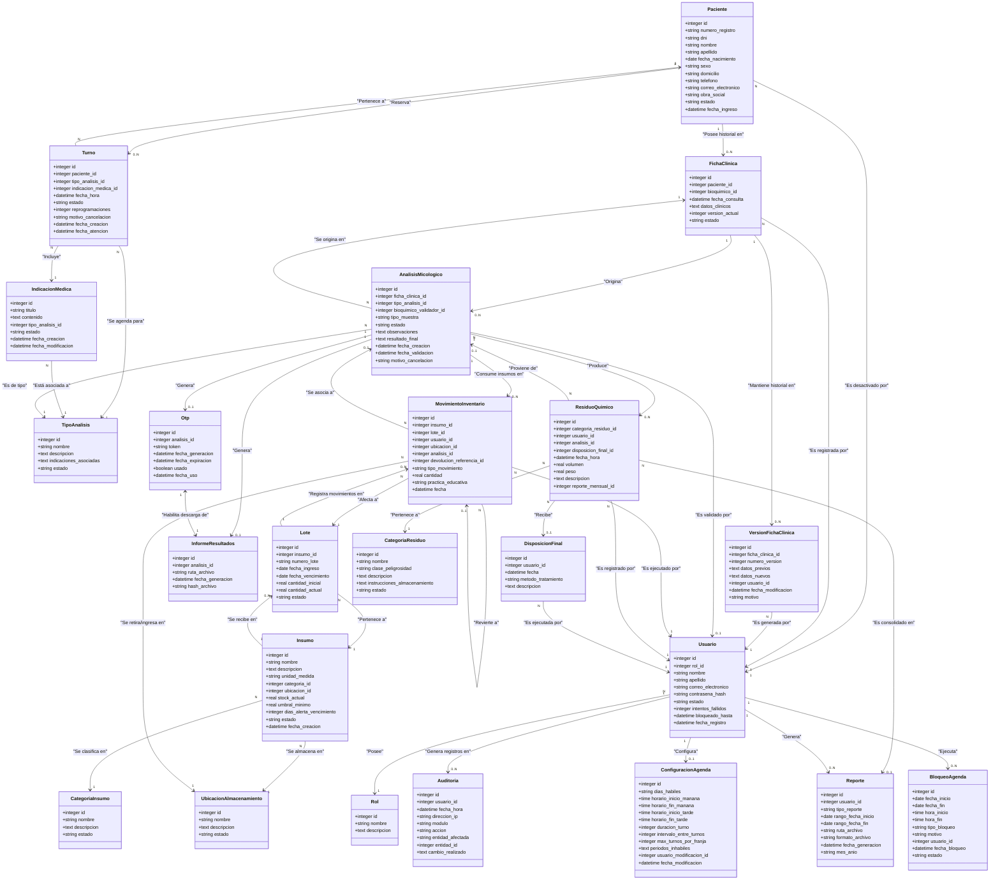

# Modelo de Dominio — SIGEMI
## Sistema Integral de Gestión Micológica

---

## 1. Resumen de Clases (Entidades del Dominio)

| **Clase** | **Descripción** | **Justificación/Origen** |
|---|---|---|
| **Paciente** | Persona atendida en el laboratorio de Micología. Contiene sus datos demográficos y es el eje central del historial clínico. | IRQ-01, ACT-04, UC-REC-01, UC-REC-16 |
| **FichaClinica** | Documento clínico estructurado que registra la información médica recolectada durante una consulta presencial. Se genera por cada visita. | IRQ-01, RF-05, UC-DIAG-01 |
| **VersionFichaClinica** | Historial de cambios de una ficha clínica. Almacena la versión previa ante cada modificación. | RF-20, UC-DIAG-08 |
| **Turno** | Cita programada para un paciente en una fecha y hora específicas. Recorre un ciclo de estados. | UC-REC-01 a UC-REC-06, UC-REC-14, UC-REC-15, UC-REC-20 a UC-REC-22 |
| **IndicacionMedica** | Instrucción médica predefinida que se envía al paciente al agendar un turno, vinculada a un tipo de análisis. | RF-02, UC-REC-10 a UC-REC-13 |
| **ConfiguracionAgenda** | Conjunto único de parámetros que definen la disponibilidad horaria del laboratorio (días hábiles, duración de turnos, franjas, recesos). | UC-REC-07 |
| **BloqueoAgenda** | Restricción temporal de un día completo o franja horaria que impide la asignación de turnos. | UC-REC-08 |
| **AnalisisMicologico** | Traza el ciclo de vida completo de una muestra microbiológica, desde su ingreso hasta su validación o cancelación. | IRQ-02, RF-06, RF-21, UC-DIAG-02 a UC-DIAG-04, UC-DIAG-09 |
| **TipoAnalisis** | Catálogo de tipos de análisis micológicos y tipos de muestra disponibles. | IRQ-05, RF-16, UC-DIAG-11 |
| **Otp** | Token criptográfico de un solo uso generado al validar un análisis, que habilita la descarga segura del informe. | RF-07, RF-08, UC-DIAG-04, UC-DIAG-05, RNF-02 |
| **InformeResultados** | Documento PDF generado automáticamente al validar un análisis, almacenado en el servidor local. | RF-08, UC-DIAG-04, UC-DIAG-05, RNF-05 |
| **Insumo** | Bien físico o reactivo químico del inventario del laboratorio. Define sus propiedades, categoría y ubicación. | IRQ-03, RF-09, RF-10, UC-LAB-06 |
| **Lote** | Grupo específico de un mismo insumo con número de lote y fecha de vencimiento particulares. | IRQ-03, RF-18 |
| **MovimientoInventario** | Registro individual de cada operación sobre el inventario: ingreso, retiro o devolución. | IRQ-06, RF-10, UC-LAB-01, UC-LAB-02, UC-LAB-07, UC-LAB-09 |
| **CategoriaInsumo** | Clasificación de insumos (reactivos, medios de cultivo, materiales descartables, equipos). | IRQ-03, RF-17, UC-LAB-12 |
| **UbicacionAlmacenamiento** | Lugar físico donde se almacena un insumo dentro del laboratorio. | IRQ-03, RF-17 |
| **ResiduoQuimico** | Registro de desechos químicos generados por actividades del laboratorio, con volumen y peso exactos. | IRQ-04, RF-11, UC-LAB-03, UC-LAB-11 |
| **DisposicionFinal** | Registro de la salida y tratamiento definitivo de residuos acumulados. | RF-19 |
| **CategoriaResiduo** | Clasificación de peligrosidad para residuos químicos (Clase I, II, III). | IRQ-07, RF-17, UC-LAB-10 |
| **Usuario** | Cuenta de acceso al sistema para personal interno autenticado. Incluye credenciales y estado. | ACT-01/02/03, RF-13, UC-SEG-01, UC-SEG-02 |
| **Rol** | Perfil de autorización que define los permisos operativos dentro del sistema. | ACT-01/02/03, RF-13, RF-14, UC-SEG-02 |
| **Auditoria** | Registro inmutable y cronológico de cada evento crítico ejecutado en la plataforma. | RF-14, UC-SEG-01 |
| **Reporte** | Documento consolidado generado a partir de datos transaccionales para cumplimiento normativo o investigación. | RF-12, RF-15, UC-LAB-04, UC-LAB-13, UC-REP-01 |

---

## 2. Diccionario de Atributos por Clase

| **Clase** | **Atributo** | **Tipo de Dato** | **Descripción** |
|---|---|---|---|
| Paciente | id | integer | Identificador único |
| Paciente | numero_registro | string | Número de registro clínico interno |
| Paciente | dni | string | Documento Nacional de Identidad (único) |
| Paciente | nombre | string | Nombre/s del paciente |
| Paciente | apellido | string | Apellido/s del paciente |
| Paciente | fecha_nacimiento | date | Fecha de nacimiento (base para cálculo de edad) |
| Paciente | sexo | string | Sexo del paciente |
| Paciente | domicilio | string | Dirección de residencia |
| Paciente | telefono | string | Teléfono de contacto (WhatsApp) |
| Paciente | correo_electronico | string | Correo electrónico |
| Paciente | obra_social | string | Obra social o cobertura médica |
| Paciente | estado | string | Activo / Inactivo (baja lógica) |
| Paciente | fecha_ingreso | datetime | Fecha de creación del registro |
| FichaClinica | id | integer | Identificador único |
| FichaClinica | paciente_id | integer | FK a Paciente |
| FichaClinica | bioquimico_id | integer | FK a Usuario que registró la ficha |
| FichaClinica | fecha_consulta | datetime | Fecha y hora de la consulta presencial |
| FichaClinica | datos_clinicos | text | Información clínica estructurada (JSON) |
| FichaClinica | version_actual | integer | Número de versión vigente |
| FichaClinica | estado | string | Activo / Modificado / Histórico |
| VersionFichaClinica | id | integer | Identificador único |
| VersionFichaClinica | ficha_clinica_id | integer | FK a FichaClinica |
| VersionFichaClinica | numero_version | integer | Número secuencial de versión |
| VersionFichaClinica | datos_previos | text | Contenido de la ficha antes del cambio (JSON) |
| VersionFichaClinica | datos_nuevos | text | Contenido de la ficha después del cambio (JSON) |
| VersionFichaClinica | usuario_id | integer | FK a Usuario que realizó la modificación |
| VersionFichaClinica | fecha_modificacion | datetime | Fecha y hora de la modificación |
| VersionFichaClinica | motivo | string | Razón del cambio |
| Turno | id | integer | Identificador único |
| Turno | paciente_id | integer | FK a Paciente |
| Turno | tipo_analisis_id | integer | FK a TipoAnalisis |
| Turno | indicacion_medica_id | integer | FK a IndicacionMedica enviada |
| Turno | fecha_hora | datetime | Fecha y hora programada del turno |
| Turno | estado | string | Confirmado / Pendiente / Atendido / Cancelado / No Asistió |
| Turno | reprogramaciones | integer | Contador de reprogramaciones (máx. 2) |
| Turno | motivo_cancelacion | string | Motivo de cancelación (si aplica) |
| Turno | fecha_creacion | datetime | Fecha de creación del turno |
| Turno | fecha_atencion | datetime | Fecha/hora real de atención (si asistió) |
| IndicacionMedica | id | integer | Identificador único |
| IndicacionMedica | titulo | string | Título de la indicación |
| IndicacionMedica | contenido | text | Cuerpo de la indicación médica |
| IndicacionMedica | tipo_analisis_id | integer | FK a TipoAnalisis asociado |
| IndicacionMedica | estado | string | Activo / Inactivo (baja lógica) |
| IndicacionMedica | fecha_creacion | datetime | Fecha de creación |
| IndicacionMedica | fecha_modificacion | datetime | Fecha de última modificación |
| ConfiguracionAgenda | id | integer | Identificador único |
| ConfiguracionAgenda | dias_habiles | string | Días de atención (ej. "L,M,X,J,V") |
| ConfiguracionAgenda | horario_inicio_manana | time | Inicio franja matutina |
| ConfiguracionAgenda | horario_fin_manana | time | Fin franja matutina |
| ConfiguracionAgenda | horario_inicio_tarde | time | Inicio franja vespertina |
| ConfiguracionAgenda | horario_fin_tarde | time | Fin franja vespertina |
| ConfiguracionAgenda | duracion_turno | integer | Duración en minutos de cada turno |
| ConfiguracionAgenda | intervalo_entre_turnos | integer | Minutos de separación entre turnos consecutivos |
| ConfiguracionAgenda | max_turnos_por_franja | integer | Cantidad máxima de turnos por bloque horario |
| ConfiguracionAgenda | periodos_inhabiles | text | Feriados y recesos en formato JSON |
| ConfiguracionAgenda | usuario_modificacion_id | integer | FK a Usuario que modificó la configuración |
| ConfiguracionAgenda | fecha_modificacion | datetime | Fecha del último cambio |
| BloqueoAgenda | id | integer | Identificador único |
| BloqueoAgenda | fecha_inicio | date | Inicio del período bloqueado |
| BloqueoAgenda | fecha_fin | date | Fin del período (mismo día si es día único) |
| BloqueoAgenda | hora_inicio | time | Inicio de franja bloqueada (nulo si día completo) |
| BloqueoAgenda | hora_fin | time | Fin de franja bloqueada (nulo si día completo) |
| BloqueoAgenda | tipo_bloqueo | string | Día Completo / Franja Horaria |
| BloqueoAgenda | motivo | string | Razón del bloqueo |
| BloqueoAgenda | usuario_id | integer | FK a Usuario (Administrador) que ejecutó el bloqueo |
| BloqueoAgenda | fecha_bloqueo | datetime | Fecha de creación del bloqueo |
| BloqueoAgenda | estado | string | Activo / Inactivo (desbloqueado) |
| AnalisisMicologico | id | integer | Identificador único |
| AnalisisMicologico | ficha_clinica_id | integer | FK a FichaClinica |
| AnalisisMicologico | tipo_analisis_id | integer | FK a TipoAnalisis |
| AnalisisMicologico | bioquimico_validador_id | integer | FK a Usuario que validó (nulo hasta validación) |
| AnalisisMicologico | tipo_muestra | string | Tipo de muestra biológica (ej. uñas, piel, cabello) |
| AnalisisMicologico | estado | string | Pendiente / En Proceso / Terminado / Validado / Cancelado / Derivado |
| AnalisisMicologico | observaciones | text | Observaciones y resultados parciales |
| AnalisisMicologico | resultado_final | text | Diagnóstico y resultado definitivo |
| AnalisisMicologico | fecha_creacion | datetime | Fecha de ingreso de la muestra |
| AnalisisMicologico | fecha_validacion | datetime | Fecha de validación final (nulo hasta ese momento) |
| AnalisisMicologico | motivo_cancelacion | string | Motivo obligatorio si estado = Cancelado |
| TipoAnalisis | id | integer | Identificador único |
| TipoAnalisis | nombre | string | Nombre del tipo de análisis |
| TipoAnalisis | descripcion | text | Descripción del análisis o tipo de muestra |
| TipoAnalisis | indicaciones_asociadas | text | Indicaciones médicas estándar asociadas |
| TipoAnalisis | estado | string | Activo / Inactivo (baja lógica) |
| Otp | id | integer | Identificador único |
| Otp | analisis_id | integer | FK a AnalisisMicologico |
| Otp | token | string | Código OTP generado criptográficamente |
| Otp | fecha_generacion | datetime | Fecha y hora de generación |
| Otp | fecha_expiracion | datetime | Fecha de expiración (TTL = 7 días) |
| Otp | usado | boolean | Indica si ya fue consumido |
| Otp | fecha_uso | datetime | Fecha de consumo (nulo si no usado) |
| InformeResultados | id | integer | Identificador único |
| InformeResultados | analisis_id | integer | FK a AnalisisMicologico |
| InformeResultados | ruta_archivo | string | Ruta del PDF en servidor local |
| InformeResultados | fecha_generacion | datetime | Fecha de generación automática |
| InformeResultados | hash_archivo | string | Hash de integridad del archivo |
| Insumo | id | integer | Identificador único |
| Insumo | nombre | string | Nombre del reactivo o insumo |
| Insumo | descripcion | text | Descripción técnica |
| Insumo | unidad_medida | string | ml / g / unidades |
| Insumo | categoria_id | integer | FK a CategoriaInsumo |
| Insumo | ubicacion_id | integer | FK a UbicacionAlmacenamiento por defecto |
| Insumo | stock_actual | real | Cantidad total disponible (calculado de lotes activos) |
| Insumo | umbral_minimo | real | Umbral de alerta de stock bajo |
| Insumo | dias_alerta_vencimiento | integer | Días de anticipación para alerta de vencimiento |
| Insumo | estado | string | Activo / Inactivo (baja lógica) |
| Insumo | fecha_creacion | datetime | Fecha de alta en catálogo |
| Lote | id | integer | Identificador único |
| Lote | insumo_id | integer | FK a Insumo |
| Lote | numero_lote | string | Número de lote del fabricante |
| Lote | fecha_ingreso | date | Fecha de recepción en el laboratorio |
| Lote | fecha_vencimiento | date | Fecha de vencimiento |
| Lote | cantidad_inicial | real | Cantidad recibida originalmente |
| Lote | cantidad_actual | real | Cantidad remanente disponible |
| Lote | estado | string | Activo / Agotado / Vencido |
| MovimientoInventario | id | integer | Identificador único |
| MovimientoInventario | insumo_id | integer | FK a Insumo |
| MovimientoInventario | lote_id | integer | FK a Lote afectado |
| MovimientoInventario | usuario_id | integer | FK a Usuario responsable |
| MovimientoInventario | ubicacion_id | integer | FK a UbicacionAlmacenamiento de origen/destino |
| MovimientoInventario | analisis_id | integer | FK a AnalisisMicologico asociado (nulo si es práctica) |
| MovimientoInventario | devolucion_referencia_id | integer | FK al MovimientoInventario original (si es devolución) |
| MovimientoInventario | tipo_movimiento | string | Ingreso / Retiro / Devolución |
| MovimientoInventario | cantidad | real | Cantidad movida |
| MovimientoInventario | practica_educativa | string | Descripción de práctica si no es para análisis clínico |
| MovimientoInventario | fecha | datetime | Fecha y hora del movimiento |
| CategoriaInsumo | id | integer | Identificador único |
| CategoriaInsumo | nombre | string | Nombre de la categoría |
| CategoriaInsumo | descripcion | text | Descripción (ej. "Reactivos químicos", "Medios de cultivo") |
| CategoriaInsumo | estado | string | Activo / Inactivo |
| UbicacionAlmacenamiento | id | integer | Identificador único |
| UbicacionAlmacenamiento | nombre | string | Nombre de la ubicación (ej. "Estante A-3", "Heladera 2") |
| UbicacionAlmacenamiento | descripcion | text | Detalle de la ubicación |
| UbicacionAlmacenamiento | estado | string | Activo / Inactivo |
| ResiduoQuimico | id | integer | Identificador único |
| ResiduoQuimico | categoria_residuo_id | integer | FK a CategoriaResiduo |
| ResiduoQuimico | usuario_id | integer | FK a Usuario responsable del registro |
| ResiduoQuimico | analisis_id | integer | FK a AnalisisMicologico (nulo si es de práctica) |
| ResiduoQuimico | disposicion_final_id | integer | FK a DisposicionFinal (nulo hasta disposición) |
| ResiduoQuimico | fecha_hora | datetime | Fecha y hora de generación del residuo |
| ResiduoQuimico | volumen | real | Volumen exacto generado (ml) |
| ResiduoQuimico | peso | real | Peso exacto generado (g) |
| ResiduoQuimico | descripcion | text | Observaciones adicionales |
| ResiduoQuimico | reporte_mensual_id | integer | FK a Reporte que lo consolidó (nulo si no consolidado) |
| DisposicionFinal | id | integer | Identificador único |
| DisposicionFinal | usuario_id | integer | FK a Usuario responsable |
| DisposicionFinal | fecha | datetime | Fecha de disposición final |
| DisposicionFinal | metodo_tratamiento | string | Método de tratamiento aplicado |
| DisposicionFinal | descripcion | text | Detalles de la disposición |
| CategoriaResiduo | id | integer | Identificador único |
| CategoriaResiduo | nombre | string | Nombre de la categoría |
| CategoriaResiduo | clase_peligrosidad | string | Clase I / Clase II / Clase III |
| CategoriaResiduo | descripcion | text | Descripción de la categoría |
| CategoriaResiduo | instrucciones_almacenamiento | text | Instrucciones de resguardo y manejo |
| CategoriaResiduo | estado | string | Activo / Inactivo |
| Usuario | id | integer | Identificador único |
| Usuario | rol_id | integer | FK a Rol |
| Usuario | nombre | string | Nombre/s del usuario |
| Usuario | apellido | string | Apellido/s del usuario |
| Usuario | correo_electronico | string | Correo institucional (login) |
| Usuario | contrasena_hash | string | Hash de contraseña |
| Usuario | estado | string | Activo / Inactivo (baja lógica) / Bloqueado Temporal |
| Usuario | intentos_fallidos | integer | Contador de intentos fallidos de login |
| Usuario | bloqueado_hasta | datetime | Fecha/hora de desbloqueo automático |
| Usuario | fecha_registro | datetime | Fecha de creación de la cuenta |
| Rol | id | integer | Identificador único |
| Rol | nombre | string | Administrador / Bioquímico-Doctor / Profesor |
| Rol | descripcion | text | Descripción del rol y sus permisos |
| Auditoria | id | integer | Identificador único |
| Auditoria | usuario_id | integer | FK a Usuario responsable |
| Auditoria | fecha_hora | datetime | Fecha y hora precisa del evento |
| Auditoria | direccion_ip | string | Dirección IP de origen |
| Auditoria | modulo | string | Módulo del sistema donde ocurrió |
| Auditoria | accion | string | Acción ejecutada (CREAR, MODIFICAR, ELIMINAR, VALIDAR, etc.) |
| Auditoria | entidad_afectada | string | Nombre de la entidad afectada |
| Auditoria | entidad_id | integer | ID del registro afectado |
| Auditoria | cambio_realizado | text | Detalle del cambio en formato JSON |
| Reporte | id | integer | Identificador único |
| Reporte | usuario_id | integer | FK a Usuario que generó el reporte |
| Reporte | tipo_reporte | string | Residuos / Inventario / Operativo (Clínico) |
| Reporte | rango_fecha_inicio | date | Inicio del período reportado |
| Reporte | rango_fecha_fin | date | Fin del período reportado |
| Reporte | ruta_archivo | string | Ruta del archivo generado en servidor |
| Reporte | formato_archivo | string | PDF / CSV / XLSX |
| Reporte | fecha_generacion | datetime | Fecha de emisión del reporte |
| Reporte | mes_anio | string | Mes/año consolidado (para reporte mensual de residuos) |

---

## 3. Matriz de Relaciones

| **Clase Origen** | **Verbo / Acción** | **Clase Destino** | **Cardinalidad** | **Descripción de la Regla de Negocio** |
|---|---|---|---|---|
| Paciente | Posee | FichaClinica | 1 → 0..N | Un paciente puede tener múltiples consultas a lo largo del tiempo; cada ficha pertenece a un único paciente. |
| Paciente | Reserva | Turno | 1 → 0..N | Un paciente agenda uno o más turnos; cada turno es de un solo paciente. |
| Paciente | Es desactivado por | Usuario | N ← 1 | Solo un Administrador puede ejecutar la baja lógica de un paciente (UC-REC-19). |
| FichaClinica | Es registrada por | Usuario | N ← 1 | Un Bioquímico/Doctor completa y registra la ficha durante la consulta presencial (UC-DIAG-01). |
| FichaClinica | Contiene | AnalisisMicologico | 1 → 0..N | Una ficha clínica puede originar múltiples análisis; cada análisis se vincula a una ficha (UC-DIAG-02). |
| FichaClinica | Mantiene historial en | VersionFichaClinica | 1 → 0..N | Cada modificación de ficha almacena una versión histórica previa (RF-20, UC-DIAG-08). |
| VersionFichaClinica | Es generada por | Usuario | N ← 1 | El Bioquímico/Doctor que modifica la ficha queda registrado como autor de la versión. |
| Turno | Pertenece a | Paciente | N ← 1 | Cada turno está asignado a un paciente (UC-REC-01). |
| Turno | Se agenda para | TipoAnalisis | N ← 1 | Cada turno se agenda para un tipo de análisis micológico específico (UCE-REC-20 paso 6). |
| Turno | Incluye | IndicacionMedica | N ← 1 | Al agendar, se envía una indicación médica predefinida asociada al tipo de análisis (RF-02). |
| IndicacionMedica | Está asociada a | TipoAnalisis | N ← 1 | Cada indicación se vincula obligatoriamente a un tipo de análisis (UCE-REC-10 paso 2). |
| AnalisisMicologico | Se origina en | FichaClinica | N ← 1 | El análisis se crea a partir de una ficha clínica registrada (UC-DIAG-02 paso 6). |
| AnalisisMicologico | Es de tipo | TipoAnalisis | N ← 1 | Cada análisis corresponde a un tipo del catálogo clínico. |
| AnalisisMicologico | Es validado por | Usuario | N ← 0..1 | Solo un Bioquímico puede validar el análisis (estado "Validado") (UC-DIAG-04). |
| AnalisisMicologico | Genera | Otp | 1 → 0..1 | Al validar el análisis, el sistema genera un token OTP único para la descarga segura (UC-DIAG-04). |
| AnalisisMicologico | Genera | InformeResultados | 1 → 0..1 | Al validar el análisis, se compila y almacena el PDF del informe de resultados (UC-DIAG-04). |
| AnalisisMicologico | Consume | MovimientoInventario | 1 → 0..N | Los retiros de insumos pueden estar asociados a un análisis clínico específico para trazabilidad (IRQ-06, UC-LAB-02). |
| AnalisisMicologico | Produce | ResiduoQuimico | 1 → 0..N | Un análisis clínico puede generar residuos químicos registrados (UC-LAB-03). |
| Otp | Habilita descarga de | InformeResultados | 1 ↔ 1 | El OTP válido permite al paciente descargar el informe asociado desde el portal web (UC-DIAG-05). |
| Insumo | Se clasifica en | CategoriaInsumo | N ← 1 | Cada insumo pertenece a una categoría del catálogo (UC-LAB-12). |
| Insumo | Se almacena en | UbicacionAlmacenamiento | N ← 1 | Cada insumo tiene una ubicación de almacenamiento por defecto (IRQ-03). |
| Insumo | Se recibe en | Lote | 1 → 0..N | Un insumo puede tener múltiples lotes con distintas fechas de vencimiento (RF-18). |
| Lote | Pertenece a | Insumo | N ← 1 | Cada lote corresponde a un único insumo. |
| Lote | Registra movimientos en | MovimientoInventario | 1 → 0..N | Cada operación sobre el inventario afecta un lote específico (FEFO: se consume primero el más próximo a vencer) (RF-18). |
| MovimientoInventario | Afecta a | Lote | N ← 1 | Cada movimiento (ingreso/retiro/devolución) impacta un lote concreto (IRQ-06). |
| MovimientoInventario | Es ejecutado por | Usuario | N ← 1 | Profesor, Bioquímico o Administrador registra cada movimiento (IRQ-06). |
| MovimientoInventario | Se retira desde / ingresa en | UbicacionAlmacenamiento | N ← 1 | Cada movimiento registra la ubicación de origen o destino (UC-LAB-02). |
| MovimientoInventario | Se asocia a | AnalisisMicologico | N ← 0..1 | Opcionalmente vinculado a un análisis clínico para trazabilidad del consumo. |
| MovimientoInventario | Revierte a | MovimientoInventario | 1 → 0..1 | Una devolución referencia al movimiento de retiro original que está revirtiendo (UC-LAB-09). |
| ResiduoQuimico | Pertenece a | CategoriaResiduo | N ← 1 | Cada residuo se clasifica según su categoría de peligrosidad (IRQ-04). |
| ResiduoQuimico | Es registrado por | Usuario | N ← 1 | Profesor o Bioquímico registra la generación del residuo (UC-LAB-03). |
| ResiduoQuimico | Proviene de | AnalisisMicologico | N ← 0..1 | Opcionalmente vinculado a un análisis clínico que lo generó. |
| ResiduoQuimico | Recibe | DisposicionFinal | N ← 0..1 | Un residuo eventualmente recibe tratamiento final; varios residuos pueden consolidarse en una disposición (RF-19). |
| ResiduoQuimico | Es consolidado en | Reporte | N ← 0..1 | Al generar el reporte mensual, el residuo queda vinculado al reporte que lo consolidó (UC-LAB-04). |
| DisposicionFinal | Es ejecutada por | Usuario | N ← 1 | Un usuario autorizado registra la disposición final de residuos (RF-19). |
| Usuario | Posee | Rol | N ← 1 | Cada usuario tiene asignado un único rol que determina sus permisos (UC-SEG-02). |
| Usuario | Genera registros en | Auditoria | 1 → 0..N | Toda acción crítica del usuario queda registrada automáticamente en la auditoría (RF-14). |
| Usuario | Genera | Reporte | 1 → 0..N | Un usuario autorizado puede emitir múltiples reportes (UC-LAB-04, UC-REP-01). |
| Usuario | Configura | ConfiguracionAgenda | 1 → 0..1 | El Administrador define los parámetros de la agenda; existe una única configuración vigente. |
| Usuario | Ejecuta | BloqueoAgenda | 1 → 0..N | El Administrador puede crear múltiples bloqueos de días o franjas horarias (UC-REC-08). |

---

## 4. Diagrama del Modelo de Dominio (Mermaid)

---

## Notas de Diseño

- **Paciente** soporta el concepto de «Alta Temprana» (glosario): el Agente IA crea el registro solo con DNI y nombre; el resto de atributos demográficos se completan durante la consulta (UC-DIAG-01) o al registrar asistencia (UCE-REC-15 paso 6).
- **Lote** implementa la política FEFO (RF-18): al retirar, el sistema consume primero el lote con `fecha_vencimiento` más próxima. El atributo `dias_alerta_vencimiento` en Insumo permite que el dashboard alerte con anticipación configurable (UC-LAB-08).
- **VersionFichaClinica** materializa el requisito RF-20: cada modificación de ficha preserva el contenido anterior como historial de auditoría clínica.
- **Auditoria** es una entidad transversal que registra toda acción sensible (configuración de agenda, bloqueos, validación de análisis, modificaciones de pacientes, etc.) conforme a RF-14.
- El **Paciente** no es un Usuario del sistema (ACT-04): interactúa de forma anónima vía WhatsApp y portal OTP, sin credenciales de acceso a la plataforma interna.