# Modelo de Dominio Conceptual — SIGEMI (Unificado)

> **Nivel de abstracción**: 2 — Concepto / Dominio.
> **Propósito**: la visión completa del negocio en un solo diagrama, con todos los subsistemas y los acoplamientos entre ellos visibles en la misma imagen.
> **Estatus**: **fuente de verdad — nivel 2 (dominio conceptual)**, según `AGENTS.md`. Sustituye a `Diagramas/_superseded/modelo_dominio_nucleo_clinico.md` y `Diagramas/_superseded/diagrama_clases_sigemi.mmd`, que quedan archivados.
> **Deriva de**: `TF_2026_Requerimientos_KLUKA_JORGE.md` (nivel 1). Si este documento contradice un requerimiento, el requerimiento gana y este archivo es el defectuoso.
> **Regla de oro**: sin claves (`id`), sin `FK`, sin tipos SQL, sin mecanismos. Solo conceptos y relaciones semánticas.

## 1. Diagrama unificado (sistema completo)

```mermaid
flowchart TB
    subgraph CLIN["NÚCLEO CLÍNICO"]
        Paciente["Paciente"]
        Ficha["Ficha Clínica"]
        DatoClinico["Dato Clínico"]
        Analisis["Análisis Micológico"]
        Muestra["Muestra"]
        Hallazgo["Hallazgo"]
        Informe["Informe de Resultados"]
    end

    subgraph PERS["PERSONAS Y ACCESO"]
        Usuario["Usuario"]
        Profesional["Profesional (Bioquímico/Doctor)"]
        Administrador["Administrador"]
    end

    subgraph AGEN["AGENDA Y ATENCIÓN"]
        Turno["Turno"]
        Indicacion["Indicación Médica"]
        Agenda["Agenda del Laboratorio"]
        ConfigAgenda["Configuración de Agenda"]
        Periodo["Período Inhábil"]
        Bloqueo["Bloqueo de Agenda"]
        MotivoBloqueo["Motivo de Bloqueo"]
        Espacio["Espacio de Atención"]
        GrupoEspacio["Grupo de Espacios"]
        Disponibilidad["Disponibilidad del Profesional"]
        Ausencia["Ausencia del Profesional"]
        Oferta["Oferta de Reagendación"]
    end

    subgraph CAT["CATÁLOGOS DE ANÁLISIS"]
        TipoAnalisis["Tipo de Análisis"]
        TipoMuestra["Tipo de Muestra"]
        ReglaAdmision["Regla de Admisión"]
    end

    subgraph INV["INVENTARIO"]
        Insumo["Insumo / Reactivo"]
        CategoriaInsumo["Categoría de Insumo"]
        Lote["Lote"]
        Movimiento["Movimiento de Inventario"]
        Ubicacion["Ubicación de Almacenamiento"]
    end

    subgraph RES["RESIDUOS QUÍMICOS"]
        Residuo["Residuo Químico"]
        CategoriaResiduo["Categoría de Residuo"]
        Instruccion["Instrucción de Almacenamiento"]
        Disposicion["Disposición Final"]
    end

    subgraph EQ["EQUIPOS"]
        Equipo["Equipo"]
        TipoEquipo["Tipo de Equipo"]
        Mantenimiento["Mantenimiento de Equipo"]
    end

    subgraph TRANS["TRANSVERSALES"]
        Auditoria["Registro de Auditoría"]
        Reporte["Reporte"]
        ReporteResiduos["Reporte de Residuos"]
        ReporteInventario["Reporte de Inventario"]
        ReporteGenerico["Reporte / Estadística"]
    end

    %% --- Núcleo clínico ---
    Paciente -->|"posee"| Ficha
    Ficha -->|"contiene"| DatoClinico
    Ficha -->|"origina"| Analisis
    Analisis -->|"se realiza sobre"| Muestra
    Muestra -->|"extraída de"| Paciente
    Analisis -->|"contiene"| Hallazgo
    Analisis -->|"genera"| Informe
    Profesional -->|"registra / atiende"| Ficha
    Profesional -->|"realiza"| Analisis
    Profesional -->|"valida"| Analisis
    Profesional -->|"firma (valida)"| Informe

    %% --- Personas ---
    Usuario -->|"opera como"| Profesional
    Usuario -->|"opera como"| Administrador
    Administrador -->|"configura"| ConfigAgenda
    Administrador -->|"define"| Indicacion

    %% --- Agenda ---
    Paciente -->|"reserva / posee"| Turno
    Turno -->|"se asigna en"| Agenda
    Turno -->|"se asigna a"| Espacio
    Turno -->|"atendido por"| Profesional
    Turno -->|"incluye"| Indicacion
    Turno -->|"deriva en"| Analisis
    ConfigAgenda -->|"rige"| Agenda
    ConfigAgenda -->|"declara"| Periodo
    Periodo -->|"inhabilita"| Agenda
    Periodo -->|"se justifica por"| MotivoBloqueo
    Bloqueo -->|"inhabilita"| Agenda
    Bloqueo -->|"se justifica por"| MotivoBloqueo
    Bloqueo -->|"bloquea"| Espacio
    Bloqueo -->|"afecta a"| GrupoEspacio
    Bloqueo -->|"ejecutado por"| Usuario
    Espacio -->|"se agrupa en"| GrupoEspacio
    Profesional -->|"declara"| Disponibilidad
    Profesional -->|"sufre"| Ausencia
    Ausencia -->|"registrada por"| Usuario
    Ausencia -->|"dispara"| Oferta
    Oferta -->|"reagenda"| Turno
    Oferta -->|"se ofrece a"| Paciente

    %% --- Catálogos ---
    TipoAnalisis -->|"acepta"| ReglaAdmision
    TipoMuestra -->|"es aceptada en"| ReglaAdmision
    Analisis -->|"es de tipo"| TipoAnalisis
    Muestra -->|"es de tipo"| TipoMuestra
    Indicacion -->|"asociada a"| TipoAnalisis

    %% --- Inventario ---
    Insumo -->|"se clasifica en"| CategoriaInsumo
    Insumo -->|"se recibe en"| Lote
    Insumo -->|"se almacena en"| Ubicacion
    Lote -->|"registra"| Movimiento
    Movimiento -->|"consume"| Analisis
    Movimiento -->|"revierte"| Movimiento
    Movimiento -->|"retira / ingresa en"| Ubicacion
    Movimiento -->|"se consolida en"| ReporteInventario
    Profesional -->|"ejecuta"| Movimiento

    %% --- Residuos ---
    Residuo -->|"pertenece a"| CategoriaResiduo
    CategoriaResiduo -->|"define"| Instruccion
    Residuo -->|"proviene de"| Analisis
    Residuo -->|"recibe"| Disposicion
    Residuo -->|"se consolida en"| ReporteResiduos
    Usuario -->|"registra"| Residuo
    Usuario -->|"ejecuta"| Disposicion

    %% --- Equipos ---
    Equipo -->|"se clasifica en"| TipoEquipo
    Equipo -->|"se ubica en"| Ubicacion
    Equipo -->|"recibe"| Mantenimiento

    %% --- Transversales ---
    Usuario -->|"genera"| Auditoria
    Auditoria -->|"es consultada por"| Usuario
    Usuario -->|"genera"| Reporte
    ReporteResiduos -->|"es un"| Reporte
    ReporteInventario -->|"es un"| Reporte
    ReporteGenerico -->|"es un"| Reporte
```

## 2. Lectura del diagrama

- **Núcleo clínico** — el eje del negocio: `Paciente` posee `Ficha Clínica`, la ficha contiene `Dato Clínico` y origina `Análisis Micológico`; la `Muestra` (extraída del paciente) es lo que el análisis estudia, y éste produce `Hallazgo` e `Informe de Resultados`.
- **Personas y acceso** — `Usuario` es la persona que opera; `Profesional` y `Administrador` son responsabilidades que asume.
- **Agenda y atención** — la capacidad de atención (`Agenda`, `Configuración`, `Período Inhábil`, `Bloqueo`, `Espacio`, `Grupo`) y la disponibilidad real de quien atiende (`Disponibilidad`, `Ausencia`, `Oferta de Reagendación`).
- **Catálogos** — los tipos que tipifican el estudio (`Tipo de Análisis`) y la muestra (`Tipo de Muestra`), con la regla que dice qué combinación es válida.
- **Inventario** — el consumible y su trazabilidad por lote y movimiento.
- **Residuos** — el desecho generado por el análisis, su categoría, su instrucción de manejo y su consolidación normativa.
- **Equipos** — el bien físico, su criticidad y su mantenimiento.
- **Transversales** — auditoría y la familia `Reporte` (Residuos, Inventario, Estadística), que consolidan y observan a todos los subsistemas.

## 3. Acoplamientos entre subsistemas

| Relación | Conecta | Naturaleza |
| --- | --- | --- |
| `Turno` | Clínico ⇄ Agenda | El turno reserva la atención y deriva en el análisis |
| `Turno → Profesional` | Agenda ⇄ Personas | Quién atiende el turno |
| `Muestra → Tipo de Muestra` y `Análisis → Tipo de Análisis` | Clínico ⇄ Catálogos | La muestra y el estudio se tipifican contra el catálogo |
| `Indicación Médica → Tipo de Análisis` | Agenda ⇄ Catálogos | La indicación declara qué estudio acompaña |
| `Movimiento → Análisis` | Inventario ⇄ Clínico | Consumo real de insumo por análisis |
| `Residuo → Análisis` | Residuos ⇄ Clínico | Desecho que genera el análisis |
| `Equipo → Ubicación` e `Insumo → Ubicación` | Equipos ⇄ Inventario | **Comparten el mismo catálogo de ubicación** |
| `Residuo → Reporte de Residuos` | Residuos ⇄ Transversales | El residuo se consolida en su reporte normativo |
| `Movimiento → Reporte de Inventario` | Inventario ⇄ Transversales | El movimiento se consolida en el reporte de inventario |
| `Usuario → Auditoría / Reporte` | Transversales ⇄ todo | Quién genera la traza y el reporte |

## 4. Relaciones restauradas desde el `.mmd`

Al separar el modelo en diagramas por subsistema se perdieron estas relaciones (existen en el diagrama de clases archivado, `_superseded/diagrama_clases_sigemi.mmd`, y ahora están en el diagrama unificado):

1. `Ficha Clínica → Dato Clínico` — el concepto `Dato Clínico` no había pasado al modelo de dominio.
2. `Análisis → Tipo de Análisis` y `Muestra → Tipo de Muestra` — sin esto, Catálogos quedaba aislado.
3. `Indicación Médica → Tipo de Análisis`.
4. `Turno → Profesional` (atendido por).
5. `Configuración de Agenda → Período Inhábil`.
6. `Período Inhábil → Motivo de Bloqueo`.
7. `Bloqueo → Usuario` (ejecutado por) y `Ausencia → Usuario` (registrada por).
8. `Movimiento → Ubicación` (retiro / ingreso).
9. `Equipo → Ubicación`: **unificado** con el catálogo de inventario. En el documento anterior aparecía como `Ubicación` duplicada en §10.

## 5. Decisiones de modelado de esta revisión

1. **`Muestra` es concepto propio; `Procesamiento` desapareció.** El nodo anterior `Muestra / Procesamiento` mezclaba un *objeto* con una *actividad*. `Muestra` es la instancia física extraída del paciente y merece existir: hay un caso de uso propio para su ingreso (`UC–DIAG-02 Registrar Ingreso de Muestra`) y el requerimiento IRQ-02 habla de "la muestra extraída al paciente". `Procesamiento`, en cambio, es comportamiento (el ciclo de vida), ya trazado por los estados del análisis y `TrazabilidadAnalisis`.
2. **Se completó el par tipo/instancia.** El modelo ya separaba tipo de instancia para análisis (`Tipo de Análisis` ↔ `Análisis`) y equipos (`Tipo de Equipo` ↔ `Equipo`); faltaba `Muestra` como instancia de `Tipo de Muestra`. Relaciones nuevas: `Muestra → Paciente` (extraída de), `Análisis → Muestra` (se realiza sobre), `Muestra → Tipo de Muestra` (es de tipo).
3. **`Reporte` como padre conceptual.** El negocio lo justifica con nombre propio (Subsistema de Reportes y Estadísticas, §2.7). Hijos: `Reporte de Residuos` (RF-12 / UC–LAB-04), `Reporte de Inventario` (UC–LAB-13) y `Reporte / Estadística` (el módulo que cruza datos clínicos, de inventario y desechos para investigación).
4. **`Informe de Resultados` NO es un `Reporte`.** Es un documento clínico individual, entregado fehacientemente al paciente con OTP. Distinto por naturaleza del reporte consolidado; forzarlo bajo `Reporte` sería una generalización falsa.
5. **Se agregó `Reporte de Inventario`.** En el `.mmd` no existía: quedaba escondido dentro del `Reporte` genérico vía `tipo_reporte`. Acá queda explícito como hijo del padre `Reporte`.
6. **Divergencia deliberada con el diagrama de clases archivado:** el tipo de muestra pasó de `Análisis` a `Muestra`. En el `.mmd` histórico, `AnalisisMicologico` porta `tipo_muestra_id`; acá la muestra es quien porta su tipo (uña, piel, pelo), porque el tipo es inherente a la muestra y el análisis solo la estudia. La persistencia lo aplana: ver la sección "Correspondencia con el modelo de dominio" en `modelo_esquema_bd_sigemi.md` (nivel 3).

## 6. Huecos que quedan abiertos

1. **Cardinalidad `Muestra ↔ Análisis`.** Se asume **1:1** en este sistema (un turno, una muestra, un estudio). Es un supuesto razonable pero conviene confirmarlo contra los requerimientos antes de llevarlo al esquema relacional.
2. **`Rol`.** El diagrama de clases archivado tiene `Rol` como entidad; el modelo de dominio decidió tratarlo como responsabilidad de `Usuario`. Mantengo la decisión conceptual, pero es una divergencia deliberada respecto del modelo de clases archivado.