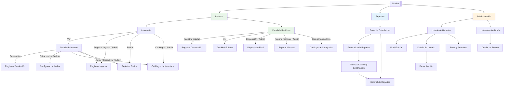
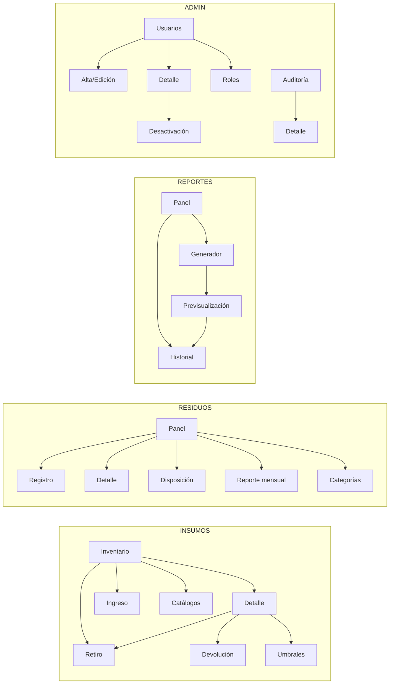

# GUÍA DE DISEÑO DE PANTALLAS — Módulos faltantes (SIGEMI)

**Módulos:** Insumos y Stock · Control de Residuos · Reportes y Estadísticas · Usuarios y Roles · Auditoría
**Versión:** 1.0 (Borrador) | **Autor:** spec_writer | **Fecha:** 2026-10-19

---

## 0. Propósito y cómo usar este documento

### 0.1 Qué es este documento

Este documento es la **especificación de diseño de pantallas** para los **5 módulos del sidebar que aún no tienen pantallas implementadas** en el prototipo SIGEMI (Sistema Integral de Gestión Micológica):

1. **Insumos y Stock** (módulo Insumos)
2. **Control de Residuos** (módulo Insumos)
3. **Reportes y Estadísticas** (módulo Reportes)
4. **Usuarios y Roles** (módulo Administración)
5. **Auditoría** (módulo Administración)

Es el complemento de `GUIA_DISENO_PANTALLAS_PRINCIPAL.md` (v2.0), que cubre Panel de Control, Agenda y Turnos y Pacientes. Con este documento quedan especificados **los 5 módulos pendientes del sidebar**; el módulo Laboratorio (Análisis y Resultados) ya está implementado y no forma parte de este encargo.

### 0.2 Qué debe producir la LLM de diseño que consume este documento

- **Wireframes o mockups** de cada pantalla y subpantalla.
- **Prototipos interactivos** que respeten los flujos paso a paso.
- **Estados visuales** para cada excepción, estado vacío, carga y error.
- **Navegación coherente** entre pantallas según la matriz de accesos (§1.2).
- **Datos de ejemplo realistas** (ver §5.10), sin lorem ipsum.

### 0.3 Relación con el prototipo actual y con los requerimientos

| Aspecto | Estado actual | Qué debe reflejar el diseño |
|---|---|---|
| Persistencia | Sin backend; datos en memoria | El diseño no cambia; los flujos sí deben ser completos. |
| Roles y permisos | **No implementados**; todo abierto | El diseño debe mostrar/ocultar acciones por rol según §3 y §5.6. |
| UCE de LAB / SEG / REP | **Pendientes de redacción** (salvo REP-01 y SEG-01) | Se toma el **UC** correspondiente como fuente y se marca la brecha. |
| Navegación | Estado único `activePage`, sin URL | Mantener el patrón: sidebar persistente y subpantallas sin ítem propio. |
| Módulos faltantes | Muestran el Panel de Análisis como respaldo | Reemplazar por las pantallas de este documento. |

> **Regla de trazabilidad:** cuando una pantalla se apoya en un UC sin UCE redactado, se indica `(UC–LAB-XX — UCE pendiente)`. Cuando el comportamiento es inferido, se marca `(derivado)`; cuando no hay fuente, `(FALTA DEFINIR)`.

### 0.4 Cómo interpretar "Flujo" y "Excepciones"

| Término | Significado |
|---|---|
| **Flujo de trabajo** | Secuencia numerada de pasos; cada uno indica actor (Usuario/Sistema) y efecto en la UI. |
| **Excepciones** | Comportamiento alternativo ante datos faltantes, conflictos, errores o falta de permisos. Referencia el paso donde se dispara. |
| **(derivado)** | Comportamiento inferido de los UC/RF pero no documentado explícitamente. Requiere validación. |
| **(FALTA DEFINIR)** | No hay fuente que lo respalde. Debe resolverse con el stakeholder antes de implementar. |
| **UC–LAB-XX / UC–SEG-XX / UC-REP-01** | Caso de Uso del documento `TF_2026_Requerimientos_KLUKA_JORGE.md` (§2.7.3.3, §2.7.3.4, §2.7.3.5). |
| **RF-XX / IRQ-XX** | Requisito Funcional / Requisito de Información del mismo documento. |

### 0.5 Convenciones de formato

- Campos **obligatorios** marcados con `*`.
- Estados con la nomenclatura exacta de los UC y del modelo de datos.
- Acciones de UI entre comillas: `"Guardar"`, `"Registrar retiro"`.
- Fechas en formato `dd/mm/aaaa`; horas en 24 h; locale **es-AR** (coma decimal, punto de miles).
- Unidades: `ml`, `g`, `unidades`, `L`, `kg`. Mostrar siempre la unidad junto al número.
- Los colores de estado se definen en §5.8.

### 0.6 Decisiones de diseño asumidas para esta versión

| # | Decisión | Fundamento | Estado |
|---|---|---|---|
| D1 | Las subpantallas de alta/edición se muestran como **drawer lateral derecho** (640 px) o **modal centrado** (720 px), no como página completa. | Coherencia con el prototipo actual (modales de paciente) y menor pérdida de contexto. | (derivado) |
| D2 | Los listados y paneles son **páginas completas** dentro del área de contenido, con sidebar persistente. | Patrón actual del prototipo. | Aceptado |
| D3 | Las confirmaciones destructivas usan **modal pequeño** (480 px) con acción primaria en rojo. | Patrón actual. | Aceptado |
| D4 | Los catálogos (insumos, categorías, ubicaciones, categorías de residuos) se agrupan en **una pantalla con pestañas**. | Evita proliferación de ítems en el sidebar. | (derivado) |
| D5 | El rol **Profesor** solo ve Insumos y Control de Residuos; nunca Reportes, Usuarios ni Auditoría. | §5.6 y definición de ACT-02. | Aceptado |
| D6 | **Auditoría** es solo lectura y solo para Administrador. | RF-14 no define consulta; se restringe por confidencialidad. | (derivado) |
| D7 | Los **roles son prefijados** (Bioquímico/Doctor, Profesor, Administrador); no se crean roles nuevos en esta versión. | UC–SEG-02 habla de "roles prefijados". | Aceptado |

---

## 1. Mapa de navegación

### 1.1 Árbol de los módulos faltantes

```
Insumos (sidebar)
├── Insumos y Stock                         ← Módulo (7 subpantallas)
│   ├── Inventario                          ← Vista principal (UC-LAB-05)
│   ├── Detalle de Insumo                   ← Subpantalla (UC-LAB-05, 07, 08)
│   ├── Registrar Ingreso                   ← Drawer (UC-LAB-01)
│   ├── Registrar Retiro                    ← Drawer (UC-LAB-02)
│   ├── Registrar Devolución                ← Drawer (UC-LAB-09)
│   ├── Configurar Umbrales                 ← Modal (UC-LAB-08)
│   └── Catálogos de Inventario             ← Subpantalla con pestañas (UC-LAB-06, 12, RF-17)
└── Control de Residuos                     ← Módulo (6 subpantallas)
    ├── Panel de Residuos                   ← Vista principal (UC-LAB-11)
    ├── Registrar Generación                ← Drawer (UC-LAB-03)
    ├── Detalle / Edición de Residuo        ← Subpantalla (UC-LAB-11)
    ├── Disposición Final                   ← Subpantalla (RF-19)
    ├── Reporte Mensual                     ← Subpantalla (UC-LAB-04)
    └── Catálogo de Categorías              ← Subpantalla (UC-LAB-10)

Reportes (sidebar)
└── Reportes y Estadísticas                 ← Módulo (4 subpantallas)
    ├── Panel de Estadísticas               ← Vista principal (UC-REP-01, derivado)
    ├── Generador de Reportes               ← Asistente 3 pasos (UC-REP-01)
    ├── Previsualización y Exportación      ← Subpantalla (UC-REP-01)
    └── Historial de Reportes               ← Subpantalla (derivado)

Administración (sidebar)
├── Usuarios y Roles                        ← Módulo (5 subpantallas)
│   ├── Listado de Usuarios                 ← Vista principal (UC-SEG-02)
│   ├── Alta / Edición de Usuario           ← Drawer (UC-SEG-02)
│   ├── Detalle de Usuario                  ← Subpantalla (UC-SEG-02)
│   ├── Desactivación de Usuario            ← Modal (UC-SEG-02)
│   └── Roles y Permisos                    ← Subpantalla informativa (UC-SEG-02)
└── Auditoría                               ← Módulo (2 subpantallas)
    ├── Listado de Eventos                  ← Vista principal (RF-14)
    └── Detalle de Evento                   ← Drawer (RF-14)
```

> **Nota:** las subpantallas **no tienen entrada propia en el sidebar**. Se acceden desde su pantalla padre. El ítem resaltado en el sidebar es siempre el módulo contenedor.

### 1.2 Tabla de accesos y navegación

| Pantalla / Subpantalla | Roles con acceso | Se llega desde | Navega hacia |
|---|---|---|---|
| **Inventario** | Bioq/Doctor (leer), Profesor (leer), Admin (leer/escribir) | Sidebar → Insumos → Insumos y Stock; Panel de Control (alertas de stock, filtrado) | Detalle de Insumo, Registrar Ingreso (Admin), Registrar Retiro, Catálogos (Admin), Generador de Reportes (tipo Inventario) |
| **Detalle de Insumo** | Bioq/Doctor, Profesor, Admin | Inventario → clic en fila o "Ver" | Ingreso, Retiro, Devolución, Umbrales (Admin), Edición/Desactivación (Admin), Movimientos |
| **Registrar Ingreso** | Admin | Inventario → "Registrar ingreso"; Detalle → "Registrar ingreso" | Detalle de Insumo (al guardar) |
| **Registrar Retiro** | Admin, Bioq/Doctor, Profesor | Inventario/Detalle → "Retirar" | Detalle de Insumo (al guardar); Análisis (si se asocia) |
| **Registrar Devolución** | Admin, Bioq/Doctor, Profesor | Detalle → "Registrar devolución" | Detalle de Insumo |
| **Configurar Umbrales** | Admin | Detalle → "Editar umbral" | Detalle de Insumo |
| **Catálogos de Inventario** | Administrador (leer/escribir) | Inventario → "Catálogos" | Inventario |
| **Panel de Residuos** | Bioq/Doctor, Profesor, Admin | Sidebar → Insumos → Control de Residuos | Registrar Generación, Detalle, Disposición Final (Admin), Reporte Mensual (Admin), Catálogo (Admin) |
| **Registrar Generación** | Bioq/Doctor, Profesor, Admin | Panel de Residuos → "Registrar residuo" | Panel de Residuos / Detalle |
| **Detalle / Edición de Residuo** | Bioq/Doctor, Profesor (solo autor), Admin | Panel de Residuos → clic en fila | Edición (autor/Admin), Disposición (Admin), Panel |
| **Disposición Final** | Admin | Panel de Residuos → "Registrar disposición final" | Panel de Residuos |
| **Reporte Mensual de Residuos** | Admin | Panel de Residuos → "Reporte mensual"; Reportes → Generador | Previsualización / descarga |
| **Catálogo de Categorías de Residuos** | Admin | Panel de Residuos → "Categorías" | Panel de Residuos |
| **Panel de Estadísticas** | Bioq/Doctor, Admin | Sidebar → Reportes → Reportes y Estadísticas | Generador de Reportes, módulos de origen |
| **Generador de Reportes** | Bioq/Doctor, Admin | Panel de Estadísticas → "Generar reporte" | Previsualización |
| **Previsualización y Exportación** | Bioq/Doctor, Admin | Generador → "Generar previsualización" | Historial, Generador (nueva consulta) |
| **Historial de Reportes** | Admin (todos), Bioq/Doctor (propios, derivado) | Panel de Estadísticas/Generador → "Historial" | Descarga del reporte |
| **Listado de Usuarios** | Admin | Sidebar → Administración → Usuarios y Roles | Alta, Detalle, Edición, Desactivación, Roles y Permisos |
| **Alta / Edición de Usuario** | Admin | Listado → "Nuevo usuario" / Detalle → "Editar" | Listado / Detalle |
| **Detalle de Usuario** | Admin | Listado → "Ver" | Edición, Desactivación, Restablecer contraseña, Desbloquear |
| **Desactivación de Usuario** | Admin | Detalle → "Desactivar" | Detalle |
| **Roles y Permisos** | Admin | Listado → "Roles y permisos" | Listado |
| **Listado de Auditoría** | Admin | Sidebar → Administración → Auditoría | Detalle de Evento |
| **Detalle de Evento** | Admin | Listado de Auditoría → clic en fila | Entidad afectada (si existe pantalla) |

### 1.3 Diagrama de navegación



### 1.4 Entradas cruzadas desde otros módulos

| Origen | Acción | Destino |
|---|---|---|
| Panel de Control → widget "Alertas de Stock" | "Ir a Insumos" | Inventario con filtro `Solo alertas = Sí` |
| Panel de Control → widget "Carga de Trabajo" | (sin cambio) | Panel de Análisis |
| Panel de Análisis → consumos | "Ver insumos utilizados" (derivado) | Detalle de Insumo (pestaña Movimientos) |
| Detalle de Análisis → residuos | "Ver residuo generado" (derivado) | Detalle de Residuo |
| Perfil de Paciente / Informe | "Ver auditoría del análisis" (solo Admin, derivado) | Auditoría filtrada por entidad `AnalisisMicologico` + ID |
| Usuarios → Detalle | "Ver actividad" | Auditoría filtrada por usuario |
| Insumos → Reporte de Inventario | "Exportar" | Generador de Reportes (tipo Inventario, previsualización) |

---

## 2. Plantilla uniforme de especificación de pantalla

Cada pantalla se describe con los mismos campos que la guía Principal, para que la IA de diseño reciba información homogénea.

| Campo | Qué va aquí |
|---|---|
| **Objetivo** | Qué resuelve la pantalla en 1-2 líneas. |
| **Usuario principal** | Rol que más la usa. |
| **Roles con acceso** | Roles autorizados (leer / escribir). |
| **Acceso / Navegación** | Cómo se llega y hacia dónde se navega. |
| **UC / UCE que cubre** | Casos de uso implementados o de los que se deriva. |
| **Layout / Componentes** | Estructura visual: cabecera, KPIs, filtros, tablas, formularios, modales, drawers. |
| **Datos** | Campos, columnas, indicadores y fuente (IRQ / entidad del modelo). |
| **Acciones (y habilitación)** | Botones/enlaces y cuándo están habilitados. |
| **Estados** | Estado de la pantalla y del objeto principal. |
| **Flujo de trabajo** | Pasos numerados con actor y efecto en UI. |
| **Excepciones** | Paso → comportamiento alternativo. |
| **Reglas de negocio / Permisos** | Restricciones, validaciones y políticas. |

---

## 3. Matriz de roles × pantallas (módulos faltantes)

**Roles:** ACT-01 Bioquímico/Doctor · ACT-02 Profesor · ACT-03 Administrador · ACT-04 Paciente (sin acceso al sistema interno).

| Pantalla / Subpantalla | Bioquímico/Doctor (ACT-01) | Profesor (ACT-02) | Administrador (ACT-03) |
|---|---|---|---|
| **Inventario** | Leer | Leer | Leer / Escribir |
| **Detalle de Insumo** | Leer | Leer | Leer / Escribir |
| **Registrar Ingreso** | **Sin acceso** | **Sin acceso** | Leer / Escribir |
| **Registrar Retiro** | Leer / Escribir | Leer / Escribir | Leer / Escribir |
| **Registrar Devolución** | Leer / Escribir | Leer / Escribir | Leer / Escribir |
| **Configurar Umbrales** | **Sin acceso** (solo lectura del valor) | **Sin acceso** | Leer / Escribir |
| **Catálogos de Inventario** | **Sin acceso** | **Sin acceso** | Leer / Escribir |
| **Panel de Residuos** | Leer | Leer | Leer |
| **Registrar Generación** | Leer / Escribir | Leer / Escribir | Leer / Escribir |
| **Detalle / Edición de Residuo** | Leer; Editar si es autor | Leer; Editar si es autor | Leer / Escribir |
| **Disposición Final** | **Sin acceso** | **Sin acceso** | Leer / Escribir |
| **Reporte Mensual de Residuos** | **Sin acceso** | **Sin acceso** | Leer / Escribir |
| **Catálogo de Categorías de Residuos** | **Sin acceso** | **Sin acceso** | Leer / Escribir |
| **Panel de Estadísticas** | Leer | **Sin acceso** | Leer |
| **Generador de Reportes** | Leer / Escribir | **Sin acceso** | Leer / Escribir |
| **Previsualización y Exportación** | Leer / Exportar | **Sin acceso** | Leer / Exportar |
| **Historial de Reportes** | Leer (propios, derivado) | **Sin acceso** | Leer (todos) |
| **Listado de Usuarios** | **Sin acceso** | **Sin acceso** | Leer / Escribir |
| **Alta / Edición de Usuario** | **Sin acceso** | **Sin acceso** | Leer / Escribir |
| **Detalle de Usuario** | **Sin acceso** | **Sin acceso** | Leer |
| **Desactivación de Usuario** | **Sin acceso** | **Sin acceso** | Leer / Escribir |
| **Roles y Permisos** | **Sin acceso** | **Sin acceso** | Leer |
| **Listado de Auditoría** | **Sin acceso** | **Sin acceso** | Leer / Exportar |
| **Detalle de Evento** | **Sin acceso** | **Sin acceso** | Leer |

> **Regla transversal:** el **Profesor (ACT-02)** no accede a Reportes ni Administración. Su sidebar solo muestra **Insumos** (Insumos y Stock, Control de Residuos). El **Bioquímico/Doctor** no administra catálogos, umbrales, usuarios ni auditoría. El **Administrador** tiene acceso completo, incluida la operación clínica e inventario ("cumple la misma función que un Bioquímico", ACT-03).

---

## 4. Especificación de pantallas

---

## 4.1 Módulo Insumos y Stock

---

### 4.1.a Inventario

| Campo | Detalle |
|---|---|
| **Objetivo** | Visualizar el estado completo del inventario: stock actual, umbrales, vencimientos, ubicaciones y alertas, con acceso a todos los movimientos. |
| **Usuario principal** | Bioquímico/Doctor y Profesor (consulta); Administrador (gestión). |
| **Roles con acceso** | Bioquímico/Doctor (leer), Profesor (leer), Administrador (leer/escribir). |
| **Acceso / Navegación** | Sidebar → Insumos → Insumos y Stock. Desde Panel de Control (alertas de stock) con filtro `Solo alertas`. Hacia Detalle, Ingreso, Retiro, Catálogos y Generador de Reportes (tipo Inventario). |
| **UC / UCE que cubre** | UC–LAB-05 Consultar Inventario (UCE pendiente); UC–LAB-13 Generar Reporte de Inventario; RF-09 Alertas de Stock. |

#### Layout / Componentes

```
┌──────────────────────────────────────────────────────────────────────────────┐
│  Insumos y Stock                     [⚙ Catálogos] [⬇ Exportar] [+ Ingreso]  │
├──────────────────────────────────────────────────────────────────────────────┤
│  ┌─ Insumos activos ─┐ ┌─ Bajo umbral ─┐ ┌─ Por vencer ──┐ ┌─ Vencidos ────┐ │
│  │       42          │ │      5  ⚠️     │ │    3  (≤30d)  │ │    1  🔴      │ │
│  └───────────────────┘ └───────────────┘ └───────────────┘ └───────────────┘ │
├──────────────────────────────────────────────────────────────────────────────┤
│  [🔍 Buscar insumo...] [Categoría ▼] [Ubicación ▼] [Estado ▼]               │
│  [☑ Solo alertas]                                        [Limpiar filtros]   │
├──────────────────────────────────────────────────────────────────────────────┤
│  Insumo                 | Categoría  | Stock     | Umbral | Estado    | Vence│
│  ────────────────────────────────────────────────────────────────────────────│
│  Agar Sabouraud         | Medios     | 850 g    | 200 g  | 🟢 Normal | 12/26│
│  KOH 20%                | Reactivos  | 120 ml   | 250 ml | 🟡 Bajo   | 03/27│
│  Hisopos estériles      | Descart.   | 0 unid.  | 50     | 🔴 Agotado| —    │
│  Azul de lactofenol     | Reactivos  | 300 ml   | 100 ml | 🟠 Vence  | 11/26│
│  Guantes nitrilo M      | Descart.   | 1.200 un.| 300    | 🟢 Normal | 08/28│
│  ────────────────────────────────────────────────────────────────────────────│
│  Ubicación      | Acciones                                                   │
│  Estante A-3    | [Ver] [Retirar]                                            │
│  Heladera R-1   | [Ver] [Retirar]                                            │
│  Estante B-2    | [Ver]  (Retirar deshabilitado)                             │
│  Estante A-1    | [Ver] [Retirar]                                            │
│  Estante C-4    | [Ver] [Retirar]                                            │
├──────────────────────────────────────────────────────────────────────────────┤
│  Mostrando 1-10 de 42 insumos                          [◀ 1 2 3 4 5 ▶]      │
└──────────────────────────────────────────────────────────────────────────────┘
```

#### Datos

| Elemento | Detalle | Fuente |
|---|---|---|
| **KPIs** | Insumos activos; bajo umbral (`stock_actual <= umbral_minimo`); lotes por vencer (≤ `dias_alerta_vencimiento`, por defecto 30 días); lotes vencidos. | `Insumo`, `Lote` |
| **Columnas** | Insumo, Categoría, Stock actual + unidad, Umbral, Estado de stock, Próximo vencimiento, Ubicación. | `Insumo`, `CategoriaInsumo`, `UbicacionAlmacenamiento`, `Lote` |
| **Estado de stock** | Normal / Bajo umbral / Agotado / Próximo a vencer / Vencido (ver §5.8). | Calculado |
| **Alertas** | Un insumo puede mostrar dos indicadores a la vez (ej. "Bajo" + "Vence"). | RF-09 |
| **Orden por defecto** | 1.º agotados, 2.º bajo umbral, 3.º próximos a vencer, 4.º resto; alfabético dentro de cada grupo. | (derivado) |

#### Acciones (y habilitación)

| Acción | Habilitada para | Efecto |
|---|---|---|
| `[+ Ingreso]` | Administrador | Abre Registrar Ingreso. |
| `[Retirar]` (por fila) | Admin, Bioq/Doctor, Profesor; solo si el insumo está activo y tiene stock > 0 | Abre Registrar Retiro con insumo pre-seleccionado. |
| `[Ver]` (por fila) | Todos los roles con acceso | Abre Detalle de Insumo. |
| `[⚙ Catálogos]` | Administrador | Abre Catálogos de Inventario. |
| `[⬇ Exportar]` | Administrador, Bioquímico/Doctor | Abre el Generador de Reportes con tipo Inventario (previsualización + exportación PDF/CSV). |
| Filtros y paginación | Todos | Filtran el listado. |
| `[Limpiar filtros]` | Todos | Restablece búsqueda y filtros. |

#### Estados

| Estado | Descripción |
|---|---|
| **Carga** | Skeleton de KPIs y tabla (<2 s). |
| **Con datos** | KPIs + tabla paginada. |
| **Sin insumos** | "No hay insumos registrados en el catálogo" + `[+ Ingreso]` (Admin) o "Consulte con el Administrador" (otros roles). |
| **Sin coincidencias** | "No se encontraron insumos con los criterios ingresados" + `[Limpiar filtros]`. |
| **Solo alertas sin resultados** | "✅ No hay insumos en alerta" + `[Ver todo el inventario]`. |
| **Error de carga** | "No se pudo cargar el inventario" + `[Reintentar]`. |

#### Flujo de trabajo

| Paso | Actor | Acción / Efecto en UI |
|---|---|---|
| 1 | Usuario | Ingresa a Insumos y Stock desde el sidebar. |
| 2 | Sistema | Consulta insumos, lotes, categorías y ubicaciones; calcula KPIs y estados. |
| 3 | Sistema | Renderiza KPIs, filtros y tabla ordenada por severidad de alerta. |
| 4 | Usuario | (Opcional) Busca por nombre o filtra por categoría, ubicación, estado o "Solo alertas". |
| 5 | Sistema | Actualiza la tabla; mantiene los filtros visibles. |
| 6 | Usuario | (Opcional) Hace clic en `[Ver]`, `[Retirar]` o en una acción de cabecera. |
| 7 | Sistema | Abre la subpantalla/drawer correspondiente con el contexto. |

#### Excepciones

| Paso | Excepción | Comportamiento UI |
|---|---|---|
| 2 | **Error de conexión** | Banner: "No se pudo cargar el inventario. Verifique su conexión." + `[Reintentar]`. |
| 2 | **Insumo sin lotes** (inconsistencia de datos) | La fila muestra "Sin lotes" en Vencimiento y badge "⚠️ Revisar"; `[Retirar]` deshabilitado con tooltip "No hay lotes disponibles". |
| 4 | **Filtro sin resultados** | Estado vacío de §Estados; no dejar la tabla en blanco sin mensaje. |
| 6 | **Retirar sin stock** | `[Retirar]` deshabilitado; tooltip "Stock insuficiente". |
| 6 | **Ingreso con insumo inactivo** | No se ofrece en el selector de Ingreso; si se accede por URL, mensaje "El insumo está inactivo y no admite movimientos." |

#### Reglas de negocio / Permisos

- El inventario es **solo lectura** en esta pantalla; toda escritura se hace por movimientos.
- El stock mostrado es la suma de `cantidad_actual` de los lotes **activos** más los lotes vencidos no descartados (mostrar desglose en el detalle). (derivado)
- Un insumo **inactivo** no admite ingresos, retiros ni devoluciones; sus movimientos históricos se preservan (UC–LAB-06).
- "Solo alertas" incluye stock ≤ umbral, lotes vencidos y lotes dentro del período de pre-vencimiento.
- El umbral por defecto es **stock mínimo = 1 unidad** y **alerta de vencimiento = 30 días**; el Admin puede sobrescribirlo por insumo (UC–LAB-08).
- La exportación del inventario corresponde a UC–LAB-13 y genera `Reporte` con `tipo_reporte = Inventario`.

---

### 4.1.b Detalle de Insumo

| Campo | Detalle |
|---|---|
| **Objetivo** | Ver la ficha completa de un insumo: stock, umbral, lotes, movimientos y datos del catálogo, y operar sobre él. |
| **Usuario principal** | Bioquímico/Doctor y Profesor (consulta y movimientos); Administrador (gestión). |
| **Roles con acceso** | Bioq/Doctor (leer + retiro/devolución), Profesor (leer + retiro/devolución), Admin (leer/escribir). |
| **Acceso / Navegación** | Inventario → fila → "Ver". Vuelve al Inventario. Hacia Ingreso, Retiro, Devolución, Umbrales y Catálogos. |
| **UC / UCE que cubre** | UC–LAB-05, UC–LAB-07 (trazabilidad), UC–LAB-08 (umbrales). |

#### Layout / Componentes

```
┌──────────────────────────────────────────────────────────────────────────────┐
│  Insumos y Stock / Agar Sabouraud                    [Registrar ingreso]     │
│  [← Volver]                            [Retirar] [Devolución] [✏ Editar]     │
├──────────────────────────────────────────────────────────────────────────────┤
│  ┌─ Resumen ────────────────────────────┐  ┌─ Alerta ────────────────────┐ │
│  │ Categoría: Medios de cultivo         │  │ 🟢 Normal                   │ │
│  │ Unidad: g                            │  │ Stock: 850 g / Umbral: 200 g│ │
│  │ Ubicación: Estante A-3               │  │ Vence: 12/2026 (2 lotes)    │ │
│  │ Estado: Activo                       │  │ [Editar umbral] (Admin)     │ │
│  └──────────────────────────────────────┘  └─────────────────────────────┘ │
├──────────────────────────────────────────────────────────────────────────────┤
│  [ Lotes ]  [ Movimientos ]  [ Ficha ]                                       │
├──────────────────────────────────────────────────────────────────────────────┤
│  Lote        | Ingreso    | Vence      | Inicial | Actual | Estado           │
│  AS-2401     | 02/03/2026 | 12/09/2026 | 500 g   | 350 g  | 🟠 Vence 30d    │
│  AS-2402     | 10/06/2026 | 12/12/2027 | 500 g   | 500 g  | 🟢 Activo       │
│  ────────────────────────────────────────────────────────────────────────────│
│  Mostrando 2 lotes                                                           │
│                                                                              │
│  Total en lotes: 850 g   |   Disponible para retiro: 850 g                  │
└──────────────────────────────────────────────────────────────────────────────┘
```

#### Datos

| Sección | Datos | Fuente |
|---|---|---|
| **Resumen** | Nombre, descripción, categoría, unidad de medida, ubicación por defecto, stock actual, umbral mínimo, días de alerta, estado. | `Insumo` |
| **Alerta** | Estado de stock, cantidad vs. umbral, próximo vencimiento y lotes afectados. | Calculado + `Lote` |
| **Lotes** | N° de lote, fecha de ingreso, fecha de vencimiento, cantidad inicial, cantidad actual, estado (Activo/Agotado/Vencido). | `Lote` |
| **Movimientos** | Fecha/hora, tipo (Ingreso/Retiro/Devolución), cantidad, lote, usuario, ubicación, análisis o práctica asociada. | `MovimientoInventario` |
| **Ficha** | Descripción técnica, fecha de alta, última modificación (derivado), proveedor (si se registra). | `Insumo` |

#### Acciones (y habilitación)

| Acción | Habilitada para | Efecto |
|---|---|---|
| `[Registrar ingreso]` | Admin | Abre Registrar Ingreso con insumo pre-seleccionado. |
| `[Retirar]` | Admin, Bioq/Doctor, Profesor; insumo activo y stock > 0 | Abre Registrar Retiro. |
| `[Devolución]` | Admin, Bioq/Doctor, Profesor; si existen retiros con saldo devolvible | Abre Registrar Devolución con insumo pre-seleccionado. |
| `[✏ Editar]` | Admin | Abre formulario de edición del catálogo (mismos campos que Catálogos). |
| `[Editar umbral]` | Admin | Abre Configurar Umbrales. |
| `[Desactivar]` | Admin | Abre confirmación de baja lógica. |
| Tabs | Todos | Cambian la sección visible sin recargar. |

#### Estados

| Estado | Descripción |
|---|---|
| **Insumo activo** | Todas las acciones habilitadas según rol. |
| **Insumo inactivo** | Banner: "⚠️ Insumo inactivo. No admite nuevos movimientos." Acciones de movimiento deshabilitadas; historial visible. |
| **Sin lotes** | Tab Lotes: "No hay lotes registrados para este insumo". |
| **Sin movimientos** | Tab Movimientos: "No hay movimientos registrados". |
| **Lote vencido con stock** | Badge rojo "Vencido — no utilizable"; el stock se muestra pero no se ofrece para retiro. |

#### Flujo de trabajo

| Paso | Actor | Acción / Efecto en UI |
|---|---|---|
| 1 | Usuario | Hace clic en una fila del Inventario. |
| 2 | Sistema | Carga la ficha, lotes y movimientos del insumo. |
| 3 | Sistema | Muestra el resumen y el estado de alerta; preselecciona la pestaña Lotes si hay alertas, o Movimientos en caso contrario. (derivado) |
| 4 | Usuario | (Opcional) Cambia de pestaña, revisa movimientos o hace una acción. |
| 5 | Sistema | Abre el drawer/modal o ejecuta la acción. |
| 6 | Sistema | Al volver, refresca stock, lotes y alertas. |

#### Excepciones

| Paso | Excepción | Comportamiento UI |
|---|---|---|
| 2 | **Insumo no encontrado** | "El insumo ya no existe o fue eliminado." + `[Volver al inventario]`. |
| 2 | **Error de carga** | "No se pudo cargar el insumo." + `[Reintentar]`. |
| 4 | **Retiro con stock insuficiente** | El drawer de retiro muestra el disponible y deshabilita la confirmación. |
| 4 | **Devolución sin retiros** | `[Devolución]` deshabilitado; tooltip "No hay retiros previos para devolver." |
| 6 | **Insumo desactivado durante la sesión** | Al refrescar, banner de inactivo; se cierran acciones de movimiento. |

#### Reglas de negocio / Permisos

- El detalle es la **fuente de verdad** del stock por lote; el Inventario muestra el agregado.
- La baja de insumo es **lógica** (`estado = Inactivo`), nunca física.
- Un lote vencido conserva su cantidad para trazabilidad, pero **no puede retirarse** (RF-18).
- La edición de datos del catálogo no altera movimientos históricos.
- El cambio de umbral se audita y afecta las alertas del dashboard de inmediato.

---

### 4.1.c Registrar Ingreso

| Campo | Detalle |
|---|---|
| **Objetivo** | Registrar la entrada de un insumo/reactivo al inventario, creando o sumando un lote con vencimiento. |
| **Usuario principal** | Administrador. |
| **Roles con acceso** | Solo Administrador. |
| **Acceso / Navegación** | Inventario → "Registrar ingreso"; Detalle → "Registrar ingreso". Se abre como drawer derecho. Al guardar vuelve al origen. |
| **UC / UCE que cubre** | UC–LAB-01 Registrar Ingreso de Insumos (UCE pendiente); RF-10; RF-18 (lotes). |

#### Layout / Componentes

```
┌──────────────────────────────────────────────────────────────┐
│  Registrar ingreso de insumo                       [✕ Cerrar]│
├──────────────────────────────────────────────────────────────┤
│  Insumo *            [🔍 Buscar / seleccionar...        ▼]   │
│  → Agar Sabouraud — Medios de cultivo — g                    │
│                                                              │
│  N° de lote *        [__________________]                    │
│  Fecha de ingreso    [19/10/2026]  (automática, editable)    │
│  Fecha de vencimiento * [__/__/____ 📅]                      │
│  Cantidad *          [________] g                            │
│  Ubicación *         [Estante A-3 ▼]                         │
│  Proveedor           [__________________] (opcional)         │
│  Observaciones       [____________________________________]  │
│                                                              │
│  ℹ️ El stock del insumo se incrementará al confirmar.        │
│                                                              │
│  [Cancelar]                         [Registrar ingreso →]    │
└──────────────────────────────────────────────────────────────┘
```

#### Datos

| Campo | Obligatorio | Tipo / Validación | Fuente |
|---|---|---|---|
| Insumo | * | Selección de insumo activo (buscador) | `Insumo` |
| N° de lote | * | Texto alfanumérico; único por insumo | `Lote.numero_lote` |
| Fecha de ingreso | * | Fecha; por defecto hoy; no futura | `Lote.fecha_ingreso` |
| Fecha de vencimiento | * | Fecha posterior al ingreso | `Lote.fecha_vencimiento` |
| Cantidad | * | > 0; decimal para ml/g, entero para unidades | `Lote.cantidad_inicial` |
| Ubicación | * | Selección de ubicación activa | `UbicacionAlmacenamiento` |
| Proveedor | (opcional) | Texto | (derivado — no está en el modelo) |
| Observaciones | (opcional) | Texto libre | (derivado) |

#### Acciones (y habilitación)

| Acción | Habilitada cuando | Efecto |
|---|---|---|
| `[Registrar ingreso →]` | Todos los obligatorios completos y válidos | Crea el lote, incrementa stock, registra movimiento `Ingreso`, audita y cierra el drawer. |
| `[Cancelar]` / `[✕ Cerrar]` | Siempre | Descarta y vuelve al origen. |
| `[🔍 Buscar]` | Siempre | Filtra el selector de insumos por nombre. |

#### Estados

| Estado | Descripción |
|---|---|
| **Formulario limpio** | Insumo pre-seleccionado si se vino del detalle; resto vacío. |
| **Formulario válido** | Botón habilitado. |
| **Validación fallida** | Campos en rojo con mensaje inline. |
| **Guardado** | Toast "Ingreso registrado exitosamente. Stock actualizado." + cierre. |

#### Flujo de trabajo

| Paso | Actor | Acción / Efecto en UI |
|---|---|---|
| 1 | Usuario | Abre "Registrar ingreso". |
| 2 | Sistema | Muestra el drawer y el selector de insumos activos. |
| 3 | Usuario | Selecciona el insumo (o confirma el pre-seleccionado). |
| 4 | Sistema | Muestra unidad, categoría y ubicación por defecto del insumo. |
| 5 | Usuario | Completa lote, vencimiento, cantidad, ubicación y observaciones. |
| 6 | Usuario | Presiona `[Registrar ingreso →]`. |
| 7 | Sistema | Valida datos y lote único; crea el lote; incrementa stock; registra el movimiento; audita. |
| 8 | Sistema | Muestra toast y refresca la pantalla de origen. |

#### Excepciones

| Paso | Excepción | Comportamiento UI |
|---|---|---|
| 3 | **Insumo inactivo** | No aparece en el selector; mensaje si se fuerza: "El insumo está inactivo. Reactive el catálogo antes de ingresar stock." |
| 7 | **Lote duplicado** (mismo insumo + N° de lote) | Mensaje: "Ya existe un lote con ese número para este insumo." + enlace "Ver lote existente". No guarda. |
| 7 | **Vencimiento anterior al ingreso** | "La fecha de vencimiento debe ser posterior a la fecha de ingreso." No guarda. |
| 7 | **Vencimiento ya pasado** | Advertencia ámbar: "El lote ya está vencido. Se registrará como Vencido — no utilizable." Requiere confirmación explícita (checkbox). (derivado) |
| 7 | **Cantidad inválida** | "La cantidad debe ser mayor a 0." |
| 7 | **Unidad "unidades" con decimales** | "Para unidades, la cantidad debe ser un número entero." |
| 7 | **Error de base de datos** | "No se pudo registrar el ingreso. No se modificó el stock." + `[Reintentar]`. |

#### Reglas de negocio / Permisos

- Solo el **Administrador** registra ingresos (UC–LAB-01 precondición).
- Cada ingreso crea un **lote** (RF-18); no se ingresa stock "suelto".
- El stock del insumo se incrementa en la cantidad del lote (postcondición UC–LAB-01).
- El movimiento se registra con tipo `Ingreso`, usuario, fecha, lote y ubicación.
- Si el ingreso deja el stock por debajo del umbral (no aplica) o el vencimiento dentro del período de alerta, se recalcula la alerta.
- Los datos de proveedor y observaciones **no están en el modelo actual**; si se incluyen, agregarlos a `Lote` o `MovimientoInventario`. (FALTA DEFINIR)

---

### 4.1.d Registrar Retiro

| Campo | Detalle |
|---|---|
| **Objetivo** | Registrar el consumo de un insumo, vinculado a un análisis micológico o a una práctica educativa, descontando stock por FEFO. |
| **Usuario principal** | Profesor y Bioquímico/Doctor. |
| **Roles con acceso** | Bioq/Doctor (escribir), Profesor (escribir), Admin (escribir). |
| **Acceso / Navegación** | Inventario/Detalle → "Retirar". Drawer derecho. Al guardar vuelve al origen. |
| **UC / UCE que cubre** | UC–LAB-02 Registrar Retiro de Insumos (UCE pendiente); RF-10; RF-18 (FEFO). |

#### Layout / Componentes

```
┌──────────────────────────────────────────────────────────────┐
│  Registrar retiro de insumo                        [✕ Cerrar]│
├──────────────────────────────────────────────────────────────┤
│  Insumo *        [Agar Sabouraud — 850 g disponibles   ▼]    │
│  Cantidad *      [______] g                                  │
│                                                              │
│  Destino *       (•) Análisis micológico                    │
│                  ( ) Práctica educativa                     │
│                                                              │
│  Análisis *      [🔍 MIC-2026-0042 — Micosis ungueal   ▼]    │
│  → Paciente: Ramírez, Claudia B. (DNI ••••5678)             │
│                                                              │
│  Lotes a consumir (FEFO):                                    │
│  ┌────────────────────────────────────────────────────────┐  │
│  │ Lote     | Vence      | Disponible | A consumir        │  │
│  │ AS-2401  | 12/09/2026 | 350 g      | 150 g  (primero)  │  │
│  │ AS-2402  | 12/12/2027 | 500 g      | —                 │  │
│  └────────────────────────────────────────────────────────┘  │
│  ℹ️ Se consume primero el lote con vencimiento más próximo.  │
│                                                              │
│  Observaciones   [______________________________________]    │
│                                                              │
│  [Cancelar]                            [Registrar retiro →]  │
└──────────────────────────────────────────────────────────────┘
```

#### Datos

| Campo | Obligatorio | Tipo / Validación | Fuente |
|---|---|---|---|
| Insumo | * | Insumo activo con stock | `Insumo` |
| Cantidad | * | > 0 y ≤ stock disponible; entero si unidad = unidades | `MovimientoInventario.cantidad` |
| Destino | * | Análisis / Práctica educativa | `analisis_id` / `practica_educativa` |
| Análisis | * (si destino = análisis) | Búsqueda por código `MIC-2026-XXXX`; solo análisis activos (no Validado/Cancelado) | `AnalisisMicologico` |
| Práctica educativa | * (si destino = práctica) | Texto libre (materia, comisión, práctica) | `MovimientoInventario.practica_educativa` |
| Lote(s) | (auto) | Asignación FEFO; desglose visible | `Lote` |
| Ubicación | (auto) | Ubicación del lote | `MovimientoInventario.ubicacion_id` |
| Observaciones | (opcional) | Texto libre | (derivado) |

#### Acciones (y habilitación)

| Acción | Habilitada cuando | Efecto |
|---|---|---|
| `[Registrar retiro →]` | Insumo con stock, cantidad válida, destino y referencia completos | Descuenta lote(s), registra movimiento `Retiro`, audita y cierra. |
| `[Cancelar]` / `[✕ Cerrar]` | Siempre | Descarta. |
| Selección de destino | Siempre | Alterna el campo Análisis / Práctica. |
| `[🔍 Buscar]` análisis | Destino = Análisis | Busca por código o paciente. |

#### Estados

| Estado | Descripción |
|---|---|
| **Formulario limpio** | Insumo pre-seleccionado; cantidad y destino vacíos. |
| **Stock insuficiente** | La cantidad ingresada supera el disponible; botón deshabilitado y mensaje. |
| **Desglose FEFO** | Se muestra la asignación automática de lotes. |
| **Análisis no encontrado** | Mensaje inline "No se encontró un análisis activo con ese código." |
| **Guardado** | Toast "Retiro registrado. Stock actualizado." |

#### Flujo de trabajo

| Paso | Actor | Acción / Efecto en UI |
|---|---|---|
| 1 | Usuario | Presiona `[Retirar]` desde Inventario o Detalle. |
| 2 | Sistema | Abre el drawer con el insumo pre-seleccionado y el stock disponible. |
| 3 | Usuario | Ingresa cantidad y elige destino (análisis o práctica). |
| 4 | Sistema | Si es análisis, habilita la búsqueda por código; si es práctica, habilita el texto. |
| 5 | Sistema | Calcula la asignación FEFO y muestra el desglose por lote. |
| 6 | Usuario | Revisa el desglose y presiona `[Registrar retiro →]`. |
| 7 | Sistema | Valida stock y vigencia de lotes; descuenta; registra movimiento; audita. |
| 8 | Sistema | Recalcula alertas; si el stock quedó ≤ umbral, muestra aviso "⚠️ El insumo quedó por debajo del umbral mínimo." |
| 9 | Sistema | Toast de éxito y cierre; refresca origen. |

#### Excepciones

| Paso | Excepción | Comportamiento UI |
|---|---|---|
| 3 | **Stock insuficiente** | "Stock insuficiente. Disponible: 850 g." Botón deshabilitado. |
| 3 | **Todos los lotes vencidos** | "No hay lotes vigentes disponibles para retiro." Botón deshabilitado. |
| 5 | **La cantidad abarca varios lotes** | Se muestra el desglose completo (varios lotes); no es un error. |
| 5 | **Lote vencido dentro del desglose** | El sistema lo excluye; si no alcanza, indica "Solo hay X disponibles en lotes vigentes." |
| 7 | **Análisis ya validado/cancelado** | "El análisis seleccionado ya está cerrado. Seleccione otro o registre una práctica." |
| 7 | **Cambio de stock entre consulta y confirmación** | "El stock cambió mientras completaba el retiro. Revise el disponible actualizado." Refresca. |
| 7 | **Error de base de datos** | "No se pudo registrar el retiro. No se descontó stock." + `[Reintentar]`. |

#### Reglas de negocio / Permisos

- El retiro **siempre** se descuenta del stock en el momento (postcondición UC–LAB-02).
- Se aplica **FEFO**: primero el lote con vencimiento más próximo; nunca lotes vencidos (RF-18).
- La trazabilidad es obligatoria: todo retiro debe tener **análisis** o **práctica educativa** (UC–LAB-02 descripción).
- Si el stock resultante alcanza el umbral o un lote entra en pre-vencimiento, se dispara la alerta del dashboard (RF-09).
- El Profesor solo puede retirar para prácticas educativas; el Bioquímico/Doctor para análisis. (derivado — validar)
- No se permite retirar de un insumo inactivo.

---

### 4.1.e Registrar Devolución

| Campo | Detalle |
|---|---|
| **Objetivo** | Registrar la devolución total o parcial de un retiro previo, vinculándola al movimiento original. |
| **Usuario principal** | Profesor y Bioquímico/Doctor. |
| **Roles con acceso** | Bioq/Doctor, Profesor, Admin. |
| **Acceso / Navegación** | Detalle de Insumo → "Devolución". Drawer derecho. |
| **UC / UCE que cubre** | UC–LAB-09 Registrar Devolución de Insumos (UCE pendiente); RF-10. |

#### Layout / Componentes

```
┌──────────────────────────────────────────────────────────────┐
│  Registrar devolución                              [✕ Cerrar]│
├──────────────────────────────────────────────────────────────┤
│  Insumo *        [Agar Sabouraud                        ▼]   │
│  Retiro original * [🔍 Buscar retiro...]                      │
│  ┌────────────────────────────────────────────────────────┐  │
│  │ Fecha       | Cantidad | Destino           | Devuelto  │  │
│  │ 15/10/2026  | 150 g    | MIC-2026-0042     | 0 g       │  │
│  └────────────────────────────────────────────────────────┘  │
│  Cantidad a devolver * [______] g   (máx. 150 g)             │
│  Estado del insumo *   (•) Utilizable   ( ) Vencido          │
│  Ubicación *           [Estante A-3 ▼]                       │
│  Observaciones         [__________________________________]  │
│                                                              │
│  ⚠️ Si el lote está vencido, la devolución se registra como   │
│     "Vencido — no utilizable" y no queda disponible.         │
│                                                              │
│  [Cancelar]                         [Registrar devolución →] │
└──────────────────────────────────────────────────────────────┘
```

#### Datos

| Campo | Obligatorio | Validación | Fuente |
|---|---|---|---|
| Insumo | * | Activo | `Insumo` |
| Retiro original | * | Movimiento `Retiro` con saldo devolvible | `MovimientoInventario` |
| Cantidad a devolver | * | > 0 y ≤ (cantidad retirada − devuelto) | `MovimientoInventario.cantidad` |
| Estado del insumo | * | Utilizable / Vencido | (derivado — condición del lote) |
| Ubicación | * | Activa | `UbicacionAlmacenamiento` |
| Observaciones | (opcional) | Texto | (derivado) |

#### Acciones (y habilitación)

| Acción | Habilitada cuando | Efecto |
|---|---|---|
| `[Registrar devolución →]` | Retiro seleccionado + cantidad válida | Incrementa stock, crea movimiento `Devolución` referenciando el retiro y audita. |
| `[Cancelar]` | Siempre | Descarta. |

#### Estados

| Estado | Descripción |
|---|---|
| **Formulario limpio** | Insumo pre-seleccionado; sin retiro elegido. |
| **Retiro seleccionado** | Se muestra el saldo devolvible y se habilita la cantidad. |
| **Lote vencido** | Badge "Vencido — no utilizable"; se permite registrar pero no queda disponible. |
| **Guardado** | Toast "Devolución registrada. Stock actualizado." |

#### Flujo de trabajo

| Paso | Actor | Acción / Efecto en UI |
|---|---|---|
| 1 | Usuario | Abre "Devolución" desde el detalle. |
| 2 | Sistema | Lista retiros del insumo con saldo devolvible (últimos 90 días por defecto; ampliable). (derivado) |
| 3 | Usuario | Selecciona el retiro original e ingresa cantidad y estado. |
| 4 | Sistema | Valida el saldo; muestra máximo permitido. |
| 5 | Usuario | Confirma. |
| 6 | Sistema | Incrementa stock; registra `Devolución` con `devolucion_referencia_id`; audita. |
| 7 | Sistema | Si el lote está vencido, lo marca "Vencido — no utilizable"; muestra toast con la aclaración. |

#### Excepciones

| Paso | Excepción | Comportamiento UI |
|---|---|---|
| 2 | **Sin retiros** | "No hay retiros registrados para este insumo." Botón deshabilitado. |
| 4 | **Cantidad mayor al saldo** | "La cantidad supera lo retirado (máx. 150 g)." |
| 4 | **Retiro ya devuelto en su totalidad** | El retiro no aparece en la lista; tooltip "Sin saldo devolvible". |
| 6 | **Lote original vencido** | Se permite, pero se muestra advertencia y queda como vencido no utilizable (UC–LAB-09 comentarios). |
| 6 | **Error de base de datos** | "No se pudo registrar la devolución." + `[Reintentar]`. |

#### Reglas de negocio / Permisos

- La devolución **revierte total o parcialmente** un retiro previo (UC–LAB-09).
- La cantidad devuelta no puede superar la retirada (precondición UC–LAB-09).
- El stock se incrementa; el movimiento se vincula al retiro original.
- Si el lote está vencido, se advierte y la devolución se registra como **"Vencido — no utilizable"**; el stock físico se conserva para trazabilidad pero no se ofrece para retiro.
- Solo se devuelve sobre retiros propios o de la misma práctica/análisis. (derivado — validar)

---

### 4.1.f Configurar Umbrales

| Campo | Detalle |
|---|---|
| **Objetivo** | Definir el stock mínimo y los días de anticipación de alerta de vencimiento por insumo. |
| **Usuario principal** | Administrador. |
| **Roles con acceso** | Solo Administrador. |
| **Acceso / Navegación** | Detalle de Insumo → "Editar umbral". Modal pequeño. Vuelve al detalle. |
| **UC / UCE que cubre** | UC–LAB-08 Configurar Umbrales de Alerta (UCE pendiente); RF-09. |

#### Layout / Componentes

```
┌──────────────────────────────────────────────────────────┐
│  Configurar umbrales — Agar Sabouraud          [✕ Cerrar]│
├──────────────────────────────────────────────────────────┤
│  Stock mínimo de alerta *    [____] g                    │
│  Días de anticipación de     [__30__] días               │
│  vencimiento *                                           │
│                                                          │
│  ℹ️ Valores por defecto: 1 unidad y 30 días.             │
│  ℹ️ El dashboard mostrará alertas cuando el stock esté    │
│     por debajo del mínimo o un lote esté por vencer.     │
│                                                          │
│  [Cancelar]                            [Guardar cambios] │
└──────────────────────────────────────────────────────────┘
```

#### Datos

| Campo | Obligatorio | Validación | Fuente |
|---|---|---|---|
| Stock mínimo | * | ≥ 0; mismo tipo que la unidad | `Insumo.umbral_minimo` |
| Días de anticipación | * | Entero ≥ 0 y ≤ 365 | `Insumo.dias_alerta_vencimiento` |

#### Acciones (y habilitación)

| Acción | Habilitada cuando | Efecto |
|---|---|---|
| `[Guardar cambios]` | Valores válidos | Persiste, audita y recalcula alertas. |
| `[Cancelar]` | Siempre | Descarta. |

#### Estados

| Estado | Descripción |
|---|---|
| **Carga** | Valores actuales pre-poblados. |
| **Modificado** | Cambios resaltados; guardar habilitado. |
| **Guardado** | Toast "Umbrales actualizados". |

#### Flujo de trabajo

| Paso | Actor | Acción / Efecto en UI |
|---|---|---|
| 1 | Usuario | Presiona "Editar umbral". |
| 2 | Sistema | Muestra valores actuales y defaults. |
| 3 | Usuario | Modifica los valores y guarda. |
| 4 | Sistema | Valida, persiste, audita y recalcula alertas. |

#### Excepciones

| Paso | Excepción | Comportamiento UI |
|---|---|---|
| 4 | **Valor negativo** | "El stock mínimo no puede ser negativo." |
| 4 | **Días fuera de rango** | "Los días de anticipación deben estar entre 0 y 365." |
| 4 | **Error de guardado** | "No se pudieron guardar los umbrales." + `[Reintentar]`. |

#### Reglas de negocio / Permisos

- Solo el Administrador configura umbrales (UC–LAB-08).
- Los valores por defecto son **1 unidad** y **30 días**; el Admin puede sobrescribirlos por insumo.
- El cambio impacta de inmediato en el widget "Alertas de Stock" del Panel de Control.
- Todo cambio se audita (valor anterior / valor nuevo).

---

### 4.1.g Catálogos de Inventario

| Campo | Detalle |
|---|---|
| **Objetivo** | Gestionar el catálogo de insumos, sus categorías y las ubicaciones de almacenamiento. |
| **Usuario principal** | Administrador. |
| **Roles con acceso** | Solo Administrador. |
| **Acceso / Navegación** | Inventario → "Catálogos". Subpantalla con pestañas. Vuelve al Inventario. |
| **UC / UCE que cubre** | UC–LAB-06 Gestionar Catálogo de Insumos; UC–LAB-12 Gestionar Categorías de Insumos; RF-17 (ubicaciones). |

#### Layout / Componentes

```
┌──────────────────────────────────────────────────────────────────────────────┐
│  Catálogos de Inventario                                          [← Volver] │
├──────────────────────────────────────────────────────────────────────────────┤
│  [ Insumos ]  [ Categorías ]  [ Ubicaciones ]                   [+ Nuevo]    │
├──────────────────────────────────────────────────────────────────────────────┤
│  Nombre               | Unidad | Categoría       | Ubicación  | Estado | Acc.│
│  Agar Sabouraud       | g      | Medios          | Estante A-3| Activo |[✏][⏻]│
│  KOH 20%              | ml     | Reactivos       | Heladera   | Activo |[✏][⏻]│
│  Hisopos estériles    | unid.  | Descartables    | Estante B-2| Activo |[✏][⏻]│
│  Azul de lactofenol   | ml     | Reactivos       | Estante A-1| Activo |[✏][⏻]│
│  ...                                                                         │
├──────────────────────────────────────────────────────────────────────────────┤
│  Mostrando 1-10 de 32                                      [◀ 1 2 3 4 ▶]   │
└──────────────────────────────────────────────────────────────────────────────┘
```

#### Datos

| Pestaña | Columnas / Campos | Fuente |
|---|---|---|
| **Insumos** | Nombre*, descripción, unidad de medida* (ml/g/unidades), categoría*, ubicación por defecto*, umbral mínimo*, días de alerta*, estado. | `Insumo` |
| **Categorías** | Nombre*, descripción, cantidad de insumos asociados, estado. | `CategoriaInsumo` |
| **Ubicaciones** | Nombre*, descripción, cantidad de insumos, estado. | `UbicacionAlmacenamiento` |

#### Acciones (y habilitación)

| Acción | Habilitada para | Efecto |
|---|---|---|
| `[+ Nuevo]` | Admin | Abre el formulario de la pestaña activa. |
| `[✏]` (editar) | Admin | Abre formulario pre-poblado. |
| `[⏻]` (activar/desactivar) | Admin | Baja/alta lógica con confirmación. |
| Pestañas | Todos con acceso | Cambian el catálogo visible. |

#### Estados

| Estado | Descripción |
|---|---|
| **Con datos** | Tabla del catálogo. |
| **Vacío** | "No hay insumos/categorías/ubicaciones registradas" + `[+ Nuevo]` (Admin). |
| **Guardado** | Toast "Catálogo actualizado". |
| **Error de validación** | Campos inline en rojo. |

#### Flujo de trabajo

| Paso | Actor | Acción / Efecto en UI |
|---|---|---|
| 1 | Usuario | Abre Catálogos y elige la pestaña. |
| 2 | Sistema | Lista los registros del catálogo con su uso. |
| 3 | Usuario | Presiona "Nuevo" o edita un registro. |
| 4 | Sistema | Muestra el formulario (modal). |
| 5 | Usuario | Completa y guarda. |
| 6 | Sistema | Valida unicidad, persiste y audita. |

#### Excepciones

| Paso | Excepción | Comportamiento UI |
|---|---|---|
| 6 | **Nombre duplicado** | "Ya existe un registro con ese nombre." No guarda. |
| 6 | **Desactivar categoría con insumos activos** | "La categoría tiene N insumos activos. Reasígnelos antes de desactivarla." (derivado) |
| 6 | **Desactivar insumo con stock** | Se permite la baja lógica; el stock queda visible solo en histórico. Advertir: "El insumo conserva N lotes con stock. No admitirá movimientos." |
| 6 | **Ubicación en uso** | "La ubicación tiene N insumos asociados. Reasígnelos antes de desactivarla." (derivado) |

#### Reglas de negocio / Permisos

- Los catálogos son gestionados **solo por el Administrador** (UC–LAB-06, LAB-12, RF-17).
- La baja es **lógica**: los registros desactivados no se ofrecen en nuevos movimientos, pero el histórico se conserva (UC–LAB-06 postcondición).
- Las categorías y ubicaciones desactivadas no se pueden seleccionar en formularios nuevos.
- La unidad de medida no puede cambiarse si el insumo tiene movimientos registrados. (derivado)
- El umbral y los días de alerta se editan también desde la pestaña Insumos; equivalen a Configurar Umbrales.

---

## 4.2 Módulo Control de Residuos

---

### 4.2.a Panel de Residuos

| Campo | Detalle |
|---|---|
| **Objetivo** | Consultar los residuos químicos generados en un período, con sus cantidades, categoría, origen y estado, y acceder a registro, corrección, disposición final y reporte mensual. |
| **Usuario principal** | Profesor y Bioquímico/Doctor (registro y consulta); Administrador (gestión completa). |
| **Roles con acceso** | Bioq/Doctor (leer/escribir generación), Profesor (leer/escribir generación), Admin (leer/escribir todo). |
| **Acceso / Navegación** | Sidebar → Insumos → Control de Residuos. Hacia Registrar Generación, Detalle, Disposición Final (Admin), Reporte Mensual (Admin) y Catálogo (Admin). |
| **UC / UCE que cubre** | UC–LAB-11 Consultar y Modificar Registro de Residuos (UCE pendiente); RF-11. |

#### Layout / Componentes

```
┌──────────────────────────────────────────────────────────────────────────────┐
│  Control de Residuos                     [⚙ Categorías] [📄 Reporte mensual] │
│                                              [Registrar disposición] [+ Nuevo]│
├──────────────────────────────────────────────────────────────────────────────┤
│  ┌─ Registros del mes ─┐ ┌─ Volumen total ─┐ ┌─ Peso total ─┐ ┌─ Pendientes ─┐│
│  │        18           │ │     4,25 L      │ │    3,80 kg   │ │   6  ⏳       ││
│  └─────────────────────┘ └─────────────────┘ └──────────────┘ └─────────────┘ │
├──────────────────────────────────────────────────────────────────────────────┤
│  [Desde 📅 01/10/2026] [Hasta 📅 19/10/2026] [Categoría ▼] [Usuario ▼]       │
│  [Estado ▼] [☐ Solo consolidados] [🔍 Buscar descripción...]                 │
│                                                       [Limpiar filtros]      │
├──────────────────────────────────────────────────────────────────────────────┤
│  [ Todos ]  [ Pendientes de disposición (6) ]  [ Dispuestos ]                │
├──────────────────────────────────────────────────────────────────────────────┤
│  Fecha/hora        | Categoría        | Volumen | Peso   | Origen      | Estado│
│  19/10 10:42       | Clase I — Ácidos | 250 ml  | 180 g  | MIC-...0042 | ⏳ Gen│
│  18/10 16:10       | Clase II — Solv. | 500 ml  | 420 g  | Práctica 3  | ⏳ Gen│
│  17/10 09:05       | Clase I — Ácidos | 750 ml  | 610 g  | MIC-...0038 | ✅ Disp│
│  15/10 11:30       | Clase III — Otros| 120 ml  | 95 g   | Práctica 2  | ⏳ Gen 🔒│
│  ────────────────────────────────────────────────────────────────────────────│
│  Registrado por  | Acciones                                                  │
│  Ramírez, C.     | [Ver] [Editar]                                             │
│  Sosa, M.        | [Ver] [Editar]                                             │
│  Ramírez, C.     | [Ver]                                                      │
│  Sosa, M.        | [Ver]                                                      │
├──────────────────────────────────────────────────────────────────────────────┤
│  Mostrando 1-10 de 18                                     [◀ 1 2 ▶]          │
└──────────────────────────────────────────────────────────────────────────────┘
```

#### Datos

| Elemento | Detalle | Fuente |
|---|---|---|
| **KPIs** | Registros del mes; volumen total (L); peso total (kg); pendientes de disposición. | Calculado sobre `ResiduoQuimico` |
| **Filtros** | Rango de fechas, categoría, usuario registrador, estado de disposición, "Solo consolidados", búsqueda en descripción. | `ResiduoQuimico` |
| **Pestañas** | Todos / Pendientes de disposición / Dispuestos. | `disposicion_final_id` |
| **Columnas** | Fecha/hora, categoría (con clase de peligrosidad), volumen, peso, origen (análisis o práctica), registrado por, estado de disposición + marca 🔒 si está consolidado. | `ResiduoQuimico`, `CategoriaResiduo`, `Usuario`, `AnalisisMicologico` |
| **Estado** | Disposición: Generado (⏳) o Dispuesto (✅). La consolidación es un indicador independiente (🔒) y no reemplaza al estado. Ver §5.8. | Calculado |

#### Acciones (y habilitación)

| Acción | Habilitada para | Efecto |
|---|---|---|
| `[+ Nuevo]` | Admin, Bioq/Doctor, Profesor | Abre Registrar Generación. |
| `[Registrar disposición]` | Admin | Abre Disposición Final con los pendientes. |
| `[📄 Reporte mensual]` | Admin | Abre Reporte Mensual. |
| `[⚙ Categorías]` | Admin | Abre Catálogo de Categorías. |
| `[Ver]` | Todos | Abre Detalle. |
| `[Editar]` | Autor del registro o Admin; solo si no está consolidado ni dispuesto | Abre la edición. |
| Pestañas / filtros / paginación | Todos | Filtran el listado. |
| `[Limpiar filtros]` | Todos | Restablece filtros. |

#### Estados

| Estado | Descripción |
|---|---|
| **Carga** | Skeleton de KPIs y tabla. |
| **Con datos** | KPIs + tabla. |
| **Sin residuos** | "No hay residuos registrados en el período" + `[+ Nuevo]` (roles con escritura). |
| **Sin coincidencias** | "No se encontraron residuos con los criterios ingresados" + `[Limpiar filtros]`. |
| **Sin pendientes de disposición** | Pestaña vacía: "✅ No hay residuos pendientes de disposición." |
| **Sin consolidados** | Con el filtro activo: "No hay residuos consolidados en el período." |
| **Error de carga** | "No se pudo cargar el registro de residuos." + `[Reintentar]`. |

#### Flujo de trabajo

| Paso | Actor | Acción / Efecto en UI |
|---|---|---|
| 1 | Usuario | Ingresa a Control de Residuos. |
| 2 | Sistema | Carga KPIs y listado del mes en curso por defecto. |
| 3 | Usuario | (Opcional) Cambia el rango de fechas, categoría, usuario o estado. |
| 4 | Sistema | Actualiza KPIs, tabs y tabla. |
| 5 | Usuario | (Opcional) Registra un residuo, lo edita, lo dispone o genera el reporte. |
| 6 | Sistema | Abre el drawer/subpantalla correspondiente. |

#### Excepciones

| Paso | Excepción | Comportamiento UI |
|---|---|---|
| 2 | **Error de conexión** | Banner: "No se pudo cargar el registro de residuos." + `[Reintentar]`. |
| 3 | **Rango de fechas inválido** | "La fecha desde no puede ser posterior a la fecha hasta." No filtra hasta corregir. |
| 5 | **Editar un residuo consolidado** | `[Editar]` deshabilitado; tooltip "El registro ya fue incluido en un reporte mensual y no puede modificarse." |
| 5 | **Editar un residuo dispuesto** | `[Editar]` deshabilitado; tooltip "El residuo ya fue dispuesto." (derivado) |
| 5 | **Intento de edición por no autor** | `[Editar]` oculto/deshabilitado; tooltip "Solo el autor o un Administrador pueden corregir este registro." |

#### Reglas de negocio / Permisos

- El listado es **solo lectura**; las escrituras se hacen en las subpantallas.
- Solo el **autor** del registro o un **Administrador** pueden corregirlo (UC–LAB-11 comentarios).
- Un registro **consolidado** (incluido en un reporte mensual emitido) no se modifica (precondición UC–LAB-11).
- Los filtros por defecto son el **mes en curso**.
- El estado de disposición se deriva de `disposicion_final_id`: `null` → Generado; con valor → Dispuesto. La **consolidación** (`reporte_mensual_id != null`) es un indicador independiente que bloquea la edición, pero no impide la disposición final.

---

### 4.2.b Registrar Generación de Residuos

| Campo | Detalle |
|---|---|
| **Objetivo** | Asentar el volumen y peso exactos de los residuos químicos generados por una actividad. |
| **Usuario principal** | Profesor y Bioquímico/Doctor. |
| **Roles con acceso** | Bioq/Doctor, Profesor, Admin (escribir). |
| **Acceso / Navegación** | Panel de Residuos → "+ Nuevo". Drawer derecho. Al guardar vuelve al panel o al detalle. |
| **UC / UCE que cubre** | UC–LAB-03 Registrar Generación de Residuos (UCE pendiente); RF-11; IRQ-04. |

#### Layout / Componentes

```
┌──────────────────────────────────────────────────────────────┐
│  Registrar generación de residuo                   [✕ Cerrar]│
├──────────────────────────────────────────────────────────────┤
│  Fecha y hora *      [19/10/2026] [10:42] (editable)         │
│  Categoría *         [Clase I — Ácidos ▼]                    │
│  → Clase de peligrosidad: I                                  │
│                                                              │
│  Volumen *           [________] ml                           │
│  Peso *              [________] g                            │
│                                                              │
│  Origen *            (•) Análisis micológico                 │
│                      ( ) Práctica educativa                  │
│  Análisis *          [🔍 MIC-2026-0042 — Ramírez, C.  ▼]     │
│                                                              │
│  Descripción         [____________________________________]  │
│                      [____________________________________]  │
│                                                              │
│  ℹ️ Ambos valores (volumen y peso) son obligatorios.         │
│  [Cancelar]                           [Registrar residuo →]  │
└──────────────────────────────────────────────────────────────┘
```

#### Datos

| Campo | Obligatorio | Validación | Fuente |
|---|---|---|---|
| Fecha y hora | * | Por defecto ahora; no futura; no anterior a 30 días (derivado) | `ResiduoQuimico.fecha_hora` |
| Categoría | * | Categoría activa | `CategoriaResiduo` |
| Volumen | * | > 0; ml | `ResiduoQuimico.volumen` |
| Peso | * | > 0; g | `ResiduoQuimico.peso` |
| Origen | * | Análisis / Práctica educativa | `analisis_id` / (derivado `practica_educativa`) |
| Análisis | * (si origen = análisis) | Análisis existente | `AnalisisMicologico` |
| Práctica educativa | * (si origen = práctica) | Texto libre | (derivado; no está en el modelo) |
| Descripción | (opcional) | Texto libre | `ResiduoQuimico.descripcion` |

#### Acciones (y habilitación)

| Acción | Habilitada cuando | Efecto |
|---|---|---|
| `[Registrar residuo →]` | Obligatorios completos y válidos | Crea el residuo en estado Generado, audita y cierra. |
| `[Cancelar]` / `[✕ Cerrar]` | Siempre | Descarta. |

#### Estados

| Estado | Descripción |
|---|---|
| **Formulario limpio** | Fecha/hora actual; sin categoría. |
| **Formulario válido** | Botón habilitado. |
| **Validación fallida** | Errores inline. |
| **Guardado** | Toast "Residuo registrado exitosamente." |

#### Flujo de trabajo

| Paso | Actor | Acción / Efecto en UI |
|---|---|---|
| 1 | Usuario | Abre "Registrar residuo". |
| 2 | Sistema | Pre-carga fecha/hora y lista categorías activas. |
| 3 | Usuario | Selecciona categoría e ingresa volumen y peso. |
| 4 | Usuario | Elige origen (análisis o práctica) y completa la referencia. |
| 5 | Usuario | Presiona `[Registrar residuo →]`. |
| 6 | Sistema | Valida; crea el registro con `usuario_id` actual; audita. |
| 7 | Sistema | Toast y refresco del panel. |

#### Excepciones

| Paso | Excepción | Comportamiento UI |
|---|---|---|
| 2 | **Sin categorías activas** | "No hay categorías de residuos activas. Contacte al Administrador." Botón deshabilitado. |
| 5 | **Volumen o peso ≤ 0** | "El volumen y el peso deben ser mayores a 0." |
| 5 | **Fecha futura** | "La fecha de generación no puede ser futura." |
| 5 | **Análisis no encontrado** | "No se encontró el análisis indicado." |
| 5 | **Práctica sin descripción** | "Indique la práctica educativa." |
| 5 | **Error de base de datos** | "No se pudo registrar el residuo." + `[Reintentar]`. |

#### Reglas de negocio / Permisos

- El registro queda vinculado a la **fecha/hora** y al **usuario responsable** (postcondición UC–LAB-03).
- El estado inicial es **Generado**.
- Volumen y peso son **obligatorios** según IRQ-04. Si en la operación real uno de los dos no aplica, debe agregarse la opción "No aplica". (FALTA DEFINIR)
- El origen es obligatorio para trazabilidad: análisis micológico o práctica educativa.
- El registro no se consolida hasta que se emita un reporte mensual.

---

### 4.2.c Detalle / Edición de Residuo

| Campo | Detalle |
|---|---|
| **Objetivo** | Ver el detalle completo de un residuo, su origen y su disposición, y corregir datos antes de la consolidación. |
| **Usuario principal** | Autor del registro y Administrador. |
| **Roles con acceso** | Bioq/Doctor y Profesor (leer; editar si son autores), Admin (leer/escribir). |
| **Acceso / Navegación** | Panel de Residuos → fila → "Ver". Subpantalla. Hacia edición, disposición (Admin) y panel. |
| **UC / UCE que cubre** | UC–LAB-11 Consultar y Modificar Registro de Residuos (UCE pendiente); RF-11. |

#### Layout / Componentes

```
┌──────────────────────────────────────────────────────────────────────────────┐
│  Control de Residuos / Residuo #R-2026-018                      [← Volver]   │
│  Estado: ⏳ Generado                    [Editar] (autor/Admin) [Disp. final] │
├──────────────────────────────────────────────────────────────────────────────┤
│  ┌─ Datos del residuo ─────────────────────────────────────────────────────┐ │
│  │ Fecha/hora: 19/10/2026 10:42        Categoría: Clase I — Ácidos         │ │
│  │ Volumen: 250 ml                     Peso: 180 g                         │ │
│  │ Registrado por: Ramírez, Claudia B.                                     │ │
│  │ Descripción: Residuo de tinción con ácido fénico.                       │ │
│  └─────────────────────────────────────────────────────────────────────────┘ │
│  ┌─ Origen ────────────────────────────────────────────────────────────────┐ │
│  │ Análisis: MIC-2026-0042 — Micosis ungueal — Ramírez, Claudia B.         │ │
│  │ [Ver análisis →]                                                       │ │
│  └─────────────────────────────────────────────────────────────────────────┘ │
│  ┌─ Disposición final ─────────────────────────────────────────────────────┐ │
│  │ (Pendiente) No se registró disposición final.                           │ │
│  └─────────────────────────────────────────────────────────────────────────┘ │
│  ┌─ Historial ─────────────────────────────────────────────────────────────┐ │
│  │ 19/10 10:42  CREAR      Sosa, M.   Registro inicial                     │ │
│  │ 19/10 11:05  MODIFICAR  Ramírez, C. Peso: 170 g → 180 g                 │ │
│  └─────────────────────────────────────────────────────────────────────────┘ │
└──────────────────────────────────────────────────────────────────────────────┘
```

#### Datos

| Sección | Datos | Fuente |
|---|---|---|
| **Datos del residuo** | Fecha/hora, categoría + clase, volumen, peso, registrado por, descripción, estado. | `ResiduoQuimico`, `CategoriaResiduo`, `Usuario` |
| **Origen** | Análisis (código, tipo, paciente) o práctica educativa; enlace al análisis. | `AnalisisMicologico` |
| **Disposición final** | Fecha, responsable, método, empresa/persona, observaciones; o "Pendiente". | `DisposicionFinal` |
| **Historial** | Eventos de auditoría del registro (fecha, acción, usuario, resumen). | `Auditoria` |

#### Acciones (y habilitación)

| Acción | Habilitada para | Efecto |
|---|---|---|
| `[Editar]` | Autor o Admin; estado Generado (no consolidado ni dispuesto) | Abre formulario de edición (mismos campos que Registrar). |
| `[Disp. final]` | Admin; estado Generado (puede estar consolidado; la consolidación no impide disponer) | Abre Disposición Final con este registro pre-seleccionado. |
| `[Ver análisis →]` | Todos | Navega al Detalle de Análisis. |
| `[← Volver]` | Todos | Vuelve al Panel de Residuos. |

#### Estados

| Estado | Descripción |
|---|---|
| **Generado** | Editable por autor/Admin; puede disponerse. |
| **Dispuesto** | Solo lectura; muestra la disposición. |
| **Consolidado (marca)** | Banner "🔒 Incluido en el reporte mensual de [mes/año]"; el registro sigue siendo Generado o Dispuesto, pero no es editable. |
| **Sin disposición** | Sección muestra "No se registró disposición final". |
| **Sin historial** | "Sin eventos de auditoría registrados." (solo si no hay datos) |

#### Flujo de trabajo

| Paso | Actor | Acción / Efecto en UI |
|---|---|---|
| 1 | Usuario | Hace clic en "Ver" desde el Panel. |
| 2 | Sistema | Carga datos, origen, disposición e historial. |
| 3 | Usuario | (Opcional) Presiona "Editar". |
| 4 | Sistema | Abre el formulario pre-poblado. |
| 5 | Usuario | Modifica y guarda. |
| 6 | Sistema | Valida, persiste, audita (campo anterior → nuevo) y refresca el detalle. |

#### Excepciones

| Paso | Excepción | Comportamiento UI |
|---|---|---|
| 2 | **Registro no encontrado** | "El residuo ya no existe." + `[Volver al panel]`. |
| 3 | **Registro consolidado** | `[Editar]` deshabilitado; tooltip "Incluido en un reporte mensual emitido." |
| 3 | **Registro dispuesto** | `[Editar]` deshabilitado; tooltip "El residuo ya fue dispuesto." (derivado) |
| 3 | **No es autor** | `[Editar]` deshabilitado; tooltip "Solo el autor o un Administrador pueden modificarlo." |
| 6 | **Error al guardar** | "No se pudieron guardar los cambios." + `[Reintentar]`. |

#### Reglas de negocio / Permisos

- La modificación solo es posible **antes de la consolidación** del reporte mensual (UC–LAB-11 precondición).
- Solo el **autor** o un **Administrador** modifican (UC–LAB-11 comentarios).
- Toda modificación se registra en **auditoría** con valores anterior/nuevo.
- El estado no cambia al editar; sigue siendo Generado.
- Un residuo dispuesto no debería editarse; si el negocio lo requiere, solo Admin con auditoría. (FALTA DEFINIR)

---

### 4.2.d Disposición Final de Residuos

| Campo | Detalle |
|---|---|
| **Objetivo** | Registrar la salida y el tratamiento definitivo de los residuos acumulados, cerrando su ciclo de vida. |
| **Usuario principal** | Administrador. |
| **Roles con acceso** | Solo Administrador. |
| **Acceso / Navegación** | Panel de Residuos → "Registrar disposición"; Detalle → "Disp. final". Subpantalla. Vuelve al panel. |
| **UC / UCE que cubre** | **RF-19** Registro de Disposición Final de Residuos. **No existe UC específico** (FALTA DEFINIR). Se deriva de RF-19 e IRQ-04. |

#### Layout / Componentes

```
┌──────────────────────────────────────────────────────────────────────────────┐
│  Disposición final de residuos                                    [← Volver] │
├──────────────────────────────────────────────────────────────────────────────┤
│  Residuos pendientes (6)                          [☑ Seleccionar todos]      │
│  ┌────────────────────────────────────────────────────────────────────────┐  │
│  │ ☑ | Fecha    | Categoría        | Volumen | Peso  | Origen             │  │
│  │ ☑ | 19/10    | Clase I — Ácidos | 250 ml  | 180 g | MIC-2026-0042      │  │
│  │ ☑ | 18/10    | Clase II — Solv. | 500 ml  | 420 g | Práctica 3         │  │
│  │ ☐ | 16/10    | Clase III — Otros| 120 ml  | 95 g  | Práctica 2         │  │
│  │ ☐ | 15/10    | Clase I — Ácidos | 300 ml  | 210 g | MIC-2026-0038      │  │
│  └────────────────────────────────────────────────────────────────────────┘  │
│  Seleccionados: 2   |   Volumen: 750 ml   |   Peso: 600 g                    │
├──────────────────────────────────────────────────────────────────────────────┤
│  Fecha de disposición *   [19/10/2026]                                       │
│  Método de tratamiento *  [Recolección externa ▼]                            │
│    · Recolección externa  · Incineración  · Neutralización química  · Otro   │
│  Responsable / empresa *  [__________________________________________]       │
│  Observaciones            [__________________________________________]       │
│                                                                              │
│  ⚠️ La disposición final es irreversible. Los residuos seleccionados          │
│     quedarán en estado "Dispuesto".                                          │
│  [Cancelar]                                   [Confirmar disposición final]  │
└──────────────────────────────────────────────────────────────────────────────┘
```

#### Datos

| Campo | Obligatorio | Validación | Fuente |
|---|---|---|---|
| Residuos seleccionados | * | ≥ 1; solo pendientes (Generado) | `ResiduoQuimico` |
| Fecha de disposición | * | No futura | `DisposicionFinal.fecha` |
| Método de tratamiento | * | Lista predefinida | `DisposicionFinal.metodo_tratamiento` |
| Responsable / empresa | * | Texto | (derivado; RF-19) |
| Observaciones | (opcional) | Texto | `DisposicionFinal.descripcion` |

#### Acciones (y habilitación)

| Acción | Habilitada cuando | Efecto |
|---|---|---|
| `[☑ Seleccionar todos]` | Siempre | Marca/desmarca todos los pendientes listados. |
| `[Confirmar disposición final]` | ≥ 1 residuo + fecha + método + responsable | Crea `DisposicionFinal`, asocia los residuos, cambia estado a Dispuesto, audita. |
| `[Cancelar]` / `[← Volver]` | Siempre | Descarta. |

#### Estados

| Estado | Descripción |
|---|---|
| **Sin pendientes** | "No hay residuos pendientes de disposición." + `[Volver al panel]`. |
| **Selección vacía** | Botón deshabilitado; "Seleccione al menos un residuo." |
| **Confirmación** | Modal: "¿Confirmar la disposición de N residuos (750 ml / 600 g)?" |
| **Guardado** | Toast "Disposición final registrada exitosamente." |

#### Flujo de trabajo

| Paso | Actor | Acción / Efecto en UI |
|---|---|---|
| 1 | Usuario | Abre Disposición Final. |
| 2 | Sistema | Lista residuos en estado Generado, con filtros por fecha/categoría. |
| 3 | Usuario | Selecciona uno o varios residuos. |
| 4 | Sistema | Recalcula totales de volumen y peso seleccionados. |
| 5 | Usuario | Completa fecha, método, responsable y observaciones. |
| 6 | Usuario | Presiona "Confirmar disposición final". |
| 7 | Sistema | Muestra modal de confirmación irreversible. |
| 8 | Usuario | Confirma. |
| 9 | Sistema | Crea la disposición, vincula los residuos, cambia estado, audita y vuelve al panel. |

#### Excepciones

| Paso | Excepción | Comportamiento UI |
|---|---|---|
| 2 | **Sin residuos pendientes** | Estado vacío; no se muestra el formulario. |
| 3 | **Residuo ya dispuesto por otro usuario** (concurrencia) | "El residuo seleccionado ya fue dispuesto. Actualice la lista." Lo quita de la selección. |
| 6 | **Sin selección** | Botón deshabilitado. |
| 6 | **Fecha futura** | "La fecha de disposición no puede ser futura." |
| 6 | **Método vacío** | "Seleccione un método de tratamiento." |
| 9 | **Error de base de datos** | "No se pudo registrar la disposición. No se modificaron los residuos." + `[Reintentar]`. |

#### Reglas de negocio / Permisos

- Solo el **Administrador** registra la disposición final (RF-19; derivado de RF-17/ACT-03).
- Los residuos pasan a **Dispuesto** y no vuelven a Generado.
- La disposición es **irreversible** desde la UI; una corrección requeriría soporte/auditoría. (derivado)
- Un residuo **consolidado** en un reporte mensual puede seguir pendiente de disposición: la consolidación bloquea la edición, no la disposición final.
- La disposición se registra con fecha, responsable y método; queda disponible para el reporte mensual.

---

### 4.2.e Reporte Mensual de Residuos

| Campo | Detalle |
|---|---|
| **Objetivo** | Consolidar los residuos del mes y emitir el documento normativo con cantidades por categoría. |
| **Usuario principal** | Administrador. |
| **Roles con acceso** | Solo Administrador. |
| **Acceso / Navegación** | Panel de Residuos → "Reporte mensual"; Reportes → Generador (tipo Residuos). Subpantalla. |
| **UC / UCE que cubre** | UC–LAB-04 Generar Reporte de Residuos (UCE pendiente); RF-12; IRQ-04. |

#### Layout / Componentes

```
┌──────────────────────────────────────────────────────────────────────────────┐
│  Reporte mensual de residuos                                      [← Volver] │
├──────────────────────────────────────────────────────────────────────────────┤
│  Mes: [◀] [Octubre 2026 ▼] [▶]              [Generar previsualización]       │
├──────────────────────────────────────────────────────────────────────────────┤
│  ┌─ Reporte de Residuos Químicos — Octubre 2026 ───────────────────────────┐ │
│  │ Generado por: Lic. Benítez, Laura (Admin)     Fecha: 19/10/2026 11:20   │ │
│  │ Período: 01/10/2026 — 31/10/2026                                       │ │
│  │                                                                         │ │
│  │ ┌─ Total registros ─┐ ┌─ Volumen total ─┐ ┌─ Peso total ─┐             │ │
│  │ │        18         │ │     4,25 L      │ │    3,80 kg   │             │ │
│  │ └───────────────────┘ └─────────────────┘ └──────────────┘             │ │
│  │                                                                         │ │
│  │ Por categoría:                                                          │ │
│  │ Clase I — Ácidos      | 7 registros | 1,80 L | 1,40 kg | 42%            │ │
│  │ Clase II — Solventes  | 6 registros | 1,65 L | 1,55 kg | 39%            │ │
│  │ Clase III — Otros     | 5 registros | 0,80 L | 0,85 kg | 19%            │ │
│  │                                                                         │ │
│  │ [gráfico de barras por categoría]                                       │ │
│  │                                                                         │ │
│  │ Detalle de registros (18)                                               │ │
│  │ Fecha | Categoría | Volumen | Peso | Origen | Estado | Dispuesto       │ │
│  │ ...                                                                     │ │
│  │                                                                         │ │
│  │ Nota legal: Reporte generado conforme a la normativa vigente 2026.      │ │
│  └─────────────────────────────────────────────────────────────────────────┘ │
│                                                                              │
│  [⬇ Descargar PDF]  [⬇ Exportar CSV]        [Emitir y consolidar el mes]     │
└──────────────────────────────────────────────────────────────────────────────┘
```

#### Datos

| Elemento | Detalle | Fuente |
|---|---|---|
| **Selector de mes** | Mes/año; por defecto el mes en curso. | `Reporte.mes_anio` |
| **Resumen** | Total de registros, volumen total (L), peso total (kg). | `ResiduoQuimico` |
| **Por categoría** | Registros, volumen, peso y porcentaje por `CategoriaResiduo`. | Agregación |
| **Gráfico** | Barras por categoría (volumen y peso). | Agregación |
| **Detalle** | Fecha, categoría, volumen, peso, origen, estado, disposición. | `ResiduoQuimico`, `DisposicionFinal` |
| **Nota legal** | Texto fijo normativo. | (FALTA DEFINIR texto exacto) |

#### Acciones (y habilitación)

| Acción | Habilitada para | Efecto |
|---|---|---|
| `[Generar previsualización]` | Admin | Calcula y muestra el reporte del mes. |
| `[⬇ Descargar PDF]` | Admin; con reporte generado | Descarga el PDF. |
| `[⬇ Exportar CSV]` | Admin; con reporte generado | Descarga CSV. |
| `[Emitir y consolidar el mes]` | Admin; con registros y previsualización | Crea `Reporte`, asocia los residuos (`reporte_mensual_id`), los marca Consolidados y audita. |
| `[← Volver]` | Admin | Vuelve al panel. |

#### Estados

| Estado | Descripción |
|---|---|
| **Sin registros** | "No hay residuos registrados en Octubre 2026." Se deshabilitan descarga y consolidación. |
| **Previsualización** | Reporte visible con totales, gráfico y detalle. |
| **Emitido** | Banner "✅ Reporte emitido el 19/10/2026. N registros consolidados." Botones de descarga habilitados; consolidación deshabilitada. |
| **Error de cálculo** | "No se pudo generar el reporte." + `[Reintentar]`. |

#### Flujo de trabajo

| Paso | Actor | Acción / Efecto en UI |
|---|---|---|
| 1 | Usuario | Abre Reporte Mensual. |
| 2 | Sistema | Muestra el mes actual y, si ya existe reporte, su estado. |
| 3 | Usuario | Elige el mes y presiona "Generar previsualización". |
| 4 | Sistema | Agrega los residuos del mes y renderiza el reporte. |
| 5 | Usuario | Revisa totales, gráfico y detalle. |
| 6 | Usuario | (Opcional) Descarga PDF/CSV. |
| 7 | Usuario | Presiona "Emitir y consolidar el mes". |
| 8 | Sistema | Confirma: "Los N registros quedarán bloqueados y no podrán editarse." |
| 9 | Sistema | Crea el reporte, vincula residuos, audita y muestra confirmación. |

#### Excepciones

| Paso | Excepción | Comportamiento UI |
|---|---|---|
| 3 | **Mes sin registros** | "No existen registros de residuos para el mes seleccionado." No genera reporte. |
| 4 | **Error de agregación** | "No se pudo generar la previsualización." + `[Reintentar]`. |
| 7 | **Reporte ya emitido** | "Ya existe un reporte emitido para este mes." Ofrece `[Ver reporte]` y `[Descargar]`; no permite reemitir. (derivado) |
| 8 | **Registros nuevos posteriores a la emisión** | Se aclara que no se incluyen; deberán incluirse en el mes siguiente o en una reemisión autorizada. (FALTA DEFINIR) |
| 9 | **Error al consolidar** | "No se pudo consolidar el reporte. No se bloquearon registros." + `[Reintentar]`. |

#### Reglas de negocio / Permisos

- Solo el **Administrador** genera el reporte mensual (UC–LAB-04 precondición).
- El reporte consolida **todos** los residuos del mes seleccionado, estén dispuestos o pendientes de disposición (UC–LAB-04/RF-12).
- Al emitirse, los registros incluidos quedan **consolidados** y no editables (UC–LAB-11).
- El reporte se guarda como entidad `Reporte` con `tipo_reporte = Residuos`, `mes_anio`, `ruta_archivo` y `formato_archivo`.
- El texto legal y el formato exacto del documento deben validarse con el stakeholder. (FALTA DEFINIR)
- Un reporte emitido **no se reemite** por defecto; si se permite, debe ser una acción auditada de Administrador. (FALTA DEFINIR)

---

### 4.2.f Catálogo de Categorías de Residuos

| Campo | Detalle |
|---|---|
| **Objetivo** | Gestionar las categorías y clases de peligrosidad de los residuos, con sus instrucciones de almacenamiento. |
| **Usuario principal** | Administrador. |
| **Roles con acceso** | Solo Administrador. |
| **Acceso / Navegación** | Panel de Residuos → "Categorías". Subpantalla con tabla. Vuelve al panel. |
| **UC / UCE que cubre** | UC–LAB-10 Gestionar Categorías de Residuos (UCE pendiente); RF-17; IRQ-07. |

#### Layout / Componentes

```
┌──────────────────────────────────────────────────────────────────────────────┐
│  Catálogo de categorías de residuos                 [+ Nueva categoría]      │
├──────────────────────────────────────────────────────────────────────────────┤
│  Nombre               | Clase | Descripción            | Residuos | Estado   │
│  Ácidos               | I     | Ácidos fuertes...      | 7        | Activo   │
│  Solventes orgánicos  | II    | Xilol, formaldehído... | 6        | Activo   │
│  Otros                | III   | Residuos menores...    | 5        | Activo   │
│  ────────────────────────────────────────────────────────────────────────────│
│  Acciones                                                                     │
│  [✏ Editar] [⏻ Desactivar]                                                   │
│  [✏ Editar] [⏻ Desactivar]                                                   │
│  [✏ Editar] [⏻ Desactivar]                                                   │
└──────────────────────────────────────────────────────────────────────────────┘
```

#### Datos

| Campo | Obligatorio | Validación | Fuente |
|---|---|---|---|
| Nombre | * | Único entre categorías activas | `CategoriaResiduo.nombre` |
| Clase de peligrosidad | * | Clase I / II / III | `CategoriaResiduo.clase_peligrosidad` |
| Descripción | (opcional) | Texto | `CategoriaResiduo.descripcion` |
| Instrucciones de almacenamiento | (opcional) | Lista ordenada de pasos | `InstruccionAlmacenamiento` |

#### Acciones (y habilitación)

| Acción | Habilitada para | Efecto |
|---|---|---|
| `[+ Nueva categoría]` | Admin | Abre modal de alta. |
| `[✏ Editar]` | Admin | Abre modal pre-poblado. |
| `[⏻ Desactivar]` | Admin; si no tiene residuos pendientes (derivado) | Baja lógica con confirmación. |
| `[⏻ Activar]` | Admin | Reactiva la categoría. |

#### Estados

| Estado | Descripción |
|---|---|
| **Con datos** | Tabla con categorías y uso. |
| **Vacío** | "No hay categorías registradas" + `[+ Nueva categoría]`. |
| **Guardado** | Toast "Categoría actualizada". |
| **Error de validación** | Inline en el modal. |

#### Flujo de trabajo

| Paso | Actor | Acción / Efecto en UI |
|---|---|---|
| 1 | Usuario | Abre el catálogo. |
| 2 | Sistema | Lista categorías con cantidad de residuos asociados. |
| 3 | Usuario | Crea o edita una categoría. |
| 4 | Sistema | Muestra modal con nombre, clase, descripción e instrucciones. |
| 5 | Usuario | Guarda. |
| 6 | Sistema | Valida unicidad, persiste y audita. |

#### Excepciones

| Paso | Excepción | Comportamiento UI |
|---|---|---|
| 6 | **Nombre duplicado** | "Ya existe una categoría con ese nombre." |
| 6 | **Desactivar categoría con residuos pendientes** | "La categoría tiene N residuos pendientes de disposición. Dispóngalos antes de desactivarla." (derivado) |
| 6 | **Clase inválida** | "Seleccione Clase I, II o III." |
| 6 | **Error al guardar** | "No se pudo guardar la categoría." + `[Reintentar]`. |

#### Reglas de negocio / Permisos

- Solo el **Administrador** gestiona categorías (UC–LAB-10).
- La baja es lógica; las categorías desactivadas no se ofrecen en nuevos registros.
- Las instrucciones de almacenamiento son una lista ordenada de pasos (`InstruccionAlmacenamiento`).
- No se elimina una categoría con residuos históricos; solo se desactiva.

---

## 4.3 Módulo Reportes y Estadísticas

---

### 4.3.a Panel de Estadísticas

| Campo | Detalle |
|---|---|
| **Objetivo** | Ofrecer una vista consolidada de indicadores operativos (clínicos, inventario y residuos) y el acceso al generador de reportes. |
| **Usuario principal** | Bioquímico/Doctor y Administrador. |
| **Roles con acceso** | Bioq/Doctor (leer), Admin (leer). Profesor sin acceso. |
| **Acceso / Navegación** | Sidebar → Reportes → Reportes y Estadísticas. Hacia Generador, Historial y módulos de origen. |
| **UC / UCE que cubre** | UC-REP-01 Consolidar y Exportar Datos Operativos (vista previa derivada); RF-15. |

#### Layout / Componentes

```
┌──────────────────────────────────────────────────────────────────────────────┐
│  Reportes y Estadísticas                    [Este mes ▼] [🔄] [Generar reporte]│
├──────────────────────────────────────────────────────────────────────────────┤
│  ┌─ Pacientes ────┐ ┌─ Turnos ───────┐ ┌─ Análisis ─────┐ ┌─ Residuos ─────┐ │
│  │   1.284        │ │ 86 atendidos   │ │ 12 validados   │ │ 4,25 L / 3,8 kg│ │
│  │  +12 este mes  │ │ 7 no asist.    │ │ 9 en proceso   │ │ 18 registros   │ │
│  └────────────────┘ └────────────────┘ └────────────────┘ └────────────────┘ │
│                                                                              │
│  ┌─ Análisis por estado ────────────┐  ┌─ Análisis por tipo de muestra ────┐ │
│  │  [donut] Pendiente 12            │  │  [barras] Uñas 45%                │ │
│  │          En proceso 9            │  │           Piel 30%                │ │
│  │          Terminado 4             │  │           Cabello 25%             │ │
│  │          Validado 12            │  │                                   │ │
│  └──────────────────────────────────┘  └───────────────────────────────────┘ │
│  ┌─ Turnos por estado ──────────────┐  ┌─ Residuos por categoría ──────────┐ │
│  │  [barras] Atendidos 86          │  │  [barras apiladas] Clase I/II/III │ │
│  │           Pendientes 14          │  │                                   │ │
│  │           No asistió 7           │  │                                   │ │
│  └──────────────────────────────────┘  └───────────────────────────────────┘ │
│  ┌─ Evolución mensual de análisis ─────────────────────────────────────────┐ │
│  │  [línea] Ene Feb Mar Abr May Jun Jul Ago Sep Oct                       │ │
│  └─────────────────────────────────────────────────────────────────────────┘ │
├──────────────────────────────────────────────────────────────────────────────┤
│  Accesos rápidos: [Reporte clínico] [Inventario] [Residuos] [Historial]      │
└──────────────────────────────────────────────────────────────────────────────┘
```

#### Datos

| Widget | Datos | Fuente |
|---|---|---|
| **Pacientes** | Total de pacientes activos y altas del período. | `Paciente` |
| **Turnos** | Atendidos, pendientes, no asistió, cancelados del período. | `Turno` |
| **Análisis** | Validados, en proceso, pendientes, terminados del período. | `AnalisisMicologico` |
| **Residuos** | Volumen y peso totales; cantidad de registros. | `ResiduoQuimico` |
| **Análisis por estado** | Distribución por estado. | `AnalisisMicologico` |
| **Análisis por tipo de muestra** | Distribución por `tipo_muestra`. | `AnalisisMicologico` |
| **Turnos por estado** | Distribución por estado. | `Turno` |
| **Residuos por categoría** | Volumen/peso por categoría. | `ResiduoQuimico`, `CategoriaResiduo` |
| **Evolución mensual** | Cantidad de análisis por mes (últimos 12 meses). | `AnalisisMicologico` |
| **Rango de fechas** | Este mes / Últimos 30 días / Este año / Personalizado. | Selector |

#### Acciones (y habilitación)

| Acción | Habilitada para | Efecto |
|---|---|---|
| Selector de rango | Todos | Recalcula KPIs y gráficos. |
| `[🔄]` | Todos | Refresca los datos y actualiza el timestamp. |
| `[Generar reporte]` | Todos | Abre el Generador de Reportes. |
| Accesos rápidos | Todos | Abren el Generador con el tipo pre-seleccionado. |
| `[Historial]` | Todos | Abre Historial de Reportes. |

#### Estados

| Estado | Descripción |
|---|---|
| **Carga** | Skeletons por widget. |
| **Con datos** | KPIs y gráficos. |
| **Sin datos** | Cada widget muestra "Sin datos para el período" y el gráfico se reemplaza por un placeholder. |
| **Error parcial** | El widget afectado muestra "No se pudo cargar" + `[Reintentar]`; el resto se muestra. |
| **Rango inválido** | "La fecha desde no puede ser posterior a la hasta." |

#### Flujo de trabajo

| Paso | Actor | Acción / Efecto en UI |
|---|---|---|
| 1 | Usuario | Ingresa a Reportes y Estadísticas. |
| 2 | Sistema | Carga los widgets con el rango "Este mes". |
| 3 | Usuario | (Opcional) Cambia el rango de fechas o refresca. |
| 4 | Sistema | Recalcula KPIs, gráficos y timestamp. |
| 5 | Usuario | (Opcional) Presiona "Generar reporte" o un acceso rápido. |
| 6 | Sistema | Abre el Generador con el tipo correspondiente. |

#### Excepciones

| Paso | Excepción | Comportamiento UI |
|---|---|---|
| 2 | **Error global** | Banner: "No se pudieron cargar las estadísticas." + `[Reintentar]`. |
| 3 | **Rango sin datos** | Widgets vacíos con mensaje; no es error. |
| 3 | **Rango > 2 años** | Advertencia "El rango máximo es de 24 meses." (derivado) |
| 5 | **Sin permisos** | No ocurre: la pantalla no se muestra para Profesor. |

#### Reglas de negocio / Permisos

- El Panel es **solo lectura**; no exporta directamente (la exportación se hace en el Generador/Previsualización).
- Los datos clínicos se muestran **agregados**; no se listan pacientes identificables.
- El rango por defecto es **Este mes**; el máximo sugerido es 24 meses. (derivado)
- Los datos se recalculan al cambiar el rango; el timestamp de actualización es visible. (derivado)
- El Profesor no accede (UC-REP-01 precondición: Bioq/Admin).

---

### 4.3.b Generador de Reportes

| Campo | Detalle |
|---|---|
| **Objetivo** | Configurar el tipo de reporte, los parámetros y generar la previsualización del conjunto de datos. |
| **Usuario principal** | Bioquímico/Doctor y Administrador. |
| **Roles con acceso** | Bioq/Doctor, Admin. |
| **Acceso / Navegación** | Panel de Estadísticas → "Generar reporte"; accesos rápidos; Panel de Residuos/Inventario → exportar. Subpantalla con stepper. |
| **UC / UCE que cubre** | UC-REP-01 (pasos 2-6); RF-15; UC–LAB-13 (inventario); UC–LAB-04 (residuos). |

#### Layout / Componentes

```
┌──────────────────────────────────────────────────────────────────────────────┐
│  Generar reporte                                                    [← Volver]│
├──────────────────────────────────────────────────────────────────────────────┤
│  ① Tipo          ② Parámetros          ③ Resultado                         │
│  ●───────────────○─────────────────────○                                   │
├──────────────────────────────────────────────────────────────────────────────┤
│  Paso 1 — Tipo de reporte                                                    │
│  ┌────────────────┐ ┌────────────────┐ ┌────────────────┐ ┌────────────────┐│
│  │ 🧬 Clínico     │ │ 📦 Inventario  │ │ 🧪 Residuos    │ │ 📊 Operativo   ││
│  │ Análisis,      │ │ Stock, lotes,  │ │ Volumen, peso, │ │ Turnos y       ││
│  │ muestras,      │ │ vencimientos,  │ │ categorías,    │ │ pacientes      ││
│  │ resultados     │ │ movimientos    │ │ disposición    │ │                ││
│  │ (anonimizado)  │ │                │ │                │ │                ││
│  └────────────────┘ └────────────────┘ └────────────────┘ └────────────────┘│
│                                                                              │
│  [Continuar →]                                                               │
└──────────────────────────────────────────────────────────────────────────────┘
```

```
┌──────────────────────────────────────────────────────────────────────────────┐
│  Generar reporte — Clínico                                          [← Volver]│
├──────────────────────────────────────────────────────────────────────────────┤
│  ① Tipo          ② Parámetros          ③ Resultado                         │
│  ●───────────────●─────────────────────○                                   │
├──────────────────────────────────────────────────────────────────────────────┤
│  Rango de fechas *   [01/09/2026 📅]  a  [30/09/2026 📅]                    │
│  Tipo de análisis    [Todos ▼]         Tipo de muestra  [Todas ▼]           │
│  Estado              [Todos ▼]         Bioquímico       [Todos ▼]           │
│                                                                              │
│  ⚠️ Los reportes clínicos se exportan ANONIMIZADOS: se remueven DNI,        │
│     nombre, apellido y datos de contacto. Se conserva un ID seudónimo.       │
│                                                                              │
│  [← Atrás]                                   [Generar previsualización →]   │
└──────────────────────────────────────────────────────────────────────────────┘
```

#### Datos

| Tipo | Parámetros | Fuente |
|---|---|---|
| **Clínico** | Rango de fechas*, tipo de análisis, tipo de muestra, estado, bioquímico. | `AnalisisMicologico`, `FichaClinica`, `Paciente` |
| **Inventario** | Rango de fechas, categoría, ubicación, "solo alertas". | `Insumo`, `Lote`, `MovimientoInventario` |
| **Residuos** | Mes/año o rango, categoría, estado. | `ResiduoQuimico`, `CategoriaResiduo` |
| **Operativo** | Rango de fechas, estado de turno. | `Turno`, `Paciente` |

#### Acciones (y habilitación)

| Acción | Habilitada cuando | Efecto |
|---|---|---|
| Selección de tipo | Siempre | Avanza al paso 2 con los parámetros del tipo. |
| `[Continuar →]` | Tipo seleccionado | Paso 2. |
| `[← Atrás]` | Paso 2 | Vuelve al paso 1. |
| `[Generar previsualización →]` | Parámetros obligatorios válidos | Ejecuta la consulta y pasa al paso 3. |
| `[← Volver]` | Siempre | Vuelve al Panel de Estadísticas. |

#### Estados

| Estado | Descripción |
|---|---|
| **Paso 1** | Tarjetas de tipo; continuar deshabilitado hasta elegir. |
| **Paso 2** | Formulario dinámico según tipo. |
| **Generando** | Spinner "Procesando datos…" (hasta 5 s). |
| **Sin resultados** | "No existen registros transaccionales para los parámetros indicados." Se permanece en el paso 2. |
| **Listo** | Pasa a Previsualización. |

#### Flujo de trabajo

| Paso | Actor | Acción / Efecto en UI |
|---|---|---|
| 1 | Usuario | Abre el Generador. |
| 2 | Usuario | Selecciona el tipo de reporte y continúa. |
| 3 | Sistema | Muestra los parámetros del tipo elegido. |
| 4 | Usuario | Completa rango y filtros. |
| 5 | Usuario | Presiona "Generar previsualización". |
| 6 | Sistema | Valida parámetros y ejecuta la consulta (si es clínico, aplica anonimización). |
| 7 | Sistema | Si hay resultados, abre la Previsualización; si no, muestra el mensaje y permanece. |

#### Excepciones

| Paso | Excepción | Comportamiento UI |
|---|---|---|
| 5 | **Campos obligatorios vacíos** | Botón deshabilitado; mensaje "Complete el rango de fechas." |
| 5 | **Rango inválido** | "La fecha desde no puede ser posterior a la hasta." |
| 5 | **Rango > 24 meses** | "El rango máximo permitido es de 24 meses." (derivado) |
| 6 | **Sin resultados** | "No existen registros transaccionales para los parámetros indicados." Detiene el flujo (UC-REP-01 excepción paso 4). |
| 6 | **Consulta > 5 s** | Spinner + "La consulta está tardando más de lo esperado. Aguarde…" |
| 6 | **Error de consulta** | "No se pudo generar la previsualización." + `[Reintentar]`. |
| 6 | **Sin permisos para el tipo** | La tarjeta no se muestra para el rol. |

#### Reglas de negocio / Permisos

- Solo **Bioquímico/Doctor y Administrador** (UC-REP-01 precondición).
- Si el reporte es **Clínico**, se aplica **anonimización estricta** antes de mostrar/exportar (UC-REP-01 paso 5).
- El tiempo de procesamiento puede llegar a **5 s** (UC-REP-01 rendimiento).
- La consulta **no** devuelve datos si no hay registros; no se muestra una tabla vacía.
- El tipo "Operativo" es una extensión de RF-15 (derivado); validar si se incluye en la versión.

---

### 4.3.c Previsualización y Exportación

| Campo | Detalle |
|---|---|
| **Objetivo** | Revisar el conjunto de datos resultante y exportarlo en el formato elegido. |
| **Usuario principal** | Bioquímico/Doctor y Administrador. |
| **Roles con acceso** | Bioq/Doctor, Admin. |
| **Acceso / Navegación** | Generador → "Generar previsualización". Subpantalla. Hacia Historial o nueva consulta. |
| **UC / UCE que cubre** | UC-REP-01 (pasos 6-9); RF-15. |

#### Layout / Componentes

```
┌──────────────────────────────────────────────────────────────────────────────┐
│  Previsualización — Reporte clínico                     [Nueva consulta]     │
├──────────────────────────────────────────────────────────────────────────────┤
│  Período: 01/09/2026 — 30/09/2026       Generado: 19/10/2026 11:35          │
│  Filtros: Tipo de análisis: Todos | Muestra: Todas | Estado: Validado        │
│  🔒 Datos anonimizados: DNI, nombre, apellido y contacto removidos.          │
├──────────────────────────────────────────────────────────────────────────────┤
│  ┌─ Registros ─────┐ ┌─ Columnas ─────┐ ┌─ Período ─────┐                    │
│  │      142        │ │       9         │ │  30 días      │                    │
│  └─────────────────┘ └─────────────────┘ └───────────────┘                    │
├──────────────────────────────────────────────────────────────────────────────┤
│  ID seudónimo | Edad | Sexo | Tipo muestra | Tipo análisis | Estado | Fecha  │
│  PAC-0001     | 45   | F    | Uñas         | Micosis ungueal| Valid. | 12/09  │
│  PAC-0002     | 32   | F    | Piel         | Micosis superf.| Valid. | 11/09  │
│  ...                                                                         │
│  Mostrando 20 de 142 registros (scroll horizontal)                           │
├──────────────────────────────────────────────────────────────────────────────┤
│  [← Volver al generador]      [⬇ Exportar CSV]  [⬇ Exportar XLSX]           │
└──────────────────────────────────────────────────────────────────────────────┘
```

#### Datos

| Elemento | Detalle |
|---|---|
| **Cabecera** | Título del reporte, período, fecha/hora de generación, filtros aplicados, aviso de anonimización (si aplica). |
| **Resumen** | Cantidad de registros, cantidad de columnas, período en días. |
| **Tabla** | Primeras 20 filas; scroll horizontal; encabezados fijos. |
| **Exportación** | CSV y XLSX; para Inventario y Residuos, además PDF. |
| **Anonimización** | En clínicos: se quitan DNI, nombre, apellido, teléfono, correo, dirección, obra social; se conserva ID seudónimo, edad, sexo y datos clínicos. |

#### Acciones (y habilitación)

| Acción | Habilitada cuando | Efecto |
|---|---|---|
| `[⬇ Exportar CSV]` | Hay ≥ 1 registro | Descarga CSV; registra `Reporte` con formato CSV y audita. |
| `[⬇ Exportar XLSX]` | Hay ≥ 1 registro | Descarga XLSX; registra `Reporte` y audita. |
| `[⬇ Exportar PDF]` | Tipos Inventario/Residuos | Descarga PDF. |
| `[Nueva consulta]` | Siempre | Vuelve al Generador. |
| `[← Volver al generador]` | Siempre | Vuelve al paso 2 conservando parámetros. |

#### Estados

| Estado | Descripción |
|---|---|
| **Listo** | Tabla y resumen visibles; exportación habilitada. |
| **Exportando** | Spinner en el botón; "Generando archivo…" |
| **Exportado** | Toast "Reporte descargado." |
| **Sin datos** | No se llega a esta pantalla (se detiene en el Generador). |
| **Error de exportación** | Toast "No se pudo generar el archivo." + `[Reintentar]`. |

#### Flujo de trabajo

| Paso | Actor | Acción / Efecto en UI |
|---|---|---|
| 1 | Sistema | Recibe los resultados del Generador. |
| 2 | Sistema | Renderiza cabecera, resumen y primeras 20 filas. |
| 3 | Usuario | Revisa los datos y el aviso de anonimización. |
| 4 | Usuario | Presiona "Exportar CSV/XLSX/PDF". |
| 5 | Sistema | Genera el archivo, registra `Reporte` (usuario, tipo, rango, formato, ruta), audita y descarga. |
| 6 | Sistema | Muestra toast de éxito. |

#### Excepciones

| Paso | Excepción | Comportamiento UI |
|---|---|---|
| 2 | **Error de renderizado** | "No se pudo mostrar la previsualización." + `[Reintentar]`. |
| 5 | **Exportación > 5 s** | Spinner persistente; a los 10 s, mensaje "La exportación está demorando. No cierre la ventana." |
| 5 | **Error al escribir el archivo** | "No se pudo generar el archivo. Intente nuevamente." |
| 5 | **Permiso revocado** | "Su sesión ya no tiene permisos para exportar este reporte." |

#### Reglas de negocio / Permisos

- La exportación **siempre** queda registrada en `Reporte` y en auditoría (usuario, fecha, tipo, rango, formato).
- Los reportes clínicos **nunca** exportan datos identificatorios (UC-REP-01 paso 5; Ley 25.326).
- Los formatos soportados son **CSV y XLSX** (UC-REP-01 paso 8); PDF solo para Inventario/Residuos (UC–LAB-13, LAB-04).
- La previsualización muestra **20 filas**; el archivo contiene el conjunto completo. (derivado)
- No se permite exportar si el conjunto está vacío.

---

### 4.3.d Historial de Reportes

| Campo | Detalle |
|---|---|
| **Objetivo** | Consultar y volver a descargar los reportes generados, con su período, formato y responsable. |
| **Usuario principal** | Administrador (todos); Bioquímico/Doctor (propios). |
| **Roles con acceso** | Admin (leer todos), Bioq/Doctor (leer propios, derivado). |
| **Acceso / Navegación** | Panel de Estadísticas → "Historial"; Previsualización → "Historial". Subpantalla. |
| **UC / UCE que cubre** | Deriva de UC-REP-01 y de la entidad `Reporte`; no hay UC de consulta de historial. (derivado) |

#### Layout / Componentes

```
┌──────────────────────────────────────────────────────────────────────────────┐
│  Historial de reportes                                                      │
├──────────────────────────────────────────────────────────────────────────────┤
│  [Tipo ▼] [Desde 📅] [Hasta 📅] [Usuario ▼]              [Limpiar filtros]   │
├──────────────────────────────────────────────────────────────────────────────┤
│  Fecha/hora       | Tipo        | Período            | Generado por | Formato │
│  19/10 11:35      | Clínico     | 01/09 — 30/09/2026 | Benítez, L.  | XLSX    │
│  18/10 09:12      | Inventario  | 01/10 — 18/10/2026 | Ramírez, C.  | PDF     │
│  15/10 16:40      | Residuos    | Septiembre 2026    | Benítez, L.  | PDF     │
│  ────────────────────────────────────────────────────────────────────────────│
│  Registros | Estado   | Acciones                                             │
│  142       | ✅ Listo | [⬇ Descargar]                                        │
│  42        | ✅ Listo | [⬇ Descargar]                                        │
│  18        | ✅ Listo | [⬇ Descargar]                                        │
└──────────────────────────────────────────────────────────────────────────────┘
```

#### Datos

| Columna | Detalle | Fuente |
|---|---|---|
| Fecha/hora | Emisión | `Reporte.fecha_generacion` |
| Tipo | Clínico / Inventario / Residuos / Operativo | `Reporte.tipo_reporte` |
| Período | Rango o mes/año | `Reporte.rango_fecha_inicio/fin`, `mes_anio` |
| Generado por | Usuario | `Reporte.usuario_id` |
| Formato | PDF / CSV / XLSX | `Reporte.formato_archivo` |
| Registros | Cantidad de filas | (derivado; no está en el modelo) |
| Estado | Listo / Error | (derivado) |

#### Acciones (y habilitación)

| Acción | Habilitada para | Efecto |
|---|---|---|
| `[⬇ Descargar]` | Admin; Bioq/Doctor solo sus reportes (derivado) | Descarga el archivo; audita la descarga. |
| Filtros | Todos | Filtran el historial. |
| `[Limpiar filtros]` | Todos | Restablece. |

#### Estados

| Estado | Descripción |
|---|---|
| **Con datos** | Tabla de reportes. |
| **Vacío** | "No hay reportes generados para los filtros seleccionados." |
| **Error de descarga** | "No se pudo descargar el archivo. Puede que ya no esté disponible." |
| **Archivo faltante** | Badge "No disponible" y descarga deshabilitada. |

#### Flujo de trabajo

| Paso | Actor | Acción / Efecto en UI |
|---|---|---|
| 1 | Usuario | Abre el Historial. |
| 2 | Sistema | Lista los reportes disponibles según rol. |
| 3 | Usuario | (Opcional) Filtra por tipo, fecha o usuario. |
| 4 | Usuario | Presiona "Descargar". |
| 5 | Sistema | Verifica el archivo, audita y descarga. |

#### Excepciones

| Paso | Excepción | Comportamiento UI |
|---|---|---|
| 2 | **Sin reportes** | Estado vacío + `[Generar reporte]`. |
| 5 | **Archivo no encontrado** | "El archivo ya no está disponible en el servidor." |
| 5 | **Sin permisos** | El reporte no aparece en la lista para Bioq/Doctor si es de otro usuario. |

#### Reglas de negocio / Permisos

- El Administrador ve **todos** los reportes; el Bioquímico/Doctor solo los **propios**. (derivado — validar)
- La descarga de un reporte se audita.
- Los reportes se conservan según la política de retención documental. (FALTA DEFINIR)
- No se permite eliminar reportes desde la UI (inmutabilidad). (derivado)

---

## 4.4 Módulo Usuarios y Roles

---

### 4.4.a Listado de Usuarios

| Campo | Detalle |
|---|---|
| **Objetivo** | Administrar las cuentas internas: consultar, crear, editar, desactivar y desbloquear usuarios, y asignar roles prefijados. |
| **Usuario principal** | Administrador. |
| **Roles con acceso** | Solo Administrador. |
| **Acceso / Navegación** | Sidebar → Administración → Usuarios y Roles. Hacia Alta/Edición, Detalle, Desactivación y Roles y Permisos. |
| **UC / UCE que cubre** | UC–SEG-02 Administrar Usuario y Roles (UCE pendiente); RF-13. |

#### Layout / Componentes

```
┌──────────────────────────────────────────────────────────────────────────────┐
│  Usuarios y Roles                        [👥 Roles y permisos] [+ Nuevo usuario]│
├──────────────────────────────────────────────────────────────────────────────┤
│  ┌─ Activos ──────┐ ┌─ Inactivos ────┐ ┌─ Bloqueados ───┐                   │
│  │      18        │ │       4        │ │       1        │                   │
│  └────────────────┘ └────────────────┘ └────────────────┘                   │
├──────────────────────────────────────────────────────────────────────────────┤
│  [🔍 Buscar por nombre o correo...] [Rol ▼] [Estado ▼]   [Limpiar filtros]   │
├──────────────────────────────────────────────────────────────────────────────┤
│  Nombre y apellido     | Correo                 | Rol          | Estado       │
│  Ramírez, Claudia B.   | cramirez@unam.edu.ar   | Bioquímico   | 🟢 Activo    │
│  Sosa, Martín          | msosa@unam.edu.ar      | Profesor     | 🟢 Activo    │
│  Benítez, Laura        | lbenitez@unam.edu.ar   | Administrador| 🟢 Activo    │
│  Gómez, Pablo          | pgomez@unam.edu.ar     | Profesor     | ⚫ Inactivo  │
│  Ferreyra, Ana         | aferreyra@unam.edu.ar  | Bioquímico   | 🔴 Bloqueado │
│  ────────────────────────────────────────────────────────────────────────────│
│  Último acceso       | Fecha registro | Acciones                            │
│  19/10/2026 08:12    | 02/03/2026     | [Ver] [Editar] [Desactivar]         │
│  19/10/2026 07:58    | 10/03/2026     | [Ver] [Editar] [Desactivar]         │
│  19/10/2026 08:30    | 01/02/2026     | [Ver] [Editar] [Desactivar]         │
│  —                   | 15/04/2026     | [Ver] [Reactivar]                   │
│  12/10/2026 17:20    | 20/05/2026     | [Ver] [Desbloquear] [Desactivar]    │
├──────────────────────────────────────────────────────────────────────────────┤
│  Mostrando 1-10 de 23                                      [◀ 1 2 3 ▶]      │
└──────────────────────────────────────────────────────────────────────────────┘
```

#### Datos

| Columna | Detalle | Fuente |
|---|---|---|
| Nombre y apellido | `nombre` + `apellido` | `Usuario` |
| Correo | Correo institucional (login) | `Usuario.correo_electronico` |
| Rol | Administrador / Bioquímico-Doctor / Profesor | `Rol.nombre` |
| Estado | Activo / Inactivo / Bloqueado Temporal | `Usuario.estado` |
| Último acceso | Fecha/hora del último login exitoso | (derivado — no está en el modelo; se obtiene de auditoría) |
| Fecha de registro | Alta de la cuenta | `Usuario.fecha_registro` |
| KPIs | Activos, inactivos, bloqueados | Calculado |

#### Acciones (y habilitación)

| Acción | Habilitada para | Efecto |
|---|---|---|
| `[+ Nuevo usuario]` | Admin | Abre Alta de Usuario. |
| `[👥 Roles y permisos]` | Admin | Abre matriz de roles. |
| `[Ver]` | Admin | Abre Detalle de Usuario. |
| `[Editar]` | Admin | Abre Edición. |
| `[Desactivar]` | Admin; no sobre sí mismo ni sobre el último Admin activo | Abre confirmación de baja. |
| `[Reactivar]` | Admin; usuario inactivo | Reactiva con confirmación. |
| `[Desbloquear]` | Admin; usuario Bloqueado Temporal | Limpia intentos fallidos y bloqueo. |
| Filtros / paginación | Admin | Filtran el listado. |

#### Estados

| Estado | Descripción |
|---|---|
| **Carga** | Skeleton de KPIs y tabla. |
| **Con datos** | Tabla paginada. |
| **Sin usuarios** | "No hay usuarios registrados" + `[+ Nuevo usuario]`. |
| **Sin coincidencias** | "No se encontraron usuarios con los criterios ingresados." |
| **Error de carga** | "No se pudo cargar el listado de usuarios." + `[Reintentar]`. |

#### Flujo de trabajo

| Paso | Actor | Acción / Efecto en UI |
|---|---|---|
| 1 | Usuario | Ingresa a Usuarios y Roles. |
| 2 | Sistema | Carga KPIs y listado de usuarios. |
| 3 | Usuario | (Opcional) Busca o filtra por rol/estado. |
| 4 | Usuario | (Opcional) Crea, edita, desactiva, reactiva o desbloquea. |
| 5 | Sistema | Abre la subpantalla/modal correspondiente. |
| 6 | Sistema | Al volver, refresca el listado y los KPIs. |

#### Excepciones

| Paso | Excepción | Comportamiento UI |
|---|---|---|
| 2 | **Error de conexión** | Banner: "No se pudo cargar el listado de usuarios." + `[Reintentar]`. |
| 4 | **Desactivarse a sí mismo** | `[Desactivar]` deshabilitado; tooltip "No puede desactivar su propia cuenta." |
| 4 | **Desactivar al último Administrador activo** | "Debe existir al menos un Administrador activo." |
| 4 | **Editar rol propio** | El selector de rol se deshabilita; tooltip "No puede cambiar su propio rol." (derivado) |

#### Reglas de negocio / Permisos

- Solo el **Administrador** accede (UC–SEG-02 precondición).
- Los roles son **prefijados**: Administrador, Bioquímico-Doctor, Profesor (UC–SEG-02).
- La baja de usuario es **lógica** (`estado = Inactivo`); no se elimina (UC–SEG-02).
- Un usuario inactivo no puede iniciar sesión (UC–SEG-01 precondición).
- Un usuario **Bloqueado Temporal** se desbloquea automáticamente al vencer `bloqueado_hasta` o manualmente por el Admin.
- "Último acceso" no existe como campo en el modelo; se obtiene de auditoría (`LOGIN`). (derivado)

---

### 4.4.b Alta / Edición de Usuario

| Campo | Detalle |
|---|---|
| **Objetivo** | Registrar una cuenta interna o modificar sus datos, rol y estado. |
| **Usuario principal** | Administrador. |
| **Roles con acceso** | Solo Administrador. |
| **Acceso / Navegación** | Listado → "+ Nuevo usuario"; Detalle → "Editar". Drawer derecho. Vuelve al Listado o Detalle. |
| **UC / UCE que cubre** | UC–SEG-02 Administrar Usuario y Roles (UCE pendiente); RF-13. |

#### Layout / Componentes

```
┌──────────────────────────────────────────────────────────────┐
│  Nuevo usuario                                    [✕ Cerrar]│
├──────────────────────────────────────────────────────────────┤
│  Datos personales                                            │
│  Nombre *            [__________________]                    │
│  Apellido *          [__________________]                    │
│  Correo institucional * [__________________]                 │
│                                                              │
│  Acceso                                                      │
│  Rol *               [Bioquímico / Doctor ▼]                 │
│  Contraseña *        [__________________] [👁]               │
│  Confirmar contraseña * [__________________] [👁]            │
│  ☐ Enviar credenciales por correo (derivado)                │
│                                                              │
│  Datos profesionales (solo rol Bioquímico/Doctor)            │
│  Matrícula *         [__________________]                    │
│  Especialidad        [Micología ________]                    │
│                                                              │
│  ℹ️ La contraseña debe tener al menos 8 caracteres,           │
│     una letra y un número. (FALTA DEFINIR política)          │
│                                                              │
│  [Cancelar]                                      [Guardar]   │
└──────────────────────────────────────────────────────────────┘
```

#### Datos

| Campo | Obligatorio | Validación | Fuente |
|---|---|---|---|
| Nombre | * | No vacío | `Usuario.nombre` |
| Apellido | * | No vacío | `Usuario.apellido` |
| Correo institucional | * | Formato email; único | `Usuario.correo_electronico` |
| Rol | * | Uno de los 3 roles prefijados | `Usuario.rol_id` |
| Contraseña | * (alta) | ≥ 8 caracteres, letra + número (derivado) | `Usuario.contrasena_hash` |
| Confirmar contraseña | * (alta) | Coincide | — |
| Matrícula | * (si rol = Bioquímico/Doctor) | Única | `Profesional.matricula` |
| Especialidad | (opcional) | Texto | `Profesional.especialidad` |
| Estado | (edición) | Activo / Inactivo | `Usuario.estado` |

#### Acciones (y habilitación)

| Acción | Habilitada cuando | Efecto |
|---|---|---|
| `[Guardar]` | Obligatorios completos y válidos | Crea/modifica usuario, hashea contraseña, registra auditoría (sin exponer la contraseña) y cierra. |
| `[Cancelar]` / `[✕ Cerrar]` | Siempre | Descarta. |
| `[👁]` | Siempre | Muestra/oculta contraseña. |
| `[Restablecer contraseña]` | Solo en edición | Abre un modal para definir una nueva contraseña. |

#### Estados

| Estado | Descripción |
|---|---|
| **Formulario limpio** | Alta: campos vacíos, rol por defecto "Profesor" (derivado). Edición: pre-poblado. |
| **Rol Bioquímico** | Se despliegan matrícula y especialidad. |
| **Contraseñas no coinciden** | Error inline; guardar deshabilitado. |
| **Guardado** | Toast "Usuario creado/actualizado exitosamente." |
| **Correo duplicado** | "El correo ya está registrado por otro usuario." |

#### Flujo de trabajo

| Paso | Actor | Acción / Efecto en UI |
|---|---|---|
| 1 | Usuario | Presiona "Nuevo usuario" o "Editar". |
| 2 | Sistema | Muestra el drawer (vacío o pre-poblado). |
| 3 | Usuario | Completa datos personales y de acceso. |
| 4 | Sistema | Si el rol es Bioquímico/Doctor, muestra los campos profesionales. |
| 5 | Usuario | Presiona "Guardar". |
| 6 | Sistema | Valida unicidad de correo/matrícula, hashea contraseña, persiste y audita. |
| 7 | Sistema | Toast y vuelta al origen. |

#### Excepciones

| Paso | Excepción | Comportamiento UI |
|---|---|---|
| 6 | **Correo duplicado** | "El correo ya está registrado." No guarda. |
| 6 | **Matrícula duplicada** | "La matrícula ya está registrada." No guarda. |
| 6 | **Contraseña débil** | "La contraseña debe tener al menos 8 caracteres, una letra y un número." |
| 6 | **Contraseñas distintas** | "Las contraseñas no coinciden." |
| 6 | **Cambio de rol con datos asociados** | Advertir que el usuario podría perder acceso a módulos. (derivado) |
| 6 | **Error de base de datos** | "No se pudo guardar el usuario." + `[Reintentar]`. |

#### Reglas de negocio / Permisos

- Solo el **Administrador** crea/edita usuarios (UC–SEG-02).
- El correo institucional es el **login** y debe ser único (IRQ / modelo `Usuario`).
- La contraseña se almacena **hasheada**; nunca se muestra en la UI ni en auditoría.
- El rol **Bioquímico/Doctor** se corresponde 1:1 con un registro `Profesional` (matrícula). (derivado del modelo)
- Un Administrador no puede quitarse su propio rol ni desactivarse (ver 4.4.a).
- La política exacta de contraseña y el envío de credenciales están **FALTA DEFINIR**.

---

### 4.4.c Detalle de Usuario

| Campo | Detalle |
|---|---|
| **Objetivo** | Ver la ficha del usuario, su rol, estado y actividad reciente, y ejecutar acciones de administración. |
| **Usuario principal** | Administrador. |
| **Roles con acceso** | Solo Administrador. |
| **Acceso / Navegación** | Listado → "Ver". Subpantalla. Hacia Edición, Desactivación, Restablecer contraseña, Desbloquear y Auditoría. |
| **UC / UCE que cubre** | UC–SEG-02 (UCE pendiente); RF-13; RF-14 (actividad). |

#### Layout / Componentes

```
┌──────────────────────────────────────────────────────────────────────────────┐
│  Usuarios y Roles / Ramírez, Claudia B.                          [← Volver]  │
│  🟢 Activo — Bioquímico / Doctor         [Editar] [Restablecer contraseña]  │
├──────────────────────────────────────────────────────────────────────────────┤
│  ┌─ Datos personales ─────────────────────────────────────────────────────┐ │
│  │ Nombre: Claudia B.          Apellido: Ramírez                          │ │
│  │ Correo: cramirez@unam.edu.ar                                           │ │
│  │ Matrícula: MP-12345          Especialidad: Micología                    │ │
│  └─────────────────────────────────────────────────────────────────────────┘ │
│  ┌─ Acceso ────────────────────────────────────────────────────────────────┐ │
│  │ Rol: Bioquímico / Doctor     Estado: 🟢 Activo                          │ │
│  │ Último acceso: 19/10/2026 08:12     Registrado: 02/03/2026              │ │
│  │ Intentos fallidos: 0         Bloqueado hasta: —                        │ │
│  └─────────────────────────────────────────────────────────────────────────┘ │
│  ┌─ Actividad reciente ────────────────────────────────────────────────────┐ │
│  │ 19/10 08:12  LOGIN        Acceso exitoso                               │ │
│  │ 18/10 17:40  MODIFICAR    Análisis MIC-2026-0042 — hallazgo agregado   │ │
│  │ 18/10 10:05  VALIDAR      Análisis MIC-2026-0038                       │ │
│  │ [Ver toda la actividad en Auditoría →]                                  │ │
│  └─────────────────────────────────────────────────────────────────────────┘ │
│                                                              [Desactivar]     │
└──────────────────────────────────────────────────────────────────────────────┘
```

#### Datos

| Sección | Datos | Fuente |
|---|---|---|
| **Datos personales** | Nombre, apellido, correo, matrícula, especialidad. | `Usuario`, `Profesional` |
| **Acceso** | Rol, estado, último acceso, fecha de registro, intentos fallidos, bloqueado hasta. | `Usuario`, `Rol` |
| **Actividad reciente** | Últimos 5-10 eventos del usuario. | `Auditoria` |

#### Acciones (y habilitación)

| Acción | Habilitada para | Efecto |
|---|---|---|
| `[Editar]` | Admin | Abre Edición. |
| `[Restablecer contraseña]` | Admin | Abre modal para nueva contraseña; audita. |
| `[Desbloquear]` | Admin; solo si está bloqueado | Limpia bloqueo e intentos. |
| `[Desactivar]` | Admin; no sobre sí mismo ni último Admin | Abre confirmación. |
| `[Reactivar]` | Admin; si está inactivo | Reactiva. |
| `[Ver toda la actividad →]` | Admin | Abre Auditoría filtrada por usuario. |

#### Estados

| Estado | Descripción |
|---|---|
| **Activo** | Acciones según rol. |
| **Inactivo** | Banner "Usuario inactivo. No puede iniciar sesión."; acciones de edición limitadas a reactivar. |
| **Bloqueado Temporal** | Banner "Cuenta bloqueada por intentos fallidos hasta [fecha]." + `[Desbloquear]`. |
| **Sin actividad** | "Sin actividad registrada." |

#### Flujo de trabajo

| Paso | Actor | Acción / Efecto en UI |
|---|---|---|
| 1 | Usuario | Hace clic en "Ver". |
| 2 | Sistema | Carga datos, acceso y actividad. |
| 3 | Usuario | (Opcional) Ejecuta una acción. |
| 4 | Sistema | Abre el modal/confirmación o navega a Auditoría. |

#### Excepciones

| Paso | Excepción | Comportamiento UI |
|---|---|---|
| 2 | **Usuario no encontrado** | "El usuario ya no existe." + `[Volver al listado]`. |
| 3 | **Desactivar último Admin** | Acción deshabilitada con tooltip. |
| 3 | **Restablecer contraseña sin confirmación** | El modal exige confirmar la nueva contraseña. |

#### Reglas de negocio / Permisos

- Solo el Administrador ve el detalle (UC–SEG-02).
- El detalle es **solo lectura**; las modificaciones se hacen en Edición.
- La actividad reciente enlaza a Auditoría (RF-14).
- El restablecimiento de contraseña se audita sin guardar el valor.

---

### 4.4.d Desactivación de Usuario

| Campo | Detalle |
|---|---|
| **Objetivo** | Dar de baja lógica una cuenta, impidiendo futuros inicios de sesión sin perder su historial. |
| **Usuario principal** | Administrador. |
| **Roles con acceso** | Solo Administrador. |
| **Acceso / Navegación** | Detalle → "Desactivar". Modal pequeño. Vuelve al Detalle. |
| **UC / UCE que cubre** | UC–SEG-02 (UCE pendiente); RF-13. |

#### Layout / Componentes

```
┌──────────────────────────────────────────────────────────┐
│  Desactivar usuario                            [✕ Cerrar]│
├──────────────────────────────────────────────────────────┤
│  Usuario: Ramírez, Claudia B. — cramirez@unam.edu.ar      │
│  Rol: Bioquímico / Doctor      Estado: 🟢 Activo          │
│                                                          │
│  Motivo de la baja *                                     │
│  [Seleccionar motivo ▼]                                  │
│   · Egreso del laboratorio                               │
│   · Licencia prolongada                                  │
│   · Cambio de rol                                        │
│   · Otro: [__________________________]                   │
│                                                          │
│  ⚠️ El usuario no podrá iniciar sesión. Su historial de   │
│     acciones se conserva.                                │
│                                                          │
│  [Cancelar]                              [Desactivar]    │
└──────────────────────────────────────────────────────────┘
```

#### Datos

| Campo | Obligatorio | Validación |
|---|---|---|
| Usuario | (pre-poblado) | — |
| Motivo | * | Lista predefinida u "Otro" con texto |

#### Acciones (y habilitación)

| Acción | Habilitada cuando | Efecto |
|---|---|---|
| `[Desactivar]` | Motivo seleccionado; no es el propio usuario; no es el último Admin activo | Cambia estado a Inactivo, invalida sesiones (derivado), audita. |
| `[Cancelar]` / `[✕ Cerrar]` | Siempre | Descarta. |

#### Estados

| Estado | Descripción |
|---|---|
| **Formulario limpio** | Esperando motivo. |
| **Motivo "Otro"** | Habilita campo de texto obligatorio. |
| **Desactivado** | Toast "Usuario desactivado exitosamente." + Detalle con badge Inactivo. |

#### Flujo de trabajo

| Paso | Actor | Acción / Efecto en UI |
|---|---|---|
| 1 | Usuario | Presiona "Desactivar" desde el Detalle. |
| 2 | Sistema | Muestra el modal con datos y motivos. |
| 3 | Usuario | Selecciona/ingresa el motivo y confirma. |
| 4 | Sistema | Valida que no sea el último Admin; desactiva; audita; invalida sesión (derivado). |
| 5 | Sistema | Toast y refresco. |

#### Excepciones

| Paso | Excepción | Comportamiento UI |
|---|---|---|
| 3 | **Motivo vacío** | Botón deshabilitado. |
| 3 | **Es el último Administrador activo** | "No se puede desactivar al último Administrador activo." |
| 3 | **Es el propio usuario** | "No puede desactivar su propia cuenta." |
| 4 | **Error de base de datos** | "No se pudo desactivar el usuario." + `[Reintentar]`. |

#### Reglas de negocio / Permisos

- Solo el Administrador desactiva usuarios (UC–SEG-02).
- La baja es **lógica**; el historial de auditoría se conserva.
- Un usuario inactivo no puede iniciar sesión (UC–SEG-01).
- El motivo es obligatorio y se registra en auditoría. (derivado)
- Debe quedar al menos **un Administrador activo** en el sistema. (derivado)
- Las sesiones activas del usuario desactivado se invalidan. (derivado)

---

### 4.4.e Roles y Permisos

| Campo | Detalle |
|---|---|
| **Objetivo** | Mostrar los roles prefijados y la matriz de permisos por módulo, como referencia para la operación. |
| **Usuario principal** | Administrador (consulta). |
| **Roles con acceso** | Solo Administrador (lectura). |
| **Acceso / Navegación** | Listado de Usuarios → "Roles y permisos". Subpantalla informativa. Vuelve al listado. |
| **UC / UCE que cubre** | UC–SEG-02 (roles prefijados); RF-13. |

#### Layout / Componentes

```
┌──────────────────────────────────────────────────────────────────────────────┐
│  Roles y permisos                                                 [← Volver] │
├──────────────────────────────────────────────────────────────────────────────┤
│  ┌─ Bioquímico / Doctor ─┐ ┌─ Profesor ────────────┐ ┌─ Administrador ──────┐│
│  │ 12 usuarios           │ │ 8 usuarios            │ │ 3 usuarios           ││
│  │ Clínica, agenda,      │ │ Insumos y residuos    │ │ Acceso total          ││
│  │ pacientes e insumos   │ │ (retiro/devolución)   │ │                       ││
│  └───────────────────────┘ └───────────────────────┘ └───────────────────────┘│
├──────────────────────────────────────────────────────────────────────────────┤
│  Módulo / acción                 | Bioquímico | Profesor | Administrador     │
│  ────────────────────────────────────────────────────────────────────────────│
│  Panel de Control                | Leer       | —        | Leer              │
│  Agenda y Turnos                 | Leer/Escr. | —        | Leer/Escr.        │
│  Pacientes                       | Leer/Escr. | —        | Leer/Escr.        │
│  Análisis / Resultados           | Leer/Escr. | —        | Leer/Escr.        │
│  Inventario                      | Leer       | Leer     | Leer/Escr.        │
│  Registrar ingreso               | —          | —        | Leer/Escr.        │
│  Retiro / Devolución             | Leer/Escr. | Leer/Escr| Leer/Escr.        │
│  Catálogos de inventario         | Leer       | —        | Leer/Escr.        │
│  Umbrales de alerta              | —          | —        | Leer/Escr.        │
│  Residuos (generación)           | Leer/Escr. | Leer/Escr| Leer/Escr.        │
│  Disposición final               | —          | —        | Leer/Escr.        │
│  Reporte mensual de residuos     | —          | —        | Leer/Escr.        │
│  Reportes y Estadísticas         | Leer/Escr. | —        | Leer/Escr.        │
│  Usuarios y Roles                | —          | —        | Leer/Escr.        │
│  Auditoría                       | —          | —        | Leer              │
├──────────────────────────────────────────────────────────────────────────────┤
│  ℹ️ Los roles son prefijados. No se crean ni editan roles en esta versión.   │
└──────────────────────────────────────────────────────────────────────────────┘
```

#### Datos

| Elemento | Detalle |
|---|---|
| **Tarjetas de rol** | Nombre, cantidad de usuarios, alcance general. |
| **Matriz** | Filas = módulo/acción; columnas = 3 roles; celdas = Leer / Leer-Escribir / —. |
| **Nota** | Los roles son prefijados (UC–SEG-02). |

#### Acciones (y habilitación)

| Acción | Habilitada para | Efecto |
|---|---|---|
| `[← Volver]` | Admin | Vuelve al listado. |
| (Sin edición) | — | La matriz es informativa; no se edita. |

#### Estados

| Estado | Descripción |
|---|---|
| **Con datos** | Tarjetas + matriz. |
| **Error** | "No se pudo cargar la matriz de permisos." + `[Reintentar]`. |

#### Flujo de trabajo

| Paso | Actor | Acción / Efecto en UI |
|---|---|---|
| 1 | Usuario | Abre Roles y Permisos. |
| 2 | Sistema | Muestra roles, conteo y matriz. |
| 3 | Usuario | Consulta y vuelve. |

#### Excepciones

| Paso | Excepción | Comportamiento UI |
|---|---|---|
| 2 | **Error de carga** | Mensaje + `[Reintentar]`. |

#### Reglas de negocio / Permisos

- Los roles son **prefijados** y **no editables** en esta versión (UC–SEG-02; D7).
- La matriz es la **fuente de verdad** para el diseño de visibilidad de acciones.
- Si en el futuro se habilitan roles personalizados, esta pantalla pasaría a modo edición. (FALTA DEFINIR)

---

## 4.5 Módulo Auditoría

---

### 4.5.a Listado de Eventos

| Campo | Detalle |
|---|---|
| **Objetivo** | Consultar el registro cronológico e inmutable de eventos críticos del sistema, con filtros y exportación. |
| **Usuario principal** | Administrador. |
| **Roles con acceso** | Solo Administrador (lectura/exportación). |
| **Acceso / Navegación** | Sidebar → Administración → Auditoría. Hacia Detalle de Evento; desde Usuarios/Insumos/Análisis con filtros pre-aplicados. |
| **UC / UCE que cubre** | **RF-14** Registro Automático de Auditoría. No hay UC de consulta (FALTA DEFINIR). |

#### Layout / Componentes

```
┌──────────────────────────────────────────────────────────────────────────────┐
│  Auditoría                                              [⬇ Exportar CSV]      │
├──────────────────────────────────────────────────────────────────────────────┤
│  🔒 Registro inmutable. Solo lectura. Últimos 7 días por defecto.            │
├──────────────────────────────────────────────────────────────────────────────┤
│  [Desde 📅 12/10/2026] [Hasta 📅 19/10/2026] [Usuario ▼] [Módulo ▼]          │
│  [Acción ▼] [Entidad ▼] [🔍 Buscar...]                    [Limpiar filtros]   │
├──────────────────────────────────────────────────────────────────────────────┤
│  Fecha/hora        | Usuario        | Módulo      | Acción    | Entidad      │
│  19/10 11:20       | Benítez, L.    | Residuos    | DISPOSICION| Residuo #18 │
│  19/10 10:42       | Ramírez, C.    | Residuos    | CREAR      | Residuo #18 │
│  19/10 09:15       | Ramírez, C.    | Análisis    | VALIDAR    | MIC-...0042 │
│  19/10 08:12       | Ramírez, C.    | Seguridad   | LOGIN      | Usuario #3  │
│  18/10 17:40       | Ramírez, C.    | Análisis    | MODIFICAR  | MIC-...0042 │
│  ────────────────────────────────────────────────────────────────────────────│
│  IP             | Resumen                          |                          │
│  192.168.1.45   | 2 residuos dispuestos (750 ml)   | [Ver detalle]            │
│  192.168.1.22   | Volumen 250 ml, peso 180 g       | [Ver detalle]            │
│  192.168.1.22   | Validación de análisis           | [Ver detalle]            │
│  192.168.1.22   | Inicio de sesión exitoso         | [Ver detalle]            │
│  192.168.1.22   | Hallazgo agregado                | [Ver detalle]            │
├──────────────────────────────────────────────────────────────────────────────┤
│  Mostrando 1-25 de 1.842                                  [◀ 1 2 3 ... 74 ▶]│
└──────────────────────────────────────────────────────────────────────────────┘
```

#### Datos

| Columna | Detalle | Fuente |
|---|---|---|
| Fecha/hora | Momento del evento | `Auditoria.fecha_hora` |
| Usuario | Responsable | `Auditoria.usuario_id` → `Usuario` |
| Módulo | Módulo afectado | `Auditoria.modulo` |
| Acción | CREAR / MODIFICAR / DESACTIVAR / VALIDAR / CANCELAR / INGRESO / RETIRO / DEVOLUCION / DISPOSICION / LOGIN / LOGOUT | `Auditoria.accion` |
| Entidad | Entidad afectada | `Auditoria.entidad_afectada` |
| ID entidad | Identificador | `Auditoria.entidad_id` |
| IP | Dirección de origen | `Auditoria.direccion_ip` |
| Resumen | Texto breve del cambio | (derivado de `CambioAuditoria` / acción) |

#### Acciones (y habilitación)

| Acción | Habilitada para | Efecto |
|---|---|---|
| Filtros | Admin | Filtran por fecha, usuario, módulo, acción y entidad. |
| `[🔍 Buscar]` | Admin | Búsqueda de texto en resumen/entidad. |
| `[Ver detalle]` | Admin | Abre el drawer de Detalle de Evento. |
| `[⬇ Exportar CSV]` | Admin | Exporta los eventos filtrados; audita la exportación. |
| Paginación | Admin | Navega páginas. |

#### Estados

| Estado | Descripción |
|---|---|
| **Carga** | Skeleton de tabla. |
| **Con datos** | Tabla paginada. |
| **Vacío** | "No hay eventos de auditoría para los filtros seleccionados." |
| **Error de carga** | "No se pudo cargar la auditoría." + `[Reintentar]`. |
| **Sin permisos** | No ocurre: la pantalla no se muestra para otros roles. |

#### Flujo de trabajo

| Paso | Actor | Acción / Efecto en UI |
|---|---|---|
| 1 | Usuario | Ingresa a Auditoría. |
| 2 | Sistema | Carga los últimos 7 días, orden descendente. |
| 3 | Usuario | (Opcional) Aplica filtros o búsqueda. |
| 4 | Sistema | Consulta y actualiza la tabla y el contador. |
| 5 | Usuario | (Opcional) Abre el detalle o exporta. |
| 6 | Sistema | Abre el drawer o descarga el CSV. |

#### Excepciones

| Paso | Excepción | Comportamiento UI |
|---|---|---|
| 2 | **Error de conexión** | Banner + `[Reintentar]`. |
| 3 | **Rango inválido** | "La fecha desde no puede ser posterior a la hasta." |
| 3 | **Rango > 1 año** | Advertencia "Para rangos mayores, use la exportación." (derivado) |
| 5 | **Exportación sin resultados** | `[⬇ Exportar CSV]` deshabilitado. |
| 5 | **Exportación > 5 s** | Spinner "Generando archivo…" |

#### Reglas de negocio / Permisos

- La auditoría es **inmutable**: no se crea, edita ni elimina desde la UI (RF-14).
- Solo el **Administrador** consulta y exporta. (derivado)
- El rango por defecto es **7 días**; el máximo sugerido para consulta en pantalla es 1 año. (derivado)
- La exportación también se registra como evento de auditoría. (derivado)
- La retención de auditoría no está definida en los RNF; se propone al menos 10 años por coherencia con RNF-04. (FALTA DEFINIR)

---

### 4.5.b Detalle de Evento

| Campo | Detalle |
|---|---|
| **Objetivo** | Ver el detalle completo de un evento y los cambios por campo (valor anterior → valor nuevo). |
| **Usuario principal** | Administrador. |
| **Roles con acceso** | Solo Administrador. |
| **Acceso / Navegación** | Listado de Auditoría → "Ver detalle". Drawer derecho. Vuelve al listado. |
| **UC / UCE que cubre** | RF-14 (consulta derivada); `CambioAuditoria`. |

#### Layout / Componentes

```
┌──────────────────────────────────────────────────────────────┐
│  Detalle de evento                                [✕ Cerrar]│
├──────────────────────────────────────────────────────────────┤
│  Fecha/hora: 19/10/2026 10:42:18                             │
│  Usuario: Ramírez, Claudia B. (Bioquímico / Doctor)          │
│  IP: 192.168.1.22                                            │
│  Módulo: Residuos          Acción: CREAR                     │
│  Entidad: ResiduoQuimico   ID: 18                            │
│                                                              │
│  Resumen: Alta de residuo — Clase I — Ácidos, 250 ml / 180 g │
│                                                              │
│  Cambios por campo:                                          │
│  ┌────────────────────────────────────────────────────────┐  │
│  │ Campo            | Valor anterior | Valor nuevo        │  │
│  │ categoria        | —              | Clase I — Ácidos   │  │
│  │ volumen          | —              | 250 ml             │  │
│  │ peso             | —              | 180 g              │  │
│  │ origen           | —              | MIC-2026-0042      │  │
│  │ estado           | —              | Generado           │  │
│  └────────────────────────────────────────────────────────┘  │
│                                                              │
│  [Ver entidad afectada →] (si la pantalla existe)            │
└──────────────────────────────────────────────────────────────┘
```

#### Datos

| Sección | Datos | Fuente |
|---|---|---|
| **Cabecera** | Fecha/hora, usuario, rol, IP, módulo, acción, entidad, ID. | `Auditoria` |
| **Resumen** | Descripción breve del evento. | (derivado) |
| **Cambios** | Campo, valor anterior, valor nuevo. | `CambioAuditoria` |
| **Entidad** | Enlace a la pantalla de la entidad si existe. | — |

#### Acciones (y habilitación)

| Acción | Habilitada para | Efecto |
|---|---|---|
| `[Ver entidad afectada →]` | Admin; si existe pantalla de la entidad | Navega a la entidad (ej. Detalle de Residuo). |
| `[✕ Cerrar]` | Admin | Vuelve al listado. |

#### Estados

| Estado | Descripción |
|---|---|
| **Evento simple** | Sin tabla de cambios (ej. LOGIN); muestra solo cabecera y resumen. |
| **Evento con cambios** | Tabla de `CambioAuditoria`. |
| **Valores largos** | Truncados con "[Ver completo]" que expande el texto. |
| **Entidad no disponible** | El enlace se oculta; solo se muestra el identificador. |

#### Flujo de trabajo

| Paso | Actor | Acción / Efecto en UI |
|---|---|---|
| 1 | Usuario | Hace clic en "Ver detalle". |
| 2 | Sistema | Carga el evento y sus cambios. |
| 3 | Sistema | Renderiza cabecera, resumen y tabla de cambios. |
| 4 | Usuario | (Opcional) Expande valores o navega a la entidad. |
| 5 | Usuario | Cierra el drawer. |

#### Excepciones

| Paso | Excepción | Comportamiento UI |
|---|---|---|
| 2 | **Evento no encontrado** | "El evento ya no está disponible." + `[Cerrar]`. |
| 2 | **Sin cambios asociados** | Sección "Cambios por campo" oculta; solo cabecera. |
| 4 | **Entidad eliminada lógicamente** | Se muestra el ID sin enlace. |

#### Reglas de negocio / Permisos

- El detalle es **solo lectura**; no hay acciones de escritura.
- Los valores anteriores/nuevos se muestran **tal como se registraron**; no se reinterpretan.
- La contraseña nunca aparece en `CambioAuditoria` (se audita el evento "cambio de contraseña" sin valores).
- El enlace a la entidad respeta los permisos del Admin (que los tiene todos).

---

## 5. Reglas transversales

Las siguientes reglas aplican a **todas** las pantallas de este documento.

### 5.1 Validaciones

| Regla | Aplicación |
|---|---|
| **Cantidades > 0** | Ingresos, retiros, devoluciones, residuos. Rechazar 0 y negativos. |
| **Stock no negativo** | Ningún movimiento puede dejar `cantidad_actual < 0` en un lote ni `stock_actual < 0`. |
| **Unidades** | `ml` y `g` admiten hasta 2 decimales; `unidades` solo enteros. Mostrar siempre la unidad. |
| **FEFO** | Los retiros consumen primero el lote con vencimiento más próximo; los vencidos nunca se consumen. |
| **Fechas** | Vencimiento > ingreso; fecha de residuo/disposición no futura; rango de reportes con desde ≤ hasta. |
| **Unicidad** | Correo de usuario único; DNI de paciente único (módulo Principal); N° de lote único por insumo; nombres de catálogos únicos entre activos. |
| **Motivos obligatorios** | Desactivación de usuario/paciente, cancelación de análisis, disposición final (método/responsable). |
| **Correo** | Formato `usuario@dominio.ext`. |
| **Contraseña** | ≥ 8 caracteres, al menos una letra y un número (propuesta; **FALTA DEFINIR**). |
| **Campos obligatorios** | Marcados con `*`; el botón de guardar/confirmar permanece deshabilitado hasta completarlos. |
| **Archivos** | Las exportaciones no pueden generarse con 0 registros. |

### 5.2 Auditoría

| Regla | Detalle |
|---|---|
| **Toda escritura audita** | Crear, modificar, desactivar, validar, cancelar, ingresar, retirar, devolver, disponer, iniciar/cerrar sesión. |
| **Datos auditados** | Usuario, fecha/hora, IP, módulo, acción, entidad, ID, y cambios por campo (anterior → nuevo). |
| **Inmutabilidad** | La auditoría no se edita ni elimina desde la UI (RF-14). |
| **Datos sensibles** | Nunca se registra la contraseña ni su hash en `CambioAuditoria`. |
| **Referencia** | RF-14; `Auditoria` + `CambioAuditoria` del modelo de datos. |

### 5.3 Mensajes de error

| Tipo | Mensaje | Acción |
|---|---|---|
| **Error 500 / Servidor** | "Error interno del servidor. Intente nuevamente en unos momentos." | `[Reintentar]`; si persiste, contactar soporte. |
| **Error de conexión** | "No se pudo conectar con el servidor. Verifique su conexión." | `[Reintentar]`. |
| **Validación** | Mensaje inline específico en el campo. | Campo en rojo; foco en el primer error. |
| **Conflicto de concurrencia** | "Los datos cambiaron mientras operaba. Revise la información actualizada." | Refrescar datos; no perder la operación. |
| **Timeout** | "La operación está tardando más de lo esperado." | `[Reintentar]`; para reportes, avisar que puede demorar hasta 5 s. |
| **Sin permisos** | "No tiene permisos para acceder a esta sección." | Volver al inicio del módulo. |

### 5.4 Estados vacíos

Toda pantalla debe manejar estados vacíos con **mensaje descriptivo + acción de recuperación**:

| Pantalla | Estado vacío | Acción de recuperación |
|---|---|---|
| Inventario | "No hay insumos registrados en el catálogo" | `[+ Ingreso]` (Admin) o "Consulte con el Administrador" |
| Inventario (filtros) | "No se encontraron insumos con los criterios ingresados" | `[Limpiar filtros]` |
| Detalle de Insumo (lotes) | "No hay lotes registrados para este insumo" | `[Registrar ingreso]` (Admin) |
| Detalle de Insumo (movimientos) | "No hay movimientos registrados" | — |
| Catálogos | "No hay insumos/categorías/ubicaciones registradas" | `[+ Nuevo]` (Admin) |
| Panel de Residuos | "No hay residuos registrados en el período" | `[+ Nuevo]` |
| Panel de Residuos (pendientes) | "✅ No hay residuos pendientes de disposición" | — |
| Disposición Final | "No hay residuos pendientes de disposición" | `[Volver al panel]` |
| Reporte Mensual | "No hay residuos registrados en [mes]" | Cambiar de mes |
| Catálogo de Categorías | "No hay categorías registradas" | `[+ Nueva categoría]` |
| Panel de Estadísticas (widget) | "Sin datos para el período" | Cambiar el rango |
| Generador de Reportes | "No existen registros transaccionales para los parámetros indicados" | Ajustar parámetros |
| Historial de Reportes | "No hay reportes generados para los filtros seleccionados" | `[Generar reporte]` |
| Listado de Usuarios | "No hay usuarios registrados" | `[+ Nuevo usuario]` |
| Auditoría | "No hay eventos de auditoría para los filtros seleccionados" | `[Limpiar filtros]` |

### 5.5 Loading states

| Duración | Comportamiento |
|---|---|
| **<1 s** | Sin indicador visible. |
| **1-2 s** | Spinner o skeleton en el componente afectado. |
| **>2 s** | Spinner + texto descriptivo ("Cargando inventario…", "Cargando residuos…"). |
| **>5 s** | "La carga está tardando más de lo esperado. Si persiste, recargue la página." |
| **Reportes (hasta 5 s)** | Spinner "Procesando datos…" con barra indeterminada; no bloquear toda la pantalla. |

### 5.6 Permisos por rol

| Rol | Alcance en estos módulos |
|---|---|
| **Bioquímico/Doctor (ACT-01)** | Inventario y residuos: lectura; retiro y devolución; generación de residuos (autor). Reportes: lectura, generación y exportación. **No** administra catálogos, umbrales, usuarios ni auditoría. |
| **Profesor (ACT-02)** | Solo Insumos: Inventario, Detalle, Retiro, Devolución y Residuos (generación y consulta). **No** accede a Reportes ni Administración. |
| **Administrador (ACT-03)** | Acceso total a los 5 módulos, incluidos catálogos, umbrales, disposición final, reporte mensual, usuarios, roles y auditoría. |
| **Paciente (ACT-04)** | Sin acceso al sistema interno. Solo portal OTP/WhatsApp. |

**Implementación de UI:** las acciones no permitidas se **ocultan** (no se muestran deshabilitadas) salvo que el deshabilitado aporte contexto (ej. "no puede desactivarse a sí mismo"). El sidebar se filtra por rol: el Profesor no ve Reportes ni Administración.

### 5.7 Navegación consistente

| Regla | Detalle |
|---|---|
| **Sidebar persistente** | Siempre visible; el ítem activo corresponde al módulo contenedor. |
| **Subpantallas sin ítem propio** | No aparecen en el sidebar; se acceden desde el padre. |
| **Botón volver** | Toda subpantalla tiene `[← Volver]` o `[✕ Cerrar]` que retorna al origen conservando filtros. |
| **Breadcrumb** | En subpantallas de detalle: `Insumos y Stock > Agar Sabouraud`, `Control de Residuos > Residuo #R-2026-018`, `Usuarios y Roles > Ramírez, Claudia B.`. |
| **Contexto** | Al abrir un drawer desde una fila, el registro queda pre-seleccionado. |
| **Refresco** | Al guardar una operación, se refresca la pantalla de origen (stock, KPIs, tablas). |
| **URL** | El prototipo actual no usa URLs; el diseño no debe depender de rutas. (Si se agrega, definir slugs en una versión futura.) |

### 5.8 Convención de estados y colores

#### Estado de stock (insumo/lote)

| Estado | Color | Descripción |
|---|---|---|
| **Normal** | 🟢 Verde | `stock_actual > umbral_minimo` y sin vencimiento próximo. |
| **Bajo umbral** | 🟡 Ámbar | `stock_actual <= umbral_minimo` y `> 0`. |
| **Agotado** | 🔴 Rojo | `stock_actual = 0`. |
| **Próximo a vencer** | 🟠 Naranja | Lote dentro de `dias_alerta_vencimiento` (por defecto 30 días). |
| **Vencido** | 🔴 Rojo oscuro / gris | Lote con `fecha_vencimiento < hoy`; no disponible para retiro. |
| **Inactivo** | ⚫ Gris | Insumo con baja lógica; no admite movimientos. |

> Un insumo puede mostrar **dos badges** (ej. "Bajo" + "Vence"): el diseño debe soportar doble indicador.

#### Tipo de movimiento

| Tipo | Ícono / color | Descripción |
|---|---|---|
| **Ingreso** | ↑ Verde | Entrada de stock por lote. |
| **Retiro** | ↓ Rojo | Consumo para análisis o práctica. |
| **Devolución** | ↺ Azul | Reversión total/parcial de un retiro. |

#### Estado de residuo

| Estado / marca | Color | Descripción |
|---|---|---|
| **Generado** | 🟡 Ámbar | Registrado, pendiente de disposición. Puede estar consolidado o no. |
| **Dispuesto** | 🟢 Verde | Con disposición final registrada. |
| **🔒 Consolidado** | 🔒 Gris/Azul | Marca independiente: incluido en un reporte mensual emitido; bloquea la edición, no la disposición. |

#### Estado de usuario

| Estado | Color | Descripción |
|---|---|---|
| **Activo** | 🟢 Verde | Puede iniciar sesión. |
| **Inactivo** | ⚫ Gris | Baja lógica; no inicia sesión. |
| **Bloqueado Temporal** | 🔴 Rojo | 5 intentos fallidos; desbloqueo automático o manual. |

#### Acciones de auditoría

| Acción | Badge sugerido |
|---|---|
| CREAR | Verde |
| MODIFICAR | Azul |
| DESACTIVAR / CANCELAR | Rojo/gris |
| VALIDAR | Violeta |
| INGRESO | Verde |
| RETIRO | Rojo |
| DEVOLUCION | Azul |
| DISPOSICION | Verde oscuro |
| LOGIN / LOGOUT | Gris |

#### Estado de reporte

| Estado | Color | Descripción |
|---|---|---|
| **Generando** | ⏳ Ámbar | En proceso. |
| **Listo** | 🟢 Verde | Disponible para descarga. |
| **Error** | 🔴 Rojo | No se pudo generar. |

### 5.9 Componentes y patrones de layout

| Patrón | Uso |
|---|---|
| **Página de listado** | Header (título + acciones primarias) → KPIs → filtros → tabs (si aplica) → tabla → paginación. |
| **Drawer derecho (640 px)** | Altas/ediciones rápidas: ingreso, retiro, devolución, generación de residuo, alta/edición de usuario, detalle de evento. |
| **Modal centrado (720 px)** | Formularios de catálogo (insumo, categoría, ubicación) y configuración de umbrales. |
| **Modal de confirmación (480 px)** | Desactivaciones, disposición final, consolidación de reporte. Acción primaria en rojo. |
| **Página de detalle** | Breadcrumb → header con estado y acciones → tarjetas de resumen → tabs (Lotes/Movimientos/Ficha; Datos/Disposición/Historial). |
| **Wizard (stepper)** | Generador de Reportes (3 pasos). |
| **Tabla** | Encabezado fijo, filas de 44-48 px, badges de estado, acciones a la derecha, paginación al pie, contador "Mostrando X-Y de Z". |
| **KPI card** | Número grande + etiqueta + variación/contexto; color de acento por severidad. |
| **Empty state** | Ícono + título + descripción + acción primaria. |
| **Banner** | Informativo (azul), advertencia (ámbar), error (rojo), éxito (verde). |
| **Toast** | Confirmaciones no bloqueantes (3-5 s). |
| **Tooltip** | Explica por qué una acción está deshabilitada. |

### 5.10 Datos de ejemplo (seed) para los mockups

Usar datos realistas y coherentes con el prototipo actual:

**Usuarios**

| Nombre | Correo | Rol | Estado |
|---|---|---|---|
| Ramírez, Claudia B. | cramirez@unam.edu.ar | Bioquímico/Doctor | Activo |
| Sosa, Martín | msosa@unam.edu.ar | Profesor | Activo |
| Benítez, Laura | lbenitez@unam.edu.ar | Administrador | Activo |
| Gómez, Pablo | pgomez@unam.edu.ar | Profesor | Inactivo |
| Ferreyra, Ana | aferreyra@unam.edu.ar | Bioquímico/Doctor | Bloqueado Temporal |

**Insumos**

| Insumo | Categoría | Unidad | Stock | Umbral | Vence | Ubicación |
|---|---|---|---|---|---|---|
| Agar Sabouraud | Medios de cultivo | g | 850 | 200 | 12/12/2027 | Estante A-3 |
| KOH 20% | Reactivos | ml | 120 | 250 | 03/2027 | Heladera R-1 |
| Hisopos estériles | Descartables | unidades | 0 | 50 | — | Estante B-2 |
| Azul de lactofenol | Reactivos | ml | 300 | 100 | 11/2026 | Estante A-1 |
| Guantes nitrilo M | Descartables | unidades | 1.200 | 300 | 08/2028 | Estante C-4 |
| Medio Sabouraud líquido | Medios de cultivo | ml | 500 | 150 | 09/2026 | Heladera R-2 |

**Residuos**

| Fecha | Categoría | Volumen | Peso | Origen | Estado |
|---|---|---|---|---|---|
| 19/10/2026 10:42 | Clase I — Ácidos | 250 ml | 180 g | MIC-2026-0042 | Generado |
| 18/10/2026 16:10 | Clase II — Solventes | 500 ml | 420 g | Práctica 3 | Generado |
| 17/10/2026 09:05 | Clase I — Ácidos | 750 ml | 610 g | MIC-2026-0038 | Dispuesto |
| 15/10/2026 11:30 | Clase III — Otros | 120 ml | 95 g | Práctica 2 | Generado 🔒 |

**Análisis para selectores**: `MIC-2026-0042 — Micosis ungueal — Ramírez, Claudia B.`; `MIC-2026-0038 — Micosis superficial — López, Ana`.

**Reportes**: clínico (01/09–30/09/2026, 142 registros, XLSX); inventario (01/10–18/10/2026, PDF); residuos (Septiembre 2026, PDF).

### 5.11 Instrucciones específicas para la IA de Figma

**Prompt de arranque (copiar y pegar junto con este documento):**

> Actuá como diseñador UI senior especializado en software de salud. Diseñá las pantallas de los 5 módulos pendientes de SIGEMI (Insumos y Stock, Control de Residuos, Reportes y Estadísticas, Usuarios y Roles, Auditoría) siguiendo estrictamente esta especificación. Entregá artboards desktop de 1440 × 900 px con sidebar persistente de 260 px, sistema de componentes reutilizable, estados con datos/vacío/carga/error, y un prototipo interactivo de los flujos principales. Usá español rioplatense, datos realistas de §5.10, badges de estado con texto e ícono (no solo color), y mostrá siempre las unidades (ml, g, unidades). Respetá la matriz de roles de §3: el Profesor no ve Reportes ni Administración. No inventes pantallas ni flujos que no estén en el documento; si algo no está definido, marcalo como "FALTA DEFINIR".

**Entregables**

1. Un **artboard por pantalla/subpantalla** (24 pantallas; 25 artboards porque el Generador de Reportes se separa en Paso 1 y Paso 2) a **1440 × 900 px**, con sidebar de 260 px y área de contenido de 1180 px.
2. Un artboard **"00 — Sistema de componentes"** con: colores, tipografía, badges, botones, inputs, tabs, tabla, KPI card, banner, toast, modal, drawer, empty state.
3. Un **flujo interactivo** (prototype links) que cubra: Inventario → Detalle → Retiro → confirmación → Inventario actualizado; Panel de Residuos → Registrar → Detalle → Disposición; Panel de Estadísticas → Generador → Previsualización → exportación; Usuarios → Alta → Detalle → Desactivación; Auditoría → Detalle.
4. **Estados**: para cada pantalla, al menos "con datos", "vacío", "cargando" y "error". Para las tablas, una fila con badge de alerta y una acción deshabilitada con tooltip.

**Reglas de diseño**

- **Desktop-first**, ancho mínimo 1024 px; el sidebar puede colapsar a íconos en 1024-1280 px.
- Usar **grid de 8 px**; tipografía sans-serif legible (14 px base, 12 px secundario, 20-24 px títulos, 28-32 px KPIs).
- **No usar lorem ipsum**: usar los datos de §5.10.
- **Español rioplatense** en toda la UI ("Insumo", "Residuo", "Umbral", "Vencimiento", "Correo"). Sin anglicismos.
- Las acciones destructivas **siempre** piden confirmación y explican la consecuencia.
- Los estados nunca dependen **solo del color**: agregar texto/ícono (accesibilidad).
- Mostrar la **unidad** en cada cantidad (ml, g, unidades, L, kg).
- En tablas, alinear números a la derecha y texto a la izquierda.
- El **sidebar** debe verse igual al prototipo actual (grupos Principal, Laboratorio, Insumos, Reportes, Administración) y resaltar el ítem activo.
- Para el Profesor, generar una variante del sidebar **sin** Reportes ni Administración.
- Los drawers no deben tapar el sidebar; se superponen al área de contenido con overlay.
- Los formularios deben mostrar ayuda contextual (por ejemplo, "Se consume primero el lote con vencimiento más próximo").
- El botón primario va a la derecha en formularios y modales; "Cancelar" a la izquierda.

**Nomenclatura de frames**

```
01_Insumos_Inventario
02_Insumos_Detalle
03_Insumos_RegistrarIngreso
04_Insumos_RegistrarRetiro
05_Insumos_RegistrarDevolucion
06_Insumos_Umbrales
07_Insumos_Catalogos
08_Residuos_Panel
09_Residuos_RegistrarGeneracion
10_Residuos_Detalle
11_Residuos_DisposicionFinal
12_Residuos_ReporteMensual
13_Residuos_Categorias
14_Reportes_PanelEstadisticas
15_Reportes_Generador_Paso1
16_Reportes_Generador_Paso2
17_Reportes_Previsualizacion
18_Reportes_Historial
19_Usuarios_Listado
20_Usuarios_AltaEdicion
21_Usuarios_Detalle
22_Usuarios_Desactivacion
23_Usuarios_RolesPermisos
24_Auditoria_Listado
25_Auditoria_DetalleEvento
26_Estados_Vacios_Errores
00_DesignSystem
```

### 5.12 Checklist de aceptación de cada pantalla

- [ ] Tiene objetivo, rol y acceso visibles en la documentación.
- [ ] La cabecera muestra título, breadcrumb (si aplica) y acciones primarias.
- [ ] Los KPIs (si aplica) tienen dato, etiqueta y contexto.
- [ ] Los filtros se limpian con un solo botón.
- [ ] La tabla tiene encabezado fijo, badges de estado y acciones por fila.
- [ ] Las acciones no permitidas están ocultas o deshabilitadas con tooltip.
- [ ] Existe estado vacío con acción de recuperación.
- [ ] Existe estado de carga (skeleton/spinner) y de error con "Reintentar".
- [ ] Las confirmaciones destructivas explican la consecuencia.
- [ ] Los formularios marcan obligatorios con `*` y validan inline.
- [ ] Se muestra la unidad en todas las cantidades.
- [ ] Se respeta el flujo FEFO en retiros.
- [ ] La auditoría está representada en los detalles que corresponden.
- [ ] Los datos de ejemplo son realistas (no lorem ipsum).

---

## 6. Preguntas abiertas / Supuestos

Los siguientes puntos requieren **validación con el stakeholder** antes de la implementación definitiva.

### 6.1 Insumos y Stock

| # | Punto | Propuesta actual | Pregunta |
|---|---|---|---|
| Q1 | **Quién registra ingresos** | Solo Administrador (UC–LAB-01). | ¿El Bioquímico/Doctor también debe poder registrar ingresos? |
| Q2 | **Proveedor y observaciones de ingreso** | Se agregan como campos opcionales (no están en el modelo). | ¿Se necesitan? ¿En qué entidad se guardan? |
| Q3 | **Lote duplicado** | Se bloquea si coincide insumo + N° de lote. | ¿Puede reingresarse el mismo lote con distinta fecha? |
| Q4 | **Vencimiento pasado al ingresar** | Se permite con confirmación y queda "Vencido — no utilizable". | ¿Debe bloquearse directamente? |
| Q5 | **Retiro por Profesor** | Solo prácticas educativas (derivado). | ¿El Profesor puede retirar para análisis clínicos? |
| Q6 | **Devolución de lote vencido** | Se registra como vencido no utilizable (UC–LAB-09). | ¿Se incrementa el stock físico? ¿Se descarta? |
| Q7 | **Edición de movimientos** | No se editan; se compensan con devolución. | ¿Se requiere corregir un movimiento erróneo? |
| Q8 | **Unidad de medida** | No editable si hay movimientos. | ¿Es correcta esta restricción? |
| Q9 | **Catálogos** | Una pantalla con pestañas Insumos/Categorías/Ubicaciones. | ¿Se necesita además "Tipos de equipo" o "Proveedores"? |

### 6.2 Control de Residuos

| # | Punto | Propuesta actual | Pregunta |
|---|---|---|---|
| Q10 | **Volumen y peso obligatorios** | Ambos obligatorios (IRQ-04). | ¿Siempre se registran ambos? ¿O uno puede ser "No aplica"? |
| Q11 | **Origen del residuo** | Análisis o práctica educativa (obligatorio). | ¿Puede haber residuos sin origen (ej. limpieza general)? |
| Q12 | **Estados** | Generado → Dispuesto; la consolidación es una marca independiente. | ¿Son suficientes? ¿Existe "Descartado" o "Derivado"? |
| Q13 | **Edición** | Autor/Admin, solo antes de consolidar y disponer. | ¿Debe permitirse editar un residuo ya dispuesto? |
| Q14 | **Disposición final** | Solo Administrador; irreversible. | ¿Quién más puede registrarla? ¿Se puede revertir? |
| Q15 | **Reporte mensual** | Un reporte por mes; no se reemite. | ¿Qué pasa con registros cargados después de emitir? ¿Se reemite? |
| Q16 | **Texto legal** | Nota genérica "normativa vigente 2026". | ¿Cuál es el texto y formato exacto exigido? |

### 6.3 Reportes y Estadísticas

| # | Punto | Propuesta actual | Pregunta |
|---|---|---|---|
| Q17 | **Tipos de reporte** | Clínico, Inventario, Residuos y Operativo (este último derivado). | ¿Se incluye "Operativo"? ¿Falta alguno? |
| Q18 | **Anonimización clínica** | Se quitan DNI, nombre, apellido y contacto; queda ID seudónimo. | ¿Qué campos exactos deben removerse? ¿Se conserva edad/sexo? |
| Q19 | **Formatos** | CSV/XLSX para REP-01; PDF/CSV para inventario y residuos. | ¿Se necesita PDF también para clínico? |
| Q20 | **Historial** | Admin ve todos; Bioq/Doctor solo los propios. | ¿Es correcto? ¿Debe poder verlos el Profesor? |
| Q21 | **Rango máximo** | 24 meses (derivado). | ¿Cuál es el rango máximo aceptable? |
| Q22 | **Panel de Estadísticas** | Widgets propuestos. | ¿Qué indicadores son prioritarios? ¿Falta evolución de turnos o pacientes? |

### 6.4 Usuarios y Roles

| # | Punto | Propuesta actual | Pregunta |
|---|---|---|---|
| Q23 | **Política de contraseña** | ≥ 8 caracteres, letra + número (propuesta). | ¿Cuál es la política real? ¿Se exige cambio periódico? |
| Q24 | **Envío de credenciales** | Checkbox "Enviar por correo" (derivado). | ¿Se envían por correo o las define el Admin? |
| Q25 | **Último acceso** | Se obtiene de auditoría. | ¿Se agrega `ultimo_acceso` al modelo? |
| Q26 | **Roles editables** | No; roles prefijados. | ¿Se necesitan roles personalizados en esta versión? |
| Q27 | **Datos profesionales** | Matrícula y especialidad para Bioquímico/Doctor. | ¿Son obligatorios? ¿Se administran acá o en otra pantalla? |
| Q28 | **Desactivación** | No permite autodesactivarse ni dejar sin Admin. | ¿Son correctas estas reglas? |

### 6.5 Auditoría

| # | Punto | Propuesta actual | Pregunta |
|---|---|---|---|
| Q29 | **Acceso** | Solo Administrador. | ¿El Bioquímico/Doctor debe ver la auditoría de sus propios análisis? |
| Q30 | **Retención** | 10 años (propuesta por RNF-04). | ¿Cuál es la retención legal de auditoría? |
| Q31 | **Exportación** | CSV de los eventos filtrados. | ¿Se necesita PDF o envío a un repositorio externo? |
| Q32 | **IP** | Se muestra la IP registrada. | ¿Qué IP se guarda si hay proxy/reverse proxy? |
| Q33 | **Eventos** | Catálogo de acciones de §5.8. | ¿Falta algún evento crítico (ej. "REABRIR", "REIMPRIMIR")? |

### 6.6 Transversales

| # | Punto | Propuesta actual | Pregunta |
|---|---|---|---|
| Q34 | **Login / logout** | Fuera del alcance de este documento; SEG-01/SEG-03 existen. | ¿Se diseña también la pantalla de login en esta iteración? |
| Q35 | **Enforcement de roles en el prototipo** | Hoy no hay roles. | ¿Se implementará en el prototipo o solo se documenta? |
| Q36 | **Persistencia** | Sin backend. | ¿El prototipo seguirá en memoria o se conectará a un backend? |
| Q37 | **Equipos** | El modelo incluye `Equipo`/`MantenimientoEquipo`, pero el sidebar no los muestra. | ¿Se agrega un módulo de Equipos o queda fuera del alcance? |

---

## 7. Apéndices

### 7.1 Referencia de UC / UCE utilizados

| ID | Nombre | Módulo | Estado UCE |
|---|---|---|---|
| UC–LAB-01 | Registrar Ingreso de Insumos | Insumos | UCE pendiente |
| UC–LAB-02 | Registrar Retiro de Insumos | Insumos | UCE pendiente |
| UC–LAB-03 | Registrar Generación de Residuos | Residuos | UCE pendiente |
| UC–LAB-04 | Generar Reporte de Residuos | Residuos | UCE pendiente |
| UC–LAB-05 | Consultar Inventario | Insumos | UCE pendiente |
| UC–LAB-06 | Gestionar Catálogo de Insumos | Insumos | UCE pendiente |
| UC–LAB-07 | Consultar Trazabilidad de Movimientos | Insumos | UCE pendiente |
| UC–LAB-08 | Configurar Umbrales de Alerta | Insumos | UCE pendiente |
| UC–LAB-09 | Registrar Devolución de Insumos | Insumos | UCE pendiente |
| UC–LAB-10 | Gestionar Categorías de Residuos | Residuos | UCE pendiente |
| UC–LAB-11 | Consultar y Modificar Registro de Residuos | Residuos | UCE pendiente |
| UC–LAB-12 | Gestionar Categorías de Insumos | Insumos | UCE pendiente |
| UC–LAB-13 | Generar Reporte de Inventario | Insumos / Reportes | UCE pendiente |
| UC–SEG-02 | Administrar Usuario y Roles | Usuarios | UCE pendiente |
| UC-REP-01 | Consolidar y Exportar Datos Operativos | Reportes | UCE–REP-01 existente |
| RF-19 | Registro de Disposición Final de Residuos | Residuos | **Sin UC** |
| RF-14 | Registro Automático de Auditoría | Auditoría | **Sin UC** |

### 7.2 Referencia de RF / IRQ utilizados

| ID | Nombre | Aplicación |
|---|---|---|
| RF-09 | Alertas de Stock en Panel de Control | Inventario, umbrales, dashboard |
| RF-10 | Gestión de Ingresos y Retiros de Inventario | Ingreso, retiro, devolución |
| RF-11 | Registro de Generación de Residuos Químicos | Registro de residuos |
| RF-12 | Generación de Reporte Mensual de Residuos | Reporte mensual |
| RF-13 | Gestión de Cuentas y Autenticación | Usuarios |
| RF-14 | Registro Automático de Auditoría | Auditoría |
| RF-15 | Consolidación y Exportación de Datos Operativos | Reportes |
| RF-17 | Gestión de Catálogos de Inventario | Catálogos |
| RF-18 | Trazabilidad de Lotes y Vencimientos | Lotes, FEFO |
| RF-19 | Registro de Disposición Final de Residuos | Disposición final |
| IRQ-03 | Insumo / Reactivo de Laboratorio | Inventario |
| IRQ-04 | Registro de Residuo Químico | Residuos |
| IRQ-06 | Movimiento de Inventario | Trazabilidad |
| IRQ-07 | Categoría de Residuo | Categorías de residuos |

### 7.3 Entidades del modelo de datos utilizadas

| Entidad | Uso en estas pantallas |
|---|---|
| `Insumo` | Catálogo, inventario, umbrales. |
| `Lote` | Ingreso, vencimientos, FEFO, detalle. |
| `MovimientoInventario` | Ingreso, retiro, devolución, trazabilidad. |
| `CategoriaInsumo` | Catálogo y filtros. |
| `UbicacionAlmacenamiento` | Catálogo, ingreso, retiro/devolución. |
| `ResiduoQuimico` | Panel, registro, detalle, reporte. |
| `DisposicionFinal` | Disposición final y detalle. |
| `CategoriaResiduo` | Catálogo, filtros, reporte. |
| `InstruccionAlmacenamiento` | Instrucciones de la categoría. |
| `Usuario` | Listado, alta/edición, detalle, desactivación. |
| `Rol` | Roles y permisos. |
| `Auditoria` | Listado de eventos. |
| `CambioAuditoria` | Detalle de evento. |
| `Reporte` | Generador, previsualización, historial, reporte mensual. |
| `AnalisisMicologico` | Selectores de origen (retiro/residuo). |

### 7.4 Trazabilidad pantalla → UC → RF

| Pantalla | UC / UCE | RF / IRQ |
|---|---|---|
| Inventario | UC–LAB-05 | RF-09, RF-10, IRQ-03 |
| Detalle de Insumo | UC–LAB-05, 07, 08 | RF-09, RF-10, IRQ-06 |
| Registrar Ingreso | UC–LAB-01 | RF-10, RF-18, IRQ-03 |
| Registrar Retiro | UC–LAB-02 | RF-09, RF-10, RF-18, IRQ-06 |
| Registrar Devolución | UC–LAB-09 | RF-10, IRQ-06 |
| Configurar Umbrales | UC–LAB-08 | RF-09 |
| Catálogos de Inventario | UC–LAB-06, 12 | RF-17 |
| Panel de Residuos | UC–LAB-11 | RF-11, IRQ-04 |
| Registrar Generación | UC–LAB-03 | RF-11, IRQ-04 |
| Detalle / Edición de Residuo | UC–LAB-11 | RF-11, IRQ-04 |
| Disposición Final | **Sin UC** | RF-19, IRQ-04 |
| Reporte Mensual | UC–LAB-04 | RF-12, IRQ-04 |
| Catálogo de Categorías | UC–LAB-10 | RF-17, IRQ-07 |
| Panel de Estadísticas | UC-REP-01 (derivado) | RF-15 |
| Generador de Reportes | UC-REP-01 | RF-15 |
| Previsualización | UC-REP-01 | RF-15 |
| Historial de Reportes | (derivado) | RF-15 |
| Listado de Usuarios | UC–SEG-02 | RF-13 |
| Alta / Edición de Usuario | UC–SEG-02 | RF-13 |
| Detalle de Usuario | UC–SEG-02 | RF-13 |
| Desactivación de Usuario | UC–SEG-02 | RF-13 |
| Roles y Permisos | UC–SEG-02 | RF-13 |
| Listado de Auditoría | **Sin UC** | RF-14 |
| Detalle de Evento | **Sin UC** | RF-14 |

### 7.5 Diagrama de navegación (resumen)



### 7.6 Correspondencia con el prototipo actual

| Módulo del sidebar | Pantalla actual | Reemplazo propuesto |
|---|---|---|
| Insumos y Stock | Panel de Análisis (respaldo) | Inventario + subpantallas de §4.1 |
| Control de Residuos | Panel de Análisis (respaldo) | Panel de Residuos + subpantallas de §4.2 |
| Reportes y Estadísticas | Panel de Análisis (respaldo) | Panel de Estadísticas + Generador/Previsualización/Historial de §4.3 |
| Usuarios y Roles | Panel de Análisis (respaldo) | Listado + Alta/Edición + Detalle + Desactivación + Roles de §4.4 |
| Auditoría | Panel de Análisis (respaldo) | Listado + Detalle de Evento de §4.5 |

### 7.7 Historial de versiones

| Versión | Fecha | Autor | Cambios |
|---|---|---|---|
| 1.0 (Borrador) | 2026-10-19 | spec_writer | Documento inicial. Especificación de los 5 módulos faltantes: 24 pantallas/subpantallas (25 artboards), flujos, excepciones, matriz de roles, estados, datos de ejemplo e instrucciones para la IA de Figma. |

---

*Fin del documento. Versión 1.0 — pendiente de revisión adversarial y validación con el stakeholder.*
