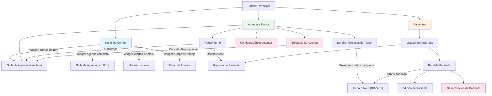

# GUÍA DE DISEÑO DE PANTALLAS — Módulo Principal (SIGEMI)

**Versión:** 2.0 (Resuelta) | **Árbitro:** spec_tie_breaker | **Fecha:** 2026-10-04

---

## 0. Propósito y cómo usar este documento

### 0.1 Qué es este documento

Este documento es una **especificación de diseño de pantallas** para las 3 secciones del módulo **Principal** del sistema SIGEMI (Sistema de Gestión de Laboratorio Micológico):

1. **Panel de Control** (dashboard)
2. **Agenda y Turnos** (módulo con 5 subpantallas)
3. **Pacientes** (módulo con 5 subpantallas)

### 0.2 Qué debe producir la LLM que consume este documento

A partir de esta guía, una LLM de diseño UI debe ser capaz de producir:

- **Wireframes o mockups** de cada pantalla y subpantalla especificada.
- **Prototipos interactivos** que respeten los flujos de trabajo paso a paso descritos.
- **Estados visuales** para cada excepción y estado vacío documentados.
- **Navegación coherente** entre pantallas según la matriz de accesos.

### 0.3 Cómo interpretar "Flujo" y "Excepciones"

| Término | Significado |
|---|---|
| **Flujo de trabajo** | Secuencia numerada de pasos que el usuario y el sistema ejecutan al interactuar con la pantalla. Cada paso indica quién actúa (usuario o sistema) y qué ocurre en la UI. |
| **Excepciones** | Comportamiento alternativo cuando algo sale del camino normal (datos no encontrados, conflictos de concurrencia, errores de validación, sin permisos). Cada excepción referencia el **paso del flujo** donde se dispara y describe **qué debe mostrar la UI**. |
| **(derivado)** | Comportamiento inferido de los UCE pero no explícitamente documentado. Requiere validación con el stakeholder. |
| **(FALTA DEFINIR)** | No hay fuente UCE ni requisito que lo respalde. Debe resolverse con el stakeholder antes de implementar. |
| **UCE–REC-XX** | Referencia al Caso de Uso Extendido correspondiente en `TF_2026_Requerimientos_KLUKA_JORGE.md`. |

### 0.4 Convenciones de formato

- Los campos **obligatorios** en formularios se marcan con `*`.
- Los **estados** de objetos usan la nomenclatura exacta de los UCE.
- Las **referencias a UCE** aparecen entre paréntesis: `(UCE–REC-20 paso 6)`.
- Las **acciones de UI** se escriben entre comillas: `"Guardar"`, `"Cancelar"`.

---

## 1. Mapa de navegación

### 1.1 Árbol del módulo Principal

```
Principal (sidebar)
├── Panel de Control                    ← Dashboard (1 pantalla)
├── Agenda y Turnos                     ← Módulo (5 subpantallas)
│   ├── Grilla de Agenda                ← Vista principal (REC-06)
│   ├── Nuevo Turno                     ← Subpantalla (REC-20)
│   ├── Detalle / Acciones de Turno     ← Subpantalla (REC-15, REC-21, REC-22)
│   ├── Configuración de Agenda         ← Subpantalla (REC-07)
│   └── Bloqueos de Agenda              ← Subpantalla (REC-08)
└── Pacientes                           ← Módulo (5 subpantallas)
    ├── Listado de Pacientes            ← Vista principal (REC-18, REC-S-01)
    ├── Perfil de Paciente              ← Subpantalla (REC-18)
    ├── Registro / Edición de Paciente  ← Subpantalla (REC-16, REC-17)
    ├── Desactivación de Paciente       ← Subpantalla (REC-19)
    └── Buscar Paciente                 ← Subflujo reutilizable (REC-S-01)
```

> **Nota:** Las subpantallas **no tienen entrada propia en el sidebar**. Se accede desde la pantalla padre del módulo correspondiente.

### 1.2 Tabla de accesos y navegación

| Pantalla / Subpantalla | Roles con acceso | Se llega desde | Navega hacia |
|---|---|---|---|
| **Panel de Control** | Bioquímico/Doctor, Administrador | Sidebar → Principal → Panel de Control | Agenda del día (widget), Agenda completa (widget), Insumos (alertas), Panel de Análisis (widget) [ACEPTADO A-10] |
| **Grilla de Agenda** | Bioquímico/Doctor, Administrador | Sidebar → Principal → Agenda y Turnos | Detalle de Turno, Nuevo Turno, Configuración, Bloqueos |
| **Nuevo Turno** | Bioquímico/Doctor, Administrador | Grilla de Agenda → botón "Nuevo Turno" | Registro de Paciente (si DNI no existe), Grilla de Agenda (al confirmar). Los datos del paciente se muestran inline en la misma subpantalla. [ACEPTADO A-03] |
| **Detalle / Acciones de Turno** | Bioquímico/Doctor, Administrador | Grilla de Agenda → clic en turno | Ficha Clínica (DIAG-01, tras marcar Presente), Grilla de Agenda (volver) |
| **Configuración de Agenda** | Administrador (leer/escribir), Bioquímico/Doctor (solo lectura — (derivado)) [ACEPTADO A-04] | Grilla de Agenda → botón "Configuración" | Grilla de Agenda (volver) |
| **Bloqueos de Agenda** | Administrador | Grilla de Agenda → botón "Bloquear Día/Franja" | Grilla de Agenda (volver) |
| **Listado de Pacientes** | Bioquímico/Doctor, Administrador | Sidebar → Principal → Pacientes | Perfil de Paciente, Registro de Paciente |
| **Perfil de Paciente** | Bioquímico/Doctor, Administrador | Listado de Pacientes → seleccionar paciente | Ficha Clínica (DIAG-01), Edición de Paciente, Desactivación (solo Admin) |
| **Registro / Edición de Paciente** | Bioquímico/Doctor, Administrador | Listado → "Nuevo Paciente" / Perfil → "Editar" | Listado de Pacientes (al guardar), Perfil de Paciente (al editar) |
| **Desactivación de Paciente** | Administrador | Perfil de Paciente → "Desactivar" | Perfil de Paciente (volver) |
| **Buscar Paciente** | Bioquímico/Doctor, Administrador | Subflujo invocado desde: Nuevo Turno, Edición, Desactivación, Grilla de Agenda | Retorna datos al UC invocante |

---

## 2. Plantilla uniforme de especificación de pantalla

Cada pantalla del documento se describe con los siguientes campos. Esta plantilla garantiza consistencia y que la LLM de diseño tenga toda la información necesaria.

| Campo | Qué va aquí |
|---|---|
| **Objetivo** | Qué resuelve esta pantalla en 1-2 líneas. |
| **Usuario principal** | Rol que más usa esta pantalla. |
| **Roles con acceso** | Todos los roles autorizados (leer / escribir). |
| **Acceso / Navegación** | Cómo se llega y hacia dónde se navega desde aquí. |
| **UCEs que cubre** | Lista de UCEs que esta pantalla implementa. |
| **Layout / Componentes** | Estructura visual: cabecera, cuerpo, paneles, tablas, formularios, modales. |
| **Datos** | Qué información se muestra (campos, columnas, indicadores). |
| **Acciones (y habilitación)** | Botones/enlaces y cuándo están habilitados o deshabilitados. |
| **Estados** | Estados del objeto principal y sus transiciones visibles en esta pantalla. |
| **Flujo de trabajo** | Pasos numerados (1, 2, 3…) con actor (Usuario/Sistema) y efecto en UI. |
| **Excepciones** | Paso del flujo → comportamiento UI alternativo. |
| **Reglas de negocio / Permisos** | Restricciones que no son excepciones (límites, políticas, validaciones). |

---

## 3. Matriz de roles × pantallas (módulo Principal)

| Pantalla / Subpantalla | Bioquímico/Doctor (ACT-01) | Profesor (ACT-02) | Administrador (ACT-03) |
|---|---|---|---|
| **Panel de Control** | Leer (todos los widgets) | **Sin acceso** (no ve datos clínicos) | Leer (todos los widgets) |
| **Grilla de Agenda** | Leer / Escribir | **Sin acceso** | Leer / Escribir |
| **Nuevo Turno** | Leer / Escribir | **Sin acceso** | Leer / Escribir |
| **Detalle / Acciones de Turno** | Leer / Escribir | **Sin acceso** | Leer / Escribir |
| **Configuración de Agenda** | **Solo lectura** (no puede guardar) — (derivado) [ACEPTADO A-04] | **Sin acceso** | Leer / Escribir |
| **Bloqueos de Agenda** | **Sin acceso** | **Sin acceso** | Leer / Escribir |
| **Listado de Pacientes** | Leer | **Sin acceso** (no ve datos clínicos) | Leer |
| **Perfil de Paciente** | Leer | **Sin acceso** (no ve datos clínicos) | Leer |
| **Registro / Edición de Paciente** | Leer / Escribir | **Sin acceso** | Leer / Escribir |
| **Desactivación de Paciente** | **Sin acceso** | **Sin acceso** | Leer / Escribir |
| **Buscar Paciente** | Leer (subflujo) | **Sin acceso** | Leer (subflujo) |

> **Regla transversal:** El Profesor (ACT-02) **no accede al módulo Principal** en absoluto. Solo interactúa con módulos de Insumos y Residuos. Esta restricción se aplica a nivel de sidebar y de rutas.

---

## 4. Especificación de pantallas

---

### 4.1 Panel de Control

| Campo | Detalle |
|---|---|
| **Objetivo** | Proveer una vista consolidada del estado operativo del laboratorio: agenda del día, carga de trabajo, alertas de stock e indicadores clave. |
| **Usuario principal** | Bioquímico/Doctor (uso diario al iniciar sesión). |
| **Roles con acceso** | Bioquímico/Doctor (leer), Administrador (leer). |
| **Acceso / Navegación** | Sidebar → Principal → Panel de Control. Desde los widgets se navega a: Agenda del día, Agenda completa, Insumos, Panel de Análisis. |
| **UCEs que cubre** | Ninguno directo. El contenido se **DERIVA** de: RF-09, UC-LAB-08, UCE–REC-06, UCE–REC-08, UCE–REC-14, UCE–REC-15, UCE–DIAG-09. |

#### Layout / Componentes

```
┌─────────────────────────────────────────────────────────────┐
│  Panel de Control                              [🔄 Actualizar]│
├─────────────────────────────────────────────────────────────┤
│  ┌─ Turnos de Hoy ───────────┐  ┌─ Carga de Trabajo ──────┐ │
│  │ Confirmados:  8           │  │ Pendiente:    12        │ │
│  │ Atendidos:    3           │  │ En proceso:    5        │ │
│  │ No asistieron: 1          │  │ Terminado:     3        │ │
│  │                           │  │ Validado:      2        │ │
│  │ [Ver agenda de hoy →]     │  │ [Ir al Panel de Análisis→]│ │
│  └───────────────────────────┘  └──────────────────────────┘ │
│  ┌─ Próximos Turnos ─────────┐  ┌─ Alertas de Stock ──────┐ │
│  │ 10:00 - García, M.        │  │ ⚠ Reactivo X: 0 unid.   │ │
│  │ 10:30 - López, A.         │  │ ⚠ Reactivo Y: vence 15d │ │
│  │ 11:00 - Pérez, R.         │  │                           │ │
│  │ [Ver agenda completa →]   │  │ [Ir a Insumos →]        │ │
│  └───────────────────────────┘  └──────────────────────────┘ │
│  ┌─ Indicadores de Agenda ───┐                                │
│  │ Franjas bloqueadas hoy: 2 │                                │
│  │ Cancelaciones por venc.: 1│                                │
│  └───────────────────────────┘                                │
└─────────────────────────────────────────────────────────────┘
```

#### Datos por widget

| Widget | Datos mostrados | Fuente UCE / Requisito | Estado |
|---|---|---|---|
| **Turnos de Hoy** | Contadores: Confirmados, Atendidos, No Asistieron. Enlace a agenda del día. | UCE–REC-06 (consulta agenda), UCE–REC-15 (registro asistencia) | ✅ Derivado de UCE |
| **Próximos Turnos** | Lista corta (máx. 5) con hora y nombre del paciente del día actual. | UCE–REC-06 | ✅ Derivado de UCE |
| **Alertas de Stock** | Lista de insumos con stock < umbral mínimo o dentro de pre-vencimiento. Umbral por defecto: stock mín = 1, pre-venc = 30 días. | RF-09, UC-LAB-08 | ✅ Derivado de UCE |
| **Carga de Trabajo** | Contadores de análisis por estado: Pendiente, En Proceso, Terminado (ámbito: análisis activos en curso, sin límite temporal), Validado (ámbito: últimos 30 días). Enlace al Panel de Análisis. (derivado — validar con stakeholder) [ACEPTADO A-08] | UCE–DIAG-09 | ✅ Derivado de UCE |
| **Indicadores de Agenda** | Franjas bloqueadas hoy (UCE–REC-08), cancelaciones por vencimiento del día (UCE–REC-14). | UCE–REC-08, UCE–REC-14 | ✅ Derivado de UCE |

#### Acciones (y habilitación)

| Acción | Habilitada para | Efecto |
|---|---|---|
| `[🔄 Actualizar]` | Todos los roles con acceso | Refresca todos los widgets desde el servidor. |
| `[Ver agenda de hoy →]` | Bioquímico/Doctor, Administrador | Navega a Grilla de Agenda con filtro "hoy". |
| `[Ver agenda completa →]` | Bioquímico/Doctor, Administrador | Navega a Grilla de Agenda sin filtro. |
| `[Ir al Panel de Análisis →]` | Bioquímico/Doctor, Administrador | Navega al módulo Laboratorio → Panel de Análisis. |
| `[Ir a Insumos →]` | Bioquímico/Doctor, Administrador | Navega al módulo Insumos → Inventario. |

#### Estados

| Estado de la pantalla | Descripción |
|---|---|
| **Carga inicial** | Se muestran spinners/skeletons en cada widget mientras se obtienen datos. |
| **Datos cargados** | Todos los widgets muestran información actualizada. |
| **Sin datos** | Widgets vacíos con mensaje descriptivo y acción de recuperación (ej. "No hay turnos para hoy"). |
| **Error de conexión** | Banner de error global con botón "Reintentar". |
| **Datos desactualizados** | Indicador visual (ej. "Última actualización: hace 5 min") si han pasado >2 min desde el último refresh. |

#### Flujo de trabajo

| Paso | Actor | Acción / Efecto en UI |
|---|---|---|
| 1 | Usuario | Ingresa al Panel de Control desde el sidebar. |
| 2 | Sistema | Muestra la estructura de widgets con indicadores de carga (skeleton/spinner). |
| 3 | Sistema | Consulta en paralelo: (a) turnos del día, (b) contadores de análisis, (c) alertas de stock, (d) indicadores de agenda. |
| 4 | Sistema | Renderiza cada widget con los datos obtenidos. Muestra timestamp de última actualización. |
| 5 | Usuario | (Opcional) Hace clic en `[🔄 Actualizar]` para refrescar datos. |
| 6 | Sistema | Re-ejecuta la consulta del paso 3 y actualiza los widgets. |
| 7 | Usuario | (Opcional) Hace clic en un enlace de navegación de un widget. |
| 8 | Sistema | Navega a la pantalla destino con el contexto/filtro correspondiente. |

#### Excepciones

| Paso | Excepción | Comportamiento UI |
|---|---|---|
| 3 | **Sin datos de turnos** (no hay turnos para hoy) | Widget "Turnos de Hoy" muestra: "No hay turnos programados para hoy" + botón `[Ver agenda completa →]`. Los demás widgets se cargan normalmente. |
| 3 | **Sin alertas de stock** | Widget "Alertas de Stock" muestra: "✅ Todos los insumos dentro de parámetros normales". |
| 3 | **Sin análisis en el laboratorio** | Widget "Carga de Trabajo" muestra: "No hay análisis en proceso" + botón `[Ir al Panel de Análisis →]`. |
| 3 | **Error de conexión en un widget** | El widget afectado muestra: "No se pudieron cargar los datos" + botón `[Reintentar]`. Los demás widgets se muestran normalmente. |
| 3 | **Error de conexión global** | Banner superior: "Error de conexión. Verifique su red." + botón `[Reintentar]` que re-ejecuta el paso 3. |
| 3 | **Sin permisos para un widget** | El widget se oculta completamente (no se muestra placeholder). Ej: si un rol futuro no puede ver stock. |
| 4 | **Datos desactualizados** (>2 min) | Se muestra indicador: "📡 Última actualización: hace X min". Si >10 min, el texto cambia a color ámbar. |
| 7 | **Clic en enlace sin permisos en destino** | Se muestra toast: "No tiene permisos para acceder a esta sección". |

#### Reglas de negocio / Permisos

- El Panel de Control es **solo lectura**. No hay acciones de escritura.
- Los contadores se calculan en tiempo real al cargar la pantalla (no se cachean por más de 2 minutos).
- Los umbrales de alerta de stock son configurables por el Administrador (UC-LAB-08). Valores por defecto: stock mínimo = 1 unidad, pre-vencimiento = 30 días.
- **(derivado — validar con stakeholder):** La lista de "Próximos Turnos" muestra máximo 5 registros. Si hay más, el enlace "Ver agenda completa" lleva a la grilla filtrada por hoy.
- **(derivado — validar con stakeholder):** El refresh automático se ejecuta cada 2 minutos si la pestaña está activa.
- **(derivado — validar con stakeholder):** Los contadores Pendiente, En Proceso y Terminado del widget "Carga de Trabajo" incluyen todos los análisis activos en curso (sin límite temporal). El contador "Validado" incluye solo los análisis validados en los últimos 30 días. [ACEPTADO A-08]

---

### 4.2 Agenda y Turnos (módulo)

---

#### 4.2.a Grilla de Agenda

| Campo | Detalle |
|---|---|
| **Objetivo** | Visualizar la agenda del laboratorio en vistas día/semana/mes, con filtros por DNI y estado, y acceso a todas las operaciones de gestión de turnos. |
| **Usuario principal** | Bioquímico/Doctor. |
| **Roles con acceso** | Bioquímico/Doctor (leer/escribir), Administrador (leer/escribir). |
| **Acceso / Navegación** | Sidebar → Principal → Agenda y Turnos. Desde aquí se accede a: Nuevo Turno, Detalle de Turno, Configuración, Bloqueos. |
| **UCEs que cubre** | UCE–REC-06 (Consultar Agenda). |

##### Layout / Componentes

```
┌──────────────────────────────────────────────────────────────────────┐
│  Agenda y Turnos                                                     │
│  [◀ Día anterior]  [Hoy]  [Día siguiente ▶]   [📅 Día|Semana|Mes]   │
│  [🔍 Buscar DNI...]  [Estado: Todos ▼]  [+ Nuevo Turno] [⚙ Config]  │
├──────────────────────────────────────────────────────────────────────┤
│  Lunes 15 de Septiembre 2026                                         │
│  ┌────────┬──────────────────────────────────────────────────────┐   │
│  │ 08:00  │ 🟢 García, María — DNI 12345678 — KLM               │   │
│  │        │ [Ver detalle] [Marcar asistencia]                    │   │
│  ├────────┼──────────────────────────────────────────────────────┤   │
│  │ 08:30  │ ⬜ Disponible                                        │   │
│  │        │ [+ Agendar]                                          │   │
│  ├────────┼──────────────────────────────────────────────────────┤   │
│  │ 09:00  │ 🔒 BLOQUEADO — Motivo: Mantenimiento                │   │
│  ├────────┼──────────────────────────────────────────────────────┤   │
│  │ 09:30  │ 🟡 López, Ana — DNI 87654321 — DMS                  │   │
│  │        │ [Ver detalle] [Marcar asistencia]                    │   │
│  ├────────┼──────────────────────────────────────────────────────┤   │
│  │ 10:00  │ ⬜ Disponible                                        │   │
│  │        │ [+ Agendar]                                          │   │
│  └────────┴──────────────────────────────────────────────────────┘   │
│                                                                      │
│  Leyenda: 🟢 Confirmado  🟡 Pendiente  🔴 Cancelado  🔒 Bloqueado   │
│           ⬜ Disponible   🟣 Atendido    ⚫ No Asistió  🔵 Reprogramado│
└──────────────────────────────────────────────────────────────────────┘
```
[ACEPTADO A-07]

##### Datos

| Elemento | Detalle |
|---|---|
| **Bloques horarios** | Generados según configuración de agenda (REC-07): hora inicio, hora fin, intervalo. |
| **Turno asignado** | Nombre del paciente, DNI, tipo de análisis (KLM = Keratina/Lana/Mucosa, DMS = Directo/Microscopía/Sembrado, etc.), estado. |
| **Bloque libre** | Sin asignación. Muestra botón `[+ Agendar]`. |
| **Bloque bloqueado** | Marcado como NO DISPONIBLE con motivo visible. |

##### Acciones (y habilitación)

| Acción | Habilitada para | Efecto |
|---|---|---|
| `[+ Nuevo Turno]` | Bioquímico/Doctor, Administrador | Abre subpantalla Nuevo Turno. |
| `[⚙ Config]` | Solo Administrador | Abre subpantalla Configuración de Agenda. |
| `[🔒 Bloquear Día/Franja]` | Solo Administrador | Abre subpantalla Bloqueos de Agenda. |
| `[Ver detalle]` | Bioquímico/Doctor, Administrador | Abre subpantalla Detalle/Acciones de Turno. |
| `[Marcar asistencia]` | Bioquímico/Doctor, Administrador | Abre diálogo Presente/Ausente (atajo directo desde la grilla). |
| `[+ Agendar]` (en bloque libre) | Bioquímico/Doctor, Administrador | Abre Nuevo Turno pre-seleccionando fecha y hora del bloque. |
| `[◀/▶]` Navegación de fecha | Todos | Cambia la fecha visible en la grilla. |
| `[Hoy]` | Todos | Vuelve a la fecha actual. |
| Filtro DNI | Todos | Filtra la grilla mostrando solo turnos del DNI ingresado. |
| Filtro Estado | Todos | Filtra por: Confirmado, Pendiente, Atendido, No Asistió, Cancelado, Reprogramado. [ACEPTADO A-07] |

##### Estados

| Estado | Descripción |
|---|---|
| **Carga** | Skeleton de la grilla mientras se obtienen datos (<2s según RNF de REC-06). |
| **Agenda vacía** (sin turnos ni bloqueos) | Mensaje: "No hay turnos para esta fecha" + botón `[+ Nuevo Turno]`. |
| **Sin datos** (error de carga) | Mensaje: "No se pudo cargar la agenda" + botón `[Reintentar]`. |
| **Con datos** | Grilla renderizada con bloques coloreados por estado. |

##### Flujo de trabajo

| Paso | Actor | Acción / Efecto en UI |
|---|---|---|
| 1 | Usuario | Ingresa al módulo Agenda y Turnos desde el sidebar. |
| 2 | Sistema | Carga la grilla con la vista "Día" y la fecha actual. Consulta bloques ocupados, libres y bloqueados (UCE–REC-06 paso 2). |
| 3 | Sistema | Renderiza la grilla con los bloques horarios y su estado visual (UCE–REC-06 paso 3). |
| 4 | Usuario | (Opcional) Aplica filtros por DNI o estado (UCE–REC-06 paso 4). |
| 5 | Sistema | Actualiza la grilla con los resultados filtrados. |
| 6 | Usuario | (Opcional) Navega entre fechas con `[◀]` / `[▶]` o selecciona vista Día/Semana/Mes. |
| 7 | Sistema | Recarga la grilla con los datos de la nueva fecha/vista. |
| 8 | Usuario | (Opcional) Selecciona un turno para ver detalle o marcar asistencia. |
| 9 | Sistema | Navega a la subpantalla correspondiente o abre el diálogo de asistencia. |

##### Excepciones

| Paso | Excepción | Comportamiento UI |
|---|---|---|
| 2 | **Tiempos de carga >2s** | Se muestra spinner con texto "Cargando agenda…" (RNF: REC-06 paso 3 <2s). Si >5s, mostrar "La carga está tardando más de lo esperado". |
| 2 | **Sin turnos para la fecha** | Grilla muestra solo bloques libres con `[+ Agendar]`. Mensaje superior: "No hay turnos asignados para esta fecha". |
| 2 | **Error de conexión** | Banner: "No se pudo cargar la agenda. Verifique su conexión." + botón `[Reintentar]`. |
| 4 | **Filtro DNI sin resultados** | Grilla vacía con mensaje: "No se encontraron turnos para el DNI ingresado". |
| 4 | **Filtro Estado sin resultados** | Grilla vacía con mensaje: "No hay turnos con el estado seleccionado". |

##### Reglas de negocio / Permisos

- La vista por defecto es **Día** con la **fecha actual**.
- Los bloques se generan según la configuración de días/horarios hábiles (REC-07).
- El botón `[⚙ Config]` y `[🔒 Bloquear]` solo son visibles para Administrador.
- **(derivado — validar con stakeholder):** La vista Semana muestra 5 días hábiles (lunes a viernes). La vista Mes muestra un calendario con indicadores de cantidad de turnos por día.

---

#### 4.2.b Nuevo Turno

| Campo | Detalle |
|---|---|
| **Objetivo** | Permitir al personal autorizado agendar un turno manualmente desde la interfaz web interna. |
| **Usuario principal** | Bioquímico/Doctor. |
| **Roles con acceso** | Bioquímico/Doctor (escribir), Administrador (escribir). |
| **Acceso / Navegación** | Desde Grilla de Agenda → botón `[+ Nuevo Turno]` o `[+ Agendar]` en bloque libre. Vuelve a Grilla de Agenda al confirmar o cancelar. |
| **UCEs que cubre** | UCE–REC-20 (Agendar Turno Manualmente), con extensión UCE–REC-16 (si DNI no existe), include UCE–REC-S-01 (Buscar Paciente). |

##### Layout / Componentes

```
┌──────────────────────────────────────────────────────┐
│  Nuevo Turno                               [✕ Cerrar]│
├──────────────────────────────────────────────────────┤
│  Paso 1: Identificar Paciente                        │
│  ┌────────────────────────────────────────────────┐  │
│  │ DNI del paciente: [____________] [🔍 Buscar]   │  │
│  │                                                 │  │
│  │ Resultado: García, María — DNI 12345678        │  │
│  │ Teléfono: 11-1234-5678 | Obra Social: OSDE     │  │
│  └────────────────────────────────────────────────┘  │
│                                                      │
│  Paso 2: Seleccionar Fecha y Horario                 │
│  ┌────────────────────────────────────────────────┐  │
│  │ Fecha: [15/09/2026 📅]                         │  │
│  │                                                 │  │
│  │ Disponibilidad:                                 │  │
│  │ 08:00 ⬜  08:30 ⬜  09:00 🔒  09:30 🟢         │  │
│  │ 10:00 ⬜  10:30 ⬜  11:00 ⬜  11:30 🔒          │  │
│  │ 14:00 ⬜  14:30 ⬜  15:00 ⬜  15:30 ⬜          │  │
│  └────────────────────────────────────────────────┘  │
│                                                      │
│  Paso 3: Tipo de Análisis                            │
│  ┌────────────────────────────────────────────────┐  │
│  │ Tipo: [Seleccionar tipo ▼]                     │  │
│  │   • KLM (Keratina, Lana, Mucosa)               │  │
│  │   • DMS (Directo, Microscopía, Sembrado)       │  │
│  │   • CH (Cultivo Hongos)                        │  │
│  └────────────────────────────────────────────────┘  │
│                                                      │
│  [← Volver]                    [Confirmar Turno →]   │
└──────────────────────────────────────────────────────┘
```

##### Datos

| Campo | Obligatorio | Fuente |
|---|---|---|
| DNI del paciente | * | UCE–REC-20 paso 2-3 |
| Nombre del paciente | (auto) | Se completa al encontrar el DNI |
| Fecha | * | UCE–REC-20 paso 6 |
| Horario | * | UCE–REC-20 paso 6 |
| Tipo de análisis | * | UCE–REC-20 paso 6 |

##### Acciones (y habilitación)

| Acción | Habilitada cuando | Efecto |
|---|---|---|
| `[🔍 Buscar]` | DNI ingresado (mínimo 7 dígitos) | Busca paciente en BD (UCE–REC-S-01). |
| `[📅]` Selector de fecha | Siempre | Abre calendario para elegir fecha. |
| Selección de horario | Solo en bloques ⬜ (disponibles) | Resalta el horario seleccionado. |
| `[Confirmar Turno →]` | DNI válido + paciente encontrado + fecha + horario + tipo seleccionados | Registra el turno (UCE–REC-20 paso 8). |
| `[← Volver]` | Siempre | Cancela y vuelve a Grilla de Agenda sin guardar. |
| `[✕ Cerrar]` | Siempre | Cierra la subpantalla y vuelve a Grilla de Agenda. |

##### Estados

| Estado | Descripción |
|---|---|
| **Paso 1 activo** | Esperando ingreso de DNI. |
| **Paciente encontrado** | Muestra datos del paciente. Habilita Paso 2. |
| **Paciente no encontrado** | Muestra opciones: `[Registrar nuevo paciente]` (dispara REC-16) y `[Buscar otro DNI]` (limpia campo). [ACEPTADO A-02] |
| **Paso 2 activo** | Grilla de disponibilidad cargada. |
| **Paso 3 activo** | Selector de tipo de análisis habilitado. |
| **Confirmación exitosa** | Toast: "Turno registrado exitosamente" + redirección a Grilla de Agenda. |

##### Flujo de trabajo

| Paso | Actor | Acción / Efecto en UI | Referencia UCE |
|---|---|---|---|
| 1 | Usuario | Ingresa DNI del paciente en el campo de búsqueda. | UCE–REC-20 paso 2-3 |
| 2 | Usuario | Presiona `[🔍 Buscar]` o presiona Enter. | UCE–REC-20 paso 3 |
| 3 | Sistema | Busca el DNI en la base de datos. | UCE–REC-20 paso 4, UCE–REC-S-01 |
| 4a | Sistema | **DNI encontrado:** muestra nombre, teléfono, obra social. Habilita Paso 2. | UCE–REC-S-01 paso 4a |
| 4b | Sistema | **DNI no existe:** muestra "Paciente no registrado" con dos opciones: `[Registrar nuevo paciente]` (abre REC-16) y `[Buscar otro DNI]` (limpia campo). [ACEPTADO A-02] | UCE–REC-20 paso 4 (ext. REC-16) |
| 5 | Usuario | (Si 4b) Presiona `[Registrar nuevo paciente]`. Se abre formulario REC-16. Al completar exitosamente, retorna al Paso 6. **(Nota de trazabilidad: corresponde a UCE–REC-20 excepción paso 4: retorna a mostrar disponibilidad.)** [ACEPTADO A-09] | UCE–REC-20 excepción paso 4 |
| 6 | Sistema | Carga la grilla de disponibilidad horaria para la fecha actual (o la fecha pre-seleccionada si vino de un bloque libre). | UCE–REC-20 paso 5 |
| 7 | Usuario | Selecciona fecha (si desea cambiar), horario disponible y tipo de análisis. | UCE–REC-20 paso 6 |
| 8 | Usuario | Presiona `[Confirmar Turno →]`. | UCE–REC-20 paso 7 |
| 9 | Sistema | Registra el turno con estado "Confirmado", envía notificación WhatsApp, programa recordatorio, registra auditoría. | UCE–REC-20 pasos 8-11 |
| 10 | Sistema | Muestra toast "Turno registrado exitosamente" y redirige a Grilla de Agenda. | UCE–REC-20 paso 12 |

##### Excepciones

| Paso | Excepción | Comportamiento UI | Referencia UCE |
|---|---|---|---|
| 2 | **DNI inválido** (formato incorrecto, <7 dígitos, no numérico) | Muestra alerta inline: "Ingrese un DNI válido (solo números, mínimo 7 dígitos)". No ejecuta búsqueda. | (derivado de UCE–REC-01 excepción paso 3) |
| 3 | **Error de conexión** al buscar DNI | Muestra "Error al buscar. Intente nuevamente." + botón `[Reintentar]`. | (derivado) |
| 4b | **DNI no existe** | Muestra "Paciente no registrado" con dos opciones: `[Registrar nuevo paciente]` (abre REC-16) o `[Buscar otro DNI]` (limpia campo). [ACEPTADO A-02] | UCE–REC-20 excepción paso 4 |
| 5 | **Error al registrar nuevo paciente** | Muestra error y permite reintentar o cancelar. No avanza al Paso 6. | UCE–REC-16 excepción paso 5 |
| 7 | **Franja ocupada entre consulta y confirmación** (condición de carrera) | Muestra "El horario seleccionado ya no está disponible". Refresca la grilla de disponibilidad. El usuario debe seleccionar otro horario. | UCE–REC-20 excepción paso 6 |
| 8 | **Campos incompletos** al confirmar | Botón `[Confirmar Turno →]` deshabilitado. Si se fuerza (ej. por accesibilidad), muestra "Complete todos los campos obligatorios". | (derivado) |
| 9 | **Error de base de datos** al registrar | Muestra "Error al registrar el turno. Los datos no se guardaron." + botón `[Reintentar]`. No se crea turno parcial. | UCE–REC-20 excepción paso 8 |

##### Reglas de negocio / Permisos

- El turno se crea con estado **"Confirmado"** (UCE–REC-20 paso 8).
- Se envía notificación WhatsApp al paciente automáticamente (UCE–REC-20 paso 9).
- Se programa recordatorio de asistencia (UCE–REC-20 paso 10).
- Si el paciente viene de un bloque libre pre-seleccionado, la fecha y hora ya están cargadas.
- **(derivado — validar con stakeholder):** Si el paciente tiene datos incompletos (alta temprana vía WhatsApp), se muestra un aviso: "⚠️ Este paciente tiene datos incompletos. Se podrán completar al registrar asistencia."

---

#### 4.2.c Detalle / Acciones de Turno

| Campo | Detalle |
|---|---|
| **Objetivo** | Ver el detalle de un turno y ejecutar acciones: registrar asistencia (presente/ausente), cancelar o reprogramar. |
| **Usuario principal** | Bioquímico/Doctor. |
| **Roles con acceso** | Bioquímico/Doctor (leer/escribir), Administrador (leer/escribir). |
| **Acceso / Navegación** | Desde Grilla de Agenda → clic en un turno → `[Ver detalle]`. Vuelve a Grilla de Agenda. Desde "Presente" puede navegar a Ficha Clínica (DIAG-01). |
| **UCEs que cubre** | UCE–REC-15 (Registrar Asistencia), UCE–REC-21 (Cancelar Turno Manualmente), UCE–REC-22 (Reprogramar Turno Manualmente). |

##### Layout / Componentes

```
┌──────────────────────────────────────────────────────────────┐
│  Detalle del Turno                                [✕ Cerrar] │
├──────────────────────────────────────────────────────────────┤
│  Paciente: García, María                                     │
│  DNI: 12345678                                               │
│  Fecha: Lunes 15/09/2026 — 08:00                             │
│  Tipo de análisis: KLM (Keratina, Lana, Mucosa)              │
│  Estado: 🟢 Confirmado                                       │
│  Origen: Agendado vía WhatsApp (Agente IA)                   │
│  Recordatorio programado: ✅ Sí                              │
├──────────────────────────────────────────────────────────────┤
│  Acciones disponibles:                                       │
│  ┌─────────────────┐ ┌─────────────────┐ ┌─────────────────┐ │
│  │ ✅ Registrar    │ │ ❌ Cancelar     │ │ 📅 Reprogramar  │ │
│  │    Asistencia   │ │    Turno        │ │    Turno        │ │
│  └─────────────────┘ └─────────────────┘ └─────────────────┘ │
└──────────────────────────────────────────────────────────────┘
```

##### Acciones (y habilitación)

| Acción | Habilitada cuando | Efecto |
|---|---|---|
| `[✅ Registrar Asistencia]` | Turno en estado "Confirmado" o "Pendiente" del día actual. | Abre diálogo Presente/Ausente (UCE–REC-15 paso 3). |
| `[❌ Cancelar Turno]` | Turno en estado "Confirmado" o "Pendiente". | Abre diálogo de confirmación (UCE–REC-21 paso 4). |
| `[📅 Reprogramar Turno]` | Turno en estado "Confirmado" o "Pendiente". | Abre flujo de reprogramación (UCE–REC-22). |
| `[✕ Cerrar]` | Siempre | Vuelve a Grilla de Agenda. |

##### Estados del turno y transiciones visibles

| Estado actual | Acciones habilitadas | Transición posible |
|---|---|---|
| **Confirmado** | Asistencia, Cancelar, Reprogramar | → Atendido (Presente), → No Asistió (Ausente), → Cancelado, → Confirmado (nueva fecha) |
| **Pendiente** | Asistencia, Cancelar, Reprogramar | → Atendido, → No Asistió, → Cancelado, → Confirmado (nueva fecha) |
| **Atendido** | Ninguna (bloqueado) | — |
| **No Asistió** | Ninguna (bloqueado) | — |
| **Cancelado** | Ninguna (bloqueado) | — |

##### Flujo de trabajo — Registrar Asistencia (Presente)

| Paso | Actor | Acción / Efecto en UI | Referencia UCE |
|---|---|---|---|
| 1 | Usuario | Desde la Grilla de Agenda o desde Detalle, presiona `[Registrar Asistencia]`. | UCE–REC-15 paso 1-2 |
| 2 | Sistema | Muestra diálogo con opciones "Presente" y "Ausente". | UCE–REC-15 paso 3 |
| 3 | Usuario | Selecciona "Presente". | UCE–REC-15 paso 4 |
| 4 | Sistema | Cambia estado del turno a "Atendido", registra hora de atención. | UCE–REC-15 paso 5 |
| 5 | Sistema | Verifica si el paciente tiene datos demográficos incompletos. | UCE–REC-15 paso 6 |
| 5.1 | Sistema | **Si hay datos incompletos:** muestra formulario ligero (dirección, obra social, etc.) pre-poblado con datos existentes. El usuario completa y guarda. | UCE–REC-15 paso 6 (modificado v2) |
| 6 | Sistema | Registra evento en auditoría. | UCE–REC-15 paso 7 |
| 7 | Sistema | Confirma operación y habilita botón `[Iniciar Consulta →]` (navega a Ficha Clínica / DIAG-01). | UCE–REC-15 paso 8 |

##### Flujo de trabajo — Registrar Asistencia (Ausente)

| Paso | Actor | Acción / Efecto en UI | Referencia UCE |
|---|---|---|---|
| 1-2 | Usuario/Sistema | Igual que secuencia Presente (pasos 1-2). | UCE–REC-15 |
| 3 | Usuario | Selecciona "Ausente". | UCE–REC-15 sec. Ausente paso 2 |
| 4 | Sistema | Solicita motivo opcional de inasistencia (campo de texto). | UCE–REC-15 sec. Ausente paso 3 |
| 5 | Usuario | Ingresa motivo (opcional) y confirma. | UCE–REC-15 sec. Ausente paso 4 |
| 6 | Sistema | Cambia estado a "No Asistió", libera bloque horario. | UCE–REC-15 sec. Ausente paso 5 |
| 7 | Sistema | Dispara UCE–REC-04 (Reasignación Automática). | UCE–REC-15 sec. Ausente paso 6 |
| 8 | Sistema | Registra evento en auditoría. | UCE–REC-15 sec. Ausente paso 7 |
| 9 | Sistema | Confirma operación. Vuelve a Grilla de Agenda. | — |

##### Flujo de trabajo — Cancelar Turno

| Paso | Actor | Acción / Efecto en UI | Referencia UCE |
|---|---|---|---|
| 1 | Usuario | Desde Detalle, presiona `[Cancelar Turno]`. | UCE–REC-21 paso 3 |
| 2 | Sistema | Muestra diálogo de confirmación: "¿Está seguro de cancelar el turno de [Paciente] el [fecha] a las [hora]?". | UCE–REC-21 paso 4 |
| 2.1 | Sistema | **Si el turno está a <24h:** agrega advertencia: "⚠️ El turno está a menos de 24 horas. ¿Desea cancelar de todas formas?" Requiere confirmación explícita adicional (checkbox o segundo botón). | UCE–REC-21 excepción paso 2 |
| 3 | Usuario | Confirma la cancelación. | UCE–REC-21 paso 5 |
| 4 | Sistema | Cambia estado a "Cancelado", libera bloque, notifica WhatsApp, dispara REC-04, registra auditoría. | UCE–REC-21 pasos 6-10 |
| 5 | Sistema | Muestra "Turno cancelado exitosamente". Vuelve a Grilla de Agenda. | UCE–REC-21 paso 11 |

##### Flujo de trabajo — Reprogramar Turno

| Paso | Actor | Acción / Efecto en UI | Referencia UCE |
|---|---|---|---|
| 1 | Usuario | Desde Detalle, presiona `[Reprogramar Turno]`. | UCE–REC-22 paso 3 |
| 2 | Sistema | Verifica cantidad de reprogramaciones previas del turno. | UCE–REC-22 paso 4 |
| 2.1 | Sistema | **Si ya fue reprogramado 2 veces:** muestra advertencia "El turno alcanzó el límite de reprogramaciones. ¿Desea reprogramar de forma excepcional?" Requiere confirmación de Administrador. | UCE–REC-22 excepción paso 4 |
| 3 | Sistema | Muestra grilla de disponibilidad horaria. | UCE–REC-22 paso 5 |
| 4 | Usuario | Selecciona nueva fecha y hora. | UCE–REC-22 paso 6 |
| 5 | Sistema | Valida que la franja esté disponible. | UCE–REC-22 paso 7 |
| 5.1 | Sistema | **Si la franja fue ocupada:** notifica "La franja seleccionada ya no está disponible" y solicita nueva selección. | UCE–REC-22 excepción paso 7 |
| 6 | Sistema | Actualiza turno con nueva fecha/hora, libera bloque original, notifica WhatsApp, dispara REC-04, registra auditoría. | UCE–REC-22 pasos 8-12 |
| 7 | Sistema | Muestra "Turno reprogramado exitosamente". Vuelve a Grilla de Agenda. | UCE–REC-22 paso 13 |

##### Excepciones

| Paso | Excepción | Comportamiento UI | Referencia UCE |
|---|---|---|---|
| 1 | **Turno ya marcado** (estado Atendido/No Asistió/Cancelado) | Muestra "Este turno ya fue procesado y no puede modificarse." Acciones deshabilitadas. | UCE–REC-15 excepción paso 2 |
| 2.1 | **Cancelación <24h sin confirmación extra** | El botón "Confirmar" permanece deshabilitado hasta que el usuario marque el checkbox de confirmación adicional. | UCE–REC-21 excepción paso 2 |
| 3 | **Usuario cancela la confirmación** | Se aborta la operación sin modificar el turno. Diálogo se cierra. | UCE–REC-21 excepción paso 5 |
| 2.1 | **Reprogramación >2 veces sin ser Admin** | Si el usuario no es Administrador, el botón "Reprogramar excepcionalmente" está deshabilitado. Solo Admin puede confirmar. | UCE–REC-22 excepción paso 4 |
| 5.1 | **Franja ocupada al reprogramar** | Muestra notificación y refresca la grilla. El usuario debe seleccionar otro horario. | UCE–REC-22 excepción paso 7 |

##### Reglas de negocio / Permisos

- Un turno solo puede marcarse **una vez**. Una vez marcado (Atendido o No Asistió), las acciones se bloquean permanentemente.
- La cancelación manual <24h requiere **confirmación adicional explícita** (UCE–REC-21 excepción paso 2).
- El límite de reprogramaciones es **2**. A partir de la 3ra, se requiere rol de Administrador (UCE–REC-22 excepción paso 4).
- Al marcar "Presente", si el paciente tiene datos incompletos, se muestra el formulario de completitud demográfica **antes** de habilitar la consulta clínica (UCE–REC-15 paso 6).
- Al marcar "Ausente", el motivo es **opcional** pero el bloque se libera igual y dispara REC-04.

---

#### 4.2.d Configuración de Agenda

| Campo | Detalle |
|---|---|
| **Objetivo** | Permitir al Administrador definir los parámetros generales de la agenda: días/horarios hábiles, duración de turnos, intervalos, recesos e inhábiles. |
| **Usuario principal** | Administrador. |
| **Roles con acceso** | Administrador (leer/escribir). Bioquímico/Doctor (solo lectura, sin botón guardar) — (derivado — validar con stakeholder). [ACEPTADO A-04] |
| **Acceso / Navegación** | Desde Grilla de Agenda → botón `[⚙ Config]`. Vuelve a Grilla de Agenda al guardar o cancelar. |
| **UCEs que cubre** | UCE–REC-07 (Configurar Parámetros de Agenda). |

##### Layout / Componentes

```
┌──────────────────────────────────────────────────────────────┐
│  Configuración de Agenda                          [✕ Cerrar] │
├──────────────────────────────────────────────────────────────┤
│  Días hábiles:                                                │
│  ☑ Lunes  ☑ Martes  ☑ Miércoles  ☑ Jueves  ☑ Viernes        │
│  ☐ Sábado  ☐ Domingo                                         │
│                                                               │
│  Horarios de atención:                                        │
│  Mañana: [08:00] a [12:00]                                    │
│  Tarde:  [14:00] a [18:00]                                    │
│                                                               │
│  Duración estándar del turno: [30] minutos                    │
│  Intervalo entre turnos: [0] minutos                          │
│                                                               │
│  Períodos de receso / inhábiles:                              │
│  ┌────────────────────────────────────────────────────────┐  │
│  │ Fecha          | Motivo               | Acciones        │  │
│  │ 25/12/2026     | Navidad              | [Editar][Eliminar]│ │
│  │ 01/01/2027     | Año Nuevo            | [Editar][Eliminar]│ │
│  └────────────────────────────────────────────────────────┘  │
│  [+ Agregar feriado/receso]                                   │
│                                                               │
│  [Cancelar]                              [Guardar Configuración]│
└──────────────────────────────────────────────────────────────┘
```

##### Datos

| Campo | Obligatorio | Valor por defecto |
|---|---|---|
| Días hábiles | * (al menos 1) | Lunes a Viernes |
| Horario mañana inicio | * | 08:00 |
| Horario mañana fin | * | 12:00 |
| Horario tarde inicio | (opcional) | 14:00 |
| Horario tarde fin | (obligatorio si tarde inicio está definido) | 18:00 |
| Duración del turno | * | 30 minutos |
| Intervalo entre turnos | * | 0 minutos |
| Feriados/recesos | (lista opcional) | Vacía |

##### Acciones (y habilitación)

| Acción | Habilitada para | Efecto |
|---|---|---|
| `[Guardar Configuración]` | Solo Administrador, con datos válidos | Persiste configuración, registra auditoría (UCE–REC-07 pasos 7-8). |
| `[Cancelar]` | Todos | Descarta cambios y vuelve a Grilla de Agenda. |
| `[+ Agregar feriado/receso]` | Solo Administrador | Abre formulario para agregar fecha + motivo. |
| `[Editar]` / `[Eliminar]` en feriados | Solo Administrador | Modifica o elimina un feriado de la lista. |

##### Estados

| Estado | Descripción |
|---|---|
| **Carga** | Formulario pre-poblado con valores actuales. |
| **Modificado** | Campos editados se resaltan. Botón `[Guardar]` habilitado. |
| **Guardado** | Toast "Configuración guardada exitosamente" + redirección a Grilla de Agenda. |
| **Error de validación** | Campos inválidos resaltados en rojo con mensaje de error inline. |

##### Flujo de trabajo

| Paso | Actor | Acción / Efecto en UI | Referencia UCE |
|---|---|---|---|
| 1 | Usuario | Ingresa a Configuración de Agenda desde la Grilla. | UCE–REC-07 paso 1 |
| 2 | Sistema | Despliega formulario con valores actuales. | UCE–REC-07 paso 2 |
| 3 | Usuario | Define días hábiles y horarios de atención. | UCE–REC-07 paso 3 |
| 4 | Usuario | Configura duración estándar del turno e intervalo. | UCE–REC-07 paso 4 |
| 5 | Usuario | Define períodos de receso o inhábiles (feriados). | UCE–REC-07 paso 5 |
| 6 | Usuario | Presiona `[Guardar Configuración]`. | UCE–REC-07 paso 6 |
| 7 | Sistema | Valida consistencia de horarios y duraciones. | UCE–REC-07 paso 7 |
| 8 | Sistema | Persiste los cambios y registra en auditoría. | UCE–REC-07 pasos 7-8 |
| 9 | Sistema | Muestra "Configuración guardada exitosamente". | UCE–REC-07 paso 9 |

##### Excepciones

| Paso | Excepción | Comportamiento UI | Referencia UCE |
|---|---|---|---|
| 7 | **Horarios inconsistentes** (hora fin < hora inicio, duración > franja horaria, etc.) | Muestra alerta de validación inline en los campos afectados. No persiste. Ej: "La hora de fin (10:00) es menor que la hora de inicio (14:00)." | UCE–REC-07 excepción paso 7 |
| 7 | **Sin días hábiles seleccionados** | Muestra "Debe seleccionar al menos un día hábil." No persiste. | (derivado) |
| 7 | **Duración de turno inválida** (≤0 o > franja) | Muestra "La duración del turno debe ser mayor a 0 y menor que la franja horaria." | (derivado) |
| 8 | **Error de base de datos** | Muestra "Error al guardar la configuración. Intente nuevamente." No persiste cambios parciales. | (derivado) |

##### Reglas de negocio / Permisos

- Solo el **Administrador** puede guardar cambios. Bioquímico/Doctor ve la configuración en modo solo lectura — (derivado — validar con stakeholder). [ACEPTADO A-04]
- Los cambios afectan inmediatamente la disponibilidad calculada por el Agente IA y la Grilla de Agenda.
- **(derivado — validar con stakeholder):** Si se reduce la duración del turno, los turnos ya agendados no se modifican. La nueva duración aplica solo a turnos futuros.

---

#### 4.2.e Bloqueos de Agenda

| Campo | Detalle |
|---|---|
| **Objetivo** | Permitir al Administrador bloquear o desbloquear días completos o franjas horarias específicas, inhabilitando la asignación de turnos. |
| **Usuario principal** | Administrador. |
| **Roles con acceso** | Administrador (leer/escribir). |
| **Acceso / Navegación** | Desde Grilla de Agenda → botón `[🔒 Bloquear Día/Franja]`. Vuelve a Grilla de Agenda. |
| **UCEs que cubre** | UCE–REC-08 (Bloquear/Desbloquear Días y Franjas Horarias). |

##### Layout / Componentes

```
┌──────────────────────────────────────────────────────────────┐
│  Bloqueos de Agenda                               [✕ Cerrar] │
├──────────────────────────────────────────────────────────────┤
│  Tipo de bloqueo:  ☑ Día completo   ☐ Franja horaria        │
│                                                               │
│  Si "Día completo":                                          │
│  Fecha: [15/09/2026 📅]                                      │
│                                                               │
│  Si "Franja horaria":                                        │
│  Fecha: [15/09/2026 📅]                                      │
│  Desde: [09:00]  Hasta: [12:00]                              │
│                                                               │
│  Motivo del bloqueo: *                                        │
│  [________________________________________________________]  │
│  [________________________________________________________]  │
│                                                               │
│  ⚠️ Este período tiene 3 turnos activos.                     │
│     [Cancelar turnos afectados] [Reprogramar turnos]          │
│                                                               │
│  [Cancelar]                              [Confirmar Bloqueo] │
└──────────────────────────────────────────────────────────────┘
```

##### Datos

| Campo | Obligatorio | Detalle |
|---|---|---|
| Tipo de bloqueo | * | Día completo o Franja horaria |
| Fecha | * | Día a bloquear |
| Franja desde/hasta | * (si franja horaria) | Rango horario |
| Motivo | * | Texto libre (mínimo 10 caracteres) |

##### Acciones (y habilitación)

| Acción | Habilitada cuando | Efecto |
|---|---|---|
| `[Confirmar Bloqueo]` | Todos los campos obligatorios completos + sin turnos activos (o turnos cancelados/reprogramados) | Marca bloques como NO DISPONIBLES, registra auditoría. |
| `[Cancelar turnos afectados]` | Cuando hay turnos activos en el período | Cancela los turnos uno por uno (con confirmación). |
| `[Reprogramar turnos]` | Cuando hay turnos activos en el período | Abre flujo de reprogramación para cada turno afectado. |
| `[Desbloquear]` | En vista de bloqueos existentes | Libera el bloqueo y restaura disponibilidad. |

##### Estados

| Estado | Descripción |
|---|---|
| **Formulario limpio** | Esperando selección de tipo y fecha. |
| **Con turnos activos detectados** | Muestra advertencia y opciones de resolución. `[Confirmar Bloqueo]` deshabilitado. |
| **Turnos resueltos** | Advertencia desaparece. `[Confirmar Bloqueo]` habilitado. |
| **Bloqueo confirmado** | Toast "Bloqueo aplicado exitosamente" + redirección a Grilla de Agenda. |

##### Flujo de trabajo — Bloquear

| Paso | Actor | Acción / Efecto en UI | Referencia UCE |
|---|---|---|---|
| 1 | Usuario | Ingresa a Bloqueos de Agenda y selecciona "Bloquear Día/Franja". | UCE–REC-08 paso 1 |
| 2 | Sistema | Muestra calendario mensual con turnos existentes. | UCE–REC-08 paso 2 |
| 3 | Usuario | Selecciona día o rango de fechas. | UCE–REC-08 paso 3 |
| 4 | Usuario | Elige: día completo o franja horaria específica. | UCE–REC-08 paso 4 |
| 5 | Usuario | Ingresa motivo del bloqueo y presiona "Confirmar Bloqueo". | UCE–REC-08 paso 5 |
| 6 | Sistema | Valida que no existan turnos activos en el período. | UCE–REC-08 paso 6 |
| 6.1 | Sistema | **Si hay turnos activos:** muestra lista de turnos y ofrece `[Cancelar turnos afectados]` o `[Reprogramar turnos]`. Bloquea confirmación hasta resolver. | UCE–REC-08 excepción paso 6 |
| 7 | Sistema | Marca los bloques como NO DISPONIBLES. | UCE–REC-08 paso 7 |
| 8 | Sistema | Registra evento en auditoría. | UCE–REC-08 paso 8 |

##### Flujo de trabajo — Desbloquear

| Paso | Actor | Acción / Efecto en UI | Referencia UCE |
|---|---|---|---|
| 1 | Usuario | Desde la Grilla de Agenda o desde la vista de bloqueos, selecciona un día/franja bloqueada. | UCE–REC-08 (comentarios) |
| 2 | Usuario | Presiona "Desbloquear". | UCE–REC-08 (comentarios) |
| 3 | Sistema | Muestra diálogo de confirmación con el motivo original del bloqueo. | (derivado) |
| 4 | Usuario | Confirma el desbloqueo. | (derivado) |
| 5 | Sistema | Restaura la disponibilidad de los bloques. Registra en auditoría. | (derivado) |

##### Excepciones

| Paso | Excepción | Comportamiento UI | Referencia UCE |
|---|---|---|---|
| 6 | **Turnos activos en el período** | Muestra lista de turnos afectados con paciente, hora y estado. Ofrece: `[Cancelar turnos afectados]` o `[Reprogramar turnos]`. El botón `[Confirmar Bloqueo]` permanece deshabilitado hasta que no queden turnos activos. | UCE–REC-08 excepción paso 6 |
| 5 | **Motivo vacío o muy corto** (<10 caracteres) | Muestra "El motivo debe tener al menos 10 caracteres." No permite confirmar. | (derivado) |
| 7 | **Error de base de datos** | Muestra "Error al aplicar el bloqueo. Intente nuevamente." No persiste. | (derivado) |

##### Reglas de negocio / Permisos

- Solo el **Administrador** puede bloquear/desbloquear.
- El motivo del bloqueo es **obligatorio** y se registra en auditoría.
- No se puede bloquear un período con turnos activos sin primero resolverlos (cancelar o reprogramar).
- El desbloqueo sigue el flujo inverso y también se registra en auditoría.

---

### 4.3 Pacientes (módulo)

---

#### 4.3.a Listado de Pacientes

| Campo | Detalle |
|---|---|
| **Objetivo** | Mostrar un listado paginado de todos los pacientes registrados, con filtros por DNI, nombre, apellido, rango de fechas de registro y estado, y acceso al perfil de cada paciente. [ACEPTADO A-01] |
| **Usuario principal** | Bioquímico/Doctor. |
| **Roles con acceso** | Bioquímico/Doctor (leer), Administrador (leer). |
| **Acceso / Navegación** | Sidebar → Principal → Pacientes. Desde aquí se accede a: Perfil de Paciente, Registro de Paciente. |
| **UCEs que cubre** | UCE–REC-18 (Consultar Paciente), UCE–REC-S-01 (Buscar Paciente). |

##### Layout / Componentes

```
┌──────────────────────────────────────────────────────────────────┐
│  Pacientes                                        [+ Nuevo Paciente]│
├──────────────────────────────────────────────────────────────────┤
│  [🔍 Buscar por DNI, Nombre o Apellido...]  [Estado: Todos ▼]    │
│  [Rango de fechas de registro: Desde 📅  Hasta 📅]  [Buscar]     │
├──────────────────────────────────────────────────────────────────┤
│  DNI        | Nombre          | Apellido   | Edad | Estado  | Acc.│
│  12345678   | María           | García     | 45   | Activo  | [Ver]│
│  87654321   | Ana             | López      | 32   | Activo  | [Ver]│
│  11223344   | Roberto         | Pérez      | 67   | Activo  | [Ver]│
│  55667788   | Carlos          | Fernández  | 28   | Inactivo| [Ver]│
├──────────────────────────────────────────────────────────────────┤
│  Mostrando 1-10 de 47 pacientes     [◀ 1 2 3 4 5 ▶]             │
└──────────────────────────────────────────────────────────────────┘
```
[ACEPTADO A-01]

##### Datos

| Columna | Fuente |
|---|---|
| DNI | UCE–REC-18 paso 6a |
| Nombre | UCE–REC-18 paso 6a |
| Apellido | UCE–REC-18 paso 6a |
| Edad | Calculada dinámicamente desde Fecha de Nacimiento (UCE–REC-18 comentarios) |
| Estado | Activo / Inactivo (UCE–REC-19) |

##### Acciones (y habilitación)

| Acción | Habilitada para | Efecto |
|---|---|---|
| `[+ Nuevo Paciente]` | Bioquímico/Doctor, Administrador | Abre subpantalla Registro de Paciente (REC-16). |
| `[Ver]` (por fila) | Bioquímico/Doctor, Administrador | Abre Perfil de Paciente. |
| `[Buscar]` | Con al menos 2 caracteres en el campo de búsqueda | Filtra el listado. |
| Filtro Estado | Todos | Filtra por Activo / Inactivo / Todos. |
| Filtro Rango de Fechas de registro | Todos | Filtra pacientes registrados entre las fechas seleccionadas. [ACEPTADO A-01] |
| Paginación | Todos | Navega entre páginas del listado. |

##### Estados

| Estado | Descripción |
|---|---|
| **Carga** | Skeleton de tabla mientras se obtienen datos (<2s). |
| **Sin pacientes** | Mensaje: "No hay pacientes registrados" + botón `[+ Nuevo Paciente]`. |
| **Sin coincidencias** | Mensaje: "No se encontraron pacientes con los criterios ingresados". |
| **Con datos** | Tabla paginada con pacientes. |

##### Flujo de trabajo

| Paso | Actor | Acción / Efecto en UI | Referencia UCE |
|---|---|---|---|
| 1 | Usuario | Ingresa al módulo Pacientes desde el sidebar. | UCE–REC-18 paso 1 |
| 2 | Sistema | Muestra listado paginado de todos los pacientes registrados (activos e inactivos). | UCE–REC-18 paso 2 |
| 3 | Usuario | (Opcional) Aplica filtros: DNI, Nombre, Apellido, Rango de Fechas de registro, Estado. [ACEPTADO A-01] | UCE–REC-18 paso 3 |
| 4 | Sistema | Consulta la base de datos y retorna resultados coincidentes. | UCE–REC-18 paso 4 |
| 5 | Usuario | Selecciona un paciente de la lista. | UCE–REC-18 paso 5 |
| 6 | Sistema | Navega al Perfil del Paciente seleccionado. | UCE–REC-18 paso 6 |

##### Excepciones

| Paso | Excepción | Comportamiento UI | Referencia UCE |
|---|---|---|---|
| 2 | **Sin pacientes registrados** | Muestra "No hay pacientes registrados" + botón `[+ Nuevo Paciente]` habilitado. | UCE–REC-18 excepción paso 4 |
| 4 | **Sin coincidencias con los filtros** | Muestra "No se encontraron pacientes con los criterios ingresados". Mantiene los filtros visibles para que el usuario los ajuste. | UCE–REC-18 excepción paso 4 |
| 4 | **Error de conexión** | Muestra "No se pudo cargar el listado" + botón `[Reintentar]`. | (derivado) |
| 4 | **Tiempos de carga >2s** | Spinner con texto "Cargando pacientes…". Si >5s, mostrar mensaje de espera. | (derivado, RNF REC-18 paso 4 <2s) |

##### Reglas de negocio / Permisos

- El listado incluye pacientes **activos e inactivos** por defecto. El filtro de estado permite separarlos.
- La edad se calcula dinámicamente; no se almacena como campo.
- Pacientes inactivos se muestran con indicador visual (ej. fila grisada o badge "Inactivo").
- El filtro "Rango de Fechas de registro" permite acotar la búsqueda por la fecha en que el paciente fue registrado en el sistema (UCE–REC-18 v2 paso 3). [ACEPTADO A-01]

---

#### 4.3.b Perfil de Paciente

| Campo | Detalle |
|---|---|
| **Objetivo** | Mostrar el perfil completo de un paciente: datos personales, historial de consultas, análisis micológicos y resultados. |
| **Usuario principal** | Bioquímico/Doctor. |
| **Roles con acceso** | Bioquímico/Doctor (leer), Administrador (leer). |
| **Acceso / Navegación** | Desde Listado de Pacientes → seleccionar paciente. Desde aquí se accede a: Ficha Clínica (DIAG-01), Edición de Paciente, Desactivación (solo Admin). |
| **UCEs que cubre** | UCE–REC-18 (Consultar Paciente). |

##### Layout / Componentes

```
┌──────────────────────────────────────────────────────────────────┐
│  Perfil del Paciente                         [Editar] [Desactivar]│
├──────────────────────────────────────────────────────────────────┤
│  ┌─ Datos Personales ──────────────────────────────────────────┐ │
│  │ DNI: 12345678    Nombre: María    Apellido: García          │ │
│  │ F. Nacimiento: 15/03/1981    Edad: 45 años                  │ │
│  │ Teléfono: 11-1234-5678    Correo: maria@email.com           │ │
│  │ Dirección: Av. San Martín 1234, CABA                        │ │
│  │ Obra Social: OSDE    Estado: 🟢 Activo                      │ │
│  └─────────────────────────────────────────────────────────────┘ │
│                                                                  │
│  ┌─ Historial de Consultas ────────────────────────────────────┐ │
│  │ Fecha       | Diagnóstico        | Institución              │ │
│  │ 10/09/2026  | Onicomicosis       | Lab. Micológico          │ │
│  │ 15/03/2026  | Tiña capitis       | Lab. Micológico          │ │
│  │ [Ver ficha completa →] (por cada consulta)                  │ │
│  └─────────────────────────────────────────────────────────────┘ │
│                                                                  │
│  ┌─ Análisis Micológicos ──────────────────────────────────────┐ │
│  │ Fecha       | Tipo    | Estado      | Resultado             │ │
│  │ 10/09/2026  | KLM     | 🟢 Validado | [Ver informe →]       │ │
│  │ 15/03/2026  | DMS     | 🟡 En proc. | —                     │ │
│  └─────────────────────────────────────────────────────────────┘ │
│                                                                  │
│  [+ Nueva Consulta]                                              │
└──────────────────────────────────────────────────────────────────┘
```

##### Datos

| Sección | Campos | Fuente |
|---|---|---|
| **Datos Personales** | DNI, Nombre, Apellido, Fecha de Nacimiento, Edad (calculada), Teléfono, Correo, Dirección, Obra Social, Estado | UCE–REC-18 paso 6a |
| **Historial de Consultas** | Fecha, Diagnóstico presuntivo, Institución (cronológico) | UCE–REC-18 paso 6b |
| **Análisis Micológicos** | Fecha, Tipo, Estado (Pendiente/En Proceso/Terminado/Validado) | UCE–REC-18 paso 6c |
| **Resultados** | Enlace a informes validados (si existen) | UCE–REC-18 paso 6d |

##### Acciones (y habilitación)

| Acción | Habilitada para | Efecto |
|---|---|---|
| `[Editar]` | Bioquímico/Doctor, Administrador | Abre subpantalla Edición de Paciente (REC-17). |
| `[Desactivar]` | Solo Administrador | Abre subpantalla Desactivación de Paciente (REC-19). |
| `[Nueva Consulta]` | Bioquímico/Doctor, Administrador | Navega a Ficha Clínica (DIAG-01) con paciente pre-seleccionado. |
| `[Ver ficha completa →]` | Bioquímico/Doctor, Administrador | Navega al historial de consultas del paciente (DIAG-06 — Consultar Historial de Paciente). [ACEPTADO A-06] |
| `[Ver informe →]` | Bioquímico/Doctor, Administrador | Abre el informe validado del análisis. |

##### Estados

| Estado | Descripción |
|---|---|
| **Paciente activo** | Todas las acciones habilitadas según rol. |
| **Paciente inactivo** | Badge "Inactivo" visible. `[Nueva Consulta]` deshabilitado. `[Editar]` deshabilitado. Historial legible. |
| **Sin consultas** | Sección vacía con mensaje "No hay consultas registradas". |
| **Sin análisis** | Sección vacía con mensaje "No hay análisis registrados". |

##### Flujo de trabajo

| Paso | Actor | Acción / Efecto en UI | Referencia UCE |
|---|---|---|---|
| 1 | Usuario | Selecciona un paciente del Listado. | UCE–REC-18 paso 5 |
| 2 | Sistema | Despliega vista detallada con: Datos Personales, Historial de Consultas, Análisis Micológicos, Resultados. | UCE–REC-18 paso 6 |
| 3 | Usuario | (Opcional) Revisa las secciones del perfil. | — |
| 4 | Usuario | (Opcional) Presiona `[Nueva Consulta]`, `[Editar]`, o `[Desactivar]`. | — |
| 5 | Sistema | Navega a la subpantalla correspondiente. | — |

##### Excepciones

| Paso | Excepción | Comportamiento UI | Referencia UCE |
|---|---|---|---|
| 2 | **Paciente inactivo** | Muestra banner superior: "⚠️ Este paciente se encuentra INACTIVO. No se pueden agendar nuevos turnos ni iniciar consultas. El historial permanece accesible." Botones `[Nueva Consulta]` y `[Editar]` deshabilitados. | (derivado de UCE–REC-19 postcondición) |
| 2 | **Error de carga del perfil** | Muestra "No se pudo cargar el perfil del paciente" + botón `[Reintentar]` + botón `[Volver al listado]`. | (derivado) |
| 4 | **`[Nueva Consulta]` en paciente inactivo** | Botón deshabilitado. Tooltip: "No se puede iniciar consulta con un paciente inactivo." | (derivado de UCE–REC-19 postcondición) |

##### Reglas de negocio / Permisos

- El perfil es **solo lectura**. Las modificaciones se hacen desde la subpantalla de Edición.
- Pacientes inactivos: historial **legible** pero **no permite nueva consulta ni turno**.
- La edad se calcula dinámicamente desde Fecha de Nacimiento.
- `[Desactivar]` solo visible para Administrador.

---

#### 4.3.c Registro / Edición de Paciente

| Campo | Detalle |
|---|---|
| **Objetivo** | Registrar un nuevo paciente (REC-16) o modificar los datos de un paciente existente (REC-17). |
| **Usuario principal** | Bioquímico/Doctor. |
| **Roles con acceso** | Bioquímico/Doctor (escribir), Administrador (escribir). |
| **Acceso / Navegación** | Desde Listado → `[+ Nuevo Paciente]` (Registro). Desde Perfil → `[Editar]` (Edición). Vuelve al Listado o Perfil según origen. |
| **UCEs que cubre** | UCE–REC-16 (Registrar Paciente), UCE–REC-17 (Modificar Paciente). |

##### Layout / Componentes

```
┌──────────────────────────────────────────────────────────────┐
│  Registro de Paciente  /  Edición de Paciente     [✕ Cerrar] │
├──────────────────────────────────────────────────────────────┤
│  Campos obligatorios marcados con *                           │
│                                                               │
│  DNI: *            [____________]                            │
│  Nombre: *         [____________]                            │
│  Apellido: *       [____________]                            │
│  F. Nacimiento: *  [__ / __ / ____ 📅]                       │
│  Teléfono: *       [____________]                            │
│  Correo:           [____________]                            │
│  Dirección:        [____________]                            │
│  Obra Social:      [____________]                            │
│                                                               │
│  [Cancelar]                              [Guardar]            │
└──────────────────────────────────────────────────────────────┘
```

##### Datos

| Campo | Obligatorio | Tipo | Validación |
|---|---|---|---|
| DNI | * | Numérico, 7-8 dígitos | Único en BD, formato numérico |
| Nombre | * | Texto | No vacío, solo letras y espacios |
| Apellido | * | Texto | No vacío, solo letras y espacios |
| Fecha de Nacimiento | * | Fecha | No futura, formato DD/MM/AAAA |
| Teléfono | * | Texto | Formato válido |
| Correo | (opcional) | Email | Formato email si se completa |
| Dirección | (opcional) | Texto | — |
| Obra Social | (opcional) | Texto | — |

##### Acciones (y habilitación)

| Acción | Modo Registro | Modo Edición | Efecto |
|---|---|---|---|
| `[Guardar]` | Habilitado con campos obligatorios completos | Habilitado con al menos un campo modificado válido | Persiste y redirige. |
| `[Cancelar]` | Habilitado | Habilitado | Descarta cambios y vuelve. |
| `[📅]` Selector de fecha | Habilitado | **Deshabilitado** si paciente tiene análisis registrados | Abre calendario. |

##### Estados

| Estado | Descripción |
|---|---|
| **Formulario limpio** | Campos vacíos (Registro) o pre-poblados (Edición). |
| **Validación fallida** | Campos inválidos resaltados en rojo con mensajes inline. |
| **Guardado exitoso** | Toast "Paciente registrado/modificado exitosamente" + redirección. |
| **DNI duplicado** (Registro) | Muestra datos existentes + opciones: `[Modificar este paciente]` o `[Cancelar]`. |

##### Flujo de trabajo — Registro (REC-16)

| Paso | Actor | Acción / Efecto en UI | Referencia UCE |
|---|---|---|---|
| 1 | Usuario | Ingresa al módulo Pacientes y presiona "Nuevo Paciente". | UCE–REC-16 paso 1 |
| 2 | Sistema | Despliega formulario con campos: DNI*, Nombre*, Apellido*, F. Nacimiento*, Teléfono*, Correo, Dirección, Obra Social. | UCE–REC-16 paso 2 |
| 3 | Usuario | Completa campos obligatorios y presiona "Guardar". | UCE–REC-16 paso 3 |
| 4 | Sistema | Valida que el DNI no exista previamente. | UCE–REC-16 paso 4 |
| 5 | Sistema | Persiste el registro con estado "Activo". | UCE–REC-16 paso 5 |
| 6 | Sistema | Muestra "Paciente registrado exitosamente". | UCE–REC-16 paso 6 |

##### Flujo de trabajo — Edición (REC-17)

| Paso | Actor | Acción / Efecto en UI | Referencia UCE |
|---|---|---|---|
| 1 | Usuario | Ingresa al módulo Pacientes y presiona "Buscar Paciente" (o desde Perfil → Editar). | UCE–REC-17 paso 1 |
| 2 | Sistema | Ejecuta UCE–REC-S-01 (Buscar Paciente). | UCE–REC-17 paso 2 |
| 3 | Usuario | Ingresa criterio de búsqueda (DNI, Nombre o Apellido). | UCE–REC-17 paso 3 |
| 4 | Sistema | Consulta la base de datos. | UCE–REC-17 paso 4 |
| 5 | Sistema | Si múltiples coincidencias, muestra listado paginado. Si una sola, la selecciona automáticamente. | UCE–REC-17 paso 5 |
| 6 | Sistema | Despliega formulario pre-poblado con datos actuales. | UCE–REC-17 paso 6 |
| 7 | Usuario | Modifica campos deseados y presiona "Guardar Cambios". | UCE–REC-17 paso 7 |
| 8 | Sistema | Valida campos editados (formato DNI, teléfono, etc.). | UCE–REC-17 paso 8 |
| 9 | Sistema | Actualiza registro en BD. | UCE–REC-17 paso 9 |
| 10 | Sistema | Muestra "Datos actualizados exitosamente". | UCE–REC-17 paso 10 |
| 11 | Sistema | Registra evento en auditoría. | UCE–REC-17 paso 11 |

##### Excepciones

| Paso | Excepción | Comportamiento UI | Referencia UCE |
|---|---|---|---|
| 4 (Registro) | **DNI duplicado** | Muestra "El paciente ya se encuentra registrado" con los datos existentes. Ofrece: `[Modificar este paciente]` (abre REC-17 con datos pre-poblados) o `[Cancelar]`. | UCE–REC-16 excepción paso 4 |
| 4 (Edición) | **Paciente no encontrado** | Muestra "Paciente no encontrado" y ofrece `[Crear nuevo paciente]` (REC-16). | UCE–REC-17 excepción paso 4 |
| 8 (Edición) | **DNI modificado ya pertenece a otro paciente** | Rechaza el cambio. Muestra "El DNI ingresado ya corresponde a otro paciente." No persiste. | UCE–REC-17 excepción paso 8 |
| 8 (Edición) | **Fecha de Nacimiento con análisis registrados** | Campo F. Nacimiento deshabilitado (readonly). Tooltip: "No se puede modificar la fecha de nacimiento porque el paciente tiene análisis registrados." | UCE–REC-17 comentarios |
| 5/9 | **Error de base de datos** | Muestra "Error al guardar. Los datos no se guardaron." Aborta transacción sin datos parciales. | UCE–REC-16 excepción paso 5, UCE–REC-17 excepción paso 9 |
| 3 | **DNI inválido** (formato) | Muestra alerta inline: "Ingrese un DNI válido." | (derivado) |

##### Reglas de negocio / Permisos

- **No se guardan datos parciales.** Si hay error de BD, la transacción se aborta completamente.
- La **Fecha de Nacimiento** no es modificable si el paciente tiene análisis registrados (UCE–REC-17 comentarios).
- El DNI debe ser **único** en el sistema.
- En modo Edición, el formulario se pre-pobla con los datos actuales del paciente.

---

#### 4.3.d Desactivación de Paciente

| Campo | Detalle |
|---|---|
| **Objetivo** | Permitir al Administrador desactivar (baja lógica) un paciente, impidiendo nuevos turnos o análisis pero preservando el historial. |
| **Usuario principal** | Administrador. |
| **Roles con acceso** | Solo Administrador (escribir). |
| **Acceso / Navegación** | Desde Perfil de Paciente → botón `[Desactivar]`. Vuelve al Perfil tras completar. |
| **UCEs que cubre** | UCE–REC-19 (Desactivar Paciente). |

##### Layout / Componentes

```
┌──────────────────────────────────────────────────────────────┐
│  Desactivar Paciente                              [✕ Cerrar] │
├──────────────────────────────────────────────────────────────┤
│  Paciente: García, María — DNI 12345678                      │
│  Estado actual: 🟢 Activo                                    │
│                                                               │
│  Motivo de la desactivación: *                                │
│  [Seleccionar motivo ▼]                                       │
│    • Paciente fallecido                                       │
│    • Solicitud de baja del paciente                           │
│    • Registro duplicado                                       │
│    • Otro: [________________________________]                │
│                                                               │
│  [Cancelar]                          [Confirmar Desactivación]│
└──────────────────────────────────────────────────────────────┘
```

##### Datos

| Campo | Obligatorio | Detalle |
|---|---|---|
| Paciente | (pre-poblado) | Nombre, DNI, estado actual |
| Motivo | * | Selección de lista predefinida o texto libre ("Otro") |

##### Acciones (y habilitación)

| Acción | Habilitada cuando | Efecto |
|---|---|---|
| `[Confirmar Desactivación]` | Motivo seleccionado/completado + sin turnos vigentes futuros | Desactiva paciente, registra auditoría. |
| `[Cancelar turnos futuros]` | Si hay turnos vigentes futuros | Cancela los turnos listados. |
| `[Cancelar]` | Siempre | Cierra diálogo sin cambios. |

##### Estados

| Estado | Descripción |
|---|---|
| **Formulario limpio** | Esperando selección de motivo. |
| **Con turnos futuros detectados** | Muestra lista de turnos futuros. `[Confirmar Desactivación]` deshabilitado. |
| **Desactivación exitosa** | Toast "Paciente desactivado exitosamente" + redirección al Perfil (ahora muestra badge "Inactivo"). |

##### Flujo de trabajo

| Paso | Actor | Acción / Efecto en UI | Referencia UCE |
|---|---|---|---|
| 1 | Usuario | Ingresa al módulo Pacientes y presiona "Buscar Paciente" (o desde Perfil → Desactivar). | UCE–REC-19 paso 1 |
| 2 | Sistema | Ejecuta UCE–REC-S-01 (Buscar Paciente). | UCE–REC-19 paso 2 |
| 3 | Usuario | Ingresa criterio de búsqueda. | UCE–REC-19 paso 3 |
| 4 | Sistema | Recupera y muestra datos del paciente. | UCE–REC-19 paso 4 |
| 5 | Usuario | Presiona "Desactivar Paciente". | UCE–REC-19 paso 5 |
| 6 | Sistema | Muestra diálogo de confirmación solicitando motivo obligatorio. | UCE–REC-19 paso 6 |
| 7 | Usuario | Ingresa motivo y confirma. | UCE–REC-19 paso 7 |
| 8 | Sistema | Verifica que el paciente no tenga turnos vigentes futuros. | UCE–REC-19 paso 8 |
| 8.1 | Sistema | **Si hay turnos futuros:** muestra lista de turnos activos y solicita cancelarlos antes de continuar. | UCE–REC-19 excepción paso 8 |
| 9 | Sistema | Cambia estado del paciente a "Inactivo". | UCE–REC-19 paso 9 |
| 10 | Sistema | Registra evento en auditoría (usuario, fecha, motivo, paciente). | UCE–REC-19 paso 10 |
| 11 | Sistema | Muestra "Paciente desactivado exitosamente". | UCE–REC-19 paso 11 |

##### Excepciones

| Paso | Excepción | Comportamiento UI | Referencia UCE |
|---|---|---|---|
| 4 | **Paciente no encontrado** | Muestra "Paciente no encontrado" y finaliza el flujo. | UCE–REC-19 excepción paso 4 |
| 6 | **Motivo no seleccionado** | El botón `[Confirmar Desactivación]` permanece deshabilitado. | (derivado) |
| 8 | **Turnos vigentes futuros** | Muestra lista de turnos futuros con fecha, hora y estado. Ofrece: `[Cancelar todos]` o `[Cancelar uno por uno]`. El botón `[Confirmar Desactivación]` permanece deshabilitado hasta que no queden turnos futuros. | UCE–REC-19 excepción paso 8 |
| 9 | **Error de base de datos** | Muestra "Error al desactivar el paciente. No se realizaron cambios." Aborta transacción. | UCE–REC-19 excepción paso 9 |

##### Reglas de negocio / Permisos

- Solo el **Administrador** puede desactivar pacientes.
- La desactivación es **baja lógica**, no física. No se eliminan registros de BD.
- El motivo es **obligatorio** y se registra en auditoría.
- Un paciente inactivo **no puede recibir nuevos turnos** pero su historial permanece accesible.
- **(derivado — validar con stakeholder):** Si se selecciona "Registro duplicado", el sistema podría sugerir (en una versión futura) fusionar registros. Por ahora, solo se desactiva.

---

#### 4.3.e Buscar Paciente (subflujo reutilizable)

| Campo | Detalle |
|---|---|
| **Objetivo** | Subproceso reutilizable de búsqueda de pacientes. Recibe un criterio (DNI, Nombre, Apellido) y retorna el/los pacientes coincidentes al UC invocante. |
| **Usuario principal** | No tiene actor directo. Es invocado por otros UCEs. |
| **Roles con acceso** | Bioquímico/Doctor, Administrador (según el UC invocante). |
| **Acceso / Navegación** | No tiene entrada directa. Se invoca desde: Nuevo Turno, Modificar Paciente, Desactivar Paciente, Grilla de Agenda. |
| **UCEs que cubre** | UCE–REC-S-01 (Buscar Paciente). |

##### Layout / Componentes (cuando se muestra como diálogo)

```
┌──────────────────────────────────────────────────────┐
│  Buscar Paciente                          [✕ Cerrar] │
├──────────────────────────────────────────────────────┤
│  Criterio de búsqueda:                                │
│  [DNI / Nombre / Apellido____________] [🔍 Buscar]   │
├──────────────────────────────────────────────────────┤
│  Resultados:                                          │
│  ┌────────────────────────────────────────────────┐  │
│  │ DNI        | Nombre completo     | Estado       │  │
│  │ 12345678   | García, María       | Activo       │  │
│  │ 12345679   | García, Martín      | Activo       │  │
│  └────────────────────────────────────────────────┘  │
│                                                      │
│  Mostrando 1-2 de 2 resultados                       │
│  [Seleccionar]  [Cancelar]                           │
└──────────────────────────────────────────────────────┘
```

##### Flujo de trabajo

| Paso | Actor | Acción / Efecto en UI | Referencia UCE |
|---|---|---|---|
| 1 | Sistema (UC invocante) | Solicita al usuario el criterio de búsqueda (DNI, Nombre o Apellido). | UCE–REC-S-01 paso 1 |
| 2 | Usuario | Ingresa el criterio. | UCE–REC-S-01 paso 2 |
| 3 | Sistema | Consulta la base de datos con el criterio ingresado. | UCE–REC-S-01 paso 3 |
| 4a | Sistema | **Una sola coincidencia exacta:** retorna los datos del paciente al UC invocante automáticamente. | UCE–REC-S-01 paso 4a |
| 4b | Sistema | **Múltiples coincidencias:** muestra listado paginado. El usuario selecciona uno. Al seleccionar, retorna los datos al UC invocante. | UCE–REC-S-01 paso 4b |

##### Excepciones

| Paso | Excepción | Comportamiento UI | Referencia UCE |
|---|---|---|---|
| 3 | **Sin coincidencias** | Informa "Paciente no encontrado" al UC invocante. El UC invocante maneja la situación (ofrecer crear, buscar de nuevo, etc.). | UCE–REC-S-01 excepción paso 3 |
| 3 | **Error de base de datos** | Retorna error al UC invocante. El UC invocante muestra mensaje de error correspondiente. | UCE–REC-S-01 excepción paso 3 |

##### Notas de reutilización

Este subflujo se invoca desde las siguientes pantallas:

| Pantalla invocante | Qué hace con el resultado |
|---|---|
| **Nuevo Turno** | Si encuentra paciente, pre-pobla datos y avanza a selección de horario. Si no encuentra, ofrece registrar nuevo paciente. |
| **Edición de Paciente** | Si encuentra, pre-pobla formulario de edición. Si no encuentra, ofrece crear nuevo. |
| **Desactivación de Paciente** | Si encuentra, muestra datos y permite desactivar. Si no encuentra, finaliza. |
| **Grilla de Agenda** (filtro DNI) | Si encuentra, filtra la grilla a los turnos de ese paciente. |

---

## 5. Reglas transversales

Las siguientes reglas aplican a **todas** las pantallas del módulo Principal.

### 5.1 Validaciones

| Regla | Aplicación |
|---|---|
| **DNI formato** | Solo números, 7-8 dígitos. Rechazar letras, símbolos o longitudes incorrectas. Validación en tiempo real (al salir del campo o al presionar Buscar). |
| **Campos obligatorios** | Marcados con `*`. El botón de guardar/confirmar permanece deshabilitado hasta que todos estén completos y válidos. |
| **Unicidad de DNI** | El DNI debe ser único en el sistema. Si se intenta registrar un DNI existente, se muestra el paciente existente y se ofrece modificarlo. |
| **Fecha de nacimiento** | No puede ser futura. No modificable si el paciente tiene análisis registrados. |
| **Correo electrónico** | Si se completa, debe tener formato válido (usuario@dominio.ext). |
| **Teléfono** | Formato válido (mínimo 8 dígitos numéricos, permite guiones y paréntesis). |

### 5.2 Auditoría

| Regla | Detalle |
|---|---|
| **Toda escritura registra** | Cada operación de creación, modificación o desactivación registra: usuario responsable, fecha, hora, dirección IP, acción realizada, y datos antes/después (si aplica). |
| **Tabla de auditoría** | Los registros son inmutables. Solo lectura para roles autorizados. |
| **Referencia** | RF-14 (Registro Automático de Auditoría). |

### 5.3 Mensajes de error

| Tipo | Mensaje | Acción |
|---|---|---|
| **Error 500 / Servidor** | "Error interno del servidor. Intente nuevamente en unos momentos." | Botón `[Reintentar]`. Si persiste, contactar soporte. |
| **Error de conexión** | "No se pudo conectar con el servidor. Verifique su conexión a internet." | Botón `[Reintentar]`. |
| **Error de validación** | Mensaje inline específico en el campo afectado. Ej: "El DNI ingresado ya corresponde a otro paciente." | El campo se resalta en rojo. |
| **Timeout** | "La operación está tardando más de lo esperado. Intente nuevamente." | Botón `[Reintentar]`. |

### 5.4 Estados vacíos

Toda pantalla debe manejar estados vacíos con **mensaje descriptivo + acción de recuperación**:

| Pantalla | Estado vacío | Acción de recuperación |
|---|---|---|
| Panel de Control (widget) | "No hay datos para mostrar" | Botón de navegación al módulo correspondiente |
| Grilla de Agenda | "No hay turnos para esta fecha" | `[+ Nuevo Turno]` |
| Listado de Pacientes | "No hay pacientes registrados" | `[+ Nuevo Paciente]` |
| Perfil (sin consultas) | "No hay consultas registradas" | `[Nueva Consulta]` |
| Perfil (sin análisis) | "No hay análisis registrados" | — (solo informativo) |
| Búsqueda sin resultados | "No se encontraron resultados" | `[Crear nuevo]` o ajustar filtros |

### 5.5 Loading states

| Duración | Comportamiento |
|---|---|
| **<1s** | Sin indicador visible (carga instantánea). |
| **1-2s** | Spinner o skeleton en el componente afectado. |
| **>2s** | Spinner + texto descriptivo ("Cargando datos…"). |
| **>5s** | Mensaje: "La carga está tardando más de lo esperado. Si el problema persiste, intente recargar la página." |

### 5.6 Permisos por rol

| Regla | Detalle |
|---|---|
| **Profesor (ACT-02)** | **No accede al módulo Principal.** No ve datos clínicos de pacientes. Solo interactúa con Insumos y Residuos. |
| **Bioquímico/Doctor (ACT-01)** | **Panel de Control:** acceso completo (lectura). **Agenda y Turnos:** acceso completo a Grilla de Agenda, Nuevo Turno y Detalle/Acciones de Turno (lectura/escritura). **Configuración de Agenda:** solo lectura, sin botón guardar — (derivado). **Bloqueos de Agenda:** sin acceso. **Pacientes:** acceso completo a Listado, Perfil (lectura) y Registro/Edición (lectura/escritura). **Desactivación de Pacientes:** sin acceso. [ACEPTADO A-05] |
| **Administrador (ACT-03)** | Acceso completo a todas las pantallas del módulo Principal, incluyendo Configuración de Agenda, Bloqueos y Desactivación de Pacientes (lectura/escritura en todas). |
| **Paciente (ACT-04)** | **No accede al sidebar.** Interactúa exclusivamente vía WhatsApp o portal OTP. |

### 5.7 Navegación consistente

| Regla | Detalle |
|---|---|
| **Subpantallas sin entrada en sidebar** | Las subpantallas (Nuevo Turno, Detalle de Turno, Perfil de Paciente, etc.) no tienen entrada directa en el sidebar. Se acceden desde su pantalla padre. |
| **Botón volver** | Toda subpantalla tiene botón `[✕ Cerrar]` o `[← Volver]` que retorna a la pantalla de origen. |
| **Breadcrumb** | (Derivado — validar con stakeholder) Se recomienda breadcrumb para indicar la ruta: `Principal > Pacientes > García, María`. |

### 5.8 Convención de estados

#### Estados de Turno

| Estado | Color | Descripción |
|---|---|---|
| **Confirmado** | 🟢 Verde | Turno agendado y confirmado. |
| **Pendiente** | 🟡 Amarillo | Turno solicitado pero no confirmado (derivado). |
| **Atendido** | 🟣 Violeta | Paciente se presentó y fue atendido. |
| **No Asistió** | ⚫ Gris oscuro | Paciente no se presentó (marcado manualmente o por vencimiento). |
| **Cancelado** | 🔴 Rojo | Turno cancelado por paciente, staff o sistema. |
| **Reprogramado** | 🔵 Azul | Turno cuya fecha/hora fue modificada (derivado). |

#### Estados de Paciente

| Estado | Color | Descripción |
|---|---|---|
| **Activo** | 🟢 Verde | Paciente registrado y habilitado para turnos y consultas. |
| **Inactivo** | ⚫ Gris | Paciente desactivado (baja lógica). Historial preservado, sin nuevos turnos. |

---

## 6. Preguntas abiertas / Supuestos

Los siguientes puntos requieren **validación con el stakeholder** antes de la implementación definitiva:

### 6.1 Panel de Control — Contenido derivado

| # | Punto | Propuesta actual | Pregunta para el stakeholder |
|---|---|---|---|
| Q1 | **Widgets del dashboard** | 5 widgets propuestos (Turnos de Hoy, Próximos Turnos, Alertas de Stock, Carga de Trabajo, Indicadores de Agenda). | ¿Son estos los indicadores que necesita ver al iniciar sesión? ¿Falta alguno? ¿Sobra alguno? |
| Q2 | **Refresh automático** | Cada 2 minutos si la pestaña está activa. | ¿Es adecuada esta frecuencia? ¿Prefiere refresh manual exclusivamente? |
| Q3 | **Próximos Turnos** | Máximo 5 registros del día actual. | ¿Es suficiente? ¿Quiere ver también los del día siguiente? |
| Q4 | **Indicadores de Agenda** | Franjas bloqueadas hoy + cancelaciones por vencimiento del día. | ¿Son útiles estos indicadores? ¿Quiere ver otros (ej. tasa de no-asistencia semanal)? |
| Q4b | **Ámbito temporal de Carga de Trabajo** | Pendiente/En Proceso/Terminado = análisis activos en curso (sin límite temporal). Validado = últimos 30 días. | ¿Son correctos estos ámbitos temporales? ¿Prefiere otros rangos? [ACEPTADO A-08] |

### 6.2 Agenda y Turnos

| # | Punto | Propuesta actual | Pregunta para el stakeholder |
|---|---|---|---|
| Q5 | **Vista Semana/Mes** | Semana = 5 días hábiles. Mes = calendario con indicadores de cantidad. | ¿Estas vistas son correctas? ¿Necesita vista personalizada (ej. por bioquímico)? |
| Q6 | **Paciente con datos incompletos en Nuevo Turno** | Se muestra aviso: "⚠️ Este paciente tiene datos incompletos. Se podrán completar al registrar asistencia." | ¿Es correcto este comportamiento? ¿Prefiere obligar a completar datos antes de agendar? |
| Q7 | **Marcar asistencia desde la grilla** | Atajo directo `[Marcar asistencia]` en cada fila de la grilla. | ¿Es útil o prefiere que siempre se pase por la pantalla de Detalle? |
| Q7b | **Bioquímico/Doctor en Configuración de Agenda** | Solo lectura, sin botón guardar (derivado). | ¿Debe el Bioquímico/Doctor poder ver la configuración de agenda? ¿O debe ocultarse esta subpantalla para ese rol? [ACEPTADO A-04] |

### 6.3 Pacientes

| # | Punto | Propuesta actual | Pregunta para el stakeholder |
|---|---|---|---|
| Q8 | **Breadcrumb** | Se recomienda breadcrumb en subpantallas. | ¿Desea breadcrumb o prefiere solo botón "Volver"? |
| Q9 | **Desactivación — Registro duplicado** | Si el motivo es "Registro duplicado", solo se desactiva. Fusión de registros como mejora futura. | ¿Necesita la funcionalidad de fusión de registros en esta versión? |
| Q10 | **Listado — Columnas visibles** | DNI, Nombre, Apellido, Edad, Estado. | ¿Quiere ver columnas adicionales (ej. último turno, cantidad de análisis)? |

### 6.4 Transversales

| # | Punto | Propuesta actual | Pregunta para el stakeholder |
|---|---|---|---|
| Q11 | **Profesor sin acceso al módulo Principal** | El Profesor no ve ninguna pantalla del módulo Principal. | ¿Es correcto? ¿Necesita ver algo del Panel de Control (ej. solo indicadores no clínicos)? |
| Q12 | **Estado "Pendiente" para turnos** | Se propone como estado intermedio (derivado). | ¿Existe realmente este estado en la operativa actual? ¿O todos los turnos nacen como "Confirmado"? |
| Q13 | **Estado "Reprogramado" para turnos** | Se propone como estado visual (derivado). | ¿Quiere que se distinga visualmente un turno reprogramado de uno confirmado originalmente? |
| Q14 | **Notificaciones WhatsApp desde la interfaz interna** | Se asume que el sistema envía WhatsApp automáticamente al crear/cancelar/reprogramar turnos desde la web interna. | ¿Es correcto? ¿Quiere poder desactivar el envío de notificaciones en ciertos casos? |

---

## 7. Apéndices

### 7.1 Referencia de UCEs utilizados

| ID | Nombre | Módulo |
|---|---|---|
| UCE–REC-01 | Agendar Turno (WhatsApp) | Turnos |
| UCE–REC-02 | Cancelar Turno (WhatsApp) | Turnos |
| UCE–REC-03 | Reprogramar Turno (WhatsApp) | Turnos |
| UCE–REC-04 | Reasignación Automática de Turno Liberado | Turnos |
| UCE–REC-05 | Consultar Turno (WhatsApp) | Turnos |
| UCE–REC-06 | Consultar Agenda | Turnos |
| UCE–REC-07 | Configurar Parámetros de Agenda | Turnos |
| UCE–REC-08 | Bloquear/Desbloquear Días y Franjas | Turnos |
| UCE–REC-14 | Cancelar Turno por Vencimiento | Turnos |
| UCE–REC-15 | Registrar Asistencia a Turno | Turnos |
| UCE–REC-16 | Registrar Paciente | Pacientes |
| UCE–REC-17 | Modificar Paciente | Pacientes |
| UCE–REC-18 | Consultar Paciente | Pacientes |
| UCE–REC-19 | Desactivar Paciente | Pacientes |
| UCE–REC-20 | Agendar Turno Manualmente | Turnos |
| UCE–REC-21 | Cancelar Turno Manualmente | Turnos |
| UCE–REC-22 | Reprogramar Turno Manualmente | Turnos |
| UCE–REC-S-01 | Buscar Paciente (include-only) | Soporte |
| UCE–DIAG-06 | Consultar Historial de Paciente | Laboratorio |
| UCE–DIAG-09 | Consultar Panel de Análisis | Laboratorio |

### 7.2 Referencia de Requisitos utilizados

| ID | Nombre | Aplicación |
|---|---|---|
| RF-09 | Alertas de Stock en Panel de Control | Dashboard |
| RF-14 | Registro Automático de Auditoría | Transversal |
| UC-LAB-08 | Configurar Umbrales de Alerta | Dashboard (alertas de stock) |

### 7.3 Diagrama de navegación del módulo Principal



### 7.4 Historial de versiones

| Versión | Fecha | Autor | Cambios |
|---|---|---|---|
| 1.0 (Borrador) | 2026-10-04 | spec_writer | Documento inicial. Especificación de 3 pantallas principales con 10 subpantallas, flujos, excepciones y matriz de roles. |
| 2.0 (Resuelta) | 2026-10-04 | spec_tie_breaker | Resolución de 10 ataques de revisión adversarial (A-01 a A-10). Ver §8 para detalle completo. |

---

## 8. Resolución de revisiones

| ID | Veredicto final | Corrección aplicada |
|---|---|---|
| A-01 | Aceptado | Agregado filtro "Rango de Fechas de registro" al Listado de Pacientes (§4.3.a): layout ASCII, tabla de acciones, flujo paso 3, y reglas de negocio. |
| A-02 | Aceptado | Armonizado flujo paso 4b y excepciones de Nuevo Turno: ambas muestran dos opciones (`[Registrar nuevo paciente]` y `[Buscar otro DNI]`). También corregido en tabla de Estados. |
| A-03 | Aceptado | Corregida Tabla 1.2: Nuevo Turno ya no dice que navega a "Perfil de Paciente (si DNI existe)". Los datos del paciente se muestran inline en la misma subpantalla. |
| A-04 | Aceptado | Marcado acceso de Bioquímico/Doctor a Configuración de Agenda como "(derivado — validar con stakeholder)" en §4.2.d (Roles con acceso), §3 (Matriz), y §5.6 (Permisos). Agregada pregunta Q7b en §6.2. |
| A-05 | Aceptado | Reformulado §5.6 para Bioquímico/Doctor: acceso desglosado por subpantalla (Panel de Control, Grilla/Nuevo/Detalle, Configuración solo lectura, Bloqueos sin acceso, Pacientes con restricciones). Eliminada la frase ambigua "Acceso completo a Agenda". |
| A-06 | Aceptado | Corregida referencia del botón "Ver ficha completa →" en Perfil de Paciente (§4.3.b): de DIAG-07 (Modificar) a DIAG-06 (Consultar Historial de Paciente). |
| A-07 | Aceptado | Agregado estado "Reprogramado" (🔵 Azul) a la leyenda de la Grilla de Agenda (§4.2.a) y al filtro de Estado. |
| A-08 | Aceptado | Definido ámbito temporal del widget Carga de Trabajo (§4.1): Pendiente/En Proceso/Terminado = análisis activos en curso; Validado = últimos 30 días. Marcado como (derivado). Corregidos números del mockup (Validado: 2, coherente con Terminado: 3). Agregada pregunta Q4b en §6.1. |
| A-09 | Aceptado | Agregada nota de trazabilidad en flujo de Nuevo Turno paso 5: "(Nota de trazabilidad: corresponde a UCE–REC-20 excepción paso 4: retorna a mostrar disponibilidad.)". Sin renumerar el flujo. |
| A-10 | Aceptado | Agregado "Agenda completa (widget)" como destino de navegación desde Panel de Control en Tabla 1.2. También agregado enlace en diagrama Mermaid (§7.3). |

---

*Fin del documento resuelto. Versión 2.0 — todas las discrepancias de la revisión adversarial han sido resueltas.*